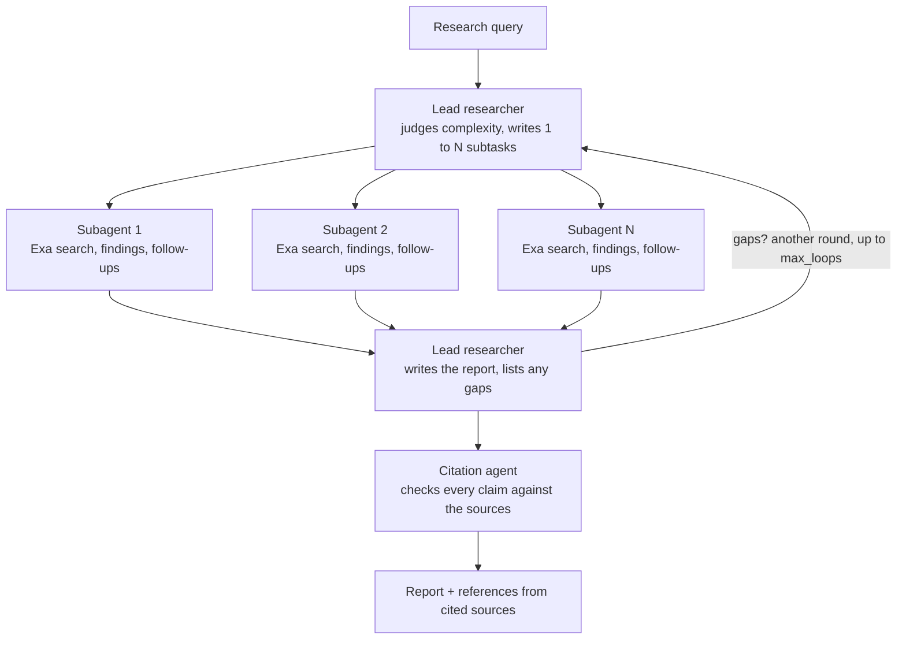

# AdvancedResearch: An Open-Source Implementation of Anthropic's Multi-Agent Research System

In June 2025 Anthropic published ["How we built our multi-agent research system"](https://www.anthropic.com/engineering/multi-agent-research-system), the engineering write-up behind the Research feature in Claude. It describes an orchestrator-worker pattern: a lead agent reads the query, writes a plan, spawns subagents that search in parallel, synthesises what they return, decides whether another round is needed, and hands the finished report to a citation agent. On Anthropic's internal research eval, that system with Claude Opus 4 as lead and Claude Sonnet 4 subagents beat a single Opus 4 agent by 90.2%.

The paper is unusually specific about what made the system work, down to how many subagents a query of each complexity deserves. It does not ship code. [AdvancedResearch](https://github.com/The-Swarm-Corporation/AdvancedResearch) is our open-source implementation of that design. It is one Python package, MIT licensed, and every agent in it is a single call to the [Swarms API](https://docs.swarms.ai). Every web search is a single call to [Exa](https://exa.ai). There is no agent framework to install and no model-provider SDK: two API keys and `httpx`.

This post walks through the paper's design decisions and shows where each one lives in the code, then runs the lead researcher for real and reads the bill.

## The architecture, side by side

Anthropic's description of the system fits in one paragraph. The lead researcher "develops a strategy, and spawns subagents to explore different aspects simultaneously." Each subagent "independently performs web searches, evaluates tool results using interleaved thinking, and returns findings." The lead "synthesizes these results and decides whether more research is needed." Finally a CitationAgent "processes the documents and research report to identify specific locations for citations."

AdvancedResearch has the same four stages, implemented as four prompts and one shared source list:



| Anthropic's component | AdvancedResearch | Where in the code |
|---|---|---|
| LeadResearcher plans and delegates | `Director-Agent` with the orchestrator prompt | `create_director_agent()`, `prompts.get_orchestrator_prompt()` |
| Subagents search in parallel, filter results | `Worker-Search-Agent-N`, one thread each | `run_worker_agents()`, `run_agent()` |
| Interleaved thinking over tool results | Search rounds: read results, record findings, ask for narrower follow-ups | `run_agent()` loop over `worker_search_rounds` |
| Lead synthesises and decides on more research | Synthesis prompt that ends with a `needs_more_research` JSON block | `AdvancedResearch._synthesize()`, `_split_report()` |
| CitationAgent attributes claims to sources | Citation prompt over the report and the numbered source list | `AdvancedResearch._cite()` |
| Memory for the plan and findings | `Conversation` history plus a thread-safe `SourceRegistry` | `Conversation`, `SourceRegistry` |

The entire system is about 1,400 lines in `advanced_research/main.py` and 130 lines of prompts in `advanced_research/prompts.py`.

## Installation

```bash
pip3 install -U advanced-research
```

Two environment variables, in your shell or a `.env` file:

```bash
SWARMS_API_KEY="..."   # https://cloud.swarms.world/api-keys
EXA_API_KEY="..."      # https://dashboard.exa.ai/api-keys
```

The smallest possible run:

```python
from advanced_research import AdvancedResearch

research = AdvancedResearch(
    name="AI Research Team",
    director_model_name="gpt-5.5",     # lead researcher, report, citations
    worker_model_name="gpt-5.4-mini",  # search subagents
    max_loops=1,
    verbose=True,                      # print every agent reply as it arrives
)

report = research.run(
    "How do solid-state batteries compare with lithium-ion batteries for electric vehicles in 2026?"
)
print(report)
print(research.get_usage())  # tokens and Swarms + Exa cost
```

Any model from `GET https://api.swarms.world/v1/models/available` works for either role, so the lead can be a frontier model and the subagents a cheap fast one, which is exactly the split Anthropic used.

## How each principle from the paper became code

Anthropic lists eight prompt-engineering principles that got the system from a demo to production. Six of them are directly visible in AdvancedResearch.

### 1. Teach the orchestrator how to delegate

The paper's most quoted finding: vague instructions produced subagents that duplicated each other's work or left gaps, so each subagent brief needs "an objective, an output format, guidance on the tools and sources to use, and clear task boundaries."

The orchestrator prompt asks the lead for exactly those four fields per subtask, and tells it the subtasks "must not overlap, and together they must cover the whole query":

```python
# advanced_research/prompts.py (excerpt)
STEP 2: WRITE ONE SUBTASK PER SUBAGENT
Each subtask must give the subagent everything it needs, because it cannot ask you questions:
- objective: one precise question to answer, including the time frame when recency matters.
- search_queries: 2 or 3 web search queries. Start short and broad, then one more specific query.
- output_format: what the subagent should return, e.g. "a list of approved drugs with approval dates and sources".
- boundaries: what is out of scope for this subagent, so two subagents never cover the same ground.
```

The prompt also carries a worked example of a bad subtask ("research AI in healthcare") next to three good ones, which is the "think like your agents" principle applied to the prompt itself.

### 2. Scale effort to query complexity

Anthropic's early agents would spawn "50 subagents for simple queries," so they wrote explicit scaling rules into the prompt: "Simple fact-finding requires just 1 agent with 3-10 tool calls, direct comparisons might need 2-4 subagents with 10-15 calls each, and complex research might use more than 10 subagents."

AdvancedResearch encodes the same three tiers, with a configurable ceiling (`max_subagents`, default 5) because every subagent here is a billable API call:

```python
STEP 1: JUDGE THE EFFORT THE QUERY NEEDS
- simple: one fact or a narrow question. Use 1 subagent.
- comparison: a direct comparison or a question with a few distinct parts. Use 2 to 4 subagents.
- complex: open-ended research across many angles. Use up to {max_subagents} subagents with clearly divided responsibilities.
Never use more subagents than the query needs.
```

The lead returns a `complexity` field in its plan, so you can see which tier it chose for every run.

### 3. Start wide, then narrow down

The paper found that agents defaulted to long, over-specific queries that returned nothing, and that the fix was to "start with short, broad queries, evaluate what's available, then progressively narrow focus."

Two places in the code do this. The lead is told to write queries "as a person would type them into a search engine," broad first. Then each subagent runs its planned searches, reads the results, and may ask for "1 to 3 follow-up searches that are narrower than the ones already run." Those run in the next search round. The default is two rounds (`worker_search_rounds=2`), and a subagent stops early when it marks its coverage as comprehensive:

```python
# advanced_research/main.py, inside run_agent()
for round_number in range(1, config.worker_search_rounds + 1):
    queries = [q for q in queries if q not in seen_queries][:3]
    if not queries:
        break
    seen_queries.extend(queries)
    with concurrent.futures.ThreadPoolExecutor(max_workers=len(queries)) as pool:
        search_outputs = list(pool.map(lambda q: exa_search(q, ...), queries))
    ...
    queries = [q for q in findings.get("follow_up_queries") or []]
    if findings.get("coverage_assessment") == "comprehensive":
        break
```

### 4. Parallel tool calling

Anthropic added two kinds of parallelism, "the lead agent spins up 3-5 subagents in parallel" and "the subagents use 3+ tools in parallel," and reports that together they "cut research time by up to 90% for complex queries."

Both are thread pools in AdvancedResearch. `run_worker_agents()` runs one thread per subtask, capped at `max_subagents`. Inside each subagent, the round's two or three Exa searches run in their own pool, as in the excerpt above. A one-round run with the defaults takes 20 to 60 seconds end to end.

### 5. Subagents as intelligent filters, with a shared source list

The paper describes subagents as "intelligent filters" that compress a mass of search results into findings the lead can use, so the lead's own context never fills up with raw pages.

AdvancedResearch adds a detail the paper does not spell out: how citation numbers stay consistent across agents that never talk to each other. Every Exa result is registered in a `SourceRegistry` that is shared by the whole run and protected by a lock. The first time a URL appears it gets the next number, and every subagent sees the same number for the same page. Findings cite `[n]`, the report keeps those numbers, and the references list is built from whatever the final report actually cites:

```python
class SourceRegistry:
    """Numbers every source found during a run, shared by all subagents,
    so a citation like [3] means the same page everywhere."""

    def add(self, result: dict[str, Any]) -> int:
        with self._lock:
            url = result["url"]
            if url not in self._ids:
                self.sources.append(result)
                self._ids[url] = len(self.sources)
            return self._ids[url]
```

The subagent prompt enforces the other half of filtering, source quality. Anthropic's human testers noticed early agents "consistently chose SEO-optimized content farms over authoritative but less highly-ranked sources," so the subagent prompt here ranks sources explicitly: official bodies, peer-reviewed papers and primary documents are strong; content farms, undated pages and anonymous aggregators are weak; "prefer strong sources even when they rank lower."

### 6. A citation agent that verifies every claim against its source

The CitationAgent is the last step in both systems. In AdvancedResearch it receives the report and only the sources that the report or the findings cite, so the prompt stays small. Its rules: use only the numbers in the source list, replace a citation whose source does not support the claim, add a citation to any claim that a listed source does support, and soften or remove any claim nothing supports. If the citation call fails, the run keeps the synthesis citations rather than failing, because a report with unchecked citations is more useful than no report.

### The lead decides whether to keep going

Anthropic's lead agent "decides whether more research is needed" after each round. AdvancedResearch makes that decision machine-readable. The synthesis prompt asks the lead to end its report with one fenced JSON block:

```json
{"needs_more_research": false, "gaps": []}
```

`_split_report()` pulls that block off the end. If `needs_more_research` is true and `max_loops` allows, the next round re-plans, but only for the listed gaps: the orchestrator prompt says "plan subtasks only for the gaps. Do not repeat research that is already done." The bar is deliberately high: another round is justified only "when a gap would change the answer to the query."

## A real planning run

Here is the lead researcher's actual output for the solid-state battery question above, run on the Swarms API with `gpt-5.5` on 8 November 2026. The prompt is the orchestrator prompt from `prompts.py` with `max_subagents=5`.

```json
{
  "complexity": "comparison",
  "strategy": "Divide the comparison into four non-overlapping angles: technical performance, safety/lifetime, commercialization status, and cost/supply-chain outlook for EV applications as of November 2026.",
  "subtasks": [
    {
      "objective": "Compare solid-state batteries and conventional lithium-ion batteries for EVs on technical performance metrics as of 2026, including energy density, charging speed, power capability, operating temperature range, and vehicle range implications.",
      "search_queries": [
        "solid-state battery vs lithium-ion EV energy density 2026",
        "solid state batteries electric vehicles charging speed power density 2026",
        "EV solid-state battery performance metrics 2026"
      ],
      "output_format": "A comparison table with metrics, units, typical 2026 values or ranges, and cited sources for each figure.",
      "boundaries": "Focus only on technical performance metrics. Do not cover safety, cost, manufacturing scale, commercial rollout timelines, or company-specific deployment status except where needed to source a metric."
    },
    {
      "objective": "Compare solid-state and lithium-ion EV batteries on safety, degradation, cycle life, calendar life, thermal runaway risk, and real-world reliability as understood in 2026.",
      "search_queries": [
        "solid-state battery safety cycle life lithium-ion EV 2026",
        "solid state battery thermal runaway degradation cycle life 2026",
        "EV battery safety comparison solid-state lithium-ion 2026"
      ],
      "output_format": "A concise evidence summary with separate sections for safety, degradation/cycle life, calendar life, and reliability, noting where evidence is lab-scale versus real-world EV use.",
      "boundaries": "Do not discuss energy density, charging speed, costs, supply chains, or commercialization timelines except where directly tied to safety or lifetime evidence."
    },
    {
      "objective": "Determine the commercialization status of solid-state EV batteries versus conventional lithium-ion EV batteries as of 08 November 2026, including which companies have announced vehicles, pilot production, mass production, or delays.",
      "search_queries": [
        "solid-state battery EV commercialization 2026 Toyota QuantumScape Nissan BMW",
        "solid state battery electric vehicle production timeline 2026",
        "which EVs use solid-state batteries 2026"
      ],
      "output_format": "A company-by-company table listing announced milestones, current status as of November 2026, expected production dates, named vehicle programs if any, and sources.",
      "boundaries": "Focus on commercialization and deployment status only. Do not compare chemistry-level performance, safety, or cost except when an announcement includes those claims."
    },
    {
      "objective": "Compare the 2026 cost, manufacturing readiness, supply-chain requirements, and scalability of solid-state batteries versus lithium-ion batteries for EVs.",
      "search_queries": [
        "solid-state battery cost per kWh 2026 lithium-ion EV",
        "solid state battery manufacturing challenges scalability 2026",
        "EV battery cost forecast solid-state versus lithium-ion 2026"
      ],
      "output_format": "A cost and scalability comparison with estimated $/kWh ranges where available, key manufacturing bottlenecks, material requirements, and short-term outlook through 2030.",
      "boundaries": "Do not cover technical performance, safety, degradation, or company deployment timelines except where they directly affect manufacturing cost or scalability."
    }
  ]
}
```

A few things worth noticing. The lead classified the query as a comparison and chose four subagents, inside the 2 to 4 band the prompt gives for that tier. Each subtask has an explicit boundary that names what the other three cover, so the subagents cannot drift into each other's territory. The queries read like search queries, not sentences, and each list runs from broad to specific. The commercialisation subtask pins the date it was given ("as of 08 November 2026"), which is the recency guidance from the prompt showing up in the output.

The planning call used 625 input tokens and 799 output tokens and cost $0.031159 on the Swarms API, service fee included.

## What a run costs

`research.get_usage()` returns every Swarms call and every Exa search with its cost, and `research.total_cost` is their sum. A rough budget for a one-round comparison query like the one above, with the default models:

| Stage | Calls | Model | Typical cost |
|---|---|---|---|
| Plan | 1 | gpt-5.5 | $0.03 |
| Search subagents | 4 agents x 1 to 2 rounds | gpt-5.4-mini | $0.02 to $0.04 each |
| Exa searches | 12 to 24 | auto search, 10 results | $0.007 each |
| Report | 1 | gpt-5.5 | $0.08 to $0.15 |
| Citations | 1 | gpt-5.5 | $0.08 to $0.15 |

That lands most one-round runs between $0.30 and $0.60 all in, dominated by the two long lead-researcher calls that read every finding and every cited source. Swapping the lead to `claude-sonnet-5-5` or `gpt-5.4` cuts that roughly in half; keeping a frontier lead and cheap workers is the paper's recommendation and the default here. Swarms API pricing for the two default models on 8 November 2026, per million tokens with the 15% service fee included:

| Model | Input | Output |
|---|---|---|
| gpt-5.5 | $5.75 | $34.50 |
| gpt-5.4-mini | $0.8625 | $5.175 |

Anthropic's own data point is a useful calibration: "multi-agent systems use about 15x more tokens than chats," and "token usage by itself explains 80% of the variance" in research performance on BrowseComp. The cost above is what buying that extra token budget looks like when every agent is a metered API call.

## Why the Swarms API and not an agent framework

Anthropic's production section is mostly about state. "Agents are stateful and errors compound," they write, which is why they added checkpoints, retry logic and full tracing, and why they note that their lead agents still execute subagents synchronously, waiting for each set to finish.

AdvancedResearch gets simpler versions of those properties from being stateless at the API boundary. Each agent is one `POST /v1/agent/completions` with a system prompt and a task, so there is no long-lived agent process to checkpoint; the run's state is the `Conversation` and the `SourceRegistry` in your own process, and `export_on=True` writes both to a JSON file after every run. Retries live in one function:

```python
def _post_json(service, url, headers, body, timeout=120.0, attempts=3):
    for attempt in range(1, attempts + 1):
        started = time.monotonic()
        try:
            response = httpx.post(url, headers=headers, json=body, timeout=timeout)
        except httpx.TransportError as error:
            if attempt == attempts:
                raise ResearchAPIError(f"{service} request failed: {error}") from error
            time.sleep(2**attempt)
            continue
        elapsed = time.monotonic() - started
        if response.status_code in (503, 504) and elapsed >= GATEWAY_TIMEOUT_SECONDS:
            raise ResearchAPIError(
                f"{service} returned {response.status_code} after {elapsed:.0f} s, the "
                "Swarms API's 30-second request limit. Use a faster model "
                "or a lower max_tokens for this agent."
            )
        if response.status_code in (429, 500, 502, 503) and attempt < attempts:
            time.sleep(2**attempt)
            continue
        if response.status_code >= 400:
            raise ResearchAPIError(f"{service} returned {response.status_code}: {response.text[:500]}")
        return response.json()
```

A subagent that fails is reported inside its result (`"error": "..."`) and the report step is told about it, so one bad search does not lose the round. The same pattern Anthropic describes for synchronous execution applies: each round waits for all its subagents, then synthesises.

The practical consequence is that you can change the model of any role to anything the Swarms API serves, a single string, and the same code runs Claude, GPT, DeepSeek or Qwen models in any combination. Anthropic found that "upgrading to Claude Sonnet 4 is a larger performance gain than doubling the token budget on Claude Sonnet 3.7." With a hosted API in front of every model, that experiment is a one-line change.

## Running it in more ways

**Two rounds.** Let the lead ask for another round when a gap would change the answer:

```python
research = AdvancedResearch(
    director_model_name="claude-sonnet-5-5",
    worker_model_name="gpt-5.4-mini",
    max_loops=2,
    export_on=True,  # writes examples/outputs/<id>.json with history, sources and usage
)
report = research.run("What are the most effective treatments for Type 2 diabetes as of 2026?")
```

**Steer the rounds yourself.** `step()` runs one plan-search-report round and returns the plan, the report, the decision and the gaps, without the citation pass. Useful for a UI that shows progress, or for inserting your own stopping rule:

```python
first = research.step("How is the EU AI Act being enforced in 2026?")
print(first["plan"]["complexity"], len(first["plan"]["subtasks"]))
if first["needs_more_research"]:
    second = research.step(
        "How is the EU AI Act being enforced in 2026?",
        previous_report=first["report"],
        gaps=first["gaps"],
    )
```

**Tune the subagents.** `AdvancedResearchAdditionalConfig` sets how many Exa results each search returns, how much page text is kept per result, how many search rounds a subagent may run, and the subagent ceiling:

```python
from advanced_research import AdvancedResearch, AdvancedResearchAdditionalConfig

config = AdvancedResearchAdditionalConfig(
    exa_search_num_results=8,
    exa_search_max_characters=1200,
    worker_search_rounds=3,
    max_subagents=4,
)
research = AdvancedResearch(config=config, worker_model_name="claude-haiku-5-5")
```

**Full history.** `output_type="all"` returns the whole conversation (query, plan, each subagent's findings, report), `"json"` serialises it, and `"markdown"` renders it with one heading per agent. `"final"`, the default, returns the cited report with its references section.

## What the paper has that this does not, yet

Anthropic's system saves the lead's plan to external memory so it survives context truncation past 200,000 tokens, and lets subagents write large outputs to a filesystem and pass back references. AdvancedResearch keeps the plan in the `Conversation` and sends findings inline, which is fine at the default sizes and a reasonable place to extend if you push `max_subagents` and `worker_search_rounds` up. The paper also describes a tool-testing agent that rewrote tool descriptions and cut task completion time by 40%; here the only tool is Exa, so that loop does not apply. And Anthropic evaluates with an LLM judge scoring factual accuracy, citation accuracy, completeness, source quality and tool efficiency from 0.0 to 1.0. The repository ships offline unit tests that fake both APIs, so `pytest tests` runs without keys, but a research-quality eval set is the obvious next contribution.

If you want to work on any of those, the repo is at [github.com/The-Swarm-Corporation/AdvancedResearch](https://github.com/The-Swarm-Corporation/AdvancedResearch). Fork it, run `uv pip install -r requirements.txt pytest`, run the tests, and open a pull request.

## FAQ

### Is this an official Anthropic project?

No. It is an independent open-source implementation of the design described in Anthropic's engineering post, built and maintained by The Swarm Corporation. It cites the paper and its authors (Hadfield, Zhang, Lien, Scholz, Fox and Ford, June 2025) and follows its published principles, but it shares no code with Anthropic's Research feature.

### Do I need Claude models to use it?

No. Every agent runs through the Swarms API, so the lead and the subagents can be any model it serves. The defaults are `gpt-5.5` for the lead and `gpt-5.4-mini` for subagents; `claude-sonnet-5-5` and `claude-haiku-5-5` are common alternatives for the same two roles.

### How is this different from the deep research pipeline in our earlier post?

[Build Your Own Deep Research API](/blog/build-deep-research-api-multi-agent) builds a four-stage pipeline from scratch in about 100 lines using the Swarms API's built-in `auto_search` tool. AdvancedResearch is a maintained package that follows Anthropic's design more closely: a planner that scales subagent count to complexity, subagents with their own search rounds and follow-up queries, a shared numbered source registry, an explicit needs-more-research decision loop, and a citation agent. It uses Exa directly so you control result counts, page-text size and search type.

### How long does a run take, and can it time out?

A one-round run with the defaults takes 20 to 60 seconds. Each individual Swarms API request has a 30-second limit, so a very slow lead model with a high `director_max_tokens` can time out on the report step. The package raises a clear error with the fix in that case; the defaults (4,000 output tokens for the lead) stay under the limit.

### How do I see what each agent said?

Pass `verbose=True` to print every agent reply as it arrives, with a lock so parallel subagents do not interleave. Or set `export_on=True` and read `examples/outputs/<id>.json`, which holds the conversation history, every source found, and per-call usage.

### What does it cost?

Roughly $0.30 to $0.60 for a one-round comparison query with the default models, split between Swarms API tokens (the lead's report and citation calls are the biggest items) and Exa searches at $7 per thousand. `get_usage()` gives the exact breakdown after each run, and a cheaper lead model halves the total.
