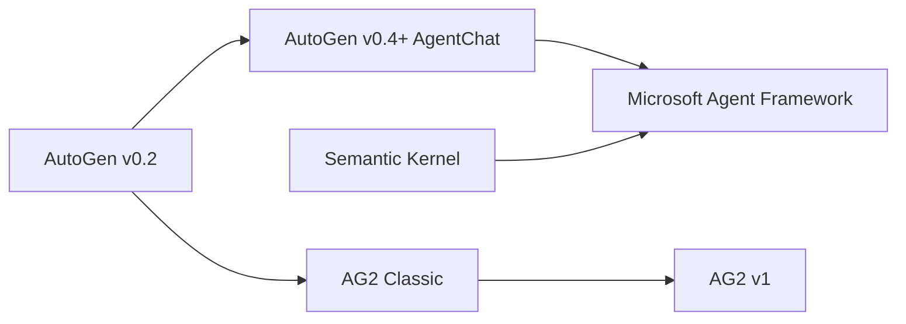
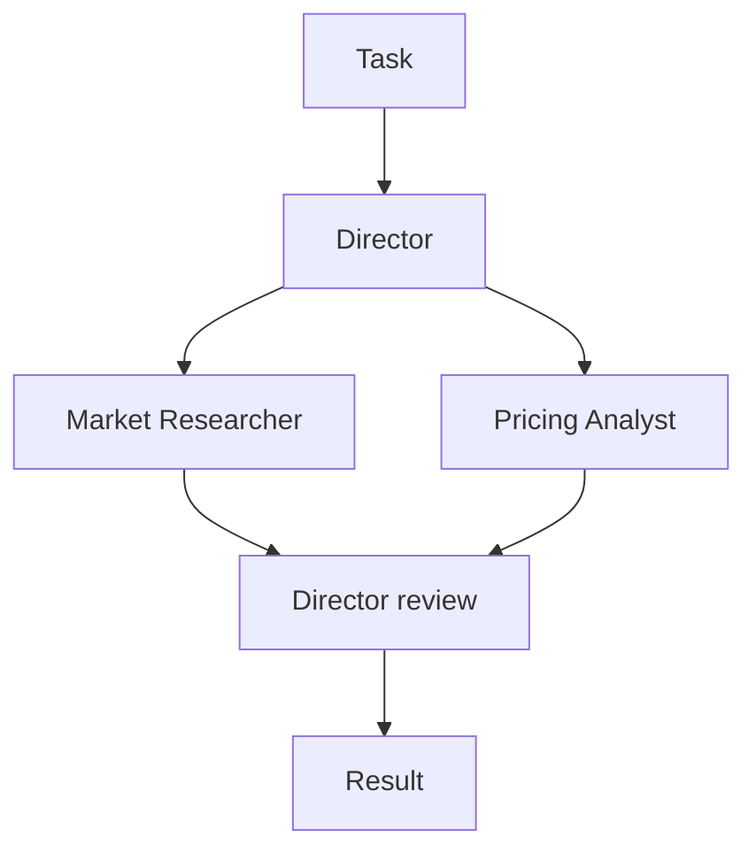

# AutoGen Alternatives in 2026: Where to Go After AutoGen

If you are looking for an AutoGen alternative, the reason is probably the banner at the top of the AutoGen repository. Microsoft has put AutoGen in maintenance mode and points new users to Microsoft Agent Framework. Your AutoGen code still runs, but it will not get new features, so sooner or later you have to decide where it goes next, how much of it has to change, and when to move.

This guide covers all three. It sets out what happened to AutoGen and when, what a replacement should have, six options (Microsoft Agent Framework, AG2, Swarms, LangGraph, CrewAI and the OpenAI Agents SDK), a comparison table, and a side-by-side migration from AutoGen AgentChat to the Swarms API for the three team patterns most AutoGen projects use. Swarms is our product, so we say plainly where another option is the better fit.

## Why Are Teams Looking for an AutoGen Alternative Now?

AutoGen started at Microsoft Research as an open-source framework for multi-agent conversation. Version 0.4 was, in the words of the [official migration guide](https://microsoft.github.io/autogen/stable/user-guide/agentchat-user-guide/migration-guide.html), "a from-the-ground-up rewrite adopting an asynchronous, event-driven architecture", with breaking changes. That rewrite produced the AgentChat API (`AssistantAgent`, `RoundRobinGroupChat`, `SelectorGroupChat` and the termination conditions) that most current AutoGen code uses.

Then Microsoft moved its agent work to a new framework:

- **September 30, 2025:** AutoGen shipped Python [v0.7.5](https://github.com/microsoft/autogen/releases). As of October 11, 2026 it is still the latest release of `autogen-agentchat`.
- **October 1, 2025:** Microsoft [announced Microsoft Agent Framework](https://azure.microsoft.com/en-us/blog/introducing-microsoft-agent-framework/), which "converges AutoGen, a former Microsoft Research project, and the enterprise-ready foundations of Semantic Kernel" into one framework.
- **October 2, 2025:** AutoGen maintainer Eric Zhu posted an [AutoGen update](https://github.com/microsoft/autogen/discussions/7066). AutoGen "will still be maintained", has "a stable API and will continue to receive critical bug fixes and security patches", but "we will not be adding significant new features to it."
- **April 3, 2026:** Microsoft released [Agent Framework 1.0](https://devblogs.microsoft.com/agent-framework/microsoft-agent-framework-version-1-0/) for .NET and Python, described as "the production-ready release: stable APIs, and a commitment to long-term support."
- **April 2026:** the [AutoGen README](https://github.com/microsoft/autogen) gained a maintenance-mode banner: "AutoGen is now in maintenance mode. It will not receive new features or enhancements and is community managed going forward." Contributions are limited to bug fixes, security patches and documentation, and new users are told to start with Microsoft Agent Framework. The most recent commit on `main`, on April 6, 2026, was that banner update.

Nothing breaks today. The code is MIT-licensed, pinned packages keep installing, and your agents keep working. What changes is the future: new model features, new protocols and new orchestration patterns ship in other projects, and fixes now depend on a community-managed repository. For a production system, that is reason enough to plan a migration, even if it is not an emergency.

### Which AutoGen do you have?

Three different things go by the AutoGen name, and the right AutoGen alternative depends on which one you run.



- **Microsoft AutoGen (v0.4 and later).** Packages `autogen-agentchat`, `autogen-core` and `autogen-ext`; your imports look like `from autogen_agentchat.agents import AssistantAgent`. This is the project in maintenance mode.
- **AG2 Classic.** The community fork's continuation of the older `ConversableAgent` API, imported as `import autogen`. Its [README](https://github.com/ag2ai/ag2-classic) says it is published to PyPI as the `autogen` package and is itself in maintenance mode.
- **`pyautogen`.** Microsoft's migration guide says "We no longer have admin access to the `pyautogen` PyPI package" and that its releases are no longer from Microsoft since version 0.2.34.

If your code imports `autogen_agentchat`, the rest of this guide applies directly. If it imports `autogen` and uses `ConversableAgent` and `initiate_chat`, read the AG2 section first.

## What Should an AutoGen Alternative Have?

Before comparing options, list what your AutoGen code actually uses. These are the questions that decide most migrations:

- **The team patterns you use.** Search your code for `RoundRobinGroupChat`, `SelectorGroupChat`, `Swarm` (AutoGen's handoff team, unrelated to Swarms), `MagenticOneGroupChat` and `AgentTool`. Each alternative covers a different subset, and the [swarm architectures overview](/blog/swarm-architectures-explained) is a good map of the shapes these patterns take.
- **A way to stop.** AutoGen's [termination conditions](https://microsoft.github.io/autogen/stable/user-guide/agentchat-user-guide/tutorial/termination.html) (`TextMentionTermination`, `MaxMessageTermination`, `TokenUsageTermination`, `TimeoutTermination`, `HandoffTermination` and others, combined with `|` and `&`) are what keep a group chat from running forever. Check what the replacement gives you: turn limits, a judge agent, or a loop you write. Runaway conversations are one of the [silent failure modes](/blog/multi-agent-system-failure-modes) of multi-agent systems.
- **Your model providers.** AutoGen's extensions ship clients for OpenAI, Azure OpenAI, Azure AI, Anthropic and Ollama. Confirm the replacement covers the ones you call.
- **Tools and MCP.** Python function tools, MCP servers through `McpWorkbench`, and code execution all need a home.
- **State and humans.** An AutoGen team keeps its conversation between runs until you call `reset()`, and `UserProxyAgent` brings a person into the loop. Decide whether you need durable checkpoints and pause-and-resume, or whether carrying history yourself is enough.
- **Where it runs.** Most options are libraries that run inside your process. A hosted API runs the orchestration for you.
- **Maintenance signal.** Who maintains it, how often it releases, and under what license.

## The Best AutoGen Alternatives in 2026

### 1. Microsoft Agent Framework: the official AutoGen replacement

[Microsoft Agent Framework](https://github.com/microsoft/agent-framework) (MAF) is the project Microsoft built to replace both AutoGen and Semantic Kernel. Its migration guide says it is "developed by the core AutoGen and Semantic Kernel teams at Microsoft." It is MIT-licensed, supports Python and .NET (with a Go SDK in a [separate repository](https://github.com/microsoft/agent-framework-go)), and installs with `pip install agent-framework`. Multi-agent work runs on a graph-based `Workflow` API, with built-in sequential, concurrent, handoff, group chat and Magentic-One orchestrations, plus checkpointing, human-in-the-loop support, OpenTelemetry tracing, middleware, a DevUI debugger, and MCP and A2A support. Releases are frequent: `agent-framework` reached [1.21.0 on PyPI](https://pypi.org/project/agent-framework/) on October 8, 2026.

**Strengths for AutoGen users.** The single-agent API is close to what you have: Eric Zhu's announcement says MAF's "single-agent interface is almost identical to AutoGen's", and the [AutoGen migration guide](https://learn.microsoft.com/en-us/agent-framework/migration-guide/from-autogen/) walks through model clients, tools, MCP, streaming and teams side by side. Group chat keeps a familiar shape: [`GroupChatBuilder`](https://learn.microsoft.com/en-us/agent-framework/workflows/orchestrations/group-chat) takes a `selection_func` for round-robin or custom selection, or an `orchestrator_agent` that picks speakers with a model, which covers what `SelectorGroupChat` did. You also get Microsoft's long-term support commitment.

**Trade-offs.** Teams become Workflows, so the orchestration layer is still a rewrite. If you used AutoGen Core's distributed runtime, the migration guide says "Agent Framework focuses on single-process composition today; distributed execution is planned." Samples lean on Azure and Microsoft Foundry; the repository has provider packages for Anthropic, Gemini, Bedrock, Mistral, Ollama and others, but some are still prereleases on PyPI. You still run the orchestration yourself and hold every provider key.

**Best for:** teams already on Azure, Foundry or .NET, and anyone who wants the shortest code-level path off AutoGen with vendor support. If you are staying in the Microsoft stack, this is the right choice, and the other options below are worth a look mainly if you want something MAF does not offer.

### 2. AG2: the community fork

[AG2](https://github.com/ag2ai/ag2) describes itself as "AG2 (formerly AutoGen)". It is Apache 2.0, maintained by a group of volunteers from several organizations, with Chi Wang and Qingyun Wu listed as project administrators. AG2 now has two lines:

- **AG2 Classic** keeps the `autogen.*` namespace and its classes: `ConversableAgent`, `AssistantAgent`, `UserProxyAgent`, `GroupChat` and `GroupChatManager`, nested and sequential chats. It lives in [ag2ai/ag2-classic](https://github.com/ag2ai/ag2-classic) and is in maintenance mode, with "security and critical bug fixes only."
- **AG2 v1** (`pip install ag2`, `import ag2`) is the actively developed framework. Version 1.0.0 reached [PyPI](https://pypi.org/project/ag2/) on July 27, 2026, and 1.1.2 followed on October 3, 2026. Its core is an async `Agent`, and multiple agents coordinate through a Network of a hub and typed channels.

**Strengths.** If your code is in the older `ConversableAgent` style, AG2 Classic lets it keep running with no rewrite, and the same community is building the next version. AG2 v1 supports several providers through extras such as `ag2[openai]`, `ag2[anthropic]` and `ag2[gemini]`.

**Trade-offs.** Classic is also in maintenance mode, so it buys time. The AG2 README is explicit that v1 "is not a drop-in upgrade from Classic. The agent model, orchestration, and imports all changed." And if you are on Microsoft's AgentChat (`autogen_agentchat` imports), AG2 has no shortcut for you: its APIs differ from AgentChat, so the move is a rewrite similar in size to any other option.

**Best for:** teams with v0.2-style AutoGen code who want to stay with a conversation-first, community-run project.

### 3. Swarms (via the Swarms API): AutoGen's team patterns as one API call

The [Swarms API](https://docs.swarms.ai/docs/documentation/getting-started/quickstart) is a hosted multi-agent service. One request to `POST /v1/swarm/completions` describes the agents (name, system prompt, model), the architecture that coordinates them (`swarm_type`) and the task. The server runs the agents and returns every agent's output with token usage and cost. `swarm_type` accepts [14 values](https://docs.swarms.ai/docs/documentation/multi-agent/swarm_completions), including `RoundRobin`, `GroupChat`, `HierarchicalSwarm`, `MultiAgentRouter`, `PlannerWorkerSwarm`, `MixtureOfAgents`, `MajorityVoting` and `DebateWithJudge`. Single agents run on `POST /v1/agent/completions`.

**Strengths for AutoGen users.** The common AutoGen teams map onto named architectures: `RoundRobinGroupChat` to `RoundRobin`, a planner-led `SelectorGroupChat` to `HierarchicalSwarm`, and `MagenticOneGroupChat` most closely to `PlannerWorkerSwarm`. Switching patterns means changing one field while the agent definitions stay the same, which makes it cheap to test whether a [debate, vote or council](/blog/multi-agent-collaboration-patterns) beats your group chat. There is no orchestration runtime to host, and any language that can send HTTP can call it. Each agent picks its own `model_name`, so one team can mix providers, with `fallback_models` for failover. Agents can reach MCP servers through `mcp_url`, output can stream with `stream: true`, and every response reports usage and cost.

**Trade-offs.** The API is stateless: each request starts fresh, and you carry context in `history` (agent endpoint) or `messages` (swarm endpoint). There is no per-message model that picks the next speaker the way `SelectorGroupChat` does, and no composable termination conditions: `max_loops` caps the number of rounds (at most 50), and an early exit on a phrase like "APPROVE" is a loop you write, as Example 1 below shows. Python function tools do not run on the server; `tools_list_dictionary` returns structured tool calls for your code to execute, while MCP servers (and, on the agent endpoint, the built-in `auto_search` and `web_scraper` tools) run server-side. Because it is hosted, prompts and data go to the API; if everything has to stay in your own process, the open-source Swarms framework ([docs.swarms.world](https://docs.swarms.world)) is the self-hosted route, and this guide uses only the API. The single swarm endpoint is available on all tiers, while batch swarm runs and GraphWorkflow require a paid plan.

**Best for:** teams that used AutoGen for its team patterns and want them as an API call, want to compare architectures on the same agents, or want to mix model vendors without running orchestration infrastructure. The migration section below shows the code.

### 4. LangGraph

[LangGraph](https://github.com/langchain-ai/langgraph) (MIT, from LangChain) calls itself a "low-level orchestration framework for building, managing, and deploying long-running, stateful agents." You define a typed state, nodes and edges, and LangGraph adds durable execution that resumes after failures, human-in-the-loop interrupts and short- and long-term memory. It has Python and JavaScript versions, and `langgraph` was at [1.2.14](https://pypi.org/project/langgraph/) on October 6, 2026.

**Strengths.** Control flow is explicit, cycles and conditional edges are native, and checkpointing is built in. If your AutoGen team was really a state machine dressed as a chat, LangGraph makes that structure visible.

**Trade-offs.** Group chat is something you design, with a state schema, nodes and routing functions, so a one-line `RoundRobinGroupChat` becomes a small graph. Tracing and managed deployment come from LangSmith, a separate commercial product.

**Best for:** workflows that need durable execution, branching and resumable state. If you later want to compare graph engines, see [Swarms GraphWorkflow vs LangGraph](/blog/swarms-graphworkflow-vs-langgraph) and the pattern-by-pattern [LangGraph to Swarms migration guide](/blog/migrating-from-langgraph-to-swarms).

### 5. CrewAI

[CrewAI](https://github.com/crewAIInc/crewAI) (MIT) is a Python framework with two building blocks: Crews, teams of role-based agents working on tasks, and Flows, event-driven workflows for precise control. A crew runs a sequential process or a hierarchical one, which "automatically assigns a manager to the defined crew to properly coordinate the planning and execution of tasks through delegation and validation of results." The `crewai` package was at [1.15.27](https://pypi.org/project/crewai/) on October 9, 2026 and supports Python 3.10 to 3.13.

**Strengths.** Roles, goals and tasks are easy to read and map onto how a business process is described. The hierarchical process is close to a planner-led `SelectorGroupChat`.

**Trade-offs.** The unit of work is a task with an expected output, which is a different mental model from a free-form chat, so prompts and control logic need rework. Managed deployment and observability come from the commercial CrewAI AMP Suite.

**Best for:** business-process automation where each agent has a clear role and deliverable. See [Swarms vs CrewAI](/blog/swarms-vs-crewai) for a code-level comparison.

### 6. OpenAI Agents SDK

The [OpenAI Agents SDK](https://github.com/openai/openai-agents-python) (MIT) is a "lightweight yet powerful framework for building multi-agent workflows" that is "provider-agnostic, supporting the OpenAI Responses and Chat Completions APIs, as well as 100+ other LLMs." Its primitives are agents, handoffs, agents as tools, guardrails, sessions, human-in-the-loop and tracing. It has Python and JavaScript versions; `openai-agents` was at [0.23.1](https://pypi.org/project/openai-agents/) on October 2, 2026.

**Strengths.** AutoGen's `Swarm` team (handoffs) and `AgentTool` map directly onto handoffs and agents as tools. Sessions manage conversation history across runs, and tracing is built in.

**Trade-offs.** There are no group chat presets; round-robin and selector patterns are yours to write. The package is still on a 0.x version.

**Best for:** assistants built around handoffs between specialists. See [OpenAI Agents SDK vs Swarms](/blog/openai-agents-sdk-vs-swarms) for a deeper comparison.

## AutoGen Alternatives Compared

| | Maintained by | License | Languages | Where it runs | Multi-agent model | Latest release (PyPI, Oct 11, 2026) |
|---|---|---|---|---|---|---|
| Microsoft Agent Framework | Microsoft | MIT | Python, .NET (Go separately) | Your process (Foundry hosting optional) | Graph workflows: sequential, concurrent, handoff, group chat, Magentic | 1.21.0 |
| AG2 | Volunteer maintainers | Apache 2.0 | Python | Your process | Network of a hub and channels (Classic: GroupChat) | 1.1.2 |
| **Swarms API** | Swarms | Hosted service | Any language over HTTP | Hosted | 14 `swarm_type` architectures | n/a |
| LangGraph | LangChain | MIT | Python, JavaScript | Your process (LangSmith optional) | Typed state graph | 1.2.14 |
| CrewAI | CrewAI | MIT | Python 3.10 to 3.13 | Your process (AMP optional) | Crews (sequential, hierarchical) and Flows | 1.15.27 |
| OpenAI Agents SDK | OpenAI | MIT | Python, JavaScript | Your process | Handoffs and agents as tools | 0.23.1 |
| AutoGen (for reference) | Community managed | MIT (code) | Python, .NET | Your process | RoundRobin, Selector, Swarm, MagenticOne teams | 0.7.5 (Sep 30, 2025) |

For a broader comparison across frameworks, see the [2026 multi-agent framework comparison](/blog/multi-agent-framework-comparison-2026).

## Should You Stay on AutoGen for Now?

Moving is not always urgent. Staying on AutoGen for a while is reasonable when:

- **The system is stable and pinned.** If you are not waiting on new features and your dependencies are locked, the code keeps working.
- **It is research or a prototype.** AutoGen and AutoGen Studio remain useful for exploring multi-agent conversation. The README itself says AutoGen Studio "is not meant to be a production-ready app."
- **A migration would collide with other work.** Plan it on your schedule rather than in response to a provider API change or a security advisory.

If you stay, pin versions, watch the repository for security fixes, and keep a list of which team patterns each service uses, because that list is the migration plan.

## How Do You Migrate From AutoGen to Swarms?

The rest of this guide moves three AutoGen AgentChat teams to the Swarms API. The AutoGen code follows the current AgentChat documentation for the latest release (0.7.5): async agents built around a model client, teams with termination conditions, and `team.run()` returning a `TaskResult`. The Swarms code uses plain HTTP with `aiohttp`, reading the key from the `SWARMS_API_KEY` environment variable. Agents run on [`/v1/agent/completions`](https://docs.swarms.ai/docs/documentation/capabilities/agent) and teams on [`/v1/swarm/completions`](https://docs.swarms.ai/docs/documentation/multi-agent/swarm_completions).

```bash
# AutoGen (before)
pip install -U "autogen-agentchat" "autogen-ext[openai]"
export OPENAI_API_KEY="..."

# Swarms API (after)
pip install aiohttp python-dotenv
export SWARMS_API_KEY="..."   # from https://swarms.world/platform/api-keys
```

Two things change in every example. First, the model client disappears: each agent names its model in `model_name`, and one key covers every provider on the [models list](https://docs.swarms.ai/api-reference/models/get-available-ai-models). Second, there is no team object to keep alive or reset between tasks: each call is a plain HTTP request. AutoGen AgentChat is already async, so the `aiohttp` versions keep the same `async`/`await` shape you are used to.

### Concept mapping

| AutoGen AgentChat | Swarms API | Notes |
|---|---|---|
| `OpenAIChatCompletionClient(model=...)` | `model_name` on each agent | Per agent, so one team can mix providers. Add `fallback_models` for failover |
| `AssistantAgent(name, system_message=..., description=...)` | Agent spec with `agent_name`, `system_prompt`, `description` | The description helps architectures that choose between agents |
| `agent.run(task=...)` | `POST /v1/agent/completions` with `agent_config` and `task` | |
| `team.run(task=...)` | `POST /v1/swarm/completions` with `agents`, `swarm_type` and `task` | |
| `RoundRobinGroupChat` | `swarm_type: "RoundRobin"` | Fixed order, full shared history |
| `SelectorGroupChat` with a planner | `swarm_type: "HierarchicalSwarm"` | A director plans and delegates, then reviews |
| `SelectorGroupChat` picking one expert | `swarm_type: "MultiAgentRouter"` | One routing decision per task |
| `MagenticOneGroupChat` | `swarm_type: "PlannerWorkerSwarm"` | Closest match: planner, workers and a judge that decides whether to run another cycle |
| `Swarm` team with `HandoffMessage`, or `AgentTool` | `handoffs` on an agent spec | See the [handoffs example](https://docs.swarms.ai/docs/examples/examples/agent-handoffs) |
| `MaxMessageTermination(n)` | `max_loops` | For `RoundRobin`, one loop is one turn per agent; at most 50 |
| `TextMentionTermination("APPROVE")` | A check in your own loop | Example 1 |
| `TaskResult.messages` | `output`, a list of `{"role", "content"}` turns | `outputs` on the agent endpoint |
| Team context kept until `reset()` | Stateless requests | Pass prior turns in `history` (agent) or `messages` (swarm) |
| `tools=[python_function]` | `tools_list_dictionary` | Returns tool calls for your code to run |
| `McpWorkbench` | `mcp_url`, `mcp_config` or `mcp_urls` | The server calls the MCP tools; see [MCP integration](https://docs.swarms.ai/docs/documentation/capabilities/mcp_integration) |
| `run_stream()`, `model_client_stream=True` | `stream: true` (swarm) or `streaming_on` (agent) | |
| `models_usage` on each message | `usage` on the response | Token counts and cost for the whole run |
| `UserProxyAgent` | Two requests with a human step between them | |

### Example 1: A two-agent conversation

The two-agent example in the [AgentChat teams tutorial](https://microsoft.github.io/autogen/stable/user-guide/agentchat-user-guide/tutorial/teams.html) is a writer and a critic in a `RoundRobinGroupChat`, stopped when the critic says "APPROVE". Here it also has a message limit.

**AutoGen AgentChat (before)**

```python
import asyncio

from autogen_agentchat.agents import AssistantAgent
from autogen_agentchat.conditions import MaxMessageTermination, TextMentionTermination
from autogen_agentchat.teams import RoundRobinGroupChat
from autogen_ext.models.openai import OpenAIChatCompletionClient


async def main() -> None:
    model_client = OpenAIChatCompletionClient(model="gpt-5.4")

    writer = AssistantAgent(
        "writer",
        model_client=model_client,
        system_message="You write concise product announcements.",
    )
    critic = AssistantAgent(
        "critic",
        model_client=model_client,
        system_message=(
            "Review the latest draft and give specific feedback. "
            "Reply with APPROVE when the draft needs no more changes."
        ),
    )

    # Stop when the critic approves, or after the task plus 8 agent messages.
    termination = TextMentionTermination("APPROVE") | MaxMessageTermination(9)
    team = RoundRobinGroupChat([writer, critic], termination_condition=termination)

    result = await team.run(task="Write a 100-word announcement for our new usage dashboard.")
    for message in result.messages:
        print(f"{message.source}: {message.content}\n")
    print("Stopped because:", result.stop_reason)

    await model_client.close()


asyncio.run(main())
```

**Swarms API (after)**

```python
import asyncio
import os

import aiohttp
from dotenv import load_dotenv

load_dotenv()

API_KEY = os.environ["SWARMS_API_KEY"]
BASE_URL = "https://api.swarms.world"
HEADERS = {"x-api-key": API_KEY, "Content-Type": "application/json"}

WRITER = {
    "agent_name": "Writer",
    "description": "Writes and revises product announcements",
    "system_prompt": "You write concise product announcements.",
    "model_name": "gpt-5.4",
    "max_loops": 1,
}
CRITIC = {
    "agent_name": "Critic",
    "description": "Reviews drafts and approves them",
    "system_prompt": (
        "Review the draft and give specific feedback. "
        "Reply with APPROVE when the draft needs no more changes."
    ),
    "model_name": "claude-sonnet-5",
    "max_loops": 1,
}


async def run_agent(session, agent_config, task, history=None):
    """Run one turn on POST /v1/agent/completions and return the reply text."""
    payload = {"agent_config": agent_config, "task": task}
    if history:
        payload["history"] = history
    async with session.post(f"{BASE_URL}/v1/agent/completions", json=payload) as resp:
        if resp.status >= 400:
            body = await resp.text()
            raise RuntimeError(f"{resp.status}: {body}")
        result = await resp.json()
    # "outputs" is a list of {"role": ..., "content": ...} turns.
    turns = [
        turn
        for turn in result["outputs"]
        if str(turn.get("role", "")).lower() not in ("user", "system")
    ]
    return str(turns[-1]["content"])


async def main() -> None:
    task = "Write a 100-word announcement for our new usage dashboard."
    writer_history = []
    prompt = task

    # One session for the whole conversation; each call gets up to 120 seconds.
    timeout = aiohttp.ClientTimeout(total=120)
    async with aiohttp.ClientSession(headers=HEADERS, timeout=timeout) as session:
        for _ in range(4):  # 4 writer turns and 4 critic turns, like MaxMessageTermination(9)
            draft = await run_agent(session, WRITER, prompt, writer_history)
            print(f"Writer:\n{draft}\n")
            writer_history += [
                {"role": "user", "content": prompt},
                {"role": "assistant", "content": draft},
            ]

            review = await run_agent(session, CRITIC, f"Task: {task}\n\nDraft:\n{draft}")
            print(f"Critic:\n{review}\n")
            if "APPROVE" in review:  # the TextMentionTermination("APPROVE") check
                break
            prompt = f"Revise your draft using this feedback:\n{review}"


asyncio.run(main())
```

**What changes.** The termination condition becomes two lines of Python: a `for` loop for the message cap and an `if` for the approval phrase. The writer keeps its own context through the `history` field, following the [conversation history guide](https://docs.swarms.ai/docs/examples/examples/conversation-history), while the critic only needs the latest draft, so it gets none, which also keeps its token count flat. The two agents now run on different providers. If you do not need the early exit, the same two agents can run as a single `RoundRobin` request (Example 2) with `max_loops` set to the number of rounds.

### Example 2: A round-robin group chat

Three specialists take turns on one plan, each seeing everything said before, for two full rounds.

**AutoGen AgentChat (before)**

```python
import asyncio

from autogen_agentchat.agents import AssistantAgent
from autogen_agentchat.conditions import MaxMessageTermination
from autogen_agentchat.teams import RoundRobinGroupChat
from autogen_ext.models.openai import OpenAIChatCompletionClient


async def main() -> None:
    model_client = OpenAIChatCompletionClient(model="gpt-5.4")

    strategist = AssistantAgent(
        "product_strategist",
        model_client=model_client,
        system_message=(
            "You define positioning, target personas and differentiation. "
            "Build on what earlier speakers said."
        ),
    )
    marketer = AssistantAgent(
        "growth_marketer",
        model_client=model_client,
        system_message=(
            "You propose acquisition channels and a launch plan. "
            "Build on what earlier speakers said."
        ),
    )
    engineer = AssistantAgent(
        "sales_engineer",
        model_client=model_client,
        system_message=(
            "You cover integration requirements and a proof-of-concept plan. "
            "Build on what earlier speakers said."
        ),
    )

    # 1 task message + 3 agents x 2 rounds = 7 messages.
    team = RoundRobinGroupChat(
        [strategist, marketer, engineer],
        termination_condition=MaxMessageTermination(7),
    )

    result = await team.run(
        task=(
            "Draft a go-to-market plan for an AI code review tool "
            "for engineering teams of 20 to 100 developers."
        )
    )
    for message in result.messages:
        print(f"{message.source}:\n{message.content}\n")

    await model_client.close()


asyncio.run(main())
```

**Swarms API (after)**

```python
import asyncio
import os

import aiohttp
from dotenv import load_dotenv

load_dotenv()

API_KEY = os.environ["SWARMS_API_KEY"]
BASE_URL = "https://api.swarms.world"
HEADERS = {"x-api-key": API_KEY, "Content-Type": "application/json"}


async def main() -> None:
    payload = {
        "name": "GTM roundtable",
        "description": "Three specialists take turns on one go-to-market plan",
        "swarm_type": "RoundRobin",
        "task": (
            "Draft a go-to-market plan for an AI code review tool "
            "for engineering teams of 20 to 100 developers."
        ),
        "max_loops": 2,  # every agent speaks twice, in list order
        "agents": [
            {
                "agent_name": "Product Strategist",
                "description": "Positioning and target personas",
                "system_prompt": (
                    "You define positioning, target personas and differentiation. "
                    "Build on what earlier speakers said."
                ),
                "model_name": "gpt-5.4",
                "max_loops": 1,
            },
            {
                "agent_name": "Growth Marketer",
                "description": "Acquisition channels and launch plan",
                "system_prompt": (
                    "You propose acquisition channels and a launch plan. "
                    "Build on what earlier speakers said."
                ),
                "model_name": "claude-sonnet-5",
                "max_loops": 1,
            },
            {
                "agent_name": "Sales Engineer",
                "description": "Integration requirements and proof of concept",
                "system_prompt": (
                    "You cover integration requirements and a proof-of-concept plan. "
                    "Build on what earlier speakers said."
                ),
                "model_name": "gpt-5.4-mini",
                "max_loops": 1,
            },
        ],
    }

    # Multi-agent runs can take minutes, so give the whole request room.
    timeout = aiohttp.ClientTimeout(total=600)
    async with aiohttp.ClientSession(headers=HEADERS, timeout=timeout) as session:
        async with session.post(f"{BASE_URL}/v1/swarm/completions", json=payload) as resp:
            resp.raise_for_status()
            result = await resp.json()

    for turn in result["output"]:
        print(f"{turn['role']}:\n{turn['content']}\n")
    print("Seconds:", result["execution_time"])
    print("Usage:", result["usage"])


asyncio.run(main())
```

**What changes.** This is the closest one-to-one mapping in the guide. The [RoundRobin](https://docs.swarms.ai/docs/documentation/multi-agent/round_robin) architecture visits agents in the order you list them, cycles through the full roster once per loop, and gives every agent the complete conversation so far, which is what `RoundRobinGroupChat` does with its broadcast. The one arithmetic change: `MaxMessageTermination` counts messages, including the task, while `max_loops` counts rounds. Put the agent that should open the discussion first and the one that should wrap it up last.

### Example 3: A selector group chat

The main [`SelectorGroupChat` example](https://microsoft.github.io/autogen/stable/user-guide/agentchat-user-guide/selector-group-chat.html) in the AutoGen docs pairs a planning agent, which breaks the task down and assigns subtasks, with specialists, while a model picks the next speaker after every message. The Swarms API does not have per-message speaker selection. Its [GroupChat](https://docs.swarms.ai/docs/documentation/multi-agent/group_chat) architecture is a shared transcript in which each agent speaks in turn, so the documented behavior that matches a planner-led selector chat is [HierarchicalSwarm](https://docs.swarms.ai/docs/documentation/multi-agent/hierarchical_swarm): a director agent decomposes the task, delegates to workers, then reviews and synthesizes what comes back.



**AutoGen AgentChat (before)**

```python
import asyncio

from autogen_agentchat.agents import AssistantAgent
from autogen_agentchat.conditions import MaxMessageTermination, TextMentionTermination
from autogen_agentchat.teams import SelectorGroupChat
from autogen_ext.models.openai import OpenAIChatCompletionClient


async def main() -> None:
    model_client = OpenAIChatCompletionClient(model="gpt-5.4")

    planner = AssistantAgent(
        "PlanningAgent",
        description="Plans the work. Should be the first to engage when given a new task.",
        model_client=model_client,
        system_message=(
            "You break the task into subtasks and assign each one as '<agent> : <task>'. "
            "Your team: MarketResearcher, PricingAnalyst. You do not do the work yourself. "
            "When every subtask is done, summarize the findings and end with TERMINATE."
        ),
    )
    researcher = AssistantAgent(
        "MarketResearcher",
        description="Researches competitors, segments and market size.",
        model_client=model_client,
        system_message="You research competitors, customer segments and market size.",
    )
    analyst = AssistantAgent(
        "PricingAnalyst",
        description="Analyzes competitor pricing and proposes price tiers.",
        model_client=model_client,
        system_message="You analyze competitor pricing and propose price tiers with reasoning.",
    )

    termination = TextMentionTermination("TERMINATE") | MaxMessageTermination(25)
    team = SelectorGroupChat(
        [planner, researcher, analyst],
        model_client=model_client,  # picks the next speaker after every message
        termination_condition=termination,
    )

    result = await team.run(
        task=(
            "Recommend launch pricing for an AI code review tool for teams of "
            "20 to 100 developers. Cover competitors, segments and three price tiers."
        )
    )
    print(result.messages[-1].content)

    await model_client.close()


asyncio.run(main())
```

**Swarms API (after)**

```python
import asyncio
import os

import aiohttp
from dotenv import load_dotenv

load_dotenv()

API_KEY = os.environ["SWARMS_API_KEY"]
BASE_URL = "https://api.swarms.world"
HEADERS = {"x-api-key": API_KEY, "Content-Type": "application/json"}


async def main() -> None:
    payload = {
        "name": "Pricing study",
        "description": "A director plans the work and delegates to two specialists",
        "swarm_type": "HierarchicalSwarm",
        "task": (
            "Recommend launch pricing for an AI code review tool for teams of "
            "20 to 100 developers. Cover competitors, segments and three price tiers."
        ),
        "director_model_name": "gpt-5.4",
        "director_settings": {"temperature": 0.2},
        "max_loops": 1,
        "agents": [
            {
                "agent_name": "Market Researcher",
                "description": "Researches competitors, segments and market size",
                "system_prompt": "You research competitors, customer segments and market size.",
                "model_name": "claude-sonnet-5",
                "max_loops": 1,
            },
            {
                "agent_name": "Pricing Analyst",
                "description": "Analyzes competitor pricing and proposes price tiers",
                "system_prompt": "You analyze competitor pricing and propose price tiers with reasoning.",
                "model_name": "gpt-5.4",
                "max_loops": 1,
            },
        ],
    }

    # Multi-agent runs can take minutes, so give the whole request room.
    timeout = aiohttp.ClientTimeout(total=600)
    async with aiohttp.ClientSession(headers=HEADERS, timeout=timeout) as session:
        async with session.post(f"{BASE_URL}/v1/swarm/completions", json=payload) as resp:
            resp.raise_for_status()
            result = await resp.json()

    for turn in result["output"]:
        print(f"{turn['role']}:\n{turn['content']}\n")


asyncio.run(main())
```

**What changes.** The `PlanningAgent` leaves the roster. `HierarchicalSwarm` creates its director automatically, and every agent you list in `agents` runs as a worker, so adding a planner there would just give the director a third worker. The planner's model moves to `director_model_name`, and its sampling settings to `director_settings`; a low temperature gives more consistent delegation. The "TERMINATE" convention and the selector prompt go away, because the director decides when the work is assigned and reviewed. This is the [manager-worker pattern](/blog/manager-worker-agent-architectures) made explicit. If your selector chat existed mainly to send each task to one expert, use `MultiAgentRouter` instead, and if it was a long-running Magentic-One style team, try `PlannerWorkerSwarm`, which stops early when its judge marks the goal complete.

### A migration checklist

1. Inventory every AutoGen team: its type, agents, termination condition and tools.
2. Map each team to a `swarm_type` using the table above, and move each `system_message` to `system_prompt` unchanged.
3. Pick a `model_name` per agent from `GET /v1/models/available`, and add `fallback_models` where an outage would hurt.
4. Turn message caps into `max_loops` rounds, and write a loop for any phrase-based early exit.
5. Move Python tools behind an MCP server, or execute the tool calls that `tools_list_dictionary` returns in your own code.
6. Replace saved team state with stored `history` or `messages`, keyed by your own session ID.
7. Run old and new side by side on the same tasks, compare outputs and the `usage` costs, then switch one team at a time.

For a longer walkthrough of building a team from scratch on the API, see [How to Build an Agent Swarm in Python](/blog/build-agent-swarm-python), and for the concepts underneath, [What Is Multi-Agent Orchestration?](/blog/what-is-multi-agent-orchestration).

## Frequently Asked Questions

### Is AutoGen deprecated?

AutoGen is still available, but Microsoft has put it in maintenance mode. The README says it "will not receive new features or enhancements and is community managed going forward," and contributions are limited to bug fixes, security patches and documentation. Microsoft recommends Microsoft Agent Framework for new projects and publishes a migration guide for existing users.

### What is the best AutoGen alternative?

It depends on where you are going. Microsoft Agent Framework is the best fit if you are in the Microsoft stack or want the most similar API with vendor support. AG2 suits teams with older `ConversableAgent` code, LangGraph suits workflows that need durable state and explicit branching, and the Swarms API suits teams that want AutoGen's team patterns as a hosted API call with a different model per agent.

### What is the difference between AutoGen and AG2?

AutoGen is Microsoft's project, now in maintenance mode, whose current API is AgentChat (`autogen_agentchat`). AG2 is a community-run project that describes itself as "formerly AutoGen". It maintains AG2 Classic, which keeps the older `autogen.*` API and is published to PyPI as `autogen`, and develops AG2 v1 (`pip install ag2`), a new framework that is not a drop-in upgrade from Classic.

### Microsoft Agent Framework vs AutoGen: what changes when you migrate?

Single agents change little: the AutoGen maintainers say MAF's single-agent interface is almost identical to AutoGen's, with additions such as middleware and hosted tools. Teams change the most, because MAF replaces AutoGen's `Team` classes with a graph-based `Workflow` API and builders for sequential, concurrent, handoff, group chat and Magentic orchestrations. If you depend on AutoGen Core's distributed runtime, check Microsoft's guide first, since distributed execution in MAF is still listed as planned.

### Does the Swarms API have an equivalent of SelectorGroupChat?

There is no per-message model-based speaker selection. For the common case, a planner that assigns subtasks to specialists, `HierarchicalSwarm` gives you a director that plans, delegates and reviews. For routing each task to the single best agent, use `MultiAgentRouter`.

### Can I migrate from AutoGen one team at a time?

Yes. Each Swarms team is one HTTP request, so you can replace a single AutoGen team inside an existing application while the rest of the code keeps running on AutoGen. Run both versions on the same inputs, compare the outputs and the `usage` figures in the response, and switch when you are satisfied.
