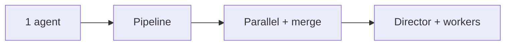
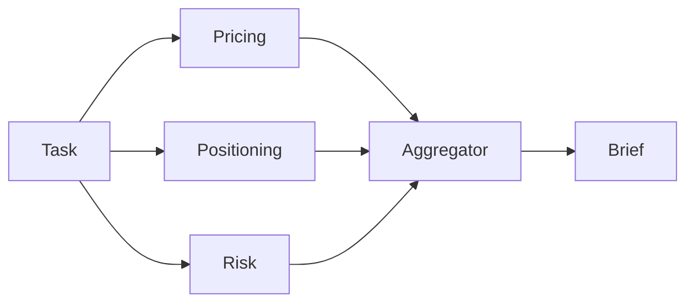
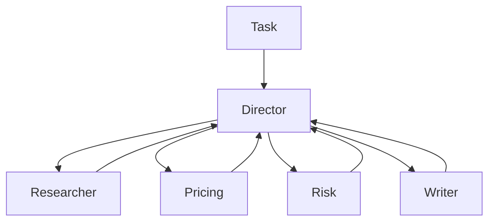

# How to Build an Agent Swarm in Python: A Step-by-Step Tutorial

This tutorial shows how to build an agent swarm in Python with the hosted Swarms API, one step at a time. You start with a single agent that writes a competitive analysis brief for a product. Then you split the work into a pipeline, run specialists in parallel and merge their drafts, and finish with a hierarchical swarm in which a director agent plans the brief and delegates the pieces to workers. The task stays the same the whole way through, so you can see exactly what each architecture changes in the code, the output and the cost.

Everything runs over HTTP with `aiohttp`. There is no agent framework to install and no model to host: each step is one JSON payload sent to `https://api.swarms.world`, and the response carries the output, token counts and cost. The last step covers what changes in production: structured output, cost tracking, rate limits and batch runs.

If you are still deciding whether you need more than one agent, read [single agent vs. multi-agent](/blog/single-agent-vs-multi-agent) first. For the idea behind the word "swarm", [what is swarm intelligence](/blog/what-is-swarm-intelligence) traces it from ant colonies to LLM agents.

## What You Will Build

The running example is a one-page competitive analysis brief: positioning, a pricing comparison, the main risks and three recommendations. The input is a short set of product notes for a made-up invoicing app called Acme Invoice. Replace the notes with your own product and every step still works.

The same brief gets built five ways:

1. One agent writes the whole brief.
2. A pipeline: a researcher, an analyst and a writer run in order.
3. Three specialists draft sections in parallel, then the same specialists run again with an aggregator that merges their drafts.
4. A hierarchical swarm: a director plans the brief and hands work to four workers.
5. Optional: the API designs the team for you, or you write the flow by hand.



Because only the payload changes between steps, you can run all of them on the same notes and compare the briefs and the printed costs side by side. That comparison is the most useful thing this agent swarm tutorial can give you: a measured answer to whether extra agents pay for themselves on your task.

Each step is its own script. They all import a small shared module from step 0, so later scripts stay short:

```text
swarm-tutorial/
  .env
  common.py            # step 0: setup, helpers, the task
  step1_agent.py
  step2_pipeline.py
  step3_concurrent.py
  step3_mixture.py
  step4_hierarchical.py
  ...
```

## Step 0: Set Up the Swarms API in Python

**Get an API key.** Create an account at [swarms.world](https://swarms.world) and generate a key on the [API Keys page](https://swarms.world/platform/api-keys). The [API Key Setup guide](https://docs.swarms.ai/docs/documentation/getting-started/api-key-setup) walks through it. New accounts get free credits, and the billable endpoints used here need a credit balance above $1.00. The key is shown once, so save it right away.

**Install two packages.**

```bash
pip install aiohttp python-dotenv
```

**Store the key in a `.env` file** in your project folder, and keep that file out of version control:

```bash
SWARMS_API_KEY=your_api_key_here
```

**Create `common.py`.** This holds the base URL, the `x-api-key` header, a few helpers and the task. Every later script imports from it.

```python
# common.py: shared setup for every step in this tutorial
import asyncio
import os

import aiohttp
from dotenv import load_dotenv

load_dotenv()

API_KEY = os.environ["SWARMS_API_KEY"]  # fails fast with KeyError if the key is missing

BASE_URL = "https://api.swarms.world"
HEADERS = {"x-api-key": API_KEY, "Content-Type": "application/json"}
# Multi-agent runs can take minutes, so give the whole request room.
TIMEOUT = aiohttp.ClientTimeout(total=600)


def new_session():
    """Open one session per program, inside a coroutine, and reuse it for every call."""
    return aiohttp.ClientSession(headers=HEADERS, timeout=TIMEOUT)


async def post(session, path, payload):
    """POST to the Swarms API. Returns the JSON body or raises with the error detail."""
    async with session.post(f"{BASE_URL}{path}", json=payload) as resp:
        if resp.status >= 400:
            body = await resp.text()
            raise RuntimeError(f"{path} returned {resp.status}: {body}")
        return await resp.json()


async def run_agent(session, payload):
    return await post(session, "/v1/agent/completions", payload)


async def run_swarm(session, payload):
    return await post(session, "/v1/swarm/completions", payload)


def print_turns(turns):
    """Print a list of {"role": ..., "content": ...} turns."""
    for turn in turns:
        print(f"\n=== {turn['role']} ===\n{turn['content']}")


def print_usage(result):
    """Agent completions report total_cost directly; swarm completions nest it in billing_info."""
    usage = result.get("usage") or {}
    cost = usage.get("total_cost", (usage.get("billing_info") or {}).get("total_cost"))
    print(f"\ntokens: {usage.get('total_tokens')}  cost: ${cost}")


PRODUCT_NOTES = """
Product: Acme Invoice (a made-up example), invoicing and expense tracking for freelancers.
Pricing: free for up to 5 clients, then $12 per month.
Strengths: invoices built from time logs, multi-currency, receipt capture on mobile.
Gaps: no payroll, no inventory, integrations limited to Stripe and PayPal.
Customers: solo freelancers and two-person studios in the US and EU.
Competitors to cover: a full small-business accounting suite, a free invoice
generator, and a payments platform with built-in invoicing.
"""


def make_task(notes):
    return (
        "Write a one-page competitive analysis brief for the product below. "
        "Cover positioning, a pricing comparison, the main risks, and three "
        "recommendations for the next two quarters. Use only the facts given "
        "and label anything else as an assumption.\n" + notes
    )


TASK = make_task(PRODUCT_NOTES)


async def main():
    async with new_session() as session:
        # Health check from the quickstart: is the API reachable?
        async with session.get(f"{BASE_URL}/health") as resp:
            print(await resp.json())
        # A 200 with your balance confirms the key works.
        async with session.get(f"{BASE_URL}/v1/account/credits") as resp:
            print(resp.status, await resp.json())


if __name__ == "__main__":
    asyncio.run(main())
```

Run `python common.py`. A healthy API answers the health check with a JSON body whose `status` is `"ok"`, and a 200 from `/v1/account/credits` with your balance means the key is active. The health check follows the [Swarms API quickstart](https://docs.swarms.ai/docs/documentation/getting-started/quickstart).

A few choices in this file matter later. The helpers that call the API are coroutines that take an aiohttp session as their first argument: each script opens one session inside its `main()` coroutine with `new_session()` and reuses it for every call. `post()` reads the response body before raising, because a `422` body names the exact field that failed validation, and that is the fastest way to fix a bad payload. The session timeout is generous because a multi-agent run makes many model calls before it answers. `print_usage()` reads cost from two places because the single-agent and swarm endpoints report it differently (step 6 covers both). Every script ends with `asyncio.run(main())`; in Jupyter, where an event loop is already running, use `await main()` instead.

## Step 1: Run a Single Agent

**What changes:** nothing to orchestrate yet. One agent gets a system prompt, a model and the task, and you send it to `POST /v1/agent/completions`. In the [Agent Completions reference](https://docs.swarms.ai/docs/documentation/capabilities/agent), the request is an `agent_config` object plus a `task` string. If you want a refresher on what the word "agent" covers, see [what is an AI agent](/blog/what-is-an-agent).

```python
# step1_agent.py: one agent writes the whole brief (uses common.py from step 0)
import asyncio

from common import TASK, new_session, print_usage, run_agent

payload = {
    "agent_config": {
        "agent_name": "Competitive Analyst",
        "description": "Writes competitive analysis briefs for product teams",
        "system_prompt": (
            "You are a product marketing analyst. Write short, specific "
            "competitive briefs with clear headings. Do not invent figures."
        ),
        "model_name": "claude-sonnet-5",
        "max_loops": 1,
        "max_tokens": 4096,
        "temperature": 0.4,
    },
    "task": TASK,
}


async def main():
    async with new_session() as session:
        result = await run_agent(session, payload)
    print(result["outputs"][-1]["content"])
    print_usage(result)


asyncio.run(main())
```

`outputs` is a list of messages, each with a `role` (the agent's name) and `content`. Taking the last one gives you the agent's final answer. If you leave out `model_name`, the API uses `claude-sonnet-5`. `temperature` accepts 0 to 2, and `max_loops` is how many passes the agent gets at the task.

**Example output** (abridged, numbers elided):

```json
{
  "job_id": "agent-...",
  "success": true,
  "name": "Competitive Analyst",
  "description": "Writes competitive analysis briefs for product teams",
  "temperature": 0.4,
  "outputs": [
    {
      "role": "Competitive Analyst",
      "content": "# Acme Invoice: Competitive Brief\n\n## Positioning\nAcme Invoice sits between the free invoice generator and the accounting suite: more automation than the first, much less setup than the second..."
    }
  ],
  "usage": { "input_tokens": ..., "output_tokens": ..., "total_tokens": ..., "total_cost": ... },
  "timestamp": "..."
}
```

For many tasks this is enough, and you should stop here if the brief is good. The limits show up when it is not: one prompt does the research, the analysis and the writing, so when the result is weak you cannot tell which part failed, and you cannot give the writing a different prompt or model from the analysis. Splitting the work fixes both. (If you want the agent to look things up first, this endpoint also accepts `"tools_enabled": ["auto_search"]` at the top level of the payload, billed as a flat fee per request.)

## Step 2: Chain Agents into a Pipeline with SequentialWorkflow

**What changes:** the endpoint becomes `POST /v1/swarm/completions`, `agent_config` becomes a list of `agents`, and `swarm_type` says how to coordinate them. With [`SequentialWorkflow`](https://docs.swarms.ai/docs/documentation/multi-agent/sequential_workflow), each agent runs after the previous one and receives its output. The [Swarm Completions reference](https://docs.swarms.ai/docs/documentation/multi-agent/swarm_completions) lists every field this endpoint accepts.

**Why:** each stage gets its own prompt and its own model, and you can read every intermediate result. Here the researcher uses `gpt-5.4-mini` for a narrow extraction job, the analyst uses `gpt-5.4`, and the writer uses `claude-sonnet-5`. Each prompt also says what to leave for the next agent, which stops the researcher from writing the whole brief itself.

```python
# step2_pipeline.py: researcher -> analyst -> writer (uses common.py from step 0)
import asyncio

from common import TASK, new_session, print_turns, print_usage, run_swarm

PIPELINE_AGENTS = [
    {
        "agent_name": "Market Researcher",
        "description": "Extracts facts and open questions from product notes",
        "system_prompt": (
            "List the facts in the product notes that matter for competition: "
            "pricing, features, gaps, customers, and each competitor type. "
            "End with open questions. Leave analysis and writing to later agents."
        ),
        "model_name": "gpt-5.4-mini",
        "max_loops": 1,
        "max_tokens": 4096,
        "temperature": 0.2,
    },
    {
        "agent_name": "Competitive Analyst",
        "description": "Compares the product with each competitor type",
        "system_prompt": (
            "Using the researcher's notes, compare the product with each "
            "competitor type on price, features, and target customer. "
            "Rank the three biggest risks. Leave the final write-up to the writer."
        ),
        "model_name": "gpt-5.4",
        "max_loops": 1,
        "max_tokens": 4096,
        "temperature": 0.3,
    },
    {
        "agent_name": "Brief Writer",
        "description": "Turns the analysis into a one-page brief",
        "system_prompt": (
            "Write a one-page competitive brief from the analysis: positioning, "
            "pricing comparison, risks, and three recommendations. Plain language. "
            "Use no figures that are missing from your input."
        ),
        "model_name": "claude-sonnet-5",
        "max_loops": 1,
        "max_tokens": 4096,
        "temperature": 0.5,
    },
]

payload = {
    "name": "Competitive Brief Pipeline",
    "description": "Research, analyze, then write a competitive brief",
    "swarm_type": "SequentialWorkflow",
    "max_loops": 1,
    "task": TASK,
    "agents": PIPELINE_AGENTS,
}


async def main():
    async with new_session() as session:
        result = await run_swarm(session, payload)
    print_turns(result["output"])
    print_usage(result)


if __name__ == "__main__":
    asyncio.run(main())
```

For this swarm type the docs describe `output` as one turn per agent, in the same order as the `agents` array, so the list doubles as an execution trace of the pipeline. The `if __name__ == "__main__"` guard lets later steps import `PIPELINE_AGENTS` without running the pipeline.

**Example output** (abridged, numbers elided):

```json
{
  "job_id": "swarm-...",
  "status": "success",
  "swarm_name": "Competitive Brief Pipeline",
  "description": "Research, analyze, then write a competitive brief",
  "swarm_type": "SequentialWorkflow",
  "output": [
    { "role": "Market Researcher", "content": "Facts: free for up to 5 clients, then $12 per month; invoices built from time logs... Open questions: how many users pass the 5-client limit?" },
    { "role": "Competitive Analyst", "content": "Accounting suite: covers payroll and inventory, heavier setup. Free generator: wins on price, no time-log invoicing... Top risks: 1. Payments platforms bundle invoicing..." },
    { "role": "Brief Writer", "content": "# Acme Invoice: Competitive Brief\n\n## Positioning\n..." }
  ],
  "number_of_agents": 3,
  "execution_time": ...,
  "usage": {
    "input_tokens": ...,
    "output_tokens": ...,
    "total_tokens": ...,
    "billing_info": { "cost_breakdown": { ... }, "total_cost": ... }
  }
}
```

A pipeline is the right shape when every stage genuinely needs the previous stage's finished output. [Sequential, concurrent, and graph workflows](/blog/agent-orchestration-patterns) covers that decision in more depth.

### The same pipeline with the swarms-client SDK

If you prefer an SDK to raw HTTP, the official [`swarms-client`](https://docs.swarms.ai/docs/documentation/clients/python-client) package wraps the same endpoint. Install it with `pip install swarms-client`. The [Python Client docs](https://docs.swarms.ai/docs/documentation/clients/python-client) recommend passing `base_url` explicitly, because without it the client falls back to its own built-in default host.

```python
# sdk_pipeline.py: step 2's pipeline through swarms-client (reuses common.py and step2_pipeline.py)
import os

from dotenv import load_dotenv
from swarms_client import SwarmsClient

from common import TASK
from step2_pipeline import PIPELINE_AGENTS

load_dotenv()

client = SwarmsClient(
    api_key=os.getenv("SWARMS_API_KEY"),
    base_url="https://api.swarms.world",
)

response = client.swarms.run(
    name="Competitive Brief Pipeline",
    description="Research, analyze, then write a competitive brief",
    swarm_type="SequentialWorkflow",
    max_loops=1,
    task=TASK,
    agents=PIPELINE_AGENTS,
)
print(response)
```

The rest of this tutorial sticks with `aiohttp`, because some endpoints used below (such as the Auto Agent Builder) are not wrapped by the SDK yet, and the raw payloads map one to one onto the docs.

## Step 3: Run Specialists in Parallel, Then Merge Their Drafts

**What changes:** the pipeline becomes a fan-out. Three specialists (pricing, positioning, risk) each draft one section at the same time with [`ConcurrentWorkflow`](https://docs.swarms.ai/docs/documentation/multi-agent/concurrent_workflow). Then the same three run as a [`MixtureOfAgents`](https://docs.swarms.ai/docs/documentation/multi-agent/mixture_of_agents), which adds an aggregator that merges their drafts into one brief.

**Why:** the three sections do not depend on each other, so running them in parallel cuts wall-clock time, and each specialist works from a short, focused prompt. Every agent in a concurrent run receives the same original task, so the system prompt is what narrows each one to its section.

```python
# step3_concurrent.py: three specialists draft sections in parallel (uses common.py)
import asyncio

from common import TASK, new_session, print_usage, run_swarm


def specialist(name, focus):
    return {
        "agent_name": name,
        "description": f"Drafts the {focus} section of a competitive brief",
        "system_prompt": (
            f"You are a {focus} specialist. Write only the {focus} section of a "
            "competitive brief, in under 250 words, using only the facts given."
        ),
        "model_name": "gpt-5.4-mini",
        "max_loops": 1,
        "max_tokens": 2048,
        "temperature": 0.4,
    }


SPECIALISTS = [
    specialist("Pricing Analyst", "pricing"),
    specialist("Positioning Analyst", "positioning"),
    specialist("Risk Analyst", "risk"),
]

payload = {
    "name": "Competitive Brief Specialists",
    "description": "Pricing, positioning, and risk drafts in parallel",
    "swarm_type": "ConcurrentWorkflow",
    "max_loops": 1,
    "task": TASK,
    "agents": SPECIALISTS,
}


async def main():
    async with new_session() as session:
        result = await run_swarm(session, payload)
    # Turns arrive in the order the agents finished, so look them up by role.
    drafts = {turn["role"]: turn["content"] for turn in result["output"]}
    for name in ("Positioning Analyst", "Pricing Analyst", "Risk Analyst"):
        print(f"\n=== {name} ===\n{drafts.get(name, '(no output)')}")
    print_usage(result)


if __name__ == "__main__":
    asyncio.run(main())
```

The docs are explicit that concurrent turns land in `output` in the order each agent finished, which can differ from the order in your request. Code that reads `output[0]` as "the pricing section" will be right on some runs and wrong on others, with no error either way. Results arriving in completion order is one of the seven silent failures in [multi-agent system failure modes](/blog/multi-agent-system-failure-modes). Index by `role`, as above.

**Example output** (abridged, numbers elided):

```json
{
  "status": "success",
  "swarm_name": "Competitive Brief Specialists",
  "swarm_type": "ConcurrentWorkflow",
  "output": [
    { "role": "Risk Analyst", "content": "Risk 1: payments platforms include invoicing at no extra charge..." },
    { "role": "Pricing Analyst", "content": "Acme Invoice is free for up to 5 clients, then $12 per month..." },
    { "role": "Positioning Analyst", "content": "For freelancers who bill by the hour, Acme Invoice turns time logs into invoices..." }
  ],
  "number_of_agents": 3,
  "usage": { ... }
}
```

With `ConcurrentWorkflow` you get three separate sections and the merge is your job. To have the API merge them, change one field:

```python
# step3_mixture.py: same specialists plus an aggregator (reuses common.py and step3_concurrent.py)
import asyncio

from common import TASK, new_session, print_usage, run_swarm
from step3_concurrent import SPECIALISTS

payload = {
    "name": "Competitive Brief Mixture",
    "description": "Specialist drafts merged into one brief",
    "swarm_type": "MixtureOfAgents",
    "max_loops": 1,
    "task": TASK,
    "agents": SPECIALISTS,
}


async def main():
    async with new_session() as session:
        result = await run_swarm(session, payload)
    merged = result["output"][-1]  # the aggregator's synthesis is the final turn
    print(f"=== {merged['role']} ===\n{merged['content']}")
    print_usage(result)


asyncio.run(main())
```



**Example output** (abridged, numbers elided):

```json
{
  "status": "success",
  "swarm_name": "Competitive Brief Mixture",
  "swarm_type": "MixtureOfAgents",
  "output": [
    { "role": "Pricing Analyst", "content": "..." },
    { "role": "Positioning Analyst", "content": "..." },
    { "role": "Risk Analyst", "content": "..." },
    { "role": "<aggregator>", "content": "# Acme Invoice: Competitive Brief\n\nPositioning: ...\nPricing: ...\nRisks: ...\nRecommendations: 1. ..." }
  ],
  "number_of_agents": 3,
  "usage": { ... }
}
```

According to the [MixtureOfAgents docs](https://docs.swarms.ai/docs/documentation/multi-agent/mixture_of_agents), the API creates the aggregator itself, a full run typically ends with its synthesis turn, and `number_of_agents` counts only the specialists you supplied. The request schema has no field for the aggregator's prompt or model. When you need control over the merge, give the job to an agent you define, as steps 4 and 5 do. [Multi-agent collaboration patterns](/blog/multi-agent-collaboration-patterns) compares mixture of agents with voting, debate and councils.

## Step 4: Build an Agent Swarm in Python with a Director

**What changes:** a [`HierarchicalSwarm`](https://docs.swarms.ai/docs/documentation/multi-agent/hierarchical_swarm) adds a director that reads the task, splits it into assignments, hands them to workers, and reviews what comes back. You do not write the director: the swarm creates it, and every entry in `agents` is a worker, even one you name "coordinator". You configure the director with two top-level fields, `director_model_name` (default `gpt-5.4`) and `director_settings`.

**Why:** in steps 2 and 3 you decided the division of labor in advance. With a director, the plan comes from the task itself, so the same team can handle notes with no pricing data, or a product with six competitors, without a code change. This is the manager-worker shape described in [manager-worker agent architectures](/blog/manager-worker-agent-architectures).



```python
# step4_hierarchical.py: a director delegates to four workers (uses common.py)
import asyncio

from common import TASK, new_session, print_turns, print_usage, run_swarm


def worker(name, description, prompt, model="gpt-5.4-mini"):
    return {
        "agent_name": name,
        "description": description,
        "system_prompt": prompt,
        "model_name": model,
        "max_loops": 1,
        "max_tokens": 4096,
        "temperature": 0.3,
    }


WORKERS = [
    worker(
        "Market Researcher",
        "Extracts facts, competitor types, and open questions from product notes",
        "You extract facts and open questions from product notes. You write no recommendations.",
    ),
    worker(
        "Pricing Analyst",
        "Compares pricing and packaging against each competitor type",
        "You compare pricing and packaging. Use only the prices given and label estimates.",
    ),
    worker(
        "Risk Analyst",
        "Identifies and ranks the biggest competitive risks",
        "You identify the three to five biggest competitive risks and rank them.",
    ),
    worker(
        "Brief Writer",
        "Writes the final one-page brief from the team's findings",
        "You write the final one-page competitive brief from the other agents' findings.",
        model="claude-sonnet-5",
    ),
]


def hierarchical_payload(task):
    return {
        "name": "Competitive Brief Team",
        "description": "A director plans the brief and delegates to specialists",
        "swarm_type": "HierarchicalSwarm",
        "max_loops": 1,
        "task": task,
        "agents": WORKERS,
        "director_model_name": "gpt-5.4",
        "director_settings": {"temperature": 0.2, "max_tokens": 8000},
        "list_all_agents": True,
    }


async def main():
    async with new_session() as session:
        result = await run_swarm(session, hierarchical_payload(TASK))
    print_turns(result["output"])
    print_usage(result)


if __name__ == "__main__":
    asyncio.run(main())
```

Three details do most of the work here. Worker `description` fields are written as job descriptions, because the director plans against that roster, and vague descriptions lead to vague assignments. `list_all_agents` shows every agent the names and descriptions of the others, so the writer knows whose findings to expect. And the director runs at a low temperature, which the docs recommend for more consistent task decomposition, while workers keep their own settings. The swarm-level `max_loops` (capped at 50) gives the swarm more execution loops; more loops means more model calls, so start at 1.

**Example output** (abridged, numbers elided):

```json
{
  "job_id": "swarm-...",
  "status": "success",
  "swarm_name": "Competitive Brief Team",
  "swarm_type": "HierarchicalSwarm",
  "output": [
    { "role": "Market Researcher", "content": "Facts from the notes: ... Missing: churn data, competitor prices..." },
    { "role": "Pricing Analyst", "content": "Against the free generator, Acme Invoice charges for volume (over 5 clients)..." },
    { "role": "Risk Analyst", "content": "1. Payments platforms bundle invoicing (high). 2. ..." },
    { "role": "Brief Writer", "content": "# Acme Invoice: Competitive Brief\n\n## Positioning\n..." }
  ],
  "number_of_agents": 4,
  "execution_time": ...,
  "usage": { "input_tokens": ..., "output_tokens": ..., "total_tokens": ..., "billing_info": { ... } }
}
```

As with every swarm type, look turns up by `role`. A director adds planning and review calls on top of the workers' own, so expect this step to cost more than step 2. Compare the printed costs and the briefs: if the pipeline's brief is as good, keep the pipeline. [What is multi-agent orchestration](/blog/what-is-multi-agent-orchestration) covers how orchestrators hold state and handle failures in more detail.

## Step 5 (Optional): Let the API Design the Team, or Write the Flow Yourself

Two shorter variations. The first hands team design to the API. The second goes the other way and pins the exact order of work.

### Generate the roster with the Auto Agent Builder

The [Auto Agent Builder](https://docs.swarms.ai/docs/documentation/multi-agent/auto_agent_builder) (`POST /v1/auto-agent-builder/completions`) takes a task and returns agent configurations: names, descriptions, system prompts and model choices. It designs the team and runs nothing, so you can review the roster before you pay for a run. `max_agents` is a ceiling (the builder prefers the smallest team that covers the task), and `agent_kwargs` applies settings such as `max_loops` to every generated agent. There is more background in [introducing the Auto Agent Builder](/blog/introducing-auto-agent-builder).

```python
# step5_auto_builder.py: generate a team, review it, then run it (uses common.py)
import asyncio

from common import TASK, new_session, post, print_turns, print_usage, run_swarm


async def main():
    async with new_session() as session:
        built = await post(
            session,
            "/v1/auto-agent-builder/completions",
            {"task": TASK, "max_agents": 4, "agent_kwargs": {"max_loops": 1, "max_tokens": 4096}},
        )

        for agent in built["agents"]:
            print(f"{agent['agent_name']} ({agent['model_name']}): {agent['description']}")

        if input("\nRun this team? [y/N] ").strip().lower() == "y":
            result = await run_swarm(session, {
                "name": "Auto-built Brief Team",
                "swarm_type": "HierarchicalSwarm",
                "director_model_name": "gpt-5.4",
                "max_loops": 1,
                "task": TASK,
                "agents": built["agents"],
            })
            print_turns(result["output"])
            print_usage(result)


asyncio.run(main())
```

**Example output** of the builder call (abridged, numbers elided):

```json
{
  "job_id": "auto-agent-builder-...",
  "name": "auto-agent-builder",
  "status": "success",
  "agents": [
    { "agent_name": "CompetitorResearcher", "description": "Maps each competitor type...", "system_prompt": "You are...", "model_name": "gpt-5.4" },
    { "agent_name": "PricingStrategist", "description": "Compares pricing tiers...", "system_prompt": "You are...", "model_name": "gpt-5.4" },
    { "agent_name": "BriefWriter", "description": "Writes the final brief...", "system_prompt": "You are...", "model_name": "claude-sonnet-5" }
  ],
  "usage": { "input_tokens": ..., "output_tokens": ..., "total_tokens": ..., "total_cost": ..., "cost_per_agent": ... },
  "timestamp": "..."
}
```

### Mix sequential and parallel steps with AgentRearrange

When you already know the order, [`AgentRearrange`](https://docs.swarms.ai/docs/documentation/multi-agent/agent_rearrange) lets you write it as a string. In `rearrange_flow`, `->` hands off to the next step and a comma runs agents in parallel within a step. The flow below runs the researcher first, then pricing and risk side by side, then the writer. `rearrange_flow` is required for this swarm type.

```python
# step5_rearrange.py: research, then pricing and risk in parallel, then write
# (reuses common.py and the WORKERS list from step4_hierarchical.py)
import asyncio

from common import TASK, new_session, print_turns, print_usage, run_swarm
from step4_hierarchical import WORKERS

payload = {
    "name": "Competitive Brief Flow",
    "description": "Research first, pricing and risk in parallel, then write",
    "swarm_type": "AgentRearrange",
    "rearrange_flow": "Market Researcher -> Pricing Analyst, Risk Analyst -> Brief Writer",
    "max_loops": 1,
    "task": TASK,
    "agents": WORKERS,
}


async def main():
    async with new_session() as session:
        result = await run_swarm(session, payload)
    print_turns(result["output"])
    print_usage(result)


asyncio.run(main())
```

The output has the same shape as step 2: a list of `role` and `content` turns, one per agent in the flow. This gives you the merge control that `MixtureOfAgents` lacks, because the writer is an agent you define.

## Step 6: Run Your Python Agent Swarm in Production

The swarm works. These are the changes worth making before it runs unattended.

### Get structured output with response_format

A brief is for people. Downstream code usually wants fields. The [Structured Outputs docs](https://docs.swarms.ai/docs/documentation/capabilities/swarms_api_tools) pass a JSON schema through `llm_args.response_format` on any agent, including agents inside a swarm. Here a formatter agent is added to the end of the step 2 pipeline, so the last turn is JSON that matches the schema. The docs list `gpt-5.4` and `gpt-5.4-mini` as models that support this mode, so the formatter uses `gpt-5.4`.

```python
# step6_structured.py: end the pipeline with a JSON scorecard (reuses common.py and step2_pipeline.py)
import asyncio
import json

from common import TASK, new_session, print_usage, run_swarm
from step2_pipeline import PIPELINE_AGENTS

SCORECARD_FORMAT = {
    "type": "json_schema",
    "json_schema": {
        "name": "competitive_scorecard",
        "strict": True,
        "schema": {
            "type": "object",
            "properties": {
                "product": {"type": "string"},
                "threats": {
                    "type": "array",
                    "items": {
                        "type": "object",
                        "properties": {
                            "competitor": {"type": "string"},
                            "level": {"type": "string", "enum": ["low", "medium", "high"]},
                            "reason": {"type": "string"},
                        },
                        "required": ["competitor", "level", "reason"],
                        "additionalProperties": False,
                    },
                },
                "recommendations": {"type": "array", "items": {"type": "string"}},
            },
            "required": ["product", "threats", "recommendations"],
            "additionalProperties": False,
        },
    },
}

formatter = {
    "agent_name": "Scorecard Formatter",
    "description": "Converts the brief into a JSON scorecard",
    "system_prompt": "Convert the competitive brief you receive into the scorecard schema. Return only JSON.",
    "model_name": "gpt-5.4",
    "max_loops": 1,
    "max_tokens": 2048,
    "temperature": 0.0,
    "llm_args": {"response_format": SCORECARD_FORMAT},
}


async def main():
    async with new_session() as session:
        result = await run_swarm(session, {
            "name": "Competitive Brief Pipeline (JSON)",
            "swarm_type": "SequentialWorkflow",
            "max_loops": 1,
            "task": TASK,
            "agents": PIPELINE_AGENTS + [formatter],
        })

    scorecard = json.loads(result["output"][-1]["content"])  # content is a JSON string
    print(json.dumps(scorecard, indent=2))
    print_usage(result)


asyncio.run(main())
```

**Example output** (the parsed scorecard, abridged):

```json
{
  "product": "Acme Invoice",
  "threats": [
    { "competitor": "Payments platform with built-in invoicing", "level": "high", "reason": "..." },
    { "competitor": "Free invoice generator", "level": "medium", "reason": "..." },
    { "competitor": "Small-business accounting suite", "level": "low", "reason": "..." }
  ],
  "recommendations": ["...", "...", "..."]
}
```

With `"strict": True` and `"additionalProperties": False`, every field in `required` is present, so the parsing code stays short.

### Read token usage and cost from the response

Every response reports what the run used. On `/v1/agent/completions`, `usage` holds `input_tokens`, `output_tokens`, `total_tokens` and `total_cost`. On `/v1/swarm/completions`, the cost sits under `usage.billing_info`, with a breakdown into a per-agent fee and input and output token costs:

```python
# step6_cost.py: where the money went in one swarm run (reuses common.py and step2_pipeline.py)
import asyncio

from common import new_session, run_swarm
from step2_pipeline import payload


async def main():
    async with new_session() as session:
        result = await run_swarm(session, payload)
    usage = result["usage"]
    billing = usage["billing_info"]
    breakdown = billing["cost_breakdown"]

    print(f"time:          {result['execution_time']}s")
    print(f"input tokens:  {usage['input_tokens']}")
    print(f"output tokens: {usage['output_tokens']}")
    print(f"agent fees:    ${breakdown['agent_cost']}")
    print(f"input cost:    ${breakdown['input_token_cost']}")
    print(f"output cost:   ${breakdown['output_token_cost']}")
    print(f"total:         ${billing['total_cost']}")
    if billing.get("discount_active"):
        print(f"discount:      {billing['discount_type']} ({billing['discount_percentage']}%)")


asyncio.run(main())
```

**Example output** of the `usage` object these lines read (shape from the docs, values elided):

```json
{
  "input_tokens": ...,
  "output_tokens": ...,
  "total_tokens": ...,
  "billing_info": {
    "cost_breakdown": {
      "agent_cost": ...,
      "input_token_cost": ...,
      "output_token_cost": ...,
      "token_counts": { "total_input_tokens": ..., "total_output_tokens": ..., "total_tokens": ... },
      "num_agents": 3,
      "night_time_discount_applied": false
    },
    "total_cost": ...,
    "discount_active": false,
    "discount_type": "none",
    "discount_percentage": 0
  }
}
```

On the [Pricing page](https://docs.swarms.ai/docs/documentation/resources/pricing), tokens are priced per model: each model costs its provider's price plus a 15% service fee, and a swarm that mixes models, like the step 2 pipeline, is billed per agent at each agent's own model price. Swarm completions add $0.01 per agent and get 50% off token costs between 8 PM and 6 AM Pacific (the agent fee is not discounted), and the [night-mode guide](https://docs.swarms.ai/docs/guides/guides/night-mode-pricing-strategy) notes that the check uses the time the run finishes. `GET /v1/models/pricing?model_name=gpt-5.4` returns a model's current price per million tokens, and `GET /v1/usage/costs` returns the flat fees. Log `total_cost` per run next to the task, and you can answer "what does one brief cost?" from data. If you also run agents in your own process with the open-source framework, [tracking token usage and cost per agent](/blog/track-llm-token-usage-cost-python) covers the same accounting there.

### Stay inside rate limits

The [Rate Limits page](https://docs.swarms.ai/docs/documentation/resources/ratelimits) sets the free tier at 100 requests per minute, 350 per hour and 1,200 per day, and premium plans at 2,000, 10,000 and 100,000. Only completed billable requests count. Going over returns a `429`, and [rate limit headers](https://docs.swarms.ai/docs/documentation/resources/rate-limit-headers) on responses tell you where you stand: `X-RateLimit-Remaining-Minute` on normal responses and `Retry-After` (in seconds) on a `429`. A drop-in replacement for `post()` that waits and retries:

```python
# retry.py: retry 429s using the Retry-After header (reuses common.py)
import asyncio

from common import BASE_URL


async def post_with_retry(session, path, payload, max_retries=3):
    for attempt in range(max_retries + 1):
        async with session.post(f"{BASE_URL}{path}", json=payload) as resp:
            if resp.status == 429 and attempt < max_retries:
                wait = int(resp.headers.get("Retry-After", 60))
            elif resp.status >= 400:
                body = await resp.text()
                raise RuntimeError(f"{path} returned {resp.status}: {body}")
            else:
                remaining = resp.headers.get("X-RateLimit-Remaining-Minute")
                if remaining is not None:
                    print(f"requests left this minute: {remaining}")
                return await resp.json()
        print(f"Rate limited, retrying in {wait}s")
        await asyncio.sleep(wait)
```

Two other errors deserve their own handling: `402` means the credit balance is too low, and `403` means the model or endpoint needs a premium plan. Retrying either one will not help.

### Run many briefs with the batch endpoint

To brief a whole list of products, `POST /v1/swarm/batch/completions` takes an array of up to 50 swarm specs and runs them in one request. It is a premium endpoint (Pro and Ultra plans). Per the [batch swarm docs](https://docs.swarms.ai/docs/examples/examples/batch-swarm-completions), results come back in request order, each with a `status`; the output is under `result` (the single-swarm response calls it `output`), and a failed item reports `"status": "error"` with a `detail` message without failing the rest of the batch.

```python
# step6_batch.py: one brief per notes file in a single request
# (premium plans; reuses common.py and step4_hierarchical.py)
import asyncio
import json
from pathlib import Path

from common import make_task, new_session, post
from step4_hierarchical import hierarchical_payload


async def main():
    notes_files = sorted(Path("product_notes").glob("*.txt"))[:50]  # 50 specs per request max
    batch = []
    for path in notes_files:
        spec = hierarchical_payload(make_task(path.read_text()))
        spec["name"] = f"Brief: {path.stem}"
        batch.append(spec)

    async with new_session() as session:
        results = await post(session, "/v1/swarm/batch/completions", batch)

    out = Path("briefs")
    out.mkdir(exist_ok=True)
    for path, item in zip(notes_files, results):
        if item["status"] == "success":
            (out / f"{path.stem}.json").write_text(json.dumps(item["result"], indent=2))
            print(f"{path.stem}: ${item['usage']['billing_info']['total_cost']}")
        else:
            print(f"{path.stem}: failed: {item.get('detail')}")


asyncio.run(main())
```

**Example output** (response shape from the docs, abridged):

```json
[
  { "status": "success", "swarm_name": "Brief: acme-invoice", "result": { ... }, "usage": { "billing_info": { "total_cost": ... } } },
  { "status": "error", "swarm_name": "Brief: other-product", "detail": "Failed to run swarm: ..." }
]
```

On the free tier, send one `/v1/swarm/completions` request per product instead. This is where aiohttp helps: the requests share one session, and `asyncio.gather` keeps several in flight at once while each waits on its swarm. The semaphore caps how many run together, and `post_with_retry` from the rate-limit section handles any `429`:

```python
# step6_parallel.py: free tier, one swarm request per notes file, a few at a time
# (reuses common.py, retry.py and step4_hierarchical.py)
import asyncio
import json
from pathlib import Path

from common import make_task, new_session
from retry import post_with_retry
from step4_hierarchical import hierarchical_payload

MAX_IN_FLIGHT = 4  # swarm runs in progress at once; retry.py handles any 429


async def run_brief(session, semaphore, path):
    async with semaphore:
        payload = hierarchical_payload(make_task(path.read_text()))
        return await post_with_retry(session, "/v1/swarm/completions", payload)


async def main():
    notes_files = sorted(Path("product_notes").glob("*.txt"))
    semaphore = asyncio.Semaphore(MAX_IN_FLIGHT)
    async with new_session() as session:
        results = await asyncio.gather(
            *(run_brief(session, semaphore, path) for path in notes_files),
            return_exceptions=True,  # collect failures instead of raising on the first one
        )

    out = Path("briefs")
    out.mkdir(exist_ok=True)
    for path, result in zip(notes_files, results):
        if isinstance(result, Exception):
            print(f"{path.stem}: failed: {result}")
        else:
            (out / f"{path.stem}.json").write_text(json.dumps(result["output"], indent=2))
            print(f"{path.stem}: ${result['usage']['billing_info']['total_cost']}")


asyncio.run(main())
```

A schedule that finishes inside the night-time window also gets the token discount.

## Which Architecture Should You Use When You Build an Agent Swarm in Python?

Pick by the shape of the work, then confirm with the printed costs.

| Step | `swarm_type` | Use it when |
| --- | --- | --- |
| 1 | none (single agent) | One prompt and one point of view produce a good result |
| 2 | `SequentialWorkflow` | Each stage needs the previous stage's finished output |
| 3 | `ConcurrentWorkflow` | Sections are independent and you will combine them yourself |
| 3 | `MixtureOfAgents` | You want independent drafts merged into one answer by the API |
| 4 | `HierarchicalSwarm` | The split of work depends on the input, so a director should plan it |
| 5 | `AgentRearrange` | You know the exact order, including which steps run in parallel |

The API offers 14 swarm types in total, including `MajorityVoting`, `CouncilAsAJudge`, `GroupChat` and `MultiAgentRouter`; `GET /v1/swarms/available` returns the current list, and the [available architectures page](https://docs.swarms.ai/docs/documentation/multi-agent/available-architectures) describes each one. [Swarm architectures explained](/blog/swarm-architectures-explained) goes deeper on when to use each structure. If you are coming from another framework, [AutoGen alternatives](/blog/autogen-alternatives) compares the options.

## Frequently Asked Questions

### How do I build a multi-agent system in Python without a framework?

Describe the whole system as one JSON payload and send it to `POST /v1/swarm/completions`: a list of agents, a `swarm_type` and a task. The API runs the agents and returns each agent's output along with token counts and cost. Locally you only need `aiohttp` and an API key; the `swarms-client` SDK is optional.

### What is the difference between ConcurrentWorkflow and MixtureOfAgents?

Both run the same specialists in parallel on the same task. `ConcurrentWorkflow` returns one turn per agent and leaves the merge to you. `MixtureOfAgents` adds an aggregator that synthesizes the drafts into a final turn, which you cannot configure through the request.

### Does the director go in the agents list of a HierarchicalSwarm?

No. The swarm creates the director itself, and every entry in `agents` runs as a worker, even one named "coordinator". Set the director's model with `director_model_name` (default `gpt-5.4`) and its sampling settings with `director_settings`.

### How much does it cost to run an agent swarm through the Swarms API?

Each agent's tokens are billed at its model's provider price plus a 15% service fee, and swarm completions add $0.01 per agent, with 50% off token costs from 8 PM to 6 AM Pacific. Each response reports the actual cost in `usage` (under `usage.billing_info.total_cost` for swarms). `GET /v1/models/pricing` returns a model's current token price, and `GET /v1/usage/costs` returns the flat fees. Running the same task through each step of this tutorial shows what extra agents cost for your workload.

### How many agents can one swarm have?

The `agents` array accepts up to 2,000 entries and `max_loops` is capped at 50; exceeding either returns a `422` before anything is billed. In practice, start with the fewest agents that cover the task, which is also how the Auto Agent Builder sizes its rosters.

### Which models can each agent use?

Each agent sets its own `model_name`, chosen from `GET /v1/models/available`; if you leave it out, the agent uses `claude-sonnet-5`. A small set of models, such as `gpt-5.6` and `claude-opus-5`, is limited to premium plans, and free-tier requests for them return a `403` with a suggested alternative.

---

The full reference for every endpoint used here is at [docs.swarms.ai](https://docs.swarms.ai). For more working code, the [Swarms API Examples suite](/blog/swarms-api-examples-suite) collects more than 100 runnable scripts, and [what is a multi-agent system](/blog/what-is-a-multi-agent-system) covers the concepts behind them.
