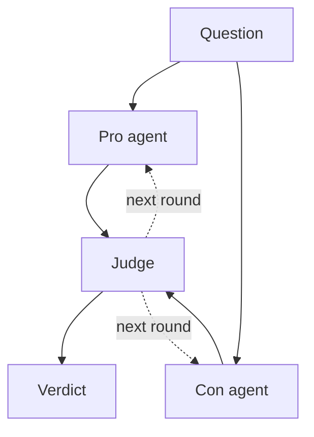
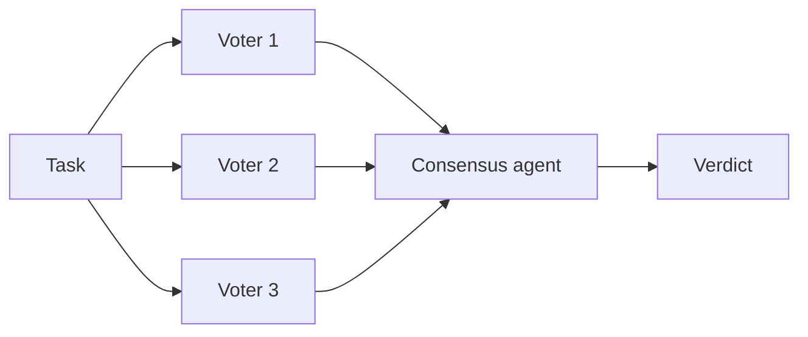
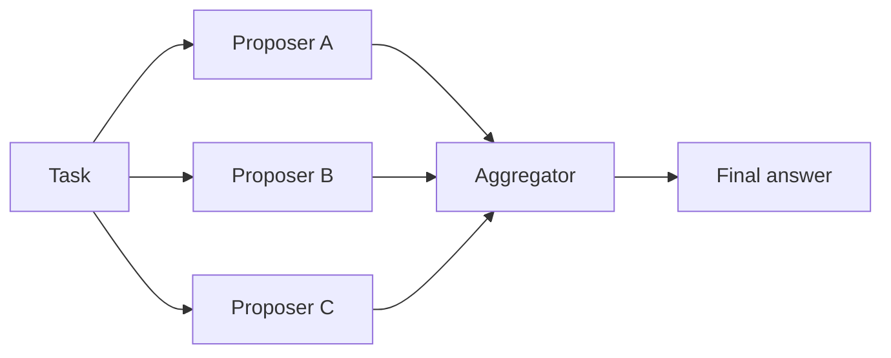
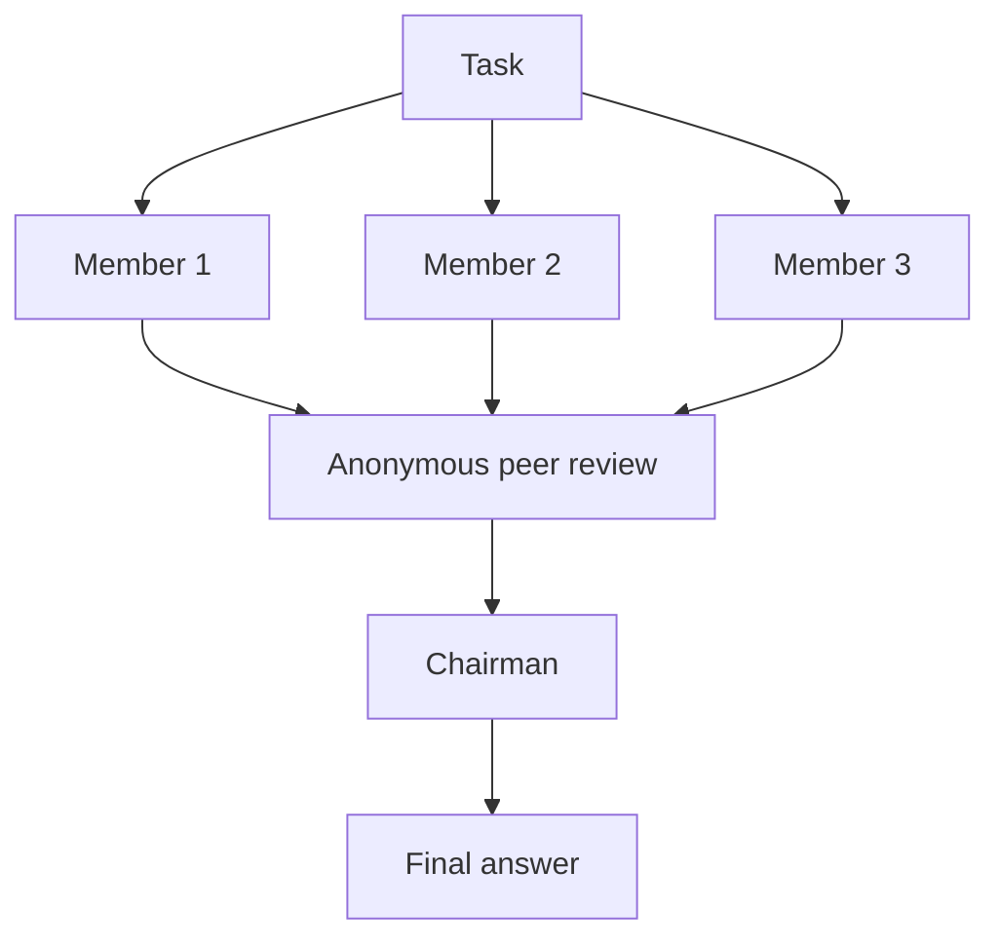
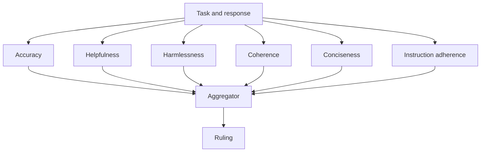
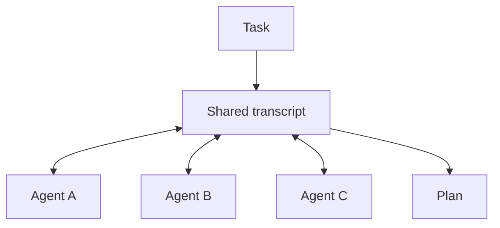

# Multi-Agent Collaboration Patterns: Debate, Voting, Mixture of Agents, and Councils

Multi-agent collaboration is what happens when several LLM agents work on the same question and a fixed rule turns their outputs into one answer. The rule is what separates the patterns: two agents argue and a judge rules, a panel votes, a layer of proposers feeds an aggregator, or a council answers, reviews each other anonymously, and a chairman writes the result. Each rule traces back to a paper or a well-known project, each has a predictable number of model calls, and each fits a different kind of task.

This guide covers six patterns. For each one you get a diagram, the research it comes from, when it helps, what it costs in model calls, and a complete request to the Swarms API that you can copy and run. Every example uses one endpoint, `POST /v1/swarm/completions`, and changes only the `swarm_type`.

If you want the wider map first, [what is a multi-agent system](/blog/what-is-a-multi-agent-system) covers the basics and [swarm architectures explained](/blog/swarm-architectures-explained) lists every way to organize a team of agents. This post goes deep on the ones where agents work on the same problem together.

## What is multi-agent collaboration?

Most multi-agent systems divide labor. A researcher hands off to a writer, a director assigns subtasks to workers, a router sends each request to one specialist. That is orchestration, and [what is multi-agent orchestration](/blog/what-is-multi-agent-orchestration) covers it in detail, with the sequential, concurrent and graph shapes compared in [agent orchestration patterns](/blog/agent-orchestration-patterns).

Collaboration patterns point several agents at the same task and then combine what they produce. The combination step is the design decision. You can count votes, ask a judge, have an aggregator merge the drafts, or let agents read each other and revise. Each choice trades cost and latency for a specific kind of reliability.

The reason any of this works is that independent errors cancel. If three agents each have a 20% chance of a wrong answer and their mistakes are unrelated, the chance that two of them are wrong in the same way is much lower. The catch is the word "unrelated." Three copies of the same model with the same prompt tend to make the same mistake, and a vote among them confirms it. That is why the examples below mix model families and give each agent a different brief. The [multi-agent system failure modes](/blog/multi-agent-system-failure-modes) post covers what happens when one agent's bad output quietly becomes the next agent's context.

## Setup

Every example needs a Swarms API key from the [API keys page](https://swarms.world/platform/api-keys), stored in the `SWARMS_API_KEY` environment variable or a `.env` file:

```bash
pip install aiohttp python-dotenv
export SWARMS_API_KEY="your-api-key"
```

All six patterns go through the [Swarm Completions endpoint](https://docs.swarms.ai/docs/documentation/multi-agent/swarm_completions). The response always has the same envelope (`job_id`, `status`, `output`, `execution_time`, `usage`), and `output` is a list of `{"role": ..., "content": ...}` turns whose roles depend on the pattern. Each code block below is self-contained, so you can paste any one of them into a file and run it. The [quickstart](https://docs.swarms.ai/docs/documentation/getting-started/quickstart) shows the same setup, and the [Swarms API examples suite](/blog/swarms-api-examples-suite) has more than 100 runnable examples beyond these six.

A note on cost before the patterns. The API bills $0.01 per agent in your `agents` list plus input and output tokens ([pricing](https://docs.swarms.ai/docs/documentation/resources/pricing)). Token spend and latency follow the number of model calls a pattern makes, so each section below states that number.

## Pattern 1: Multi-agent debate with a judge



### How it works

`DebateWithJudge` takes exactly three agents, in order: one argues for the proposition, one argues against it, and a judge weighs both and writes a synthesis. With `max_loops` above 1, the judge's synthesis becomes the starting point for the next round, so both sides have to answer the judge's feedback. The full schema is on the [DebateWithJudge docs page](https://docs.swarms.ai/docs/documentation/multi-agent/debate_with_judge).

### The research behind multi-agent debate

The best-known evidence that LLMs reason better when they argue is [Du et al., "Improving Factuality and Reasoning in Language Models through Multiagent Debate"](https://arxiv.org/abs/2305.14325) (2023, published at ICML 2024). In their setup, several instances of the same model each answer, read the others' answers, and revise over a few rounds until they converge. With three agents and two rounds of debate on gpt-3.5-turbo, GSM8K accuracy went from 77.0% for a single agent to 85.0% with debate, and arithmetic accuracy went from 67.0% to 81.8%. A majority vote over the same three agents reached 81.0% on GSM8K, so in their experiments the exchange between agents added something beyond the vote. On arithmetic, accuracy rose with more agents and more rounds, and the authors note plainly that debate costs more because it needs multiple model instances and rounds.

Du et al. use no assigned sides and no judge. The pro, con and judge structure in `DebateWithJudge` is closer to [Liang et al., "Encouraging Divergent Thinking in Large Language Models through Multi-Agent Debate"](https://arxiv.org/abs/2305.19118) (EMNLP 2024). They describe a failure they call Degeneration-of-Thought: once a model is confident in an answer, self-reflection stops producing new ideas even when the answer is wrong. An opposing debater forces new arguments into the context, and a judge decides when to stop and extracts the final answer. Two of their findings carry over directly. A moderate level of disagreement worked better than forcing the debaters to disagree on every point. And when the debaters ran on different models, the judge favored the side that shared its own model. The example below gives Pro and Con the same model and puts the judge on a different one, so neither side has that advantage.

### When it helps

Debate fits yes or no questions and A versus B decisions with real trade-offs: build or buy, migrate now or later, approve a policy or not. It is the right tool when a single model would commit to its first framing. For questions with one checkable answer, start with a vote, which is cheaper, and move to debate only if the vote's accuracy falls short.

### What it costs

Three calls per round, run in order: Pro, then Con, then Judge. With `max_loops: 2` that is six calls, and the judge's input grows each round because it reads both sides.

```python
import asyncio
import os

import aiohttp
from dotenv import load_dotenv

load_dotenv()

API_KEY = os.environ["SWARMS_API_KEY"]
BASE_URL = "https://api.swarms.world"
HEADERS = {"x-api-key": API_KEY, "Content-Type": "application/json"}


def text(turn):
    content = turn["content"]
    return content if isinstance(content, str) else " ".join(map(str, content))


async def main() -> None:
    payload = {
        "name": "Database Split Debate",
        "description": "Pro and Con argue, a judge rules",
        "swarm_type": "DebateWithJudge",
        "task": (
            "Should a 10-engineer startup with one Postgres database split it into "
            "one database per service this quarter? Consider delivery speed, "
            "incident risk, data consistency and hiring."
        ),
        "agents": [
            {
                "agent_name": "Pro",
                "description": "Argues for the proposition",
                "system_prompt": (
                    "You argue FOR the proposition. Give your three strongest arguments "
                    "with concrete mechanisms and answer the other side's best point. "
                    "In later rounds, respond directly to the judge's feedback."
                ),
                "model_name": "claude-sonnet-5",
                "max_loops": 1,
                "temperature": 0.5,
            },
            {
                "agent_name": "Con",
                "description": "Argues against the proposition",
                "system_prompt": (
                    "You argue AGAINST the proposition. Give your three strongest arguments "
                    "with concrete mechanisms and answer the other side's best point. "
                    "In later rounds, respond directly to the judge's feedback."
                ),
                "model_name": "claude-sonnet-5",
                "max_loops": 1,
                "temperature": 0.5,
            },
            {
                "agent_name": "Judge",
                "description": "Weighs both sides and writes the verdict",
                "system_prompt": (
                    "You are an impartial judge. Assess each side on evidence and logic, "
                    "name the strongest point from each, then give a clear verdict and "
                    "the conditions under which it would change."
                ),
                "model_name": "gpt-5.4",
                "max_loops": 1,
                "temperature": 0.2,
            },
        ],
        "max_loops": 2,  # two rounds, three calls per round
    }

    # Multi-agent runs can take minutes, so give the whole request room.
    timeout = aiohttp.ClientTimeout(total=600)
    async with aiohttp.ClientSession(headers=HEADERS, timeout=timeout) as session:
        async with session.post(f"{BASE_URL}/v1/swarm/completions", json=payload) as resp:
            resp.raise_for_status()
            result = await resp.json()

    judge_turns = [t for t in result["output"] if t["role"] == "Judge"]
    print(f"{len(judge_turns)} rounds in {result['execution_time']:.1f}s")
    print("Final verdict:\n", text(judge_turns[-1]))


asyncio.run(main())
```

## Pattern 2: Majority voting with LLM agents



### How it works

`MajorityVoting` runs every agent on the task in parallel, with no agent seeing another's answer. A separate `Consensus-Agent` then tallies the votes and writes a final verdict with the reasoning behind it. The docs note that this consensus agent always runs on `gpt-5.4` and cannot be configured through the request. Details are on the [MajorityVoting docs page](https://docs.swarms.ai/docs/documentation/multi-agent/majority_voting) and in the [code review board example](https://docs.swarms.ai/docs/examples/examples/majority-voting).

### The research: self-consistency

LLM majority voting has its clearest evidence in [Wang et al., "Self-Consistency Improves Chain of Thought Reasoning in Language Models"](https://arxiv.org/abs/2203.11171) (ICLR 2023). Instead of taking one greedy chain-of-thought answer, they sample several reasoning paths from the same model and keep the final answer that appears most often. The abstract reports gains of 17.9% on GSM8K, 11.0% on SVAMP and 12.2% on AQuA over standard chain-of-thought prompting.

The Swarms version differs in two ways. The voters are different agents with different briefs (and here, different models) instead of samples from one model, and a consensus agent reads the votes and their reasons instead of a plain count. Both changes make sense when the agents check different things, such as security, correctness and maintainability in a code review. If you want self-consistency in the paper's exact form, one model sampled N times, the premium [reasoning agent endpoint](https://docs.swarms.ai/docs/documentation/capabilities/reasoning_agent) has a `self-consistency` type with a `num_samples` setting.

### When it helps

Voting needs answers that can be compared: approve or reject, a label, a number, a multiple-choice option. It is the cheapest way to add a second and third opinion to a classification step. Use an odd number of voters so there are no ties, and tell every voter to put its vote in a fixed format so you can count the votes yourself and check the consensus agent against your own tally.

### What it costs

N voter calls in parallel, plus one consensus call. Three voters cost four calls, and the wall-clock time is roughly one voter call plus the consensus call.

```python
import asyncio
import os
import re
from collections import Counter

import aiohttp
from dotenv import load_dotenv

load_dotenv()

API_KEY = os.environ["SWARMS_API_KEY"]
BASE_URL = "https://api.swarms.world"
HEADERS = {"x-api-key": API_KEY, "Content-Type": "application/json"}

DIFF = '''
def get_user(conn, username):
    query = f"SELECT * FROM users WHERE name = '{username}'"
    return conn.execute(query).fetchone()
'''

VOTE_RULE = (
    "Start your reply with exactly 'VOTE: APPROVE' or 'VOTE: REJECT', "
    "then give at most three reasons."
)

voters = [
    ("Security-Reviewer", "You review code for security flaws such as injection and unsafe input handling.", "gpt-5.4"),
    ("Correctness-Reviewer", "You review code for bugs, edge cases and wrong results.", "claude-sonnet-5"),
    ("Maintainability-Reviewer", "You review code for readability, naming and testability.", "gpt-5.4-mini"),
]


def text(turn):
    content = turn["content"]
    return content if isinstance(content, str) else " ".join(map(str, content))


async def main() -> None:
    payload = {
        "name": "PR Approval Vote",
        "description": "Independent reviewers vote on a pull request",
        "swarm_type": "MajorityVoting",
        "task": f"Vote on whether this change can merge.\n{VOTE_RULE}\n\n{DIFF}",
        "agents": [
            {
                "agent_name": name,
                "description": prompt,
                "system_prompt": f"{prompt} {VOTE_RULE}",
                "model_name": model,
                "max_loops": 1,
                "temperature": 0.2,
            }
            for name, prompt, model in voters
        ],
        "max_loops": 1,
    }

    # Multi-agent runs can take minutes, so give the whole request room.
    timeout = aiohttp.ClientTimeout(total=600)
    async with aiohttp.ClientSession(headers=HEADERS, timeout=timeout) as session:
        async with session.post(f"{BASE_URL}/v1/swarm/completions", json=payload) as resp:
            resp.raise_for_status()
            result = await resp.json()

    voter_names = {name for name, _, _ in voters}
    tally = Counter()
    for turn in result["output"]:
        match = re.match(r"\s*\**VOTE:\s*(APPROVE|REJECT)", text(turn), re.IGNORECASE)
        if turn["role"] in voter_names and match:
            tally[match.group(1).upper()] += 1

    consensus = [t for t in result["output"] if t["role"] == "Consensus-Agent"]
    print("Our tally:", dict(tally))
    print("Consensus agent:\n", text(consensus[-1]) if consensus else "(none returned)")


asyncio.run(main())
```

## Pattern 3: Mixture of Agents



### How it works

`MixtureOfAgents` runs your agents in parallel as proposers, then passes every proposal to an aggregator that writes one answer. Two details from the [MixtureOfAgents docs](https://docs.swarms.ai/docs/documentation/multi-agent/mixture_of_agents) and the [due diligence example](https://docs.swarms.ai/docs/examples/examples/mixture-of-agents) matter for your payload. First, the API uses the **last** agent in `agents` as the aggregator, and that agent also runs once as an ordinary proposer, so put a dedicated synthesizer last. Second, the swarm-level `max_loops` sets the number of proposer layers. With `max_loops: 2`, every proposer runs again on the second layer and sees the first layer's combined output.

### The research behind Mixture of Agents

The pattern comes from [Wang et al., "Mixture-of-Agents Enhances Large Language Model Capabilities"](https://arxiv.org/abs/2406.04692) (2024, published at ICLR 2025). Their default setup stacks three layers of six open-source proposer models, with Qwen1.5-110B-Chat as the final aggregator. That configuration scored a 65.1% length-controlled win rate on AlpacaEval 2.0, against 57.5% for GPT-4o, using only open-source models. The paper's motivating observation is what it calls collaborativeness: a model tends to write a better answer when it is shown other models' answers, even when those answers are weaker than what it would produce alone. The authors also name the main drawback. Nothing can stream until the last layer finishes, so time to first token is high, and they suggest limiting the number of layers.

### When it helps

Mixture of Agents fits open-ended generation where quality is judged as a whole: a migration plan, a design review, an explanation, a report. The gain comes from diversity, so use different model families as proposers and give each one a different angle on the task. For tasks with a single correct answer, a vote is cheaper and easier to check.

### What it costs

N calls per layer plus one aggregation call, where N counts every agent including the aggregator. Four agents and one layer cost five calls. A second layer adds four more.

```python
import asyncio
import os

import aiohttp
from dotenv import load_dotenv

load_dotenv()

API_KEY = os.environ["SWARMS_API_KEY"]
BASE_URL = "https://api.swarms.world"
HEADERS = {"x-api-key": API_KEY, "Content-Type": "application/json"}


def text(turn):
    content = turn["content"]
    return content if isinstance(content, str) else " ".join(map(str, content))


async def main() -> None:
    payload = {
        "name": "Region Migration Plan",
        "description": "Three proposers, one synthesizer",
        "swarm_type": "MixtureOfAgents",
        "task": (
            "Write a step-by-step plan to move a 2 TB Postgres database to a new "
            "cloud region with under 5 minutes of write downtime. Include the "
            "rollback plan and the checks that gate each step."
        ),
        "agents": [
            {
                "agent_name": "Database-Engineer",
                "description": "Replication and cutover mechanics",
                "system_prompt": "Focus on replication setup, lag monitoring and the cutover sequence.",
                "model_name": "gpt-5.4",
                "max_loops": 1,
                "temperature": 0.3,
            },
            {
                "agent_name": "SRE",
                "description": "Operational risk and observability",
                "system_prompt": "Focus on monitoring, alerting, runbooks and what can go wrong at 3 a.m.",
                "model_name": "claude-sonnet-5",
                "max_loops": 1,
                "temperature": 0.3,
            },
            {
                "agent_name": "Risk-Reviewer",
                "description": "Failure cases and rollback",
                "system_prompt": "Focus on data loss scenarios, rollback paths and go or no-go criteria.",
                "model_name": "gpt-5.4-mini",
                "max_loops": 1,
                "temperature": 0.3,
            },
            {
                # The last agent is reused as the aggregator.
                "agent_name": "Synthesizer",
                "description": "Merges the proposals into one plan",
                "system_prompt": (
                    "You receive the task plus other engineers' proposals. Merge them into "
                    "one numbered plan, resolve conflicts explicitly, and drop repetition."
                ),
                "model_name": "gpt-5.4",
                "max_loops": 1,
                "temperature": 0.2,
            },
        ],
        "max_loops": 1,  # one proposer layer
    }

    # Multi-agent runs can take minutes, so give the whole request room.
    timeout = aiohttp.ClientTimeout(total=600)
    async with aiohttp.ClientSession(headers=HEADERS, timeout=timeout) as session:
        async with session.post(f"{BASE_URL}/v1/swarm/completions", json=payload) as resp:
            resp.raise_for_status()
            result = await resp.json()

    # The synthesizer appears twice: once as a proposer, then as the aggregator.
    synthesis = [t for t in result["output"] if t["role"] == "Synthesizer"][-1]
    print(text(synthesis))
    usage = result.get("usage") or {}
    print("Total cost:", usage.get("billing_info", {}).get("total_cost"))


asyncio.run(main())
```

## Pattern 4: The LLM council



### How it works

`LLMCouncil` runs in three phases. Every member answers the task independently. The answers are relabeled A, B, C so nobody knows who wrote what, and every member ranks and critiques all of them. Then a chairman reads the original answers plus every review and writes the final response. The chairman's model is set with `chairman_model` on the request (default `gpt-5.1`). The [LLMCouncil docs](https://docs.swarms.ai/docs/documentation/multi-agent/llm_council) and the [council example](https://docs.swarms.ai/docs/examples/examples/llm-council) show the output roles: one turn per member, one `<member>-Evaluation` turn per member, and a final `Chairman` turn.

### The research behind the LLM council

The three-stage design follows Andrej Karpathy's [llm-council](https://github.com/karpathy/llm-council) project, which sends one query to several models, has each model rank the others' answers with identities hidden, and has a chairman model write the final reply. Karpathy's README calls it a Saturday hack, so treat it as a design reference. The anonymous review step addresses a bias measured in the LLM-as-a-judge literature: [Zheng et al.](https://arxiv.org/abs/2306.05685) list self-enhancement bias, a judge favoring its own answers, among the problems with model judges (their evidence for it was limited). The case for a panel of different models comes from [Verga et al., "Replacing Judges with Juries"](https://arxiv.org/abs/2404.18796) (2024), which found that a panel of smaller models from different families beat a single large judge across three settings and six datasets, showed less intra-model bias, and cost over seven times less.

### When it helps

Councils fit judgment calls where reasonable answers differ and you want to see the disagreement before it is merged: architecture choices, pricing, policy, incident priorities. The evaluation turns are useful on their own, because they show which answer the members ranked highest and why. The docs advise three to five members with genuinely different prompts or models. A council of near-identical members produces near-identical answers.

### What it costs

Two calls per member (answer and review) plus one chairman call: 2N + 1. Three members cost seven calls, and each member you add costs two more.

```python
import asyncio
import os

import aiohttp
from dotenv import load_dotenv

load_dotenv()

API_KEY = os.environ["SWARMS_API_KEY"]
BASE_URL = "https://api.swarms.world"
HEADERS = {"x-api-key": API_KEY, "Content-Type": "application/json"}


def text(turn):
    content = turn["content"]
    return content if isinstance(content, str) else " ".join(map(str, content))


async def main() -> None:
    payload = {
        "name": "Moderation Latency Council",
        "description": "Members answer, review each other, chairman decides",
        "swarm_type": "LLMCouncil",
        "chairman_model": "gpt-5.4",
        "task": (
            "Our API's p99 latency doubled after we added an LLM moderation step "
            "before every response. Options: (a) run moderation asynchronously and "
            "retract flagged responses, (b) switch to a smaller moderation model, "
            "(c) cache verdicts for repeated content. Recommend one and say why."
        ),
        "agents": [
            {
                "agent_name": "Latency-Engineer",
                "description": "Optimizes for response time",
                "system_prompt": "You care most about latency budgets and tail behavior.",
                "model_name": "gpt-5.4",
                "max_loops": 1,
                "temperature": 0.4,
            },
            {
                "agent_name": "Trust-and-Safety",
                "description": "Optimizes for harm prevention",
                "system_prompt": "You care most about harmful content reaching users, even briefly.",
                "model_name": "claude-sonnet-5",
                "max_loops": 1,
                "temperature": 0.4,
            },
            {
                "agent_name": "Cost-Analyst",
                "description": "Optimizes for spend",
                "system_prompt": "You care most about cost per request and engineering effort.",
                "model_name": "gpt-5.4-mini",
                "max_loops": 1,
                "temperature": 0.4,
            },
        ],
        "max_loops": 1,
    }

    # Multi-agent runs can take minutes, so give the whole request room.
    timeout = aiohttp.ClientTimeout(total=600)
    async with aiohttp.ClientSession(headers=HEADERS, timeout=timeout) as session:
        async with session.post(f"{BASE_URL}/v1/swarm/completions", json=payload) as resp:
            resp.raise_for_status()
            result = await resp.json()

    for turn in result["output"]:
        if turn["role"].endswith("-Evaluation"):
            print(f"--- {turn['role']} ---\n{text(turn)[:400]}\n")

    chairman = [t for t in result["output"] if t["role"] == "Chairman"]
    print("Chairman:\n", text(chairman[-1]) if chairman else "(none returned)")


asyncio.run(main())
```

## Pattern 5: Council as a judge (LLM-as-a-judge)



### How it works

`CouncilAsAJudge` grades an answer that already exists. You send the original prompt and the response in `task`, and the API runs six judges in parallel, one per fixed dimension: accuracy, helpfulness, harmlessness, coherence, conciseness and instruction adherence. An aggregator then reads all six critiques and writes the ruling. `council_judge_model_name` sets the model for that final ruling (default `gpt-5.4`). The council builds its own judges, so the agents you send are not run. The [CouncilAsAJudge docs](https://docs.swarms.ai/docs/documentation/multi-agent/council_as_a_judge) ask for one placeholder entry in `agents`, which is billed at the per-agent rate but never executed. The dimensions and judge prompts are fixed. The [evaluation example](https://docs.swarms.ai/docs/examples/examples/council-as-judge) shows the output roles: `accuracy_judge` through `instruction_adherence_judge`, then `aggregator_agent`.

### The research behind LLM-as-a-judge

The standard reference is [Zheng et al., "Judging LLM-as-a-Judge with MT-Bench and Chatbot Arena"](https://arxiv.org/abs/2306.05685) (NeurIPS 2023 Datasets and Benchmarks). They found that GPT-4 as a judge agreed with human preferences over 80% of the time, about the same rate at which humans agree with each other. They also documented where model judges go wrong: position bias (favoring the first answer in a pairwise comparison), verbosity bias (favoring longer answers that add nothing), self-enhancement bias, and weak grading of math and reasoning, where a judge can be misled by the answer in front of it even when it could solve the problem itself. Their mitigations include swapping answer positions and giving the judge a reference answer.

Splitting the evaluation into six narrow rubrics gives each judge a smaller job, and grading one response at a time avoids the position bias of pairwise comparison. The other biases can still apply, so for math or factual tasks, put a reference answer in `task` alongside the response.

### When it helps

Use it as a quality gate after generation: grade a draft before it is sent, compare prompts or models on the same set of tasks, or flag responses for human review. It produces critique, so pair it with a generating pattern. A common setup runs `MixtureOfAgents` to write a draft and `CouncilAsAJudge` to grade it before anything reaches a user.

### What it costs

Seven calls per graded response (six judges and one aggregator), whatever you put in `agents`.

```python
import asyncio
import os

import aiohttp
from dotenv import load_dotenv

load_dotenv()

API_KEY = os.environ["SWARMS_API_KEY"]
BASE_URL = "https://api.swarms.world"
HEADERS = {"x-api-key": API_KEY, "Content-Type": "application/json"}

original_task = "Explain to a junior engineer when to add a database index."
candidate = (
    "Indexes always make queries faster, so add one to every column. "
    "They have no downside because the database maintains them for free."
)


def text(turn):
    content = turn["content"]
    return content if isinstance(content, str) else " ".join(map(str, content))


async def main() -> None:
    payload = {
        "name": "Answer Review Council",
        "description": "Six judges grade one response, an aggregator rules",
        "swarm_type": "CouncilAsAJudge",
        "council_judge_model_name": "gpt-5.4",
        "task": f"Task: {original_task}\n\nResponse: {candidate}",
        "agents": [
            {
                # Required by the API for this type, but never executed.
                "agent_name": "placeholder",
                "description": "Not run by CouncilAsAJudge",
                "model_name": "gpt-5.4-mini",
                "max_loops": 1,
            }
        ],
        "max_loops": 1,
    }

    # Multi-agent runs can take minutes, so give the whole request room.
    timeout = aiohttp.ClientTimeout(total=600)
    async with aiohttp.ClientSession(headers=HEADERS, timeout=timeout) as session:
        async with session.post(f"{BASE_URL}/v1/swarm/completions", json=payload) as resp:
            resp.raise_for_status()
            result = await resp.json()

    for turn in result["output"]:
        if turn["role"].endswith("_judge"):
            print(f"{turn['role']}: {text(turn)[:200]}...")

    ruling = [t for t in result["output"] if t["role"] == "aggregator_agent"]
    print("\nRuling:\n", text(ruling[-1]) if ruling else "(none returned)")


asyncio.run(main())
```

## Pattern 6: Group discussion



### How it works

`GroupChat` puts every agent in one shared conversation. Each turn, one agent speaks, sees everything said so far, and can build on it or push back. There is no aggregation rule: the transcript is the output. One setting needs care. For this type, `max_loops` is the maximum number of messages across the whole conversation, one speaker per turn, and the API's default of 1 lets only one agent speak. Set it high enough for every participant to speak at least once (the chat can also end early). See the [GroupChat docs](https://docs.swarms.ai/docs/documentation/multi-agent/group_chat) and the [brainstorm example](https://docs.swarms.ai/docs/examples/examples/group-chat).

### The research behind group conversation

Framing an application as a conversation between agents was popularized by [Wu et al., "AutoGen: Enabling Next-Gen LLM Applications via Multi-Agent Conversation"](https://arxiv.org/abs/2308.08155) (2023), which presents a framework for building applications from agents that converse with each other and can combine LLMs, human input and tools. If you are coming from that framework, [AutoGen alternatives](/blog/autogen-alternatives) covers where to go next and the docs have a [migration guide](https://docs.swarms.ai/docs/guides/migration/from-autogen).

### When it helps

Group discussion fits brainstorming and cross-functional planning, where the value is in agents reacting to each other: an engineer flags that a feature will not fit the timeline, and the product manager re-plans around it. It gives the weakest guarantees of the six patterns. Nothing forces convergence, and every turn reads the full transcript, so input tokens grow with each message. If you need a decision at the end, send the transcript to one of the patterns above.

### What it costs

Up to `max_loops` calls, run one after another. Six messages cost up to six calls, and later calls carry the longest context.

```python
import asyncio
import os

import aiohttp
from dotenv import load_dotenv

load_dotenv()

API_KEY = os.environ["SWARMS_API_KEY"]
BASE_URL = "https://api.swarms.world"
HEADERS = {"x-api-key": API_KEY, "Content-Type": "application/json"}


def text(turn):
    content = turn["content"]
    return content if isinstance(content, str) else " ".join(map(str, content))


async def main() -> None:
    payload = {
        "name": "Reliability Sprint Planning",
        "description": "Three roles plan a one-week sprint together",
        "swarm_type": "GroupChat",
        "task": (
            "Plan a one-week reliability sprint for our payments API, which had two "
            "outages last month (a bad config push and a database connection storm). "
            "Agree on at most five work items, an owner role for each, and what we drop."
        ),
        "agents": [
            {
                "agent_name": "SRE",
                "description": "Owns incident data and operational risk",
                "system_prompt": "Ground every proposal in the two outages. Push back on vague items.",
                "model_name": "claude-sonnet-5",
                "max_loops": 1,
                "temperature": 0.5,
            },
            {
                "agent_name": "Backend-Engineer",
                "description": "Estimates effort and feasibility",
                "system_prompt": "Estimate effort for each proposal and flag what will not fit in a week.",
                "model_name": "gpt-5.4",
                "max_loops": 1,
                "temperature": 0.5,
            },
            {
                "agent_name": "Product-Manager",
                "description": "Owns priorities and trade-offs",
                "system_prompt": "Decide what gets cut, and summarize the agreed plan when the group converges.",
                "model_name": "gpt-5.4-mini",
                "max_loops": 1,
                "temperature": 0.5,
            },
        ],
        "max_loops": 6,  # total messages in the conversation
    }

    # Multi-agent runs can take minutes, so give the whole request room.
    timeout = aiohttp.ClientTimeout(total=600)
    async with aiohttp.ClientSession(headers=HEADERS, timeout=timeout) as session:
        async with session.post(f"{BASE_URL}/v1/swarm/completions", json=payload) as resp:
            resp.raise_for_status()
            result = await resp.json()

    for turn in result["output"]:
        print(f"[{turn['role']}] {text(turn)[:300]}\n")


asyncio.run(main())
```

## Multi-agent collaboration patterns compared

N is the number of agents you send. Call counts come from each architecture's docs page.

| Pattern | `swarm_type` | Calls per task | Best for |
|---|---|---|---|
| Debate | `DebateWithJudge` | 3 per round | Yes or no and A versus B decisions with trade-offs |
| Voting | `MajorityVoting` | N + 1 | Labels, approvals, answers you can compare directly |
| Mixture of Agents | `MixtureOfAgents` | N per layer + 1 | Open-ended drafts: plans, reports, explanations |
| LLM council | `LLMCouncil` | 2N + 1 | Judgment calls where you want to see disagreement |
| Council as a judge | `CouncilAsAJudge` | 7 | Grading an existing response before it ships |
| Group discussion | `GroupChat` | Up to `max_loops` | Brainstorming and cross-functional planning |

The call counts show what each pattern spends, and only a run on your own task shows which one is worth it. Each pattern is a single request, so you can run several on the same question at once and compare their answers, time and cost. The example below sends a voting run, a council run and a Mixture of Agents run with `asyncio.gather` over one shared aiohttp session, so the total wait is about as long as the slowest run. The last turn of each `output` holds that pattern's final answer, and a failed run is reported without stopping the other two.

```python
import asyncio
import os

import aiohttp
from dotenv import load_dotenv

load_dotenv()

API_KEY = os.environ["SWARMS_API_KEY"]
BASE_URL = "https://api.swarms.world"
HEADERS = {"x-api-key": API_KEY, "Content-Type": "application/json"}

TASK = (
    "Our checkout service times out on 2% of calls at peak hours. Should we "
    "put a cache in front of the pricing service or scale the pricing service "
    "horizontally? Recommend one and say why."
)

MEMBERS = [
    {
        "agent_name": "Performance-Engineer",
        "description": "Focuses on latency",
        "system_prompt": "You care most about latency and tail behavior.",
        "model_name": "gpt-5.4",
        "max_loops": 1,
    },
    {
        "agent_name": "Reliability-Engineer",
        "description": "Focuses on failure modes",
        "system_prompt": "You care most about stale data, failure modes and recovery.",
        "model_name": "claude-sonnet-5",
        "max_loops": 1,
    },
    {
        "agent_name": "Cost-Analyst",
        "description": "Focuses on spend",
        "system_prompt": "You care most about infrastructure cost and engineering effort.",
        "model_name": "gpt-5.4-mini",
        "max_loops": 1,
    },
]

SYNTHESIZER = {
    "agent_name": "Synthesizer",
    "description": "Merges the proposals into one recommendation",
    "system_prompt": "Merge the other agents' answers into one recommendation with its reasons.",
    "model_name": "gpt-5.4",
    "max_loops": 1,
}

PAYLOADS = [
    {"name": "Compare: voting", "swarm_type": "MajorityVoting",
     "task": TASK, "agents": MEMBERS, "max_loops": 1},
    {"name": "Compare: council", "swarm_type": "LLMCouncil", "chairman_model": "gpt-5.4",
     "task": TASK, "agents": MEMBERS, "max_loops": 1},
    {"name": "Compare: mixture", "swarm_type": "MixtureOfAgents",
     "task": TASK, "agents": MEMBERS + [SYNTHESIZER], "max_loops": 1},
]


def text(turn):
    content = turn["content"]
    return content if isinstance(content, str) else " ".join(map(str, content))


async def run_swarm(session: aiohttp.ClientSession, payload: dict) -> dict:
    async with session.post(f"{BASE_URL}/v1/swarm/completions", json=payload) as resp:
        if resp.status >= 400:
            body = await resp.text()
            raise RuntimeError(f"{resp.status}: {body}")
        return await resp.json()


async def main() -> None:
    # Multi-agent runs can take minutes, so give the whole request room.
    timeout = aiohttp.ClientTimeout(total=600)
    async with aiohttp.ClientSession(headers=HEADERS, timeout=timeout) as session:
        # One shared session; the three runs are in flight at the same time.
        results = await asyncio.gather(
            *(run_swarm(session, p) for p in PAYLOADS), return_exceptions=True
        )

    for payload, result in zip(PAYLOADS, results):
        if isinstance(result, Exception):
            print(f"--- {payload['swarm_type']} failed: {result}\n")
            continue
        usage = result.get("usage") or {}
        cost = usage.get("billing_info", {}).get("total_cost")
        print(f"--- {payload['swarm_type']}: {result['execution_time']:.1f}s, cost {cost}")
        # The last turn holds each pattern's final answer.
        print(text(result["output"][-1])[:500], "\n")


asyncio.run(main())
```

## How do you choose a multi-agent collaboration pattern?

Start from the shape of the answer you need:

- **A label, a number or a yes or no that can be checked:** `MajorityVoting`. It is the cheapest pattern here, and you can verify the result by counting votes yourself.
- **A decision between two options with real costs on both sides:** `DebateWithJudge`. Run one round first and add rounds only if the judge's verdict keeps changing.
- **A long, open-ended draft:** `MixtureOfAgents`, with proposers from different model families and a dedicated synthesizer last.
- **A high-stakes call where you want the reasoning and the dissent on record:** `LLMCouncil`.
- **A response that already exists and needs grading:** `CouncilAsAJudge`.
- **A plan that needs several roles to react to each other:** `GroupChat`, followed by one of the patterns above if you need a final decision.

Two rules apply to all six. First, measure a single agent before you add any of them. Every pattern multiplies calls, and [single agent vs multi-agent](/blog/single-agent-vs-multi-agent) covers the signals that the extra calls will pay off. If most of your inputs are easy, screen them cheaply first and send only the hard ones to a panel, as in [reduce LLM costs with a decision model](/blog/reduce-llm-costs-decision-model). Second, track spend per run. The `usage` block in every response has token counts and cost, and [tracking token usage and cost](/blog/track-llm-token-usage-cost-python) shows how to keep per-agent totals.

These patterns spread one question across several agents. If your problem needs one agent to search through intermediate steps instead, [Tree of Thoughts](/blog/tree-of-thoughts-python-guide) is the closer fit. To build a full pipeline around any of them, [how to build an agent swarm in Python](/blog/build-agent-swarm-python) walks through the steps, and [what is swarm intelligence](/blog/what-is-swarm-intelligence) covers why groups of simple agents can outperform one large one.

## Frequently Asked Questions

### What is multi-agent collaboration?

Multi-agent collaboration is a set of patterns where several LLM agents work on the same task and their outputs are combined by a fixed rule, such as a vote, a judge, an aggregator or a chairman. It differs from orchestration, where agents split a task into separate parts. The combination rule decides what the pattern is good at and how many model calls it costs.

### Does multi-agent debate improve accuracy?

In Du et al. (2023), three gpt-3.5-turbo agents debating for two rounds raised GSM8K accuracy from 77.0% to 85.0% and arithmetic accuracy from 67.0% to 81.8% over a single agent. On arithmetic, gains grew with more agents and rounds, at a higher cost. Liang et al. (2024) found that a judge can favor a debater that runs on the same model, so give both debaters the same model or keep the judge on a different one.

### What is the difference between Mixture of Agents and majority voting?

Majority voting picks among answers: agents answer independently and the most common answer wins, which works when answers can be compared directly. Mixture of Agents merges answers: an aggregator reads every proposal and writes a new response, which suits open-ended text where there is nothing to count. Voting costs N + 1 calls, and Mixture of Agents costs N per layer plus one.

### What is an LLM council?

An LLM council is a panel of models that each answer a question, review each other's answers anonymously, and pass everything to a chairman model that writes the final response. In the Swarms API it is `swarm_type: "LLMCouncil"`, with the chairman's model set by `chairman_model`. It costs 2N + 1 calls for N members.

### Is LLM-as-a-judge reliable?

Zheng et al. (2023) found GPT-4 as a judge agreed with human preferences over 80% of the time, about as often as humans agree with each other. Model judges also show position bias, verbosity bias and weak grading of math and reasoning. A panel of judges from different model families, grading one response at a time, and reference answers for factual tasks each address part of this.

### How many model calls does each pattern use?

Debate uses three calls per round, majority voting N + 1, Mixture of Agents N per layer plus one, an LLM council 2N + 1, council as a judge seven, and group chat up to `max_loops`. Later calls in most patterns read earlier outputs, so input tokens grow faster than the call count. The `usage` field in every response reports the actual tokens and cost.
