# Swarm Architectures Explained: Every Way to Organize a Team of Agents

A swarm architecture is the set of rules that decides how a team of agents works together: which agent runs when, what each one can see, and how their outputs become one answer. Two teams with the same agents, prompts and models can produce very different results, at very different costs, depending on the architecture around them.

This page is a reference catalog of every swarm architecture the [Swarms API](https://docs.swarms.ai/docs/documentation/multi-agent/overview) offers: the 14 swarm types behind one endpoint, plus the separate endpoints for graphs, generated teams and batches. Every entry has the same parts: a diagram, a one-paragraph explanation, when to use it, when to skip it, and the payload fields to send. A decision table and a short flowchart at the end help you choose.

If you are new to the topic, [what is a multi-agent system](/blog/what-is-a-multi-agent-system) covers the basics, and [single agent vs multi-agent](/blog/single-agent-vs-multi-agent) covers when a team is worth the extra model calls. For how orchestration handles state and failures across any of these shapes, see [what is multi-agent orchestration](/blog/what-is-multi-agent-orchestration).

## What Is a Swarm Architecture?

Every multi-agent system architecture answers three questions:

1. **Order.** Which agents run, in what sequence, and which run at the same time?
2. **Visibility.** What does each agent see when it runs: only the task, the previous agent's output, or the whole conversation so far?
3. **Merge.** How do several outputs become one result: the last agent's answer, a vote, a judge's ruling, or a synthesis written by another agent?

The agents themselves stay the same across architectures. A "Researcher" agent with a fixed system prompt and model can sit in a pipeline, a parallel fan-out, a debate or a council. What changes is the coordination around it, and that coordination is what this guide means by a swarm architecture. The word "swarm" comes from swarm intelligence, the study of how many simple agents produce coordinated group behavior; [what is swarm intelligence](/blog/what-is-swarm-intelligence) traces the idea from ant colonies to LLM agents.

In the Swarms API, the architecture is a single field. You describe the agents once, then set `swarm_type` on [`POST /v1/swarm/completions`](https://docs.swarms.ai/docs/documentation/multi-agent/swarm_completions) to choose how they coordinate. Switching architectures is often a one-line change to the request, which makes it cheap to try two of them on the same task and compare.

## How Does the Swarms API Group Agent Swarm Architectures?

The API lists its swarm types at `GET /v1/swarms/available`, and the response sorts these multi-agent architectures into four categories ([Available Architectures](https://docs.swarms.ai/docs/documentation/multi-agent/available-architectures)):

| Category | What it covers | Swarm types |
| --- | --- | --- |
| workflow | Ordered or parallel execution | SequentialWorkflow, ConcurrentWorkflow, RoundRobin |
| routing | Organizing or dispatching work across agents | AgentRearrange, MultiAgentRouter |
| collaboration | Agents working toward one result | MixtureOfAgents, GroupChat, HierarchicalSwarm, HeavySwarm, PlannerWorkerSwarm |
| judgment | Decisions, votes and evaluation | MajorityVoting, CouncilAsAJudge, LLMCouncil, DebateWithJudge |

This guide follows the same grouping. Three more ways to organize agents live on their own endpoints: GraphWorkflow (a directed graph you draw yourself), the Auto Agent Builder (which designs the team for you) and the batch endpoints (which run many jobs in one request). They get their own section after the 14 swarm types.

The API rejects `"auto"` and `"SpreadSheetSwarm"` as `swarm_type` values with a `400`, and SwarmRouter and SpreadSheetSwarm remain available as options in the open-source Swarms framework, documented at [docs.swarms.world](https://docs.swarms.world).

## The Base Request

Every swarm type below uses the same request shape. Here is a complete one: a three-agent `SequentialWorkflow` that assesses a CI migration. The same team and task carry through the rest of the guide, so you can compare the swarm types on one problem. Install the two dependencies and set your key from the [API Keys page](https://swarms.world/platform/api-keys) first:

```bash
pip install aiohttp python-dotenv
export SWARMS_API_KEY="..."
```

```python
import asyncio
import os

import aiohttp
from dotenv import load_dotenv

load_dotenv()

API_KEY = os.environ["SWARMS_API_KEY"]
BASE_URL = "https://api.swarms.world"
HEADERS = {"x-api-key": API_KEY, "Content-Type": "application/json"}

TASK = (
    "Our 40-person engineering team runs CI on a self-hosted Jenkins server. "
    "Assess whether we should move to GitHub Actions this quarter."
)


async def main() -> None:
    payload = {
        "name": "CI Migration Review",
        "description": "Research, analyze, and write up a CI migration decision",
        "swarm_type": "SequentialWorkflow",
        "task": TASK,
        "max_loops": 1,
        "agents": [
            {
                "agent_name": "Researcher",
                "description": "Collects facts, constraints, and open questions",
                "system_prompt": "You research the task. List the relevant facts, constraints, and open questions. Do not recommend anything yet.",
                "model_name": "gpt-5.4-mini",
                "max_tokens": 4096,
                "temperature": 0.3,
            },
            {
                "agent_name": "Analyst",
                "description": "Weighs costs, risks, and benefits",
                "system_prompt": "You weigh the costs, risks, and benefits in the material you are given and rank the options.",
                "model_name": "gpt-5.4",
                "max_tokens": 4096,
                "temperature": 0.3,
            },
            {
                "agent_name": "Writer",
                "description": "Writes the final one-page brief",
                "system_prompt": "You turn the analysis you are given into a one-page brief with a clear recommendation.",
                "model_name": "claude-sonnet-5",
                "max_tokens": 4096,
                "temperature": 0.5,
            },
        ],
    }

    # Multi-agent runs can take minutes, so give the whole request room.
    timeout = aiohttp.ClientTimeout(total=600)
    async with aiohttp.ClientSession(headers=HEADERS, timeout=timeout) as session:
        async with session.post(f"{BASE_URL}/v1/swarm/completions", json=payload) as resp:
            resp.raise_for_status()
            result = await resp.json()

    for turn in result["output"]:
        print(f"\n--- {turn['role']}")
        print(turn["content"])

    print("\nagents billed:", result["number_of_agents"])
    print("seconds:", result["execution_time"])
    print("cost:", result["usage"]["billing_info"]["total_cost"])


asyncio.run(main())
```

A successful response carries `job_id`, `status`, `swarm_type`, `output`, `number_of_agents`, `execution_time` and `usage`. The `output` field is a list of `{"role", "content"}` turns, and what those turns mean depends on the architecture: an execution trace for a pipeline, a set of votes for MajorityVoting, answers followed by a verdict for the judgment types. Branch on `swarm_type` when you parse it.

Swarm completions bill a flat $0.01 per agent in the `agents` array plus tokens ($6.50 per million input tokens, $18.50 per million output tokens), and token costs are halved between 8 PM and 6 AM Pacific time ([Pricing](https://docs.swarms.ai/docs/documentation/resources/pricing)). That makes two things worth watching when you compare architectures: how many model calls a run makes, and how much context each call reads.

**To try another architecture, keep this script and change the payload.** Each entry below shows only the fields that differ from the base request. Merge them into `payload` inside `main()` with `payload.update({...})` before `session.post` sends it; any field a snippet does not show keeps its base value.

## Workflow Architectures: Fixed Order or Parallel Runs

### SequentialWorkflow

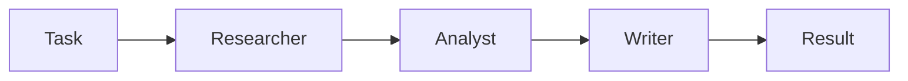

Agents run one after another in the order of the `agents` array, and each one receives the previous agent's output as its input. The `output` list has exactly one turn per agent, in request order, so it doubles as an execution trace: when the final brief is wrong, you can read back through the turns to find the step that went off track. The base request above is a SequentialWorkflow.

**Use it when:** each step needs the finished output of the step before it, as in research, then analysis, then writing.

**Skip it when:** the steps are independent. Running them in a line adds their latencies together, and an early mistake flows into every later step.

**Parameters:** none beyond the common fields. [Docs](https://docs.swarms.ai/docs/documentation/multi-agent/sequential_workflow)

```json
{
  "swarm_type": "SequentialWorkflow",
  "max_loops": 1
}
```

### ConcurrentWorkflow

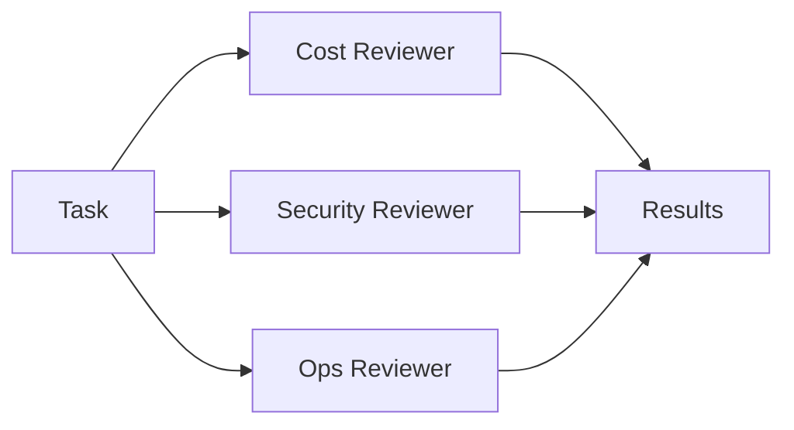

Every agent receives the same original task and runs at the same time on a thread pool. No agent waits for or sees another. You get one turn per agent back, and their order in `output` reflects when each agent finished, so match turns by `role` and never by position. There is no merge step: the API returns the separate answers, and combining them is up to you (or up to MixtureOfAgents, below).

**Use it when:** you want several independent reviews of one input and latency matters, since the agents run side by side.

**Skip it when:** one step depends on another's output, or you need the API to hand back a single combined answer.

**Parameters:** none beyond the common fields. [Docs](https://docs.swarms.ai/docs/documentation/multi-agent/concurrent_workflow)

```json
{
  "swarm_type": "ConcurrentWorkflow",
  "agents": [
    {"agent_name": "Cost Reviewer", "system_prompt": "Estimate the cost impact of the migration, including runner minutes and engineering time.", "model_name": "gpt-5.4-mini"},
    {"agent_name": "Security Reviewer", "system_prompt": "List the security risks of the migration, including secrets handling and third-party actions.", "model_name": "gpt-5.4-mini"},
    {"agent_name": "Ops Reviewer", "system_prompt": "List the operational risks of the migration and propose a rollout order.", "model_name": "gpt-5.4-mini"}
  ]
}
```

Several later entries reuse these three reviewers.

### RoundRobin

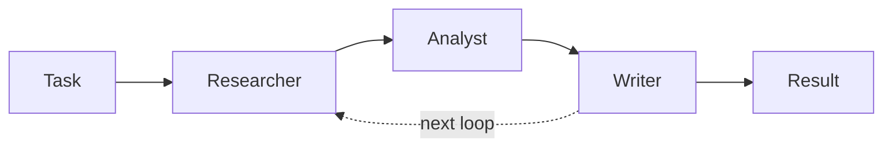

Agents take turns in the exact order you list them, and every agent reads the full conversation so far. Built-in turn headers tell each agent who spoke before and after it, which encourages agents to extend each other's work instead of repeating it. With `N` agents and `max_loops` set to `L`, the schedule is fixed: each agent gets exactly `L` turns, in the same order every loop. Put the agent that should open the discussion first and the one that should sum it up last.

**Use it when:** you want iterative refinement with a predictable speaking order, such as a draft that each specialist improves in turn over two or three rounds.

**Skip it when:** the agents' views should stay independent (later agents see, and may anchor on, earlier ones), or the roster is large. The docs recommend 3 to 5 agents, because every turn adds to the shared context.

**Parameters:** none beyond the common fields; `max_loops` sets the number of rounds. [Docs](https://docs.swarms.ai/docs/documentation/multi-agent/round_robin)

```json
{
  "swarm_type": "RoundRobin",
  "max_loops": 2
}
```

## Routing Architectures: Custom Flows and Dispatch

### AgentRearrange

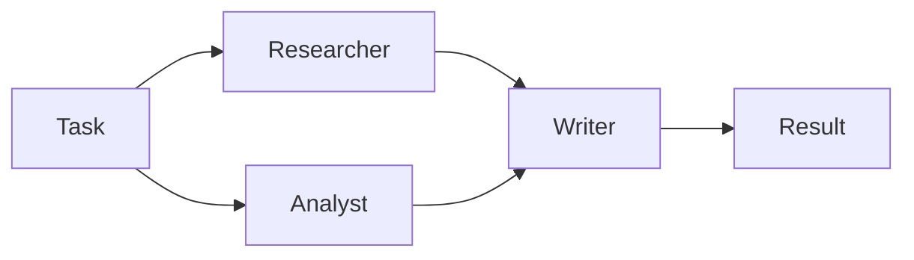

AgentRearrange runs your agents along a flow you write as a string in `rearrange_flow`. An arrow (`->`) hands work to the next step, and a comma runs agents in parallel within one step, so `"Researcher, Analyst -> Writer"` runs the first two side by side and then hands off to the Writer. The names in the flow must match `agent_name` values exactly. You can reorder or regroup the same team by editing one string, without touching any prompt.

**Use it when:** you need a mix of sequential and parallel stages, or you want to try several orderings of one team quickly.

**Skip it when:** a plain line or a plain fan-out is enough, or the flow forks and rejoins at several points, which GraphWorkflow describes more clearly with explicit edges.

**Parameters:** `rearrange_flow`, required for this type. Requests without it are rejected. [Docs](https://docs.swarms.ai/docs/documentation/multi-agent/agent_rearrange)

```json
{
  "swarm_type": "AgentRearrange",
  "rearrange_flow": "Researcher, Analyst -> Writer"
}
```

### MultiAgentRouter

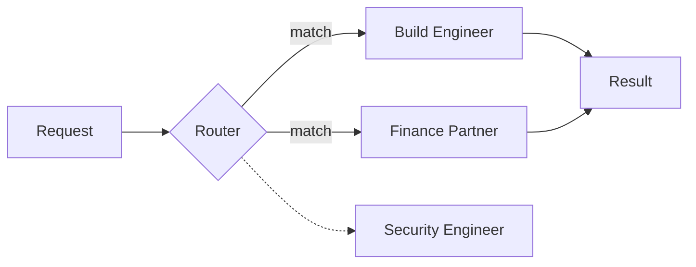

An internal router step reads the task and hands it off by function calling to the agent best suited for it. It can send the whole task to one specialist, or split it across several when more than one applies. Agents the router does not pick never run and add no turn to `output`, which holds the routing decision plus the response from each selected agent. Give every agent a clear, distinct specialty in its `description` and system prompt, since the router matches tasks to agent capabilities.

**Use it when:** requests vary in type and each type has a specialist: support tickets, mixed operational questions, or one entry point in front of many domain agents.

**Skip it when:** every request needs every specialist (use ConcurrentWorkflow or MixtureOfAgents), or the routing rule is simple enough to write as an `if` statement in your own code, which is cheaper and deterministic.

**Parameters:** none beyond the common fields. [Docs](https://docs.swarms.ai/docs/documentation/multi-agent/multi_agent_router)

```json
{
  "swarm_type": "MultiAgentRouter",
  "task": "The nightly build started failing on our ARM runners, and last month's runner bill doubled.",
  "agents": [
    {"agent_name": "Build Engineer", "description": "CI pipelines, runners, and build failures", "system_prompt": "You diagnose CI and build failures step by step.", "model_name": "gpt-5.4-mini"},
    {"agent_name": "Security Engineer", "description": "Secrets, permissions, and supply-chain risk in CI", "system_prompt": "You review security issues in CI configuration.", "model_name": "gpt-5.4-mini"},
    {"agent_name": "Finance Partner", "description": "CI and cloud spend, invoices, and budgets", "system_prompt": "You explain and reduce CI and cloud costs.", "model_name": "gpt-5.4-mini"}
  ]
}
```

## Collaboration Architectures: Agents Working Toward One Result

### MixtureOfAgents

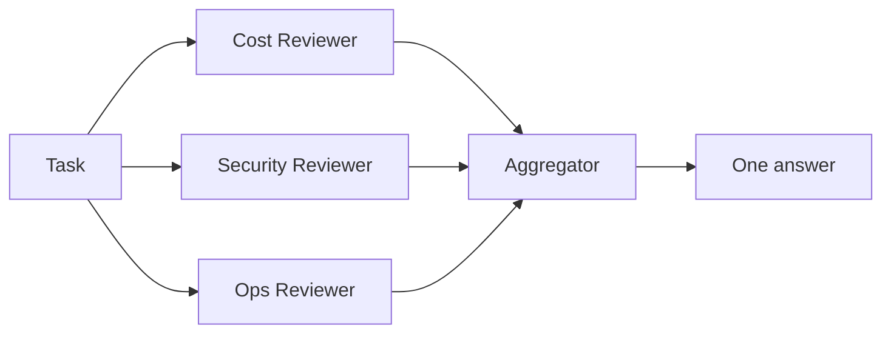

Your agents run in parallel as specialists on the same task, then an internal aggregator agent reads all of their outputs and writes one consolidated answer. The `output` list typically holds one turn per specialist plus the final synthesis turn, while `number_of_agents` counts only the specialists you supplied, because the API creates the aggregator itself. The pattern is related to the layered approach in the [Mixture-of-Agents paper](https://arxiv.org/abs/2406.04692) (Wang et al., 2024), where each layer of agents reads the previous layer's answers; the API version runs one layer of specialists and one aggregator.

**Use it when:** you want the independent perspectives of ConcurrentWorkflow and a single merged answer, for example cost, security and operations views combined into one recommendation.

**Skip it when:** you want to see and weigh the separate views yourself (ConcurrentWorkflow returns them unmerged), or the specialists need to react to each other (GroupChat).

**Parameters:** none beyond the common fields. Set `agents` to the three reviewers from the ConcurrentWorkflow entry. [Docs](https://docs.swarms.ai/docs/documentation/multi-agent/mixture_of_agents)

```json
{
  "swarm_type": "MixtureOfAgents"
}
```

### GroupChat

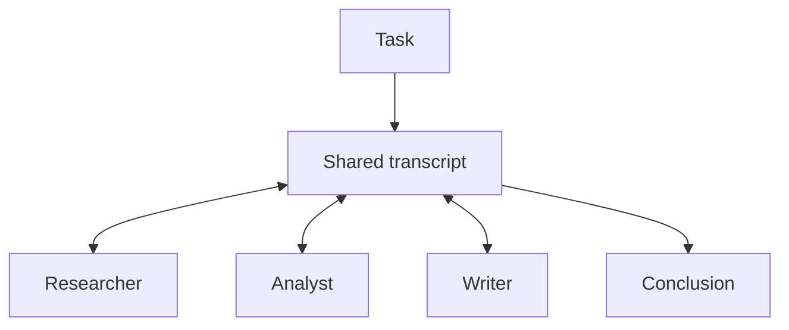

Agents hold a multi-turn conversation in one shared transcript. Each agent speaks in turn, sees everything said before it, and is expected to build on, challenge or refine earlier contributions, so later turns in `output` refer back to earlier ones. That is the main difference from ConcurrentWorkflow, where agents never see each other. GroupChat also accepts a `messages` field for passing in an existing conversation history. The docs recommend 3 to 6 agents and system prompts that tell each participant to react to the others.

**Use it when:** the problem benefits from back-and-forth: brainstorming, cross-functional planning, or a design review where one participant's constraint changes another's proposal.

**Skip it when:** you need independent judgments (agents in a shared chat influence each other), a strict turn order (RoundRobin), or a short answer at low cost. The transcript grows with every turn, and every agent reads all of it.

**Parameters:** none beyond the common fields. [Docs](https://docs.swarms.ai/docs/documentation/multi-agent/group_chat)

```json
{
  "swarm_type": "GroupChat",
  "max_loops": 1
}
```

### HierarchicalSwarm

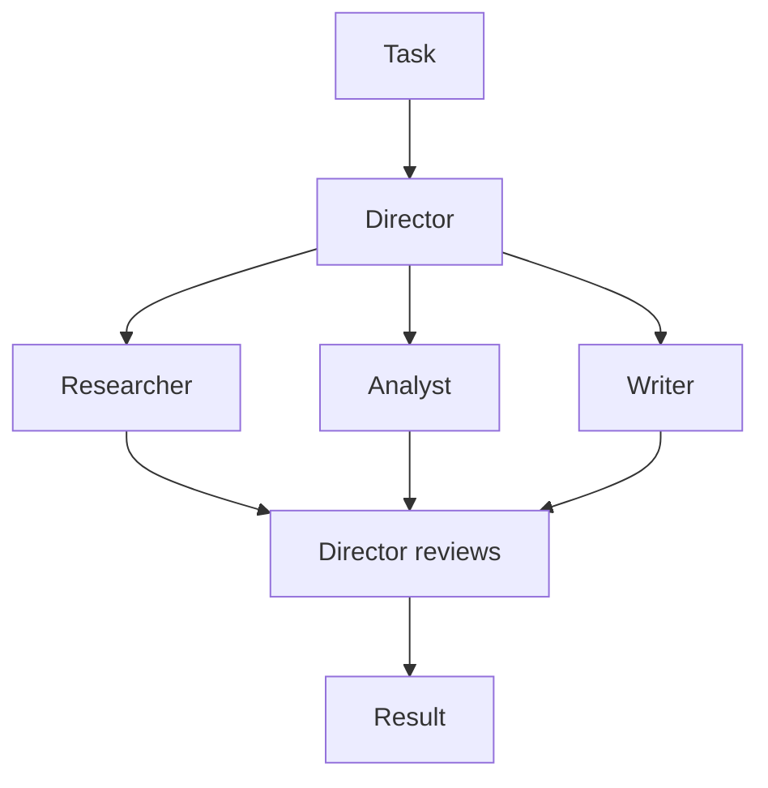

HierarchicalSwarm adds a director agent that the API creates for you. The director decomposes the task, delegates sub-tasks to your agents and integrates what comes back. Every agent in `agents` runs as a worker, even one you name "coordinator"; the director is configured separately through `director_model_name` and `director_settings`. Because the director's plan decides what each worker does, the docs recommend a capable director model and a low director temperature for consistent decomposition. For the general trade-offs of this pattern, see [manager-worker agent architectures](/blog/manager-worker-agent-architectures).

**Use it when:** the task is large enough that splitting it is itself a judgment call, and you want one agent responsible for the plan and for checking the result.

**Skip it when:** you already know the split. A SequentialWorkflow or ConcurrentWorkflow does the same work without the director's extra calls, and the director's plan is one more place for a run to go wrong.

**Parameters:** `director_model_name` (default `gpt-5.4`) and `director_settings`, an object with values such as `temperature`, `top_p` and `max_tokens`. The common field `list_all_agents` shows every agent's name and description to the others. [Docs](https://docs.swarms.ai/docs/documentation/multi-agent/hierarchical_swarm)

```json
{
  "swarm_type": "HierarchicalSwarm",
  "director_model_name": "gpt-5.4",
  "director_settings": {"temperature": 0.2, "max_tokens": 8000},
  "list_all_agents": true
}
```

### HeavySwarm

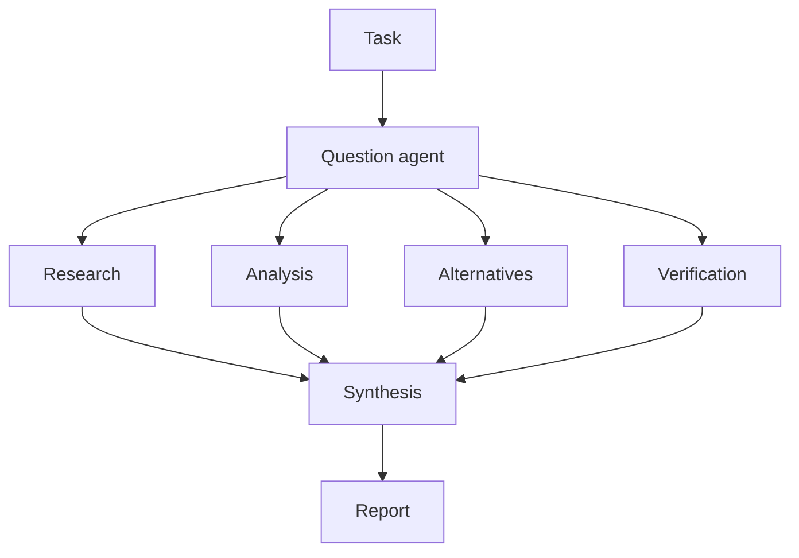

HeavySwarm builds its own team, so you send `"agents": []`. A question agent uses function calling to turn the task into four specialized questions. In the default variant, Research, Analysis, Alternatives and Verification agents answer them in parallel, and a Synthesis agent writes the final report. `heavy_swarm_variant` swaps the whole roster: `"default"` runs those 5 workers, `"medium"` runs 4 (a captain plus three specialists), and `"heavy"` runs 16 (a captain coordinating 15 domain specialists). Setting `heavy_swarm_max_loops` above 1 repeats the cycle with the previous loop's results as context. Since the request's `agents` array is empty, `number_of_agents` and the flat per-agent fee are both 0, but you still pay for every token the internal agents use.

**Use it when:** answer quality matters more than latency or cost: due diligence, deep market or technical research, and questions where verification and alternatives should be covered by default.

**Skip it when:** the question is simple, you need control over each agent's prompt, or the budget is tight. Even the default variant makes at least six model calls per loop.

**Parameters:** `heavy_swarm_variant`, `heavy_swarm_max_loops`, `heavy_swarm_question_agent_model_name` (default `gpt-5.4`) and `heavy_swarm_worker_model_name`, which applies to every worker. [Docs](https://docs.swarms.ai/docs/documentation/multi-agent/heavy_swarm)

```json
{
  "swarm_type": "HeavySwarm",
  "agents": [],
  "heavy_swarm_variant": "default",
  "heavy_swarm_max_loops": 1,
  "heavy_swarm_question_agent_model_name": "gpt-5.4",
  "heavy_swarm_worker_model_name": "claude-sonnet-5"
}
```

### PlannerWorkerSwarm

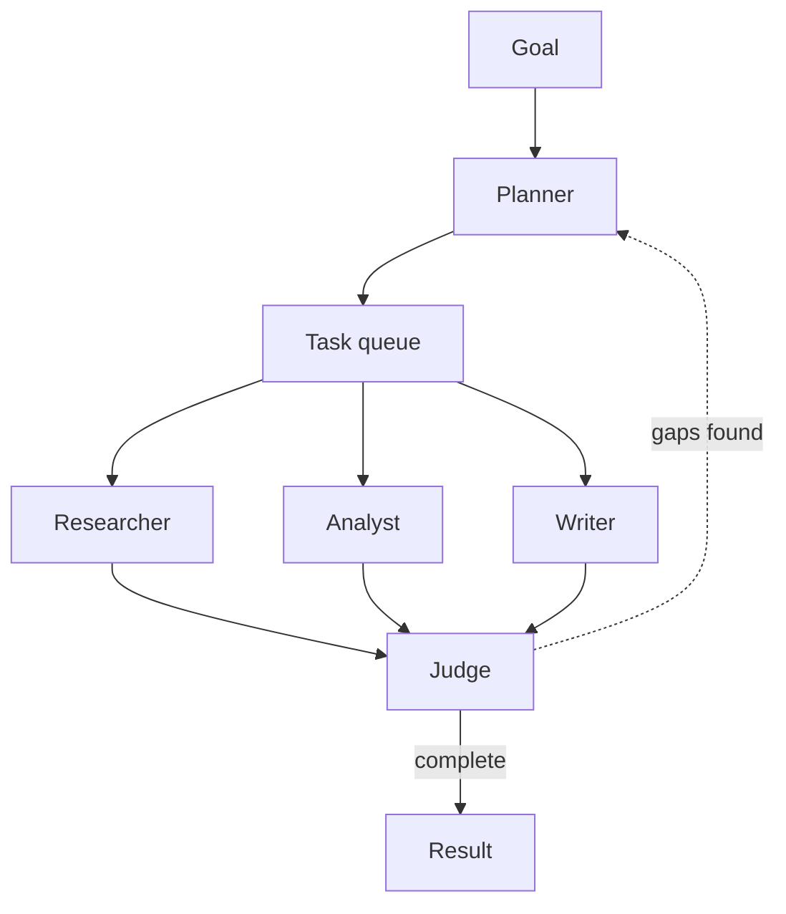

PlannerWorkerSwarm separates planning from doing. Each cycle has three phases: a planner agent writes sub-tasks into a shared queue (with optional dependencies between them), your agents claim tasks from the queue and run them concurrently, and a judge agent checks the results against the goal. The judge returns one of three verdicts: complete, needs more work (with the specific gaps), or start fresh because the work has drifted. `max_loops` caps the number of cycles, and the swarm stops early once the judge marks the goal complete. The planner and judge are internal and have no tuning fields; your `agents` are the worker pool.

**Use it when:** the goal is open-ended and multi-step, you cannot list the steps in advance, and you want an automatic check that the work is actually finished.

**Skip it when:** the steps are fixed and known. For that case the docs point to SequentialWorkflow as simpler and cheaper.

**Parameters:** none beyond the common fields. Set `max_loops` to 2 or 3 so the swarm can act on a "needs more work" verdict, and give workers narrow, execution-focused prompts. [Docs](https://docs.swarms.ai/docs/documentation/multi-agent/planner_worker_swarm)

```json
{
  "swarm_type": "PlannerWorkerSwarm",
  "task": "Write a migration plan from Jenkins to GitHub Actions covering pipelines, secrets, self-hosted runners, and rollback.",
  "max_loops": 3
}
```

## Judgment Architectures: Votes, Councils, Debates and Judges

These four produce a decision or an evaluation instead of new work. The reasoning behind each pattern (why independent votes help, what a debate surfaces, how councils reduce single-model bias) is covered in depth in [multi-agent collaboration patterns](/blog/multi-agent-collaboration-patterns).

### MajorityVoting

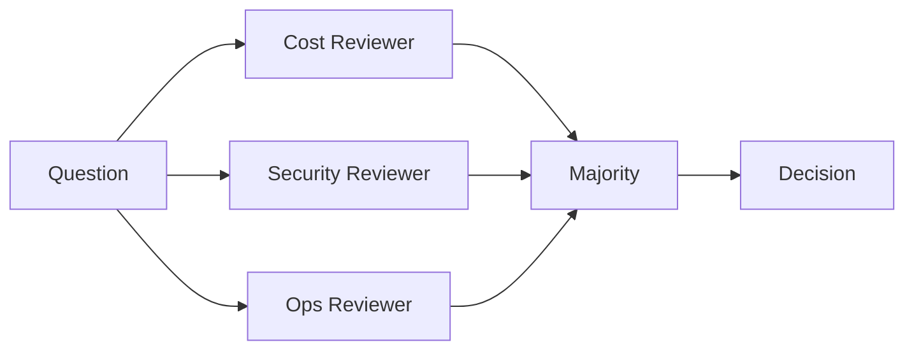

Each agent answers the same question independently, without seeing the others, and the majority answer is selected. Independence is what makes this work: a mistake one agent makes is outvoted when the others do not repeat it. It fits questions with a discrete answer (yes or no, a label, a choice from a list), and each system prompt needs clear voting instructions so the votes can be counted.

**Use it when:** you have a classification, approval or yes/no decision and want to reduce the variance of a single agent.

**Skip it when:** the answer is open-ended text with no discrete choice to count, or every voter shares the same model and prompt and is likely to make the same mistake.

**Parameters:** none beyond the common fields. Use an odd number of voters to avoid ties; here, set `agents` to the three reviewers. [Docs](https://docs.swarms.ai/docs/documentation/multi-agent/majority_voting)

```json
{
  "swarm_type": "MajorityVoting",
  "task": "Vote YES or NO, then give one sentence of reasoning: should our team move CI from Jenkins to GitHub Actions this quarter?"
}
```

### CouncilAsAJudge

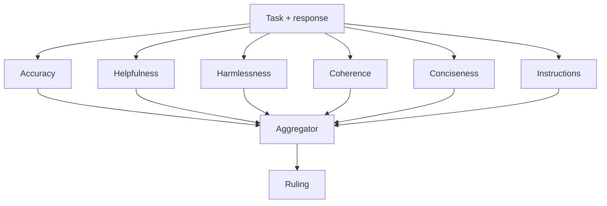

CouncilAsAJudge grades a response instead of producing one. It creates six judge agents, one per fixed dimension (accuracy, helpfulness, harmlessness, coherence, conciseness and instruction adherence), which score and critique the response in parallel. An aggregator then combines their rationales into one ruling. The judges are built internally, so the agents you send are never run; the request still needs one entry in `agents`, and a single cheap placeholder is enough (it is billed at the per-agent fee). The `task` must contain both the original prompt and the response you want graded.

**Use it when:** you need a structured quality gate: grading generated content before it ships, comparing model or prompt variants, or regression-testing prompts. A common setup is to generate with one swarm call, then grade the result with a second call to this one.

**Skip it when:** you want new content, or your rubric differs from the six fixed dimensions. In that case write your own judge agents and use MajorityVoting, or end a SequentialWorkflow with a reviewer agent.

**Parameters:** `council_judge_model_name` (default `gpt-5.4`), the model for the judge that delivers the final ruling. [Docs](https://docs.swarms.ai/docs/documentation/multi-agent/council_as_a_judge)

```json
{
  "swarm_type": "CouncilAsAJudge",
  "council_judge_model_name": "gpt-5.4",
  "task": "Task: Assess whether our team should move CI from Jenkins to GitHub Actions this quarter.\n\nResponse: <paste the Writer's brief here>",
  "agents": [
    {"agent_name": "placeholder", "description": "Required by the API, not executed", "model_name": "gpt-5.4-mini", "max_loops": 1}
  ]
}
```

### LLMCouncil

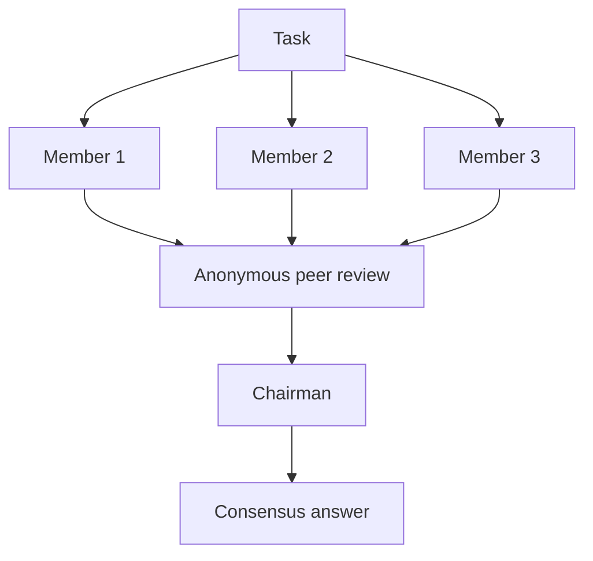

Your agents become council members. Each one answers the task independently. The answers are then relabeled A, B, C so authorship is hidden, and every member ranks and critiques all of them. Finally a chairman agent reads the original answers and every review and writes one consensus answer. The review round surfaces disagreement that a single synthesis step would hide. The same three stages appear in [llm-council](https://github.com/karpathy/llm-council), Andrej Karpathy's open-source project. The docs estimate about two calls per member (one to answer, one to evaluate) plus one chairman call, and every review reads all of the answers, so cost and latency grow faster than in a single-pass swarm.

**Use it when:** the question is a judgment call with real trade-offs, a wrong answer is expensive, and you want to compare how different models reason about it.

**Skip it when:** the question has one correct answer (MajorityVoting is cheaper), or the members are near-identical. A council of one model with one prompt produces near-identical answers, and the review round adds little.

**Parameters:** `chairman_model` (default `gpt-5.1`). Give each member a different model or perspective. [Docs](https://docs.swarms.ai/docs/documentation/multi-agent/llm_council)

```json
{
  "swarm_type": "LLMCouncil",
  "chairman_model": "gpt-5.4",
  "agents": [
    {"agent_name": "Cost Lens", "system_prompt": "Judge the migration on total cost over two years.", "model_name": "gpt-5.4"},
    {"agent_name": "Risk Lens", "system_prompt": "Judge the migration on security and delivery risk.", "model_name": "claude-sonnet-5"},
    {"agent_name": "Team Lens", "system_prompt": "Judge the migration on developer time and team disruption.", "model_name": "gpt-5.4-mini"}
  ]
}
```

### DebateWithJudge

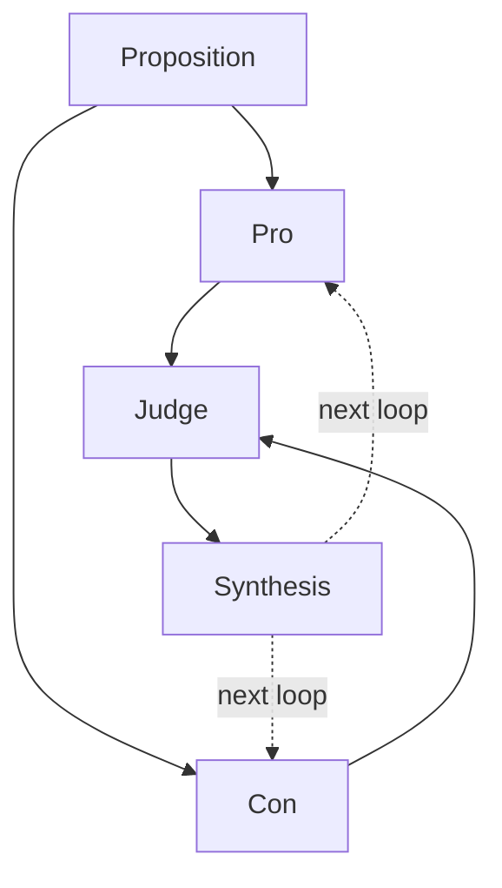

DebateWithJudge takes exactly three agents in a fixed order: the first argues for the proposition, the second argues against it, and the third judges. The judge weighs both sides, gives feedback and synthesizes the strongest points into a refined answer. With `max_loops` above 1, each new round starts from the judge's synthesis, so the arguments sharpen with every loop.

**Use it when:** the decision is binary or comparative and you want both cases argued in full before a verdict: build or buy, migrate or stay, approve or reject.

**Skip it when:** there are more than two serious options (an LLMCouncil fits better), or one side is clearly right and a debate only pads the answer.

**Parameters:** none beyond the common fields. Agent order matters: Pro, then Con, then Judge. The docs suggest a lower temperature (0.3 to 0.4) for the judge. [Docs](https://docs.swarms.ai/docs/documentation/multi-agent/debate_with_judge)

```json
{
  "swarm_type": "DebateWithJudge",
  "max_loops": 2,
  "task": "Proposition: our team should move CI from Jenkins to GitHub Actions this quarter.",
  "agents": [
    {"agent_name": "Pro", "system_prompt": "Argue for the proposition with evidence. In later rounds, answer the judge's feedback.", "model_name": "gpt-5.4-mini"},
    {"agent_name": "Con", "system_prompt": "Argue against the proposition with evidence. In later rounds, answer the judge's feedback.", "model_name": "gpt-5.4-mini"},
    {"agent_name": "Judge", "system_prompt": "Weigh both sides, name the strongest points from each, and give a verdict.", "model_name": "gpt-5.4", "temperature": 0.3}
  ]
}
```

## Beyond swarm_type: Graphs, Generated Teams and Batches

Three more endpoints organize agents, each with its own request body. GraphWorkflow and the batch endpoints are premium, available on the Pro and Ultra plans ([Premium Endpoints](https://docs.swarms.ai/docs/documentation/resources/premium-endpoints)). The Auto Agent Builder is available on every tier.

### GraphWorkflow

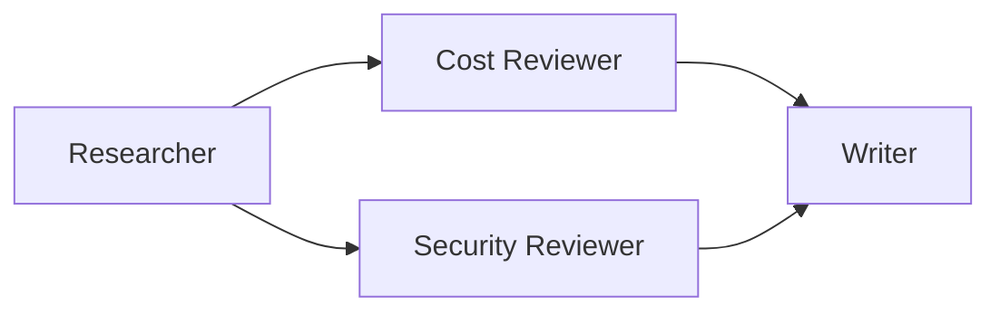

GraphWorkflow (`POST /v1/graph-workflow/completions`) runs agents as nodes in a directed graph you define. Each edge has a `source` and a `target` that match `agent_name` values, `entry_points` and `end_points` name where execution starts and finishes, and branches run in parallel and rejoin wherever two edges meet the same node. The response differs from swarm completions: `outputs` is a dictionary keyed by agent name, so you can read any node's result directly. `auto_compile` (on by default) compiles the graph before it runs. For how this engine compares with LangGraph, see [Swarms GraphWorkflow vs LangGraph](/blog/swarms-graphworkflow-vs-langgraph) and the [GraphWorkflow research paper](/blog/graphworkflow-research-paper).

**Use it when:** the flow forks and rejoins at several points, or you want every node's output by name.

**Skip it when:** the shape is a plain line, a plain fan-out or a single fork, which SequentialWorkflow, ConcurrentWorkflow and AgentRearrange cover on the standard endpoint without a premium plan.

**Fields:** `agents`, `edges`, `entry_points`, `end_points`, `task`, `max_loops` and `auto_compile`. [Docs](https://docs.swarms.ai/docs/documentation/multi-agent/graph_workflow)

```python
import asyncio
import os

import aiohttp
from dotenv import load_dotenv

load_dotenv()

API_KEY = os.environ["SWARMS_API_KEY"]
BASE_URL = "https://api.swarms.world"
HEADERS = {"x-api-key": API_KEY, "Content-Type": "application/json"}


def agent(name, prompt, model="gpt-5.4-mini"):
    return {"agent_name": name, "system_prompt": prompt, "model_name": model, "max_loops": 1}


async def main() -> None:
    workflow = {
        "name": "CI Migration Graph",
        "description": "Research, two parallel reviews, then a brief",
        "task": "Assess whether our 40-person engineering team should move CI from Jenkins to GitHub Actions this quarter.",
        "agents": [
            agent("Researcher", "List the relevant facts, constraints, and open questions."),
            agent("Cost Reviewer", "Estimate the cost impact using the research you are given."),
            agent("Security Reviewer", "List the security risks using the research you are given."),
            agent("Writer", "Write a one-page brief with a recommendation from the reviews.", "claude-sonnet-5"),
        ],
        "edges": [
            {"source": "Researcher", "target": "Cost Reviewer"},
            {"source": "Researcher", "target": "Security Reviewer"},
            {"source": "Cost Reviewer", "target": "Writer"},
            {"source": "Security Reviewer", "target": "Writer"},
        ],
        "entry_points": ["Researcher"],
        "end_points": ["Writer"],
        "max_loops": 1,
        "auto_compile": True,
    }

    # Multi-agent runs can take minutes, so give the whole request room.
    timeout = aiohttp.ClientTimeout(total=600)
    async with aiohttp.ClientSession(headers=HEADERS, timeout=timeout) as session:
        async with session.post(f"{BASE_URL}/v1/graph-workflow/completions", json=workflow) as resp:
            resp.raise_for_status()
            result = await resp.json()

    print(result["outputs"]["Writer"])
    print("cost:", result["usage"]["total_cost"])


asyncio.run(main())
```

### Auto Agent Builder

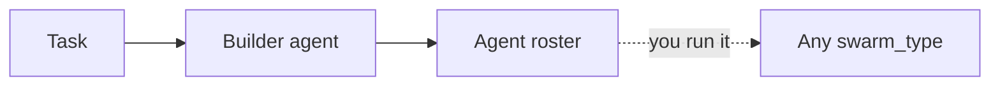

The Auto Agent Builder (`POST /v1/auto-agent-builder/completions`) designs a team from a task description and returns it as JSON: each agent's name, description, system prompt and model. It never runs the agents. A single builder agent does the design and prefers the smallest team that covers the task (`max_agents`, default 5, is a ceiling; `num_agents` sets an exact size), and the roster goes straight into the `agents` field of any swarm completion. Only the builder call is billed. [Introducing the Auto Agent Builder](/blog/introducing-auto-agent-builder) has more background.

**Use it when:** you know the task but not the team, or you want a first draft of system prompts to edit.

**Skip it when:** you already have tuned agents. Before running a generated roster in production, read its prompts and model choices; it is plain JSON, so that takes a minute.

**Fields:** `task` (required), `max_agents` or `num_agents`, `model_name` and `system_prompt` for the builder itself, and `agent_kwargs` for settings such as `max_loops` that apply to every generated agent. [Docs](https://docs.swarms.ai/docs/documentation/multi-agent/auto_agent_builder)

```python
import asyncio
import os

import aiohttp
from dotenv import load_dotenv

load_dotenv()

API_KEY = os.environ["SWARMS_API_KEY"]
BASE_URL = "https://api.swarms.world"
HEADERS = {"x-api-key": API_KEY, "Content-Type": "application/json"}

task = "Assess whether our 40-person engineering team should move CI from Jenkins to GitHub Actions this quarter."


async def main() -> None:
    # One session for both calls; the swarm run can take minutes.
    timeout = aiohttp.ClientTimeout(total=600)
    async with aiohttp.ClientSession(headers=HEADERS, timeout=timeout) as session:
        # 1. Design the team (no agents run in this call)
        async with session.post(
            f"{BASE_URL}/v1/auto-agent-builder/completions",
            json={"task": task, "max_agents": 4, "agent_kwargs": {"max_loops": 1}},
        ) as resp:
            resp.raise_for_status()
            roster = (await resp.json())["agents"]
        for a in roster:
            print(a["agent_name"], "|", a["model_name"])

        # 2. Run the generated team with any swarm_type
        async with session.post(
            f"{BASE_URL}/v1/swarm/completions",
            json={
                "name": "auto-built-ci-review",
                "swarm_type": "SequentialWorkflow",
                "task": task,
                "agents": roster,
            },
        ) as resp:
            resp.raise_for_status()
            result = await resp.json()

    for turn in result["output"]:
        print(f"\n--- {turn['role']}")
        print(turn["content"])


asyncio.run(main())
```

### Batch Endpoints

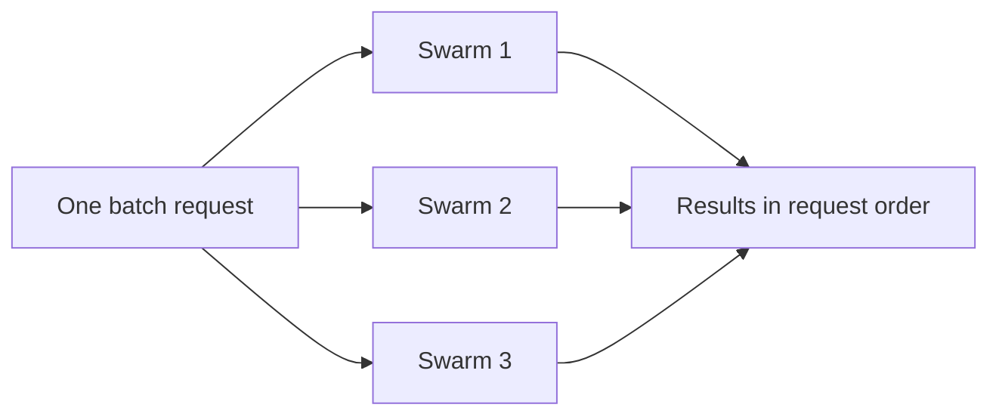

The batch endpoints run many independent jobs in one request. [`POST /v1/swarm/batch/completions`](https://docs.swarms.ai/docs/examples/examples/batch-swarm-completions) takes an array of up to 50 full swarm specs, each with its own `swarm_type`, and returns one result per item in request order. Each entry has `status`, `swarm_name`, `result` and `usage`; the swarm's output sits under `result` (the single endpoint calls it `output`). A failed item reports `"status": "error"` with a `detail` message in its own slot, and the rest of the batch still completes. For single agents, [`POST /v1/agent/batch/completions`](https://docs.swarms.ai/docs/examples/examples/batch-processing) does the same with up to 50 `{"agent_config", "task"}` items. [`POST /v1/batched-grid-workflow/completions`](https://docs.swarms.ai/docs/documentation/multi-agent/batched_grid_workflow) pairs `agent_completions[i]` with `tasks[i]`, runs every pair concurrently, and can rerun the pairs for several loops with each agent keeping its own memory.

**Use it when:** you run the same swarm over many inputs (one review per repository, one report per account), or you want to compare two architectures side by side on the same tasks.

**Skip it when:** you have a single task, or you need each result as soon as it finishes; a batch returns everything in one response.

**Fields:** an array of the same payloads you would send to `/v1/swarm/completions`. This coroutine uses `BASE_URL` from the base request and takes its session and `payload`; call it with `await run_batch(session, payload)` inside the `async with aiohttp.ClientSession(...)` block in `main()`:

```python
async def run_batch(session: aiohttp.ClientSession, payload: dict) -> None:
    services = ["billing-api", "web-frontend", "data-pipeline"]
    batch = [
        {
            **payload,
            "name": f"CI review {s}",
            "task": f"Assess whether the {s} repository should move its CI from Jenkins to GitHub Actions.",
        }
        for s in services
    ]

    # A batch of swarms can run longer than one swarm, so this call gets more time.
    async with session.post(
        f"{BASE_URL}/v1/swarm/batch/completions",
        json=batch,
        timeout=aiohttp.ClientTimeout(total=900),
    ) as resp:
        resp.raise_for_status()
        results = await resp.json()

    for item in results:
        if item["status"] == "success":
            print(item["swarm_name"], item["usage"]["billing_info"]["total_cost"])
        else:
            print(item["swarm_name"], "failed:", item["detail"])
```

## Swarm Architecture Decision Table

Relative cost below means the number of model calls per run and how much context each call reads, derived from the documented behavior of each type. Real cost depends on your models, prompts and output length, so check `usage` on a few runs before you commit; [tracking LLM token usage in Python](/blog/track-llm-token-usage-cost-python) shows one way to do that.

| Architecture | Shape | Best for | Relative cost |
| --- | --- | --- | --- |
| SequentialWorkflow | Line | Steps that build on the previous step | Low: one call per agent |
| ConcurrentWorkflow | Fan-out | Independent reviews at low latency | Low: one call per agent, in parallel |
| RoundRobin | Fixed rotation | Refinement in a set speaking order | Low to medium: agents times loops, growing context |
| AgentRearrange | Custom line and fan-out | Mixed sequential and parallel stages | Low: one call per agent in the flow |
| MultiAgentRouter | Dispatcher | Mixed request types with specialists | Low: router plus the selected agents only |
| MixtureOfAgents | Fan-out plus aggregator | Several expert views merged into one answer | Medium: one call per agent plus the aggregator |
| GroupChat | Shared conversation | Brainstorming and cross-functional planning | Medium: every turn reads the whole transcript |
| HierarchicalSwarm | Director and workers | Large tasks where the split needs judgment | Medium: director calls plus workers |
| HeavySwarm | Questions, parallel workers, synthesis | Deep research and due diligence | High: at least 6 calls per loop, 16 workers in the heavy variant |
| PlannerWorkerSwarm | Planner, queue, workers, judge | Open-ended multi-step goals | Medium to high: planner, sub-tasks and judge per cycle |
| MajorityVoting | Independent votes | Discrete decisions and classification | Low to medium: one answer per voter |
| CouncilAsAJudge | Six judges plus aggregator | Grading a response before it ships | Medium: seven internal agents per run |
| LLMCouncil | Answers, peer review, chairman | High-stakes judgment calls | High: about two calls per member plus the chairman |
| DebateWithJudge | Pro, Con, Judge | Binary or comparative decisions | Low to medium: three calls per loop |
| GraphWorkflow (premium) | Directed graph | Flows that fork and rejoin | Low: one call per node |
| Auto Agent Builder | Team designer | Drafting a roster for any of the above | Very low: one builder call |
| Batch endpoints (premium) | Many jobs, one request | The same swarm over many inputs | Sum of the jobs in the batch |

## How Do You Choose a Swarm Architecture?

Start from the question you need answered, then walk the tree:

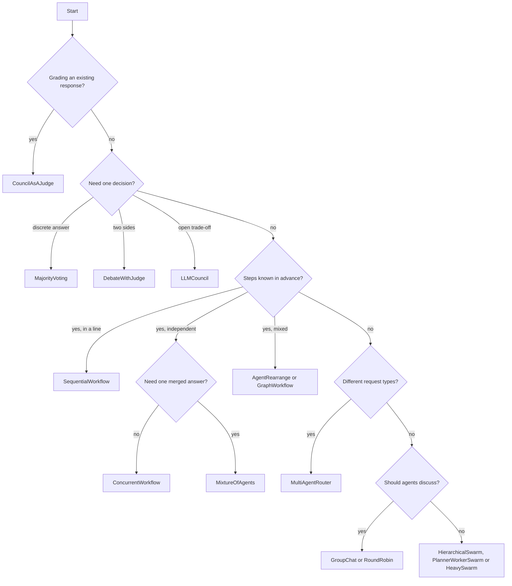

A few rules of thumb sit behind the tree:

1. **Start with the simplest shape that fits.** Most tasks are a line or a fan-out. [Sequential, concurrent and graph workflows](/blog/agent-orchestration-patterns) argues that most pipelines reduce to one of these three shapes.
2. **Add a merge, a judge or a manager only when you can name what it adds.** Each one is more calls, more context and one more agent whose mistakes can spread. [Multi-agent system failure modes](/blog/multi-agent-system-failure-modes) shows how quietly that can happen.
3. **Pick among the last three by how much you know about the work.** Use HierarchicalSwarm when a director can split the task in one pass, PlannerWorkerSwarm when you want a judge to check completion and re-plan, and HeavySwarm when you would rather not design the team at all.
4. **Measure two candidates.** Because the architecture is one field, run two swarm types on the same handful of real tasks (the batch endpoint can send them together) and compare output quality against `usage.billing_info.total_cost`.

For a step-by-step build of a first swarm, see [how to build an agent swarm in Python](/blog/build-agent-swarm-python). The [Swarms API examples suite](/blog/swarms-api-examples-suite) has runnable examples for each orchestration pattern. If your open question is which framework to use, read [the 2026 multi-agent framework comparison](/blog/multi-agent-framework-comparison-2026) and [AutoGen alternatives](/blog/autogen-alternatives).

## Frequently Asked Questions

### What is the difference between a swarm architecture and a multi-agent framework?

A swarm architecture is a coordination pattern: who runs when, what each agent sees, and how outputs merge into a result. A framework is the software that implements those patterns, along with agents, tools and memory. The Swarms API exposes its architectures as values of one field, `swarm_type`, so you can switch patterns without changing your agents.

### How many swarm types does the Swarms API support?

There are 14 `swarm_type` values, grouped by the API into workflow, routing, collaboration and judgment categories. GraphWorkflow and BatchedGridWorkflow are separate premium endpoints, and `"auto"` and `"SpreadSheetSwarm"` are rejected with a `400`. Call `GET /v1/swarms/available` for the live list with descriptions and categories.

### Which swarm architecture is the cheapest?

MultiAgentRouter can use the fewest tokens per request, because agents the router does not select never run (they still count toward the flat per-agent fee). SequentialWorkflow, ConcurrentWorkflow and AgentRearrange make one call per agent. HeavySwarm and LLMCouncil are the most expensive, since they add internal agents and review rounds. Every agent in the `agents` array also adds a flat $0.01 fee, and token costs are halved between 8 PM and 6 AM Pacific time.

### What is the difference between RoundRobin and GroupChat?

Both put agents in one shared conversation where each agent reads what came before. RoundRobin guarantees the order: agents speak in the order you list them, each gets exactly `max_loops` turns, and the order repeats every loop. GroupChat is the discussion-oriented type and also accepts a `messages` history; choose RoundRobin when the speaking order itself matters.

### Do I always need to define the agents myself?

No. HeavySwarm builds its own team and expects `"agents": []`. CouncilAsAJudge creates its six judges and aggregator internally and only needs one placeholder agent, while HierarchicalSwarm, PlannerWorkerSwarm and MixtureOfAgents add a director, a planner and judge, or an aggregator around the agents you supply. If you want the API to design your agents, the Auto Agent Builder returns a roster you can send to any swarm type.

### Can I combine swarm architectures?

Yes, by chaining calls. A common pattern is to generate with one architecture, such as SequentialWorkflow, and then grade the result with CouncilAsAJudge before it ships. For a custom shape inside one run, use AgentRearrange or GraphWorkflow, and use the batch endpoints to run many swarms of different types in a single request.
