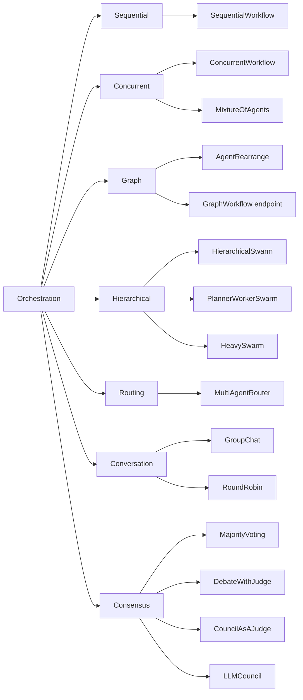

# What Is Multi-Agent Orchestration? Patterns, State, and Failure Handling

Multi-agent orchestration is the control layer around a group of LLM agents. It makes four decisions: which agent runs when, what each agent gets to see, how their outputs are combined, and when the run stops. The agents research, write and review. The orchestrator sets the order, moves context between them, merges what they return and ends the run. Every multi-agent system has one, even when it is a for-loop nobody named.

This page is the overview. It defines the term, maps each common orchestration pattern to a concrete `swarm_type` in the [Swarms API](https://docs.swarms.ai/docs/documentation/multi-agent/overview), and covers the three things that decide whether an orchestrated system holds up in production: how state moves between agents, how failures are caught, and how you see what a run did and cost. Each section links to a deeper post where one exists. If you are still deciding whether you need more than one agent, read [single agent vs multi-agent](/blog/single-agent-vs-multi-agent) first. For the parts a multi-agent system is made of, see [what is a multi-agent system](/blog/what-is-a-multi-agent-system).

## What is multi-agent orchestration?

You can describe the orchestration of any multi-agent workflow by answering four questions.

1. **Control flow: who runs when?** A fixed order, everyone at once, or a choice made at runtime by a router or a director agent.
2. **State: what does each agent see?** The original task, the previous agent's output, a sub-task written by a manager, or the whole shared conversation.
3. **Combination: how do outputs merge?** Keep the last agent's answer, return every answer side by side, take a vote, or hand all of them to an aggregator or a judge.
4. **Termination: when does it stop?** After a fixed number of passes, when a judge says the goal is met, or when an agent decides it is done.

The thing that answers those questions can be plain code or a model. In a `SequentialWorkflow` or `ConcurrentWorkflow`, you fix the order before the run starts, so the orchestration adds no model calls and behaves the same way every time. In a `HierarchicalSwarm` or `MultiAgentRouter`, an LLM makes the control-flow decision at runtime. That buys flexibility when the shape of the work depends on the input. It also costs extra calls and adds a component that can fail: a director with a bad plan sends every worker in the wrong direction.

"Agent orchestration" and "AI agent orchestration" usually mean the same thing as multi-agent orchestration. The words sometimes also describe a single agent choosing among its tools, which is a different problem, covered next.

## How is orchestration different from a single agent with tools?

A single agent with tools is one model, one system prompt and one context window running in a loop: it reads the task, calls a tool, reads the result and decides what to do next. [What is an AI agent](/blog/what-is-an-agent) covers that loop. The model is its own orchestrator, tools return data, and the model makes every judgment call.

Orchestrating LLM agents changes three things:

- **Separate contexts.** Each agent has its own system prompt and its own context window. A security reviewer never sees the marketing writer's instructions. That separation is useful, and it also means context has to be passed on purpose.
- **Separate models.** Each agent can run a different model, so cheap steps run on small models and the hard step gets the strong one.
- **Model output as input.** What flows between steps is another model's prose, which is far less predictable than a typed tool result. This is why validation and judge steps matter more in a multi-agent workflow than inside a single agent.

| | Single agent with tools | Orchestrated agents |
| --- | --- | --- |
| Who decides the next step | The model, inside its loop | Your code, or a director or router model |
| Context | One window | One window per agent, passed explicitly |
| Models | One | One per agent if you want |
| Typical failure | Loops too long or picks the wrong tool | Bad handoff, lost context, an empty step the next agent builds on |
| Swarms API endpoint | `POST /v1/agent/completions` | `POST /v1/swarm/completions` |

A single agent is cheaper, faster and easier to debug. Reach for orchestration when the work has distinct roles, independent parts that can run in parallel, or a need for review by an agent that did not write the draft.

## Multi-agent orchestration patterns: the full map

Most orchestration designs are built from seven patterns. The Swarms API exposes them as `swarm_type` values on [`POST /v1/swarm/completions`](https://docs.swarms.ai/docs/documentation/multi-agent/swarm_completions), which currently accepts 14 types, and graph workflows with explicit edges have their own endpoint.



| Pattern | Who decides what runs next | `swarm_type` | Go deeper |
| --- | --- | --- | --- |
| Sequential | Your agent order | `SequentialWorkflow` | [The three shapes of agent orchestration](/blog/agent-orchestration-patterns) |
| Concurrent | Nobody: every agent starts at once | `ConcurrentWorkflow`, `MixtureOfAgents` | [The three shapes of agent orchestration](/blog/agent-orchestration-patterns) |
| Graph | Your flow string or edge list | `AgentRearrange`, GraphWorkflow endpoint | [GraphWorkflow vs LangGraph](/blog/swarms-graphworkflow-vs-langgraph) |
| Hierarchical | A director or planner model | `HierarchicalSwarm`, `PlannerWorkerSwarm`, `HeavySwarm` | [Manager-worker architectures](/blog/manager-worker-agent-architectures) |
| Routing | A router model | `MultiAgentRouter` | [Swarm architectures explained](/blog/swarm-architectures-explained) |
| Conversation | Turn order over a shared transcript | `GroupChat`, `RoundRobin` | [Swarm architectures explained](/blog/swarm-architectures-explained) |
| Consensus and judgment | A vote, a judge or a chairman | `MajorityVoting`, `DebateWithJudge`, `CouncilAsAJudge`, `LLMCouncil` | [Multi-agent collaboration patterns](/blog/multi-agent-collaboration-patterns) |

**Sequential.** Agents run in a fixed order and each one receives the previous agent's output ([docs](https://docs.swarms.ai/docs/documentation/multi-agent/sequential_workflow)). Latency is the sum of every step, and debugging is simple because the output reads as an execution trace. Use it when each step needs the one before it.

**Concurrent.** Every agent gets the same task at the same time and none waits for another, so latency drops to roughly the slowest agent. [`ConcurrentWorkflow`](https://docs.swarms.ai/docs/documentation/multi-agent/concurrent_workflow) returns each agent's output side by side. [`MixtureOfAgents`](https://docs.swarms.ai/docs/documentation/multi-agent/mixture_of_agents) adds an aggregator that synthesizes the parallel answers into one.

**Graph.** Real pipelines often mix both: one step fans out to several parallel reviewers, and their results merge into a final step. [`AgentRearrange`](https://docs.swarms.ai/docs/documentation/multi-agent/agent_rearrange) expresses this in one string, `rearrange_flow`. For a directed graph with explicit edges, entry points and end points, the [GraphWorkflow endpoint](https://docs.swarms.ai/docs/documentation/multi-agent/graph_workflow) (`POST /v1/graph-workflow/completions`, on paid plans) takes nodes and edges directly. The [GraphWorkflow research paper post](/blog/graphworkflow-research-paper) covers the engine behind it.

**Hierarchical.** A director agent reads the task, writes sub-tasks for workers and reviews what comes back. In [`HierarchicalSwarm`](https://docs.swarms.ai/docs/documentation/multi-agent/hierarchical_swarm) the director is created for you; every agent you list is a worker, and you tune the director with `director_model_name` and `director_settings`. [`PlannerWorkerSwarm`](https://docs.swarms.ai/docs/documentation/multi-agent/planner_worker_swarm) splits the manager role in two: a planner fills a task queue, and a judge decides after each cycle whether the goal is met. [`HeavySwarm`](https://docs.swarms.ai/docs/documentation/multi-agent/heavy_swarm) builds its own team for question generation, research and analysis, and synthesis, and is the one type that runs with `"agents": []`.

**Routing.** A router model reads the task and hands it to the best-suited specialist ([docs](https://docs.swarms.ai/docs/documentation/multi-agent/multi_agent_router)). Agents the router does not pick never run, so they add no tokens, though each one listed still counts toward the per-agent fee covered in the cost section below.

**Conversation.** In [`GroupChat`](https://docs.swarms.ai/docs/documentation/multi-agent/group_chat), agents share one transcript and each speaker sees everything said so far, so they can build on or push back against each other. [`RoundRobin`](https://docs.swarms.ai/docs/documentation/multi-agent/round_robin) does the same with a deterministic schedule: agents speak in the order you list them, once per loop.

**Consensus and judgment.** These patterns spend extra calls to make one answer more reliable. [`MajorityVoting`](https://docs.swarms.ai/docs/documentation/multi-agent/majority_voting) collects independent answers and takes the majority. [`DebateWithJudge`](https://docs.swarms.ai/docs/documentation/multi-agent/debate_with_judge) has a Pro agent and a Con agent argue while a judge synthesizes, round after round. [`CouncilAsAJudge`](https://docs.swarms.ai/docs/documentation/multi-agent/council_as_a_judge) grades an existing response on six fixed dimensions. [`LLMCouncil`](https://docs.swarms.ai/docs/documentation/multi-agent/llm_council) has members answer, rank each other's anonymized answers, and leaves the final synthesis to a chairman. The [collaboration patterns post](/blog/multi-agent-collaboration-patterns) compares these in depth, and [swarm architectures explained](/blog/swarm-architectures-explained) walks through all 14 types one by one.

The patterns compose. A step in a graph can be a small sequential chain, and the output of any swarm can go through `CouncilAsAJudge` as a quality gate, which is what the failure-handling example further down does.

## State in multi-agent orchestration: what does each agent see?

State is the orchestration decision that causes the quietest damage. An agent given too little context guesses. An agent given too much pays for tokens it does not need and has to find the part that matters inside a long transcript. Each pattern makes a default choice for you:

| Pattern | `swarm_type` | What each agent sees |
| --- | --- | --- |
| Sequential | `SequentialWorkflow` | The previous agent's output |
| Concurrent | `ConcurrentWorkflow` | The original task, with no peer output |
| Fan-out plus aggregator | `MixtureOfAgents` | Specialists see the task; the aggregator sees every specialist's output |
| Custom flow | `AgentRearrange` | Agents in a parallel group share the same input; the next step receives the group's outputs |
| Director and workers | `HierarchicalSwarm` | Workers see the order the director wrote for them; the director sees all results |
| Planner, workers, judge | `PlannerWorkerSwarm` | Workers see one sub-task from the queue; the judge checks results against the goal |
| Routing | `MultiAgentRouter` | Only the selected agents see the task |
| Shared conversation | `GroupChat`, `RoundRobin` | The full transcript so far |
| Voting | `MajorityVoting` | The task, with no view of other votes |
| Council | `LLMCouncil` | The task, then anonymized peer answers to rank; the chairman sees answers and reviews |

### Sequential output passing

In a `SequentialWorkflow`, each agent runs after the previous one finishes and receives its output. The response's `output` is a list of `{"role", "content"}` turns, one per agent in pipeline order, so it doubles as a record of what each step handed to the next. All examples on this page use `aiohttp` and read the API key from the environment, as in the [quickstart](https://docs.swarms.ai/docs/documentation/getting-started/quickstart):

```bash
pip install aiohttp python-dotenv
export SWARMS_API_KEY="your-api-key"
```

A three-step release-notes pipeline, with a cheap model on the extraction step:

```python
import asyncio
import os

import aiohttp
from dotenv import load_dotenv

load_dotenv()

API_KEY = os.environ["SWARMS_API_KEY"]
BASE_URL = "https://api.swarms.world"
HEADERS = {"x-api-key": API_KEY, "Content-Type": "application/json"}

CHANGELOG = """
- Added CSV export to the reports page
- Fixed a bug where saved filters were lost after logout
- Deprecated the v1 webhooks endpoint; v2 replaces it
"""

swarm_config = {
    "name": "Release Notes Pipeline",
    "description": "Extract changes, write release notes, then edit them",
    "swarm_type": "SequentialWorkflow",
    "task": f"Write customer-facing release notes for this changelog:\n{CHANGELOG}",
    "max_loops": 1,
    "agents": [
        {
            "agent_name": "Change Extractor",
            "description": "Turns a raw changelog into a structured list",
            "system_prompt": (
                "List every change as: type (feature, fix, deprecation), "
                "what changed, and who is affected. Output only the list."
            ),
            "model_name": "gpt-5.4-mini",
            "max_loops": 1,
            "max_tokens": 2000,
            "temperature": 0.2,
        },
        {
            "agent_name": "Release Writer",
            "description": "Writes release notes from the structured list",
            "system_prompt": (
                "Write short release notes from the list you receive. Group them "
                "by type and explain each change in one or two plain sentences."
            ),
            "model_name": "claude-sonnet-5",
            "max_loops": 1,
            "max_tokens": 3000,
            "temperature": 0.5,
        },
        {
            "agent_name": "Editor",
            "description": "Tightens the notes for publication",
            "system_prompt": (
                "Edit the release notes you receive for clarity and length. "
                "Remove marketing language. Return only the final notes."
            ),
            "model_name": "gpt-5.4",
            "max_loops": 1,
            "max_tokens": 3000,
            "temperature": 0.3,
        },
    ],
}


async def main() -> None:
    # Multi-agent runs can take minutes, so give the whole request room.
    timeout = aiohttp.ClientTimeout(total=600)
    async with aiohttp.ClientSession(headers=HEADERS, timeout=timeout) as session:
        async with session.post(f"{BASE_URL}/v1/swarm/completions", json=swarm_config) as resp:
            resp.raise_for_status()
            result = await resp.json()

    # One turn per agent, in pipeline order: the list is an execution trace.
    for turn in result["output"]:
        print(f"--- {turn['role']}\n{turn['content']}\n")

    usage = result["usage"]
    cost = usage.get("billing_info", {}).get("total_cost")
    print(f"job {result['job_id']}: {result['execution_time']:.1f}s, "
          f"{usage['total_tokens']} tokens, ${cost}")


asyncio.run(main())
```

Because each agent works from what the previous one passed along, a late step that needs the original input only gets it if an earlier agent carries it forward. A checker that compares the notes against the raw changelog, for example, needs the writer to include the source items in its output. Write upstream prompts for the downstream reader.

### AgentRearrange's rearrange_flow syntax

`rearrange_flow` is a string over `agent_name` values. `->` hands off to the next step, and a comma runs agents in parallel within a step. So `"Scoper -> Security, Pricing, Integration -> Recommender"` runs one agent, then three at once, then one. The field is required for this type, and every name in it must match an agent in the `agents` array.

```python
import asyncio
import os

import aiohttp
from dotenv import load_dotenv

load_dotenv()

API_KEY = os.environ["SWARMS_API_KEY"]
BASE_URL = "https://api.swarms.world"
HEADERS = {"x-api-key": API_KEY, "Content-Type": "application/json"}

REVIEWER_RULE = "Answer only the question addressed to you in the scope, in at most 200 words."

swarm_config = {
    "name": "Vendor Evaluation",
    "description": "Scope the decision, review it three ways in parallel, then recommend",
    "swarm_type": "AgentRearrange",
    # "->" hands off to the next step; commas run agents in parallel within a step.
    "rearrange_flow": "Scoper -> Security, Pricing, Integration -> Recommender",
    "task": (
        "Should we move our support search to a hosted vector database? "
        "We index 2 million help-center documents, need SOC 2 compliance, "
        "and have a budget of $3,000 per month."
    ),
    "max_loops": 1,
    "agents": [
        {
            "agent_name": "Scoper",
            "system_prompt": (
                "Restate the decision and its constraints in five bullet points, "
                "then write one question each for Security, Pricing and Integration."
            ),
            "model_name": "gpt-5.4-mini",
            "max_tokens": 1500,
        },
        {
            "agent_name": "Security",
            "system_prompt": f"You review security and compliance risk. {REVIEWER_RULE}",
            "model_name": "claude-sonnet-5",
            "max_tokens": 1500,
        },
        {
            "agent_name": "Pricing",
            "system_prompt": f"You review cost at the stated scale. {REVIEWER_RULE}",
            "model_name": "gpt-5.4-mini",
            "max_tokens": 1500,
        },
        {
            "agent_name": "Integration",
            "system_prompt": f"You review migration and integration effort. {REVIEWER_RULE}",
            "model_name": "gpt-5.4-mini",
            "max_tokens": 1500,
        },
        {
            "agent_name": "Recommender",
            "system_prompt": (
                "Read the three reviews. Recommend adopt, trial or reject, give the "
                "two reasons that matter most, and list the open questions."
            ),
            "model_name": "gpt-5.4",
            "max_tokens": 2000,
        },
    ],
}


async def main() -> None:
    # Multi-agent runs can take minutes, so give the whole request room.
    timeout = aiohttp.ClientTimeout(total=600)
    async with aiohttp.ClientSession(headers=HEADERS, timeout=timeout) as session:
        async with session.post(f"{BASE_URL}/v1/swarm/completions", json=swarm_config) as resp:
            resp.raise_for_status()
            result = await resp.json()

    # Key turns by agent name: parallel agents can finish in any order.
    by_agent = {turn["role"]: turn["content"] for turn in result["output"]}
    for name in ("Security", "Pricing", "Integration"):
        print(f"--- {name}\n{by_agent.get(name, '(no output)')}\n")
    print("=== Recommendation\n", by_agent.get("Recommender", "(no output)"))


asyncio.run(main())
```

Two state decisions are built into this example. The Scoper writes one question per reviewer, so each reviewer gets a narrow brief with one question to answer. And results are read by role name: for `ConcurrentWorkflow`, the docs note that turns land in `output` in the order agents finish, so list position is a poor key for any parallel step.

### Shared conversation in GroupChat and RoundRobin

In `GroupChat`, every contribution goes into one transcript that the next speaker reads. `RoundRobin` adds a fixed schedule: for N agents and `max_loops` loops, every agent gets exactly `max_loops` turns, and each turn reads the full history so far. Shared transcripts make agents responsive to each other. They also grow with every turn, so each new turn reads more input tokens than the one before. The docs recommend small rosters for both: three to six agents for `GroupChat` and three to five for `RoundRobin`.

### How much context should each agent get?

A rule that holds up well: give each agent the least context that lets it do its job, and make upstream agents write for their downstream readers.

- **Scope with the system prompt.** An agent that should answer one question should be told to answer only that question, as the reviewers above are.
- **Compress at handoffs.** Ask producers for lists, fixed headings or short summaries, and cap them with `max_tokens`. A short brief gives the next agent less to misread than a long transcript, and it costs fewer input tokens.
- **Control roster awareness.** `list_all_agents: true` shows every agent the names and descriptions of the others, which helps a director or a group discussion. Leave it off when agents should stay in their lane. `multi_agent_collab_prompt` is on by default and injects a collaboration prompt; set it to `false` if you want agents to follow only their own system prompts.
- **Hide peers when you want independence.** Voting and councils work because members answer before they see each other. If agents can read one another first, you get agreement, which is a weaker signal than independent confirmation.

The message-passing layer underneath (formats, handoffs, addressing) is covered in [agent-to-agent communication protocols](/blog/agent-communication-protocols).

## Failure handling in multi-agent orchestration

A multi-agent run can fail in more places than a single call. Any agent can error, time out or return something empty or wrong, and the next agent will build on it anyway. [Multi-agent system failure modes](/blog/multi-agent-system-failure-modes) walks through seven silent failures in detail. At the orchestration layer, these are the controls the Swarms API documents:

**Loop limits.** The swarm-level `max_loops` defaults to 1 and is capped at 50. What a loop means depends on the pattern: a debate round in `DebateWithJudge`, a full rotation in `RoundRobin`, a plan, execute and judge cycle in `PlannerWorkerSwarm`, which also stops early once its judge marks the goal complete. Each agent has its own `max_loops` as well, an integer from 1 to 50 or `"auto"` to let the agent decide when it is done. Every extra loop re-runs agents and adds tokens, so set these on purpose.

**Output limits.** `max_tokens` on each agent (default 16,000) bounds both cost and how much the next agent has to read.

**Timeouts.** The swarm request has no timeout field, so set one on your HTTP client (in aiohttp, `aiohttp.ClientTimeout(total=...)` on the session) and size it to the pattern: a three-step chain and a two-loop hierarchy take very different amounts of time. Agents that call MCP servers get finer control through the connection object: `timeout` for HTTP requests (default 30 seconds), `tool_timeout` for a single tool call (default 120) and `sse_read_timeout` for streamed events (default 300).

**Validation.** Schema violations, such as `max_loops` above 50 or `temperature` outside 0 to 2, return a `422` with a `detail` array naming the field, before any work is billed. Content you validate yourself: check `status`, check that `output` has turns, and check that no turn is empty before anything downstream reads it.

**Judge and verification steps.** Some patterns carry their own check. The `HierarchicalSwarm` director reviews worker output, `DebateWithJudge` ends each round with a judge, and the `PlannerWorkerSwarm` judge can send work back for another cycle. For other patterns, add a gate: the docs suggest generating a response with one swarm call, then sending the original task plus that response through `CouncilAsAJudge`.

**Retries.** Retries happen in your client. Per the [error guidance](https://docs.swarms.ai/docs/documentation/multi-agent/overview), back off on `429` using the `Retry-After` header and retry `500` with backoff. A `401` (bad key), `402` (credit balance too low), `403` (premium-only model or endpoint) or `422` (invalid request) will fail the same way on a second try, so raise those immediately.

**Fallbacks.** Every agent accepts `fallback_models`, an ordered list of models to try if the primary fails, and `fallback_model_name`, a single model tried after that list. One level up, you can fall back to a simpler architecture in your own code. The [open-source framework](https://docs.swarms.world) has this built in as `SwarmRouter(fallback_swarms=...)`, shown in the failure-modes post.

This example puts the controls together: a `HierarchicalSwarm` whose workers have fallback models, a client that retries only what is worth retrying, a check that fails loudly on empty output, a fallback to `SequentialWorkflow`, and a `CouncilAsAJudge` review of the final brief.

```python
import asyncio
import os

import aiohttp
from dotenv import load_dotenv

load_dotenv()

API_KEY = os.environ["SWARMS_API_KEY"]
BASE_URL = "https://api.swarms.world"
HEADERS = {"x-api-key": API_KEY, "Content-Type": "application/json"}


async def run_swarm(session: aiohttp.ClientSession, spec: dict, attempts: int = 3) -> dict:
    """Run one swarm. Retry 429 and 500 with backoff; raise on anything else."""
    for attempt in range(1, attempts + 1):
        # A request that outlives the session timeout raises asyncio.TimeoutError,
        # which is not retried here.
        async with session.post(f"{BASE_URL}/v1/swarm/completions", json=spec) as resp:
            if resp.status == 200:
                return await resp.json()
            body = await resp.text()
            retry_after = resp.headers.get("Retry-After")
        if resp.status in (429, 500) and attempt < attempts:
            await asyncio.sleep(int(retry_after or 2 ** attempt))
            continue
        # 401, 402, 403 and 422 fail the same way on a retry, so stop here.
        raise RuntimeError(
            f"{spec['swarm_type']} failed with HTTP {resp.status}: {body[:300]}"
        )


def checked_turns(result: dict) -> list:
    """Fail loudly instead of passing an empty run downstream."""
    output = result.get("output")
    turns = [t for t in output if isinstance(t, dict)] if isinstance(output, list) else []
    empty = [t.get("role") for t in turns if not str(t.get("content", "")).strip()]
    if result.get("status") != "success" or not turns or empty:
        raise ValueError(
            f"unusable output: status={result.get('status')}, "
            f"turns={len(turns)}, empty={empty}"
        )
    return turns


TASK = (
    "Write a one-page market brief on AI code review tools for a seed-stage "
    "startup deciding whether to enter that market."
)

workers = [
    {
        "agent_name": "Market Researcher",
        "system_prompt": (
            "Research buyers, competitors and trends for the question you are "
            "given. Flag anything you are unsure of."
        ),
        "model_name": "claude-sonnet-5",
        "fallback_models": ["gpt-5.4"],
        "max_tokens": 3000,
    },
    {
        "agent_name": "Pricing Analyst",
        "system_prompt": "Analyze pricing models and unit economics for the question you are given.",
        "model_name": "gpt-5.4",
        "fallback_models": ["claude-sonnet-5"],
        "max_tokens": 3000,
    },
    {
        "agent_name": "Brief Writer",
        "system_prompt": "Write a one-page brief from the findings you are given. End with open questions.",
        "model_name": "claude-sonnet-5",
        "fallback_models": ["gpt-5.4"],
        "max_tokens": 4000,
    },
]

spec = {
    "name": "Market Brief",
    "swarm_type": "HierarchicalSwarm",
    "task": TASK,
    "agents": workers,
    "max_loops": 2,  # up to two rounds of plan, delegate and review
    "director_model_name": "gpt-5.4",
    "director_settings": {"temperature": 0.2, "max_tokens": 8000},
}


async def main() -> None:
    # Applies to each request on the session; a two-loop hierarchy can take minutes.
    timeout = aiohttp.ClientTimeout(total=900)
    async with aiohttp.ClientSession(headers=HEADERS, timeout=timeout) as session:
        # 1. Run the hierarchy; if it fails, fall back to a fixed pipeline of the same agents.
        try:
            result = await run_swarm(session, spec)
            turns = checked_turns(result)
        except (RuntimeError, ValueError, asyncio.TimeoutError) as err:
            print(f"HierarchicalSwarm failed ({err!r}); falling back to SequentialWorkflow")
            fallback = {**spec, "swarm_type": "SequentialWorkflow", "max_loops": 1}
            result = await run_swarm(session, fallback)
            turns = checked_turns(result)

        by_role = {t["role"]: t["content"] for t in turns}
        brief = by_role.get("Brief Writer", turns[-1]["content"])

        # 2. Gate the brief with a council of judges before anyone reads it.
        review = await run_swarm(session, {
            "name": "Brief Review",
            "swarm_type": "CouncilAsAJudge",
            "council_judge_model_name": "gpt-5.4",
            "task": f"Task: {TASK}\n\nResponse: {brief}",
            # Required by the API, billed, and never executed by CouncilAsAJudge.
            "agents": [{"agent_name": "placeholder", "model_name": "gpt-5.4-mini", "max_loops": 1}],
            "max_loops": 1,
        })
        verdict = checked_turns(review)[-1]["content"]  # the aggregator's ruling comes last

    for run in (result, review):
        cost = (run.get("usage") or {}).get("billing_info", {}).get("total_cost")
        print(f"{run['swarm_type']} {run['job_id']}: {run['execution_time']:.1f}s, ${cost}")
    print("\nJudge verdict:\n", verdict)


asyncio.run(main())
```

Two details in that code are easy to miss. Architecture-specific fields such as `director_model_name` have no effect on other swarm types, so the fallback reuses the same spec with only `swarm_type` and `max_loops` changed. And `CouncilAsAJudge` builds its own six judges and aggregator: the placeholder agent is required, billed and never run, so keep it on a small model. In production, gate on the verdict: send the brief back with the judge's notes, or route it to a person.

## Observability and cost: what does a swarm run return?

Every successful `POST /v1/swarm/completions` response carries what you need to monitor an orchestrated system:

- `job_id`: the run's identifier. Log it next to your own request ID.
- `status`, `swarm_type` and `number_of_agents`.
- `output`: the turns, which double as the execution trace.
- `execution_time`: wall-clock seconds.
- `usage`: `input_tokens`, `output_tokens`, `total_tokens`, and a `billing_info` object with a `cost_breakdown` (agent cost, input token cost, output token cost) and the run's `total_cost`.

Example output: the `usage` block from the documented `SequentialWorkflow` response in the [Swarm Completions reference](https://docs.swarms.ai/docs/documentation/multi-agent/swarm_completions). Its dollar amounts were computed under the earlier flat token pricing.

```json
{
  "usage": {
    "input_tokens": 420,
    "output_tokens": 1850,
    "total_tokens": 2270,
    "billing_info": {
      "cost_breakdown": {
        "agent_cost": 0.02,
        "input_token_cost": 0.00137,
        "output_token_cost": 0.01713,
        "num_agents": 2
      },
      "total_cost": 0.0385
    }
  }
}
```

Swarm completions are billed as a flat fee for each agent in the `agents` array plus token costs. At the time of writing, the [pricing page](https://docs.swarms.ai/docs/documentation/resources/pricing) lists $0.01 per agent, and each model's tokens cost its provider price plus a 15% service fee, so every agent is billed at its own model's rate. Token costs get a 50% discount between 8 PM and 6 AM Pacific time; the per-agent fee is charged in full at any hour. Two consequences for orchestration design: every agent you list costs something even if a router never calls it, and patterns that re-read a growing transcript (group chat, many loops) grow their input token bill faster than a short pipeline.

For the account as a whole, the [Usage Report](https://docs.swarms.ai/docs/documentation/resources/usage-report) page documents three endpoints:

- `GET /v1/usage/costs`: the flat fees, such as the per-agent fee, plus the fallback token rates used only for models with no price data. A model's token price comes from `GET /v1/models/pricing?model_name=...`, or `GET /v1/models/available` for every model at once.
- `GET /v1/account/logs`: request history across all of your API keys. `count` is the true total, and `logs` holds at most the 1,000 newest entries.
- `GET /v1/account/metrics/summary`: unique agents used, lifetime and successful completion counts, and calls in the last 24 hours and 7 days ([details](https://docs.swarms.ai/docs/documentation/capabilities/metrics_summary)).

`GET /v1/account/credits` returns your balance (billable endpoints need more than $1.00 in total credits, or they return `402` without running anything), and every rate-limited response carries [`X-RateLimit-*` headers](https://docs.swarms.ai/docs/documentation/resources/rate-limit-headers) with your remaining quota. The three reads below are independent, so the example sends them concurrently with `asyncio.gather` over one session.

```python
import asyncio
import os

import aiohttp
from dotenv import load_dotenv

load_dotenv()

API_KEY = os.environ["SWARMS_API_KEY"]
BASE_URL = "https://api.swarms.world"
HEADERS = {"x-api-key": API_KEY, "Content-Type": "application/json"}


async def get_json(session: aiohttp.ClientSession, path: str) -> dict:
    async with session.get(f"{BASE_URL}{path}") as resp:
        if resp.status >= 400:
            body = await resp.text()
            raise RuntimeError(f"GET {path} failed with HTTP {resp.status}: {body}")
        return await resp.json()


async def main() -> None:
    timeout = aiohttp.ClientTimeout(total=30)
    async with aiohttp.ClientSession(headers=HEADERS, timeout=timeout) as session:
        # The three reads are independent, so send them at once over one session.
        metrics, logs, pricing = await asyncio.gather(
            get_json(session, "/v1/account/metrics/summary"),
            get_json(session, "/v1/account/logs"),
            get_json(session, "/v1/usage/costs"),
        )

    print(f"{metrics['successful_completions']} of {metrics['total_completion_calls']} completions "
          f"succeeded; {metrics['completions_last_24h']} in the last 24 hours")

    print(f"{logs['count']} logged requests, newest first:")
    for entry in logs["logs"][:5]:
        print(entry)

    print("per-agent fee:", pricing["usage_pricing"]["swarm_completions_agent_cost"])


asyncio.run(main())
```

For per-agent token accounting in your own code, see [how to track LLM token usage and cost per agent](/blog/track-llm-token-usage-cost-python). [Completion logs on Swarms Cloud](/blog/completion-logs-swarms-cloud) shows the same request history in the dashboard. If most of your spend goes to screening many items, [screening with a decision model first](/blog/reduce-llm-costs-decision-model) cuts how many reach the agents at all. For long runs, `stream: true` lets you watch output as it is produced ([swarm streaming](https://docs.swarms.ai/docs/examples/examples/swarm-streaming)).

## How do you choose a multi-agent orchestration pattern?

Start from the shape of the task and pick the simplest pattern that fits it.

| If the task... | Pattern | `swarm_type` |
| --- | --- | --- |
| Has steps that each need the previous step's output | Sequential | `SequentialWorkflow` |
| Needs several independent analyses of the same input | Concurrent | `ConcurrentWorkflow` |
| Needs independent analyses merged into one answer | Fan-out plus aggregator | `MixtureOfAgents` |
| Mixes ordered and parallel steps that you know in advance | Graph | `AgentRearrange`, or the GraphWorkflow endpoint |
| Must be broken down at runtime, with a review of the results | Hierarchical | `HierarchicalSwarm` |
| Is long and open-ended and needs an "are we done?" check | Planner, workers, judge | `PlannerWorkerSwarm` |
| Needs deep research and you would rather not design the team | Heavy research | `HeavySwarm` |
| Arrives as one of several request types, each with a specialist | Routing | `MultiAgentRouter` |
| Benefits from agents reacting to each other | Conversation | `GroupChat` or `RoundRobin` |
| Has a discrete answer where agreement raises confidence | Voting | `MajorityVoting` |
| Is a trade-off with two defensible sides | Debate | `DebateWithJudge` |
| Produces an output that needs grading before it ships | Judge | `CouncilAsAJudge` |
| Is a high-stakes judgment call | Council | `LLMCouncil` |

Two rules sit on top of the table. Prefer code-driven orchestration (sequential, concurrent, a fixed flow) when you know the steps in advance, and pay for a director or router only when the plan depends on the input. Add a judgment pattern where a wrong answer is expensive, and skip it where a person reviews the output anyway.

To build one end to end, the [agent swarm tutorial in Python](/blog/build-agent-swarm-python) goes step by step. For framework comparisons, see the [2026 multi-agent framework comparison](/blog/multi-agent-framework-comparison-2026) and [AutoGen alternatives](/blog/autogen-alternatives). For the older idea behind all of this, simple agents producing coordinated group behavior, read [what is swarm intelligence](/blog/what-is-swarm-intelligence).

## Frequently Asked Questions

### What is multi-agent orchestration in simple terms?

It is the logic that coordinates several AI agents on one task. It decides which agent runs when, what context each one receives, how their outputs are merged and when the run ends. It can be fixed code, such as a pipeline, or a model, such as a director that assigns sub-tasks at runtime.

### What is the difference between agent orchestration and a multi-agent system?

A multi-agent system is the whole thing: the agents, their prompts and models, and the coordination around them. Orchestration is the coordination part. Two systems with identical agents behave very differently if one runs them as a pipeline and the other as a debate with a judge.

### Which orchestration pattern should I start with?

Start with a single agent. Move to a `SequentialWorkflow` if the work has distinct stages, or a `ConcurrentWorkflow` if the parts are independent. Use `AgentRearrange` when you need both, and `HierarchicalSwarm` only when the breakdown of the task has to happen at runtime, since each step up adds calls, cost and places to fail.

### How do agents share state in a multi-agent workflow?

Through the pattern's context rules. In a pipeline each agent receives the previous agent's output, in a concurrent run each agent sees only the task, in `GroupChat` and `RoundRobin` every agent reads the shared transcript, and in a hierarchy workers see the sub-task the director wrote for them. Choose the pattern partly by how much context each agent should have.

### How do you handle failures when orchestrating LLM agents?

Bound the run with `max_loops` and `max_tokens`, set a client timeout, retry only `429` and `500` responses with backoff, and give agents `fallback_models`. Check that every turn has content, and put a judge such as `CouncilAsAJudge` in front of anything that ships. The [failure modes guide](/blog/multi-agent-system-failure-modes) covers the silent failures these checks are meant to catch.

### How much does multi-agent orchestration cost on the Swarms API?

A swarm run costs a flat fee per agent plus input and output tokens, priced per model at the provider's rate plus a 15% service fee, and `usage.billing_info.total_cost` in the response gives the charge for that run. `GET /v1/models/pricing` returns a model's current token price, and `GET /v1/usage/costs` returns the flat fees. Patterns with more agents, more loops or a shared transcript cost more than a short pipeline on the same task.
