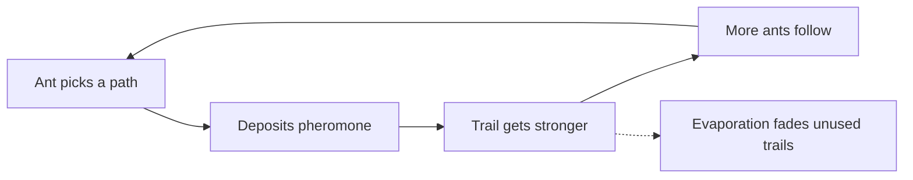
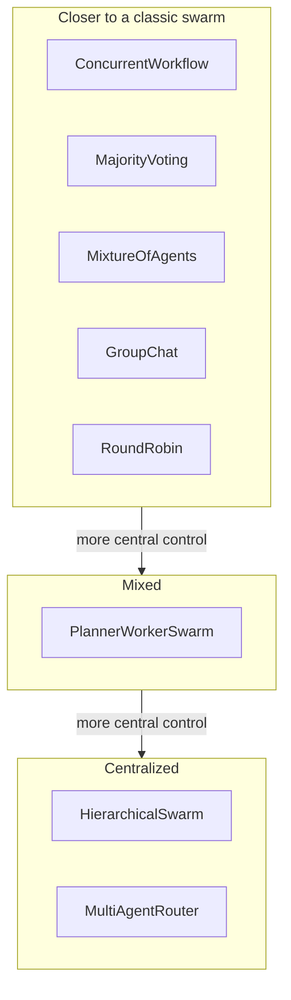

# What Is Swarm Intelligence? From Ant Colonies to LLM Agent Swarms

Swarm intelligence is the problem-solving behavior that appears when many simple agents follow local rules and no central controller tells any of them what to do. An ant colony finds a short route to food, a flock turns as one body, termites build a mound, and no single insect or bird holds the plan. Computer scientists have been copying these mechanisms since the late 1980s, and the vocabulary has now reached AI: a group of cooperating LLM agents gets called an AI swarm or an agent swarm.

This guide covers where the idea came from, the four principles behind it, the three classic algorithms (boids, ant colony optimization and particle swarm optimization), and how much of that carries over to LLM agent swarms. Some of it carries over well and some of it breaks, and we will be specific about which is which. It ends with runnable code that builds a voting swarm on the [Swarms API](https://docs.swarms.ai/docs/documentation/multi-agent/swarm_completions).

If you are new to agents, [what is an agent](/blog/what-is-an-agent) and [what is a multi-agent system](/blog/what-is-a-multi-agent-system) are shorter introductions.

## What is swarm intelligence?

The term comes from robotics. Gerardo Beni and Jing Wang introduced "swarm intelligence" in 1989, in a paper on cellular robotic systems presented at a NATO workshop on robots and biological systems ([Beni and Wang, published in the 1993 proceedings](https://doi.org/10.1007/978-3-642-58069-7_38)). Their subject was groups of simple robots that produce ordered behavior together. The word has since widened to cover any decentralized, self-organized system, natural or artificial, where the useful behavior belongs to the group.

A working definition has three parts:

1. **Many agents.** Usually identical or close to it, and often in large numbers.
2. **Local information only.** Each agent senses its neighbors or its immediate surroundings. None of them sees the whole system.
3. **A collective result.** The group solves a problem (find a path, avoid a predator, build a nest, minimize a function) that no member was given.

Guy Theraulaz and Eric Bonabeau state the puzzle well in [their history of stigmergy](https://doi.org/10.1162/106454699568700): in an insect society, "individuals work as if they were alone while their collective activities appear to be coordinated." Explaining that observation is what the field is about.

## The four principles of swarm intelligence

### 1. No central control

No ant in a colony holds a map of the foraging trails, and no starling directs the flock. Control is spread across every member, so losing any one of them changes little. That is where natural swarms get their fault tolerance: there is no single point of failure because there is no single point of control.

### 2. Simple local rules

Each agent follows a short list of rules that refer only to what it can sense nearby. Reynolds' boids, covered below, need three.

### 3. Emergent behavior

The interesting behavior exists only at the level of the group. Shortest paths, flock shapes and nest structure come out of the interactions, and no individual computes them. Small changes to the local rules can produce large changes in what emerges, which is why swarm systems are easy to describe and hard to predict.

### 4. Stigmergy: coordination through the environment

Pierre-Paul Grassé coined "stigmergy" in 1959 while studying how termites rebuild their nests ([Grassé, Insectes Sociaux, 1959](https://doi.org/10.1007/BF02223791)). His observation was that the workers coordinate through the thing they are building. A partly built structure stimulates more building at that spot, so the work in progress tells the next worker what to do.

Ant trails are the best-known case. Ants deposit pheromone as they walk and prefer directions that carry more of it, so a path that more ants use becomes more attractive still. [Dorigo's group at IRIDIA](https://iridia.ulb.ac.be/dorigo/ACO/RealAnts.html) describes how this positive feedback lets a colony find the shorter way around an obstacle: ants that happen to take the shorter side rebuild the trail faster, pheromone accumulates there sooner, and soon nearly all the traffic follows it.



Keep stigmergy in mind. It is the principle that maps most directly onto how LLM agents share work today.

## Swarm intelligence examples in nature

- **Ant foraging.** In the double bridge experiment, a nest of Argentine ants is connected to food by two bridges. When the bridges have equal length, the colony converges on one of them, and across repeated runs each bridge wins about half the time, because random early differences get amplified by pheromone ([Dorigo, Scholarpedia](https://doi.org/10.4249/scholarpedia.1461)). When one route is shorter, real ants find it without visual cues ([IRIDIA, citing Goss et al. 1989](https://iridia.ulb.ac.be/dorigo/ACO/RealAnts.html)).
- **Termite construction.** Grassé's termites respond to the structure, and the structure accumulates their responses.
- **Bird flocks and fish schools.** Coordinated turning with no leader, which Reynolds' model reproduces from three local rules.

## The classic swarm algorithms: boids, ACO and PSO

### Boids (Reynolds, 1987)

Craig Reynolds built his boids model in 1986 and published it at SIGGRAPH 1987 as ["Flocks, Herds, and Schools: A Distributed Behavioral Model"](https://doi.org/10.1145/37401.37406). Each simulated bird steers by three rules, quoted from [Reynolds' own page](https://www.red3d.com/cwr/boids/):

- **Separation:** "steer to avoid crowding local flockmates"
- **Alignment:** "steer towards the average heading of local flockmates"
- **Cohesion:** "steer to move toward the average position of local flockmates"

Nothing in those rules mentions a flock. Flocking emerges. Boids came out of computer graphics and solves no optimization problem, but it remains the cleanest demonstration that three local rules are enough for convincing group behavior.

### Ant colony optimization (Dorigo, early 1990s)

Marco Dorigo turned pheromone trails into an optimization method. The first system, Ant System, appeared in his 1992 PhD thesis at the Politecnico di Milano ([IRIDIA](https://iridia.ulb.ac.be/dorigo/ACO/about.html)), and the journal version followed in 1996 ([Dorigo, Maniezzo and Colorni](https://doi.org/10.1109/3477.484436)). On the traveling salesman problem it works like this ([Scholarpedia](https://doi.org/10.4249/scholarpedia.1461)):

1. Each artificial ant builds a tour city by city, choosing the next edge with a probability biased by the edge's pheromone and its length.
2. When every ant has finished, all pheromone values drop by a fixed fraction (evaporation).
3. Each edge then gains pheromone in proportion to the quality of the tours that used it.
4. Repeat until a stopping condition is met.

Evaporation matters as much as deposit. The Scholarpedia article calls it "a useful form of forgetting": without it, the first decent tour would lock in and the colony would stop exploring.

### Particle swarm optimization (Kennedy and Eberhart, 1995)

James Kennedy and Russell Eberhart introduced [particle swarm optimization](https://doi.org/10.1109/ICNN.1995.488968) at the 1995 IEEE International Conference on Neural Networks. Its roots are in flocking simulations, including Reynolds' work, and in social psychology ([Dorigo et al., Scholarpedia](https://doi.org/10.4249/scholarpedia.1486)). Each particle is a candidate solution with a position and a velocity. At every step its velocity is pulled toward two points: the best position it has found itself, and the best position found among its neighbors. Which particles count as neighbors (all of them, or only the two next to it on a ring) is set by the population topology, so a good position either reaches the whole swarm at once or spreads step by step from neighbor to neighbor.

| Algorithm | Introduced | Agent | Local rule | Shared signal | What emerges |
| --- | --- | --- | --- | --- | --- |
| Boids | 1987 | Simulated bird | Separation, alignment, cohesion | Neighbors' positions and headings | Flocking |
| Ant colony optimization | 1992 | Artificial ant | Choose edges biased by pheromone | Pheromone on graph edges | Short paths and tours |
| Particle swarm optimization | 1995 | Particle | Move toward own best and neighbors' best | Best positions among neighbors | Convergence on good regions |

## What is an LLM agent swarm?

An LLM agent swarm is a group of language model agents that work on one task and combine their outputs through a defined coordination pattern. Each agent has its own system prompt, its own model and its own view of the task. The pattern decides what each agent sees, who goes when, and how the outputs merge.

Several research results give the swarm intuition some grounding:

- **Self-consistency** (Wang et al., 2022) samples several reasoning paths from one model and keeps the most consistent answer, which improved chain-of-thought accuracy on arithmetic and commonsense benchmarks ([arXiv:2203.11171](https://arxiv.org/abs/2203.11171)).
- **More Agents Is All You Need** (Li et al., 2024) reports that with a plain sampling-and-voting method, LLM performance scales with the number of agents, and that the gain is correlated with task difficulty ([arXiv:2402.05120](https://arxiv.org/abs/2402.05120)).
- **Multiagent debate** (Du et al., 2023) has several model instances propose answers and critique each other over rounds, which improved mathematical and strategic reasoning and reduced hallucinated answers ([arXiv:2305.14325](https://arxiv.org/abs/2305.14325)).
- **Mixture-of-Agents** (Wang et al., 2024) stacks layers of LLM agents, where each agent reads all the outputs of the previous layer ([arXiv:2406.04692](https://arxiv.org/abs/2406.04692)).

What they share with an ant colony is the shape of the computation: many attempts in parallel, then a step that combines them and amplifies what most attempts agree on. Independent errors tend to cancel out, while agreement accumulates. [Multi-agent collaboration patterns](/blog/multi-agent-collaboration-patterns) compares debate, voting, mixture of agents and councils in detail, and [what is collective superintelligence](/blog/what-is-collective-superintelligence), with its companion essay on [why CSI will surpass AGI and ASI](/blog/collective-superintelligence), makes the larger argument about where collective systems lead.

## Swarm intelligence vs LLM agent swarms: where the analogy holds

The analogy is useful, and it is also loose. Here is the comparison side by side.

| | Classic swarm | LLM agent swarm |
| --- | --- | --- |
| Number of agents | Large: a colony, a flock, a population of particles | Usually a handful |
| Agent capability | Very simple, fixed rules | Each agent is a capable general model |
| Communication | Local: neighbors or the environment | Usually global: a shared transcript or a coordinator |
| Control | None | Often a director, router or aggregator agent |
| Source of diversity | Random noise and position | Must be designed: prompts, models, temperature |
| Cost per agent | Negligible | Every agent is a billed model call |
| Error independence | High | Low when every agent runs the same model and prompt |

Three parts of the analogy hold up well:

- **Independent attempts plus aggregation.** On tasks with a checkable answer (a label, a yes or no, a number), several independent agents and a vote tend to beat one agent, because independent mistakes rarely land on the same wrong answer.
- **Stigmergy.** A shared transcript, a task queue or a shared file is an environment that agents read and modify. When agent B builds on what agent A wrote, coordination happens through the artifact, the way termites coordinate through the mound.
- **Redundancy.** With several agents on the same question, one failed or wrong agent rarely decides the outcome.

## Where the swarm analogy breaks

- **Scale and simplicity.** Classic swarm intelligence gets smart behavior out of many weak agents. LLM swarms use a few strong ones, so most of the intelligence sits inside each agent and comparatively little of it emerges from the rules between them.
- **Central coordinators.** Many practical LLM systems put a director or a router in charge. That is a hierarchy, which classic swarms do without entirely. It is often the right engineering call (easier to debug, fewer calls), but calling it swarm intelligence stretches the term. [Manager-worker agent architectures](/blog/manager-worker-agent-architectures) covers when a hierarchy is the better design.
- **Correlated errors.** Five copies of the same model with the same prompt tend to make the same mistake. Ant noise is independent; LLM noise often is not. Diversity has to be engineered with different models, different prompts or different evidence.
- **Cost.** A pheromone deposit is free and a model call is billed in tokens. Adding agents is a budget decision, which [tracking LLM token usage and cost](/blog/track-llm-token-usage-cost-python) helps you measure.
- **The aggregator is often a model.** In voting and mixture patterns, the final merge is usually done by one LLM, which reintroduces a single component that can misread the votes. You can replace it with a plain counting rule when the answers are discrete, as the second example below does.

## Which Swarms architectures are closest to swarm intelligence?

The Swarms API exposes 14 architectures through the `swarm_type` field of `POST /v1/swarm/completions` ([full list](https://docs.swarms.ai/docs/documentation/multi-agent/available-architectures)). Sorted by how control is distributed, they fall into three groups.



| `swarm_type` | How agents coordinate | Swarm principle it resembles | Central element |
| --- | --- | --- | --- |
| [ConcurrentWorkflow](https://docs.swarms.ai/docs/documentation/multi-agent/concurrent_workflow) | Every agent gets the same task in parallel and works independently | Independent local decisions | None; you aggregate |
| [MajorityVoting](https://docs.swarms.ai/docs/documentation/multi-agent/majority_voting) | Independent answers, then a majority decision | Independent decisions plus aggregation | A consensus agent tallies the votes |
| [MixtureOfAgents](https://docs.swarms.ai/docs/documentation/multi-agent/mixture_of_agents) | Specialists answer in parallel, then an aggregator synthesizes | Diversity plus aggregation | An internal aggregator agent |
| [GroupChat](https://docs.swarms.ai/docs/documentation/multi-agent/group_chat) | Agents speak in turn into one shared transcript | Stigmergy through a shared medium | None beyond turn-taking |
| [RoundRobin](https://docs.swarms.ai/docs/documentation/multi-agent/round_robin) | Fixed rotation, each agent reads the full history | Stigmergy with a fixed schedule | The schedule itself |
| [PlannerWorkerSwarm](https://docs.swarms.ai/docs/documentation/multi-agent/planner_worker_swarm) | Workers claim sub-tasks from a shared queue and never talk to each other | Stigmergy in the execution phase | A planner and a judge |
| [HierarchicalSwarm](https://docs.swarms.ai/docs/documentation/multi-agent/hierarchical_swarm) | A director decomposes the task, delegates and reviews | Hierarchy | A director agent |
| [MultiAgentRouter](https://docs.swarms.ai/docs/documentation/multi-agent/multi_agent_router) | A router sends the task to the best-suited agent or agents | Dispatch | A router agent |

A few details from the docs matter for this mapping. In `MajorityVoting` the agents decide independently and in parallel, then a separate `Consensus-Agent` tallies the votes and writes the verdict. That agent always runs `gpt-5.4`, and the docs note it cannot be changed through the request. `MixtureOfAgents` adds an internal aggregator that is not part of your `agents` list. In `PlannerWorkerSwarm`, workers only interact with the queue, which is about as close to Grassé's termites as an LLM system gets, but a planner writes the queue and a judge decides whether to run another cycle. `HierarchicalSwarm` creates its director automatically, and you tune it with `director_model_name` and `director_settings`.

These groups describe structure and say nothing about quality. A hierarchy is the better choice for many real tasks. [Swarm architectures explained](/blog/swarm-architectures-explained) walks through all 14 with guidance on when to pick each, and [what is multi-agent orchestration](/blog/what-is-multi-agent-orchestration) covers the state and failure handling that sits around them.

## Build an AI swarm with the Swarms API

The first example is a voting swarm: three reviewers judge the same database migration independently, and the majority decides. It mirrors the ant colony in three ways. Each agent decides alone, each follows one simple output rule, and the result comes from aggregating local decisions. To reduce correlated errors, each reviewer runs a different model and looks at a different risk.

Get an API key from the [Swarms platform](https://swarms.world/platform/api-keys), then install the dependencies and set the key:

```bash
pip install aiohttp python-dotenv
export SWARMS_API_KEY="your-api-key"
```

```python
import asyncio
import os

import aiohttp
from dotenv import load_dotenv

load_dotenv()

API_KEY = os.environ["SWARMS_API_KEY"]
BASE_URL = "https://api.swarms.world"
HEADERS = {"x-api-key": API_KEY, "Content-Type": "application/json"}

MIGRATION = """
ALTER TABLE orders ADD COLUMN discount_code TEXT;
CREATE INDEX idx_orders_discount_code ON orders (discount_code);
UPDATE orders SET discount_code = 'NONE' WHERE discount_code IS NULL;
"""

RULES = (
    "Work alone and judge only from the migration text. "
    "Your first line must be exactly 'VOTE: SAFE' or 'VOTE: UNSAFE'. "
    "Then give at most three short reasons."
)


def reviewer(name: str, focus: str, model: str) -> dict:
    return {
        "agent_name": name,
        "description": f"Reviews database migrations for {focus}",
        "system_prompt": f"You are a PostgreSQL reviewer focused on {focus}. {RULES}",
        "model_name": model,
        "max_loops": 1,
        "max_tokens": 2048,
        "temperature": 0.3,
    }


async def main() -> None:
    payload = {
        "name": "Migration Safety Vote",
        "description": "Independent reviewers vote and the majority decides",
        "swarm_type": "MajorityVoting",
        "task": (
            "Is this migration safe to run on a large, busy production `orders` table "
            "during business hours?\n" + MIGRATION
        ),
        "agents": [
            reviewer("Locking Reviewer", "table locks and blocked writes", "gpt-5.4"),
            reviewer("Load Reviewer", "I/O load, runtime and replication lag", "claude-sonnet-5"),
            reviewer("Rollback Reviewer", "reversibility and partial failure", "gpt-5.4-mini"),
        ],
        "max_loops": 1,
    }

    # Multi-agent runs can take minutes, so give the whole request room.
    timeout = aiohttp.ClientTimeout(total=600)
    async with aiohttp.ClientSession(headers=HEADERS, timeout=timeout) as session:
        async with session.post(f"{BASE_URL}/v1/swarm/completions", json=payload) as resp:
            resp.raise_for_status()
            result = await resp.json()

    for turn in result["output"]:
        if turn["role"].lower() == "user":
            continue  # the echoed task
        content = turn["content"]
        if isinstance(content, list):
            content = " ".join(str(part) for part in content)
        print(f"\n--- {turn['role']}")
        print(str(content)[:600])

    billing = result.get("usage", {}).get("billing_info", {})
    print("\nAgents:", result["number_of_agents"], "| seconds:", result["execution_time"])
    print("Cost (USD):", billing.get("total_cost"))


asyncio.run(main())
```

Example output (abridged; the wording and votes will differ from run to run, and the timing and cost lines are omitted):

```
--- Locking Reviewer
VOTE: UNSAFE
1. CREATE INDEX without CONCURRENTLY blocks writes to orders until the build finishes.
2. The UPDATE rewrites every existing row in a single transaction.

--- Load Reviewer
VOTE: UNSAFE
1. Backfilling every row in one statement produces a large burst of I/O and WAL.
2. Replicas can fall behind while it runs.

--- Rollback Reviewer
VOTE: SAFE
1. Each step can be reversed with DROP INDEX and DROP COLUMN.

--- Consensus-Agent
FINAL VERDICT: UNSAFE (2-1). Build the index with CREATE INDEX CONCURRENTLY
and backfill in small batches outside peak hours.
```

The `output` field is a list of `{"role", "content"}` turns: one per reviewer, then the consensus agent's verdict ([response shape](https://docs.swarms.ai/docs/documentation/multi-agent/swarm_completions)). The docs recommend an odd number of voters so there is always a majority. To get a synthesized answer instead of a verdict, change `swarm_type` to `"MixtureOfAgents"` and give the agents open-ended analysis prompts; the aggregator then merges their perspectives into one report.

### Aggregate with a plain rule instead of a model

The second example removes the model from the aggregation step. Five labelers run as a `ConcurrentWorkflow`, so nothing coordinates them, and the tally happens in ordinary Python. This is closer to a real colony, where the "decision" is just pheromone adding up. It also lets you set a threshold: if the swarm does not agree strongly, a human gets the ticket.

```python
import asyncio
import os
import re
from collections import Counter

import aiohttp
from dotenv import load_dotenv

load_dotenv()

API_KEY = os.environ["SWARMS_API_KEY"]
BASE_URL = "https://api.swarms.world"
HEADERS = {"x-api-key": API_KEY, "Content-Type": "application/json"}

TICKET = "I was charged twice for my March invoice and now my account is locked."
LABELS = ["BILLING", "BUG", "ACCOUNT"]
MODELS = ["gpt-5.4", "claude-sonnet-5", "gpt-5.4-mini", "gpt-5.4", "claude-sonnet-5"]


async def main() -> None:
    payload = {
        "name": "Ticket Label Swarm",
        "description": "Five independent labelers, tallied in plain Python",
        "swarm_type": "ConcurrentWorkflow",
        "task": f"Label this support ticket: {TICKET}",
        "agents": [
            {
                "agent_name": f"Labeler-{i}",
                "description": "Labels one customer support ticket",
                "system_prompt": (
                    "You label customer support tickets. Work alone. "
                    f"Your first line must be 'LABEL: X' where X is one of {', '.join(LABELS)}. "
                    "Then give one sentence of reasoning."
                ),
                "model_name": model,
                "max_loops": 1,
                "max_tokens": 512,
                "temperature": 0.7,
            }
            for i, model in enumerate(MODELS, start=1)
        ],
        "max_loops": 1,
    }

    # Multi-agent runs can take minutes, so give the whole request room.
    timeout = aiohttp.ClientTimeout(total=600)
    async with aiohttp.ClientSession(headers=HEADERS, timeout=timeout) as session:
        async with session.post(f"{BASE_URL}/v1/swarm/completions", json=payload) as resp:
            resp.raise_for_status()
            result = await resp.json()

    pattern = re.compile(r"LABEL:\s*(" + "|".join(LABELS) + r")")
    votes = []
    for turn in result["output"]:
        if not turn["role"].startswith("Labeler-"):
            continue
        match = pattern.search(str(turn["content"]))
        if match:
            votes.append(match.group(1))

    tally = Counter(votes)
    print("Votes:", dict(tally))

    label, count = tally.most_common(1)[0] if tally else ("NONE", 0)
    if count >= 4:
        print("Decision:", label)
    else:
        print(f"Only {count} of {len(MODELS)} agree: send this ticket to a human")


asyncio.run(main())
```

The ticket mixes a billing problem with an account problem on purpose, so the labelers may split. That is the useful case: a weak majority is a signal in its own right. `ConcurrentWorkflow` returns turns in the order the agents finished, which does not matter for a count. For a longer walkthrough that builds up from one agent to a full swarm, see [how to build an agent swarm in Python](/blog/build-agent-swarm-python), and the [Swarms API examples suite](/blog/swarms-api-examples-suite) has more ready-to-run payloads.

## When should you use an agent swarm?

Use a voting swarm (`MajorityVoting`, or `ConcurrentWorkflow` with your own tally) when the answer is discrete and checkable, when one model gives different answers on different runs, and when a wrong answer costs more than a few extra calls. Classification, approval gates, extraction checks and code review verdicts fit this well.

Use a synthesis swarm (`MixtureOfAgents`) when the task is open-ended and the value comes from coverage: several specialists see different parts of a problem, and one report pulls them together.

Use a stigmergic pattern (`GroupChat`, `RoundRobin`) when agents need to build on each other's work, such as drafting and critiquing a design. Keep the transcript short and the roles distinct, because every agent reads everything that came before it.

Skip the swarm when one well-prompted agent with the right tools already does the job. [Single agent vs multi-agent](/blog/single-agent-vs-multi-agent) gives a checklist for that decision. And remember that a swarm can amplify a shared mistake as easily as it averages out independent ones: if every agent reads the same wrong document, the vote is unanimous and wrong. [Multi-agent system failure modes](/blog/multi-agent-system-failure-modes) covers the quieter ways these systems go wrong.

## Frequently Asked Questions

### What is swarm intelligence in simple terms?

Swarm intelligence is useful group behavior that comes from many simple agents following local rules, with no leader and no global plan. Ant colonies finding short paths and birds flocking are the standard examples. The group solves a problem that no individual member understands or was assigned.

### Who coined the term swarm intelligence?

Gerardo Beni and Jing Wang introduced the term in 1989 in a paper on cellular robotic systems, presented at a NATO workshop and published in the 1993 proceedings. The underlying biology is older: Pierre-Paul Grassé described stigmergy in termites in 1959.

### What are examples of swarm intelligence algorithms?

The three classics are Craig Reynolds' boids (1987), which simulates flocking with three steering rules; ant colony optimization, which Marco Dorigo introduced in his 1992 PhD thesis; and particle swarm optimization, published by James Kennedy and Russell Eberhart in 1995. ACO and PSO are optimization methods, while boids is a simulation of collective motion.

### Is an LLM multi-agent system really swarm intelligence?

Partly. Patterns where agents answer independently and their outputs are aggregated (voting, concurrent fan-out, mixture of agents) or where agents coordinate through a shared transcript or queue follow swarm principles. Systems with a director or router in charge are hierarchies, and LLM swarms use a few capable agents where classic swarms use many simple ones.

### What is an AI swarm used for?

AI swarms are used where independent judgments improve reliability or coverage: classifying and routing tickets, approving content or code, reviewing documents from several angles, and research tasks that benefit from multiple perspectives. With the Swarms API you choose the coordination pattern with one `swarm_type` field on `POST /v1/swarm/completions`.

### How many agents should an agent swarm have?

Start with three or five for voting, since an odd number avoids ties, and add agents only if measured accuracy improves. Each agent is a billed model call, and agents that share a model and prompt add less than their count suggests. Varying the models and the instructions usually helps more than adding more identical agents.
