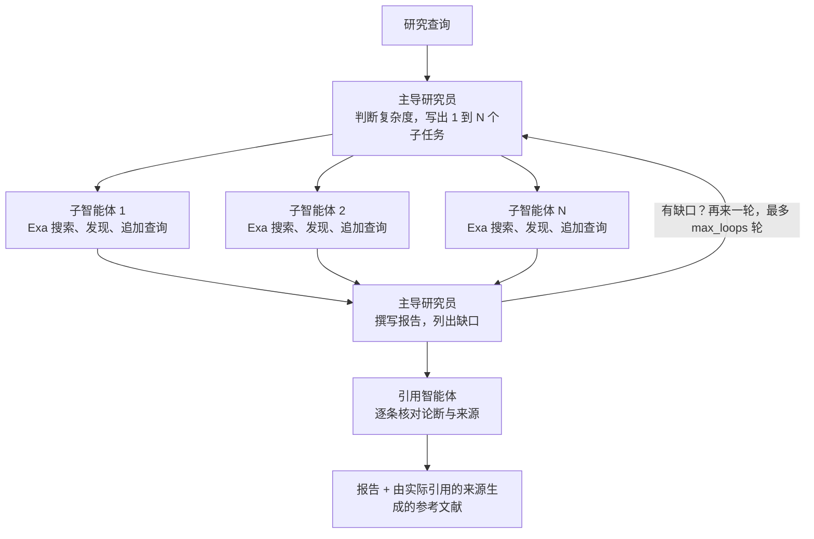

# AdvancedResearch：Anthropic 多智能体研究系统的开源实现

2025 年 6 月，Anthropic 发布了[《How we built our multi-agent research system》](https://www.anthropic.com/engineering/multi-agent-research-system)，这是 Claude 中 Research 功能背后的工程记录。文章描述了一种编排者-工作者（orchestrator-worker）模式：主导智能体阅读查询、写出计划、派生多个并行搜索的子智能体、综合它们返回的结果、判断是否需要再来一轮，最后把成稿交给引用智能体。在 Anthropic 的内部研究评测中，以 Claude Opus 4 为主导、Claude Sonnet 4 为子智能体的这套系统，比单个 Opus 4 智能体高出 90.2%。

这篇论文对系统为何奏效讲得异常具体，具体到不同复杂度的查询应该分配多少个子智能体。但它没有附带代码。[AdvancedResearch](https://github.com/The-Swarm-Corporation/AdvancedResearch) 是我们对这一设计的开源实现。它是一个 Python 包，MIT 许可证，其中每一个智能体都是对 [Swarms API](https://docs.swarms.ai) 的一次调用，每一次网络搜索都是对 [Exa](https://exa.ai) 的一次调用。没有要安装的智能体框架，也没有模型厂商 SDK：两个 API key 加上 `httpx`。

本文逐条梳理论文中的设计决策，指出每一条在代码里的位置，然后真实运行一次主导研究员，并看一看账单。

## 架构对照

Anthropic 对系统的描述一段话就能讲完。主导研究员"制定策略，并派生子智能体同时探索不同方面"。每个子智能体"独立执行网络搜索，用交错思考评估工具结果，并把发现返回"。主导智能体"综合这些结果并决定是否需要更多研究"。最后，CitationAgent"处理文档和研究报告，找出需要加引用的具体位置"。

AdvancedResearch 有同样的四个阶段，由四段提示词和一个共享的来源列表实现：



| Anthropic 的组件 | AdvancedResearch | 代码位置 |
|---|---|---|
| LeadResearcher 规划并委派 | 使用编排者提示词的 `Director-Agent` | `create_director_agent()`、`prompts.get_orchestrator_prompt()` |
| 子智能体并行搜索、过滤结果 | `Worker-Search-Agent-N`，每个一个线程 | `run_worker_agents()`、`run_agent()` |
| 对工具结果的交错思考 | 搜索轮次：阅读结果、记录发现、提出更窄的追加查询 | `run_agent()` 中对 `worker_search_rounds` 的循环 |
| 主导智能体综合并决定是否继续 | 以 `needs_more_research` JSON 块结尾的综合提示词 | `AdvancedResearch._synthesize()`、`_split_report()` |
| CitationAgent 把论断归属到来源 | 作用于报告和编号来源列表的引用提示词 | `AdvancedResearch._cite()` |
| 计划与发现的记忆 | `Conversation` 历史加线程安全的 `SourceRegistry` | `Conversation`、`SourceRegistry` |

整个系统在 `advanced_research/main.py` 中约 1,400 行，提示词在 `advanced_research/prompts.py` 中约 130 行。

## 安装

```bash
pip3 install -U advanced-research
```

两个环境变量，放在 shell 或 `.env` 文件中：

```bash
SWARMS_API_KEY="..."   # https://swarms.world/platform/api-keys
EXA_API_KEY="..."      # https://dashboard.exa.ai/api-keys
```

最小的一次运行：

```python
from advanced_research import AdvancedResearch

research = AdvancedResearch(
    name="AI Research Team",
    director_model_name="gpt-5.5",     # 主导研究员、报告、引用
    worker_model_name="gpt-5.4-mini",  # 搜索子智能体
    max_loops=1,
    verbose=True,                      # 每个智能体的回复一到就打印
)

report = research.run(
    "How do solid-state batteries compare with lithium-ion batteries for electric vehicles in 2026?"
)
print(report)
print(research.get_usage())  # token 数以及 Swarms + Exa 费用
```

`GET https://api.swarms.world/v1/models/available` 列出的任何模型都可以担任任一角色，所以主导可以用前沿模型，子智能体用便宜快速的模型，这正是 Anthropic 采用的分工。

## 论文中的每条原则如何变成代码

Anthropic 列出了八条提示工程原则，正是它们把系统从演示推到了生产。其中六条在 AdvancedResearch 里能直接看到。

### 1. 教编排者如何委派

论文被引用最多的发现：含糊的指令导致子智能体重复彼此的工作或留下空白，所以每份子智能体简报都需要"一个目标、一种输出格式、关于工具和来源的指引，以及清晰的任务边界"。

编排者提示词要求主导智能体为每个子任务恰好给出这四个字段，并告诉它子任务"不得重叠，合起来必须覆盖整个查询"：

```python
# advanced_research/prompts.py（节选）
STEP 2: WRITE ONE SUBTASK PER SUBAGENT
Each subtask must give the subagent everything it needs, because it cannot ask you questions:
- objective: one precise question to answer, including the time frame when recency matters.
- search_queries: 2 or 3 web search queries. Start short and broad, then one more specific query.
- output_format: what the subagent should return, e.g. "a list of approved drugs with approval dates and sources".
- boundaries: what is out of scope for this subagent, so two subagents never cover the same ground.
```

提示词里还放了一个糟糕子任务（"research AI in healthcare"）和三个好子任务的对照示例，这就是"像你的智能体一样思考"原则在提示词自身上的应用。

### 2. 按查询复杂度分配投入

Anthropic 早期的智能体会"为简单查询派生 50 个子智能体"，于是他们把明确的分级规则写进提示词："简单的事实查找只需 1 个智能体和 3 到 10 次工具调用，直接比较可能需要 2 到 4 个子智能体、每个 10 到 15 次调用，复杂研究可能用到超过 10 个子智能体。"

AdvancedResearch 编码了同样的三个层级，并加上一个可配置的上限（`max_subagents`，默认 5），因为这里每个子智能体都是一次计费的 API 调用：

```python
STEP 1: JUDGE THE EFFORT THE QUERY NEEDS
- simple: one fact or a narrow question. Use 1 subagent.
- comparison: a direct comparison or a question with a few distinct parts. Use 2 to 4 subagents.
- complex: open-ended research across many angles. Use up to {max_subagents} subagents with clearly divided responsibilities.
Never use more subagents than the query needs.
```

主导智能体会在计划中返回一个 `complexity` 字段，所以每次运行你都能看到它选了哪个层级。

### 3. 先宽后窄

论文发现智能体默认写又长又具体的查询，结果什么都搜不到，解决办法是"从简短宽泛的查询开始，评估有什么可用，再逐步收窄"。

代码里有两处这样做。主导智能体被告知要"像一个人在搜索引擎里输入那样"写查询，先宽泛。然后每个子智能体运行计划好的搜索、阅读结果，可以提出"1 到 3 个比已运行的更窄的追加搜索"，这些在下一轮搜索中执行。默认两轮（`worker_search_rounds=2`），当子智能体把覆盖度标为 comprehensive 时会提前停止：

```python
# advanced_research/main.py，run_agent() 内部
for round_number in range(1, config.worker_search_rounds + 1):
    queries = [q for q in queries if q not in seen_queries][:3]
    if not queries:
        break
    seen_queries.extend(queries)
    with concurrent.futures.ThreadPoolExecutor(max_workers=len(queries)) as pool:
        search_outputs = list(pool.map(lambda q: exa_search(q, ...), queries))
    ...
    queries = [q for q in findings.get("follow_up_queries") or []]
    if findings.get("coverage_assessment") == "comprehensive":
        break
```

### 4. 并行工具调用

Anthropic 加入了两种并行："主导智能体并行启动 3 到 5 个子智能体"以及"子智能体并行使用 3 个以上工具"，并报告这两者合起来"把复杂查询的研究时间缩短了最多 90%"。

在 AdvancedResearch 里两者都是线程池。`run_worker_agents()` 为每个子任务开一个线程，上限为 `max_subagents`。每个子智能体内部，该轮的两三次 Exa 搜索在各自的线程池中运行，如上面的节选所示。使用默认配置的单轮运行端到端需要 20 到 60 秒。

### 5. 子智能体作为智能过滤器，加上共享来源列表

论文把子智能体描述为"智能过滤器"，把大量搜索结果压缩成主导智能体可用的发现，这样主导智能体自己的上下文不会被原始网页填满。

AdvancedResearch 补上了论文没有展开的一个细节：互不通信的智能体之间如何保持引用编号一致。每条 Exa 结果都会登记到一个由整次运行共享、受锁保护的 `SourceRegistry` 中。一个 URL 第一次出现时拿到下一个编号，之后每个子智能体看到的同一页面都是同一个编号。发现引用 `[n]`，报告保留这些编号，参考文献列表则由最终报告实际引用的来源生成：

```python
class SourceRegistry:
    """Numbers every source found during a run, shared by all subagents,
    so a citation like [3] means the same page everywhere."""

    def add(self, result: dict[str, Any]) -> int:
        with self._lock:
            url = result["url"]
            if url not in self._ids:
                self.sources.append(result)
                self._ids[url] = len(self.sources)
            return self._ids[url]
```

子智能体提示词负责过滤的另一半，也就是来源质量。Anthropic 的人工测试者注意到早期智能体"总是选择 SEO 优化的内容农场，而不是权威但排名较低的来源"，所以这里的子智能体提示词明确给来源分级：官方机构、同行评审论文和一手文件为强；内容农场、无日期页面和匿名聚合站为弱；"即使排名靠后也优先选择强来源"。

### 6. 逐条核对论断与来源的引用智能体

两个系统里引用智能体都是最后一步。在 AdvancedResearch 中，它收到报告以及仅限报告或发现所引用的那些来源，这样提示词保持精简。它的规则是：只使用来源列表中的编号；如果来源不支持论断就替换引用；给任何有来源支持却没有引用的论断补上引用；对没有任何来源支持的论断予以弱化或删除。如果引用调用失败，运行会保留综合阶段的引用而不是整体失败，因为一份引用未经核对的报告仍比没有报告有用。

### 由主导智能体决定是否继续

Anthropic 的主导智能体在每轮之后"决定是否需要更多研究"。AdvancedResearch 把这个决定做成机器可读。综合提示词要求主导智能体在报告末尾附上一个 JSON 代码块：

```json
{"needs_more_research": false, "gaps": []}
```

`_split_report()` 把这个块从末尾剥离。如果 `needs_more_research` 为 true 且 `max_loops` 允许，下一轮会重新规划，但只针对列出的缺口：编排者提示词写明"只为缺口规划子任务，不要重复已经完成的研究"。门槛刻意设得很高：只有"当某个缺口会改变查询的答案"时才值得再来一轮。

## 一次真实的规划运行

下面是主导研究员对上文固态电池问题的真实输出，2026 年 11 月 8 日在 Swarms API 上用 `gpt-5.5` 运行，提示词是 `prompts.py` 中 `max_subagents=5` 的编排者提示词。

```json
{
  "complexity": "comparison",
  "strategy": "Divide the comparison into four non-overlapping angles: technical performance, safety/lifetime, commercialization status, and cost/supply-chain outlook for EV applications as of November 2026.",
  "subtasks": [
    {
      "objective": "Compare solid-state batteries and conventional lithium-ion batteries for EVs on technical performance metrics as of 2026, including energy density, charging speed, power capability, operating temperature range, and vehicle range implications.",
      "search_queries": [
        "solid-state battery vs lithium-ion EV energy density 2026",
        "solid state batteries electric vehicles charging speed power density 2026",
        "EV solid-state battery performance metrics 2026"
      ],
      "output_format": "A comparison table with metrics, units, typical 2026 values or ranges, and cited sources for each figure.",
      "boundaries": "Focus only on technical performance metrics. Do not cover safety, cost, manufacturing scale, commercial rollout timelines, or company-specific deployment status except where needed to source a metric."
    },
    {
      "objective": "Compare solid-state and lithium-ion EV batteries on safety, degradation, cycle life, calendar life, thermal runaway risk, and real-world reliability as understood in 2026.",
      "search_queries": [
        "solid-state battery safety cycle life lithium-ion EV 2026",
        "solid state battery thermal runaway degradation cycle life 2026",
        "EV battery safety comparison solid-state lithium-ion 2026"
      ],
      "output_format": "A concise evidence summary with separate sections for safety, degradation/cycle life, calendar life, and reliability, noting where evidence is lab-scale versus real-world EV use.",
      "boundaries": "Do not discuss energy density, charging speed, costs, supply chains, or commercialization timelines except where directly tied to safety or lifetime evidence."
    },
    {
      "objective": "Determine the commercialization status of solid-state EV batteries versus conventional lithium-ion EV batteries as of 08 November 2026, including which companies have announced vehicles, pilot production, mass production, or delays.",
      "search_queries": [
        "solid-state battery EV commercialization 2026 Toyota QuantumScape Nissan BMW",
        "solid state battery electric vehicle production timeline 2026",
        "which EVs use solid-state batteries 2026"
      ],
      "output_format": "A company-by-company table listing announced milestones, current status as of November 2026, expected production dates, named vehicle programs if any, and sources.",
      "boundaries": "Focus on commercialization and deployment status only. Do not compare chemistry-level performance, safety, or cost except when an announcement includes those claims."
    },
    {
      "objective": "Compare the 2026 cost, manufacturing readiness, supply-chain requirements, and scalability of solid-state batteries versus lithium-ion batteries for EVs.",
      "search_queries": [
        "solid-state battery cost per kWh 2026 lithium-ion EV",
        "solid state battery manufacturing challenges scalability 2026",
        "EV battery cost forecast solid-state versus lithium-ion 2026"
      ],
      "output_format": "A cost and scalability comparison with estimated $/kWh ranges where available, key manufacturing bottlenecks, material requirements, and short-term outlook through 2030.",
      "boundaries": "Do not cover technical performance, safety, degradation, or company deployment timelines except where they directly affect manufacturing cost or scalability."
    }
  ]
}
```

有几点值得注意。主导智能体把查询判定为比较类，选择了四个子智能体，落在提示词为该层级给出的 2 到 4 个区间内。每个子任务都有明确的边界，点名了其他三个子任务负责的内容，所以子智能体不会漂移到彼此的领域。查询读起来像搜索词而不是句子，每个列表都从宽到窄。商业化子任务固定了它被告知的日期（"as of 08 November 2026"），这是提示词中的时效性指引在输出里的体现。

这次规划调用消耗了 625 个输入 token 和 799 个输出 token，在 Swarms API 上的费用为 $0.031159，已含服务费。

## 一次运行的费用

`research.get_usage()` 返回每次 Swarms 调用和每次 Exa 搜索及其费用，`research.total_cost` 是它们的总和。对于像上面这样的单轮比较类查询，使用默认模型的粗略预算：

| 阶段 | 调用 | 模型 | 典型费用 |
|---|---|---|---|
| 规划 | 1 | gpt-5.5 | $0.03 |
| 搜索子智能体 | 4 个智能体 x 1 到 2 轮 | gpt-5.4-mini | 每个 $0.02 到 $0.04 |
| Exa 搜索 | 12 到 24 次 | auto 搜索，10 条结果 | 每次 $0.007 |
| 报告 | 1 | gpt-5.5 | $0.08 到 $0.15 |
| 引用 | 1 | gpt-5.5 | $0.08 到 $0.15 |

大多数单轮运行合计落在 $0.30 到 $0.60 之间，主要来自主导研究员那两次需要阅读全部发现和全部被引用来源的长调用。把主导换成 `claude-sonnet-5-5` 或 `gpt-5.4` 大约能减半；保留前沿模型做主导、便宜模型做工作者是论文的建议，也是这里的默认配置。2026 年 11 月 8 日两个默认模型在 Swarms API 上的价格，每百万 token，已含 15% 服务费：

| 模型 | 输入 | 输出 |
|---|---|---|
| gpt-5.5 | $5.75 | $34.50 |
| gpt-5.4-mini | $0.8625 | $5.175 |

Anthropic 自己的数据点是一个有用的校准："多智能体系统使用的 token 约为聊天的 15 倍"，并且在 BrowseComp 上"token 用量本身就解释了 80% 的研究表现方差"。上面的费用，就是当每个智能体都是计量 API 调用时，购买这部分额外 token 预算的样子。

## 为什么用 Swarms API 而不是智能体框架

Anthropic 关于生产环境的章节主要讲的是状态。他们写道"智能体是有状态的，错误会累积"，这也是他们加入检查点、重试逻辑和完整追踪的原因，并且他们提到主导智能体仍然同步执行子智能体，等每一批完成后再继续。

AdvancedResearch 由于在 API 边界上是无状态的，以更简单的方式获得了这些特性。每个智能体都是一次带系统提示词和任务的 `POST /v1/agent/completions`，所以没有需要做检查点的长驻智能体进程；运行的状态就是你自己进程里的 `Conversation` 和 `SourceRegistry`，`export_on=True` 会在每次运行后把两者写入一个 JSON 文件。重试集中在一个函数里：

```python
def _post_json(service, url, headers, body, timeout=120.0, attempts=3):
    for attempt in range(1, attempts + 1):
        started = time.monotonic()
        try:
            response = httpx.post(url, headers=headers, json=body, timeout=timeout)
        except httpx.TransportError as error:
            if attempt == attempts:
                raise ResearchAPIError(f"{service} request failed: {error}") from error
            time.sleep(2**attempt)
            continue
        elapsed = time.monotonic() - started
        if response.status_code in (503, 504) and elapsed >= GATEWAY_TIMEOUT_SECONDS:
            raise ResearchAPIError(
                f"{service} returned {response.status_code} after {elapsed:.0f} s, the "
                "Swarms API's 30-second request limit. Use a faster model "
                "or a lower max_tokens for this agent."
            )
        if response.status_code in (429, 500, 502, 503) and attempt < attempts:
            time.sleep(2**attempt)
            continue
        if response.status_code >= 400:
            raise ResearchAPIError(f"{service} returned {response.status_code}: {response.text[:500]}")
        return response.json()
```

失败的子智能体会在它的结果里报告（`"error": "..."`），报告阶段会被告知这一点，所以一次失败的搜索不会毁掉整轮。Anthropic 描述的同步执行模式同样适用：每一轮等待它的全部子智能体，然后综合。

实际的结果是，你可以把任何角色的模型改成 Swarms API 提供的任何模型，只需改一个字符串，同一份代码就能以任意组合运行 Claude、GPT、DeepSeek 或 Qwen 模型。Anthropic 发现"升级到 Claude Sonnet 4 带来的性能提升，大于把 Claude Sonnet 3.7 的 token 预算翻倍"。当每个模型前面都有一个托管 API 时，这个实验只是改一行。

## 更多运行方式

**两轮。** 当某个缺口会改变答案时，让主导智能体申请再来一轮：

```python
research = AdvancedResearch(
    director_model_name="claude-sonnet-5-5",
    worker_model_name="gpt-5.4-mini",
    max_loops=2,
    export_on=True,  # 把历史、来源和用量写入 examples/outputs/<id>.json
)
report = research.run("What are the most effective treatments for Type 2 diabetes as of 2026?")
```

**自己控制轮次。** `step()` 运行一轮规划-搜索-报告，返回计划、报告、决定和缺口，不含引用阶段。适合需要展示进度的 UI，或者插入你自己的停止规则：

```python
first = research.step("How is the EU AI Act being enforced in 2026?")
print(first["plan"]["complexity"], len(first["plan"]["subtasks"]))
if first["needs_more_research"]:
    second = research.step(
        "How is the EU AI Act being enforced in 2026?",
        previous_report=first["report"],
        gaps=first["gaps"],
    )
```

**调整子智能体。** `AdvancedResearchAdditionalConfig` 设置每次 Exa 搜索返回多少条结果、每条结果保留多少页面文本、一个子智能体最多跑几轮搜索，以及子智能体上限：

```python
from advanced_research import AdvancedResearch, AdvancedResearchAdditionalConfig

config = AdvancedResearchAdditionalConfig(
    exa_search_num_results=8,
    exa_search_max_characters=1200,
    worker_search_rounds=3,
    max_subagents=4,
)
research = AdvancedResearch(config=config, worker_model_name="claude-haiku-5-5")
```

**完整历史。** `output_type="all"` 返回整段对话（查询、计划、每个子智能体的发现、报告），`"json"` 将其序列化，`"markdown"` 以每个智能体一个标题的形式渲染。默认的 `"final"` 返回带参考文献部分的、经过引用核对的报告。

## 论文中有而这里暂时没有的

Anthropic 的系统把主导智能体的计划保存到外部记忆中，使其在上下文超过 200,000 个 token 被截断后仍能保留，并允许子智能体把大段输出写入文件系统、只回传引用。AdvancedResearch 把计划放在 `Conversation` 中并内联发送发现，在默认规模下没有问题，如果你把 `max_subagents` 和 `worker_search_rounds` 调高，这是一个合理的扩展点。论文还描述了一个重写工具描述、把任务完成时间缩短 40% 的工具测试智能体；这里唯一的工具是 Exa，所以那个循环不适用。另外，Anthropic 用 LLM 评审从事实准确性、引用准确性、完整性、来源质量和工具效率五个维度打 0.0 到 1.0 的分数。仓库自带用假 API 替代两个服务的离线单元测试，`pytest tests` 不需要 key 就能跑，但一套研究质量评测集显然是下一个值得贡献的方向。

如果你想参与其中任何一项，仓库在 [github.com/The-Swarm-Corporation/AdvancedResearch](https://github.com/The-Swarm-Corporation/AdvancedResearch)。Fork 它，运行 `uv pip install -r requirements.txt pytest`，跑一遍测试，然后提交 pull request。

## 常见问题

### 这是 Anthropic 的官方项目吗？

不是。它是对 Anthropic 工程文章中所描述设计的独立开源实现，由 The Swarm Corporation 构建和维护。它引用了论文及其作者（Hadfield、Zhang、Lien、Scholz、Fox 和 Ford，2025 年 6 月）并遵循其公开的原则，但与 Anthropic 的 Research 功能没有任何共享代码。

### 必须用 Claude 模型吗？

不必。每个智能体都通过 Swarms API 运行，所以主导和子智能体可以是它提供的任何模型。默认主导为 `gpt-5.5`，子智能体为 `gpt-5.4-mini`；`claude-sonnet-5-5` 和 `claude-haiku-5-5` 是这两个角色常见的替代选择。

### 它和我们之前那篇深度研究流水线文章有什么区别？

[用多智能体集群构建你自己的深度研究 API](/zh/blog/build-deep-research-api-multi-agent) 用大约 100 行代码、借助 Swarms API 内置的 `auto_search` 工具从零搭建了一条四阶段流水线。AdvancedResearch 是一个持续维护的包，更贴近 Anthropic 的设计：按复杂度决定子智能体数量的规划者、拥有自己搜索轮次和追加查询的子智能体、共享的编号来源登记表、明确的"是否需要更多研究"决策循环，以及一个引用智能体。它直接使用 Exa，所以结果数量、页面文本长度和搜索类型都由你控制。

### 一次运行要多久，会超时吗？

使用默认配置的单轮运行需要 20 到 60 秒。每个单独的 Swarms API 请求有 30 秒限制，所以非常慢的主导模型配上很高的 `director_max_tokens` 可能在报告阶段超时。这种情况下包会抛出带有解决办法的清晰错误；默认配置（主导 4,000 个输出 token）在限制之内。

### 如何查看每个智能体说了什么？

传入 `verbose=True`，每个智能体的回复一到就打印，并有锁保证并行子智能体的输出不会交错。或者设置 `export_on=True`，读取 `examples/outputs/<id>.json`，其中包含对话历史、找到的每一条来源以及逐次调用的用量。

### 费用是多少？

使用默认模型的单轮比较类查询大约 $0.30 到 $0.60，分摊在 Swarms API 的 token（主导智能体的报告和引用调用占大头）和每千次 $7 的 Exa 搜索上。每次运行后 `get_usage()` 给出精确的明细，换一个更便宜的主导模型可以把总额减半。
