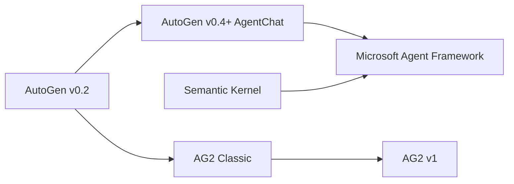
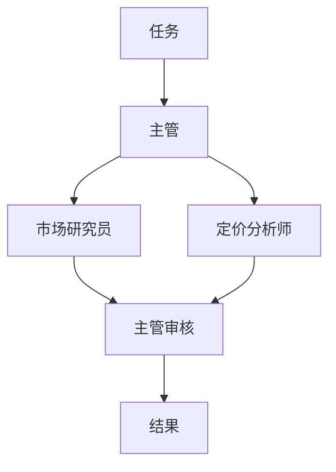

# 2026 年 AutoGen 替代方案：AutoGen 之后该何去何从

如果你正在寻找 AutoGen 替代方案，原因多半是 AutoGen 仓库顶部的那条横幅。Microsoft 已将 AutoGen 置于维护模式，并引导新用户转向 Microsoft Agent Framework。你的 AutoGen 代码仍然可以运行，但不会再有新功能，所以迟早要决定三件事：代码迁往哪里，需要改动多少，以及什么时候迁移。

本文逐一回答这三个问题。内容包括：AutoGen 发生了什么、何时发生；替代方案应该具备什么；六个选项（Microsoft Agent Framework、AG2、Swarms、LangGraph、CrewAI 和 OpenAI Agents SDK）；一张对比表；以及针对大多数 AutoGen 项目使用的三种团队模式，从 AutoGen AgentChat 到 Swarms API 的逐段对照迁移。Swarms 是我们的产品，所以在其他选项更合适的地方，我们会直接说明。

## 为什么团队现在要寻找 AutoGen 替代方案？

AutoGen 起源于 Microsoft Research，是一个用于多智能体对话的开源框架。按照[官方迁移指南](https://microsoft.github.io/autogen/stable/user-guide/agentchat-user-guide/migration-guide.html)的说法，0.4 版本是"a from-the-ground-up rewrite adopting an asynchronous, event-driven architecture"（一次采用异步、事件驱动架构的彻底重写），并包含破坏性变更。这次重写带来了 AgentChat API（`AssistantAgent`、`RoundRobinGroupChat`、`SelectorGroupChat` 以及各种终止条件），目前大多数 AutoGen 代码用的就是它。

之后，Microsoft 把智能体方面的工作转移到了一个新框架上：

- **2025 年 9 月 30 日：** AutoGen 发布 Python [v0.7.5](https://github.com/microsoft/autogen/releases)。截至 2026 年 10 月 11 日，它仍是 `autogen-agentchat` 的最新版本。
- **2025 年 10 月 1 日：** Microsoft [发布 Microsoft Agent Framework](https://azure.microsoft.com/en-us/blog/introducing-microsoft-agent-framework/)，它"converges AutoGen, a former Microsoft Research project, and the enterprise-ready foundations of Semantic Kernel"，即把 AutoGen 与 Semantic Kernel 合并为一个框架。
- **2025 年 10 月 2 日：** AutoGen 维护者 Eric Zhu 发布了一篇 [AutoGen 更新说明](https://github.com/microsoft/autogen/discussions/7066)。AutoGen 仍会得到维护，拥有稳定的 API，并会继续获得关键 bug 修复和安全补丁，但"we will not be adding significant new features to it"（不会再添加重要的新功能）。
- **2026 年 4 月 3 日：** Microsoft 发布面向 .NET 和 Python 的 [Agent Framework 1.0](https://devblogs.microsoft.com/agent-framework/microsoft-agent-framework-version-1-0/)，称其为"the production-ready release: stable APIs, and a commitment to long-term support"（可用于生产的版本：稳定的 API，以及长期支持承诺）。
- **2026 年 4 月：** [AutoGen README](https://github.com/microsoft/autogen) 加上了维护模式横幅："AutoGen is now in maintenance mode. It will not receive new features or enhancements and is community managed going forward."（AutoGen 现已进入维护模式，不会再获得新功能或增强，今后由社区管理。）贡献仅限于 bug 修复、安全补丁和文档，新用户被引导从 Microsoft Agent Framework 开始。`main` 分支上最近的一次提交是 2026 年 4 月 6 日，正是这次横幅更新。

今天什么都不会坏。代码采用 MIT 许可，锁定版本的包照常可以安装，你的智能体也照常工作。变化在于未来：新的模型功能、新协议和新的编排模式都会在其他项目中发布，而修复工作现在依赖一个由社区管理的仓库。对生产系统来说，这已足以成为规划迁移的理由，即使还谈不上紧急。

### 你用的是哪一个 AutoGen？

有三样不同的东西都叫 AutoGen，适合你的 AutoGen 替代方案取决于你运行的是哪一个。



- **Microsoft AutoGen（v0.4 及以后）。** 包名为 `autogen-agentchat`、`autogen-core` 和 `autogen-ext`；导入语句形如 `from autogen_agentchat.agents import AssistantAgent`。进入维护模式的就是这个项目。
- **AG2 Classic。** 社区分支对旧版 `ConversableAgent` API 的延续，通过 `import autogen` 导入。它的 [README](https://github.com/ag2ai/ag2-classic) 说明它以 `autogen` 包的名字发布在 PyPI 上，并且本身也处于维护模式。
- **`pyautogen`。** Microsoft 的迁移指南写道"We no longer have admin access to the `pyautogen` PyPI package"（我们已不再拥有 `pyautogen` PyPI 包的管理权限），并说明从 0.2.34 版本起，该包的发布已不再来自 Microsoft。

如果你的代码导入的是 `autogen_agentchat`，本文其余部分可以直接套用。如果导入的是 `autogen`，并使用 `ConversableAgent` 和 `initiate_chat`，请先阅读 AG2 一节。

## AutoGen 替代方案应该具备什么？

在比较各个选项之前，先列出你的 AutoGen 代码实际用到了什么。决定大多数迁移的是下面这些问题：

- **你使用的团队模式。** 在代码中搜索 `RoundRobinGroupChat`、`SelectorGroupChat`、`Swarm`（AutoGen 的交接式团队，与 Swarms 无关）、`MagenticOneGroupChat` 和 `AgentTool`。每个替代方案覆盖的子集都不同，[蜂群架构详解](/zh/blog/swarm-architectures-explained)很好地梳理了这些模式所对应的结构。
- **停止的方式。** AutoGen 的[终止条件](https://microsoft.github.io/autogen/stable/user-guide/agentchat-user-guide/tutorial/termination.html)（`TextMentionTermination`、`MaxMessageTermination`、`TokenUsageTermination`、`TimeoutTermination`、`HandoffTermination` 等，可以用 `|` 和 `&` 组合）是防止群聊无限进行下去的关键。确认替代方案提供什么：轮次上限、评审智能体，还是由你自己写循环。失控的对话是多智能体系统的[静默失败模式](/zh/blog/multi-agent-system-failure-modes)之一。
- **你的模型提供商。** AutoGen 的扩展包提供了 OpenAI、Azure OpenAI、Azure AI、Anthropic 和 Ollama 的客户端。确认替代方案覆盖了你实际调用的那些。
- **工具与 MCP。** Python 函数工具、通过 `McpWorkbench` 接入的 MCP 服务器，以及代码执行，都需要有地方安放。
- **状态与人工参与。** AutoGen 团队会在多次运行之间保留对话，直到你调用 `reset()`；`UserProxyAgent` 则把人引入循环。想清楚你是否需要持久化检查点和暂停后恢复，还是自己携带历史记录就够了。
- **运行位置。** 大多数选项是运行在你进程内的库，托管 API 则替你运行编排。
- **维护信号。** 谁在维护，多久发布一次，采用什么许可证。

## 2026 年最佳 AutoGen 替代方案

### 1. Microsoft Agent Framework：官方的 AutoGen 替代品

[Microsoft Agent Framework](https://github.com/microsoft/agent-framework)（MAF）是 Microsoft 为同时取代 AutoGen 和 Semantic Kernel 而打造的项目。它的迁移指南说，它由"the core AutoGen and Semantic Kernel teams at Microsoft"（Microsoft 的 AutoGen 和 Semantic Kernel 核心团队）开发。它采用 MIT 许可，支持 Python 和 .NET（Go SDK 在一个[单独的仓库](https://github.com/microsoft/agent-framework-go)中），通过 `pip install agent-framework` 安装。多智能体工作运行在基于图的 `Workflow` API 之上，内置顺序、并发、交接、群聊和 Magentic-One 编排，另有检查点、人工参与支持、OpenTelemetry 追踪、中间件、DevUI 调试器，以及 MCP 和 A2A 支持。发布频繁：`agent-framework` 于 2026 年 10 月 8 日在 PyPI 上发布了 [1.21.0](https://pypi.org/project/agent-framework/)。

**对 AutoGen 用户的优势。** 单智能体 API 与你现有的非常接近：Eric Zhu 的公告说 MAF 的单智能体接口"almost identical to AutoGen's"（与 AutoGen 的几乎相同），而 [AutoGen 迁移指南](https://learn.microsoft.com/en-us/agent-framework/migration-guide/from-autogen/)逐项对照讲解了模型客户端、工具、MCP、流式输出和团队。群聊保持了熟悉的形态：[`GroupChatBuilder`](https://learn.microsoft.com/en-us/agent-framework/workflows/orchestrations/group-chat) 接受 `selection_func` 来实现轮询或自定义选择，也可以接受一个用模型挑选发言者的 `orchestrator_agent`，这覆盖了 `SelectorGroupChat` 的功能。你还能获得 Microsoft 的长期支持承诺。

**权衡。** 团队变成了 Workflow，所以编排层仍然需要重写。如果你用过 AutoGen Core 的分布式运行时，迁移指南写道"Agent Framework focuses on single-process composition today; distributed execution is planned"（Agent Framework 目前专注于单进程组合，分布式执行仍在计划中）。示例偏重 Azure 和 Microsoft Foundry；仓库中有 Anthropic、Gemini、Bedrock、Mistral、Ollama 等提供商的包，但其中一些在 PyPI 上仍是预发布版本。编排仍由你自己运行，所有提供商的密钥也由你自己持有。

**适合：** 已经在使用 Azure、Foundry 或 .NET 的团队，以及希望在厂商支持下以最短代码路径离开 AutoGen 的人。如果你要留在 Microsoft 技术栈中，这就是正确的选择，下面其他选项主要在你需要 MAF 不提供的东西时才值得考虑。

### 2. AG2：社区分支

[AG2](https://github.com/ag2ai/ag2) 自称"AG2 (formerly AutoGen)"（AG2，原 AutoGen）。它采用 Apache 2.0 许可，由来自多个组织的志愿者维护，Chi Wang 和 Qingyun Wu 被列为项目管理员。AG2 现在有两条产品线：

- **AG2 Classic** 保留 `autogen.*` 命名空间及其中的类：`ConversableAgent`、`AssistantAgent`、`UserProxyAgent`、`GroupChat` 和 `GroupChatManager`，以及嵌套对话和顺序对话。它位于 [ag2ai/ag2-classic](https://github.com/ag2ai/ag2-classic)，处于维护模式，只提供"security and critical bug fixes only"（仅安全修复和关键 bug 修复）。
- **AG2 v1**（`pip install ag2`，`import ag2`）是正在积极开发的框架。1.0.0 版于 2026 年 7 月 27 日发布到 [PyPI](https://pypi.org/project/ag2/)，1.1.2 版于 2026 年 10 月 3 日跟进。它的核心是一个异步的 `Agent`，多个智能体通过由一个中心节点（hub）和类型化通道组成的 Network 进行协调。

**优势。** 如果你的代码是旧的 `ConversableAgent` 风格，AG2 Classic 能让它无需重写就继续运行，而且下一版本也由同一个社区在开发。AG2 v1 通过 `ag2[openai]`、`ag2[anthropic]`、`ag2[gemini]` 等扩展支持多个提供商。

**权衡。** Classic 同样处于维护模式，所以它只是为你争取时间。AG2 README 明确表示 v1"is not a drop-in upgrade from Classic. The agent model, orchestration, and imports all changed."（不能直接替换 Classic，智能体模型、编排和导入方式都变了。）而如果你使用的是 Microsoft 的 AgentChat（导入 `autogen_agentchat`），AG2 也没有捷径：它的 API 与 AgentChat 不同，所以迁移过去同样是一次重写，工作量与其他选项相当。

**适合：** 拥有 v0.2 风格 AutoGen 代码、并希望继续使用以对话为核心、由社区运营的项目的团队。

### 3. Swarms（通过 Swarms API）：一次 API 调用实现 AutoGen 的团队模式

[Swarms API](https://docs.swarms.ai/docs/documentation/getting-started/quickstart) 是一个托管的多智能体服务。向 `POST /v1/swarm/completions` 发送一次请求，就能描述智能体（名称、系统提示词、模型）、协调它们的架构（`swarm_type`）以及任务。服务器运行这些智能体，并返回每个智能体的输出以及 token 用量和费用。`swarm_type` 接受 [14 个取值](https://docs.swarms.ai/docs/documentation/multi-agent/swarm_completions)，包括 `RoundRobin`、`GroupChat`、`HierarchicalSwarm`、`MultiAgentRouter`、`PlannerWorkerSwarm`、`MixtureOfAgents`、`MajorityVoting` 和 `DebateWithJudge`。单个智能体则运行在 `POST /v1/agent/completions` 上。

**对 AutoGen 用户的优势。** 常见的 AutoGen 团队都能对应到有名字的架构：`RoundRobinGroupChat` 对应 `RoundRobin`，由规划者主导的 `SelectorGroupChat` 对应 `HierarchicalSwarm`，`MagenticOneGroupChat` 最接近 `PlannerWorkerSwarm`。切换模式只需改一个字段，智能体定义保持不变，因此可以低成本地测试[辩论、投票或评审会](/zh/blog/multi-agent-collaboration-patterns)是否比你的群聊效果更好。不需要托管编排运行时，任何能发送 HTTP 请求的语言都可以调用它。每个智能体各自选择 `model_name`，所以一个团队可以混用多家提供商，并可用 `fallback_models` 做故障切换。智能体可以通过 `mcp_url` 访问 MCP 服务器，输出可以通过 `stream: true` 流式返回，每个响应都会报告用量和费用。

**权衡。** API 是无状态的：每个请求都从零开始，上下文需要你通过 `history`（智能体端点）或 `messages`（蜂群端点）传入。它没有像 `SelectorGroupChat` 那样在每条消息后由模型挑选下一位发言者的机制，也没有可组合的终止条件：`max_loops` 限制轮数（最多 50），而遇到"APPROVE"之类的短语就提前退出，需要你自己写循环，下面的示例 1 会展示。Python 函数工具不会在服务器上运行；`tools_list_dictionary` 返回结构化的工具调用，由你的代码执行，而 MCP 服务器（以及智能体端点上内置的 `auto_search` 和 `web_scraper` 工具）在服务器端运行。由于是托管服务，提示词和数据会发送到 API；如果所有东西都必须留在你自己的进程内，开源的 Swarms 框架（[docs.swarms.world](https://docs.swarms.world)）是自托管的途径，本文只使用 API。单次蜂群端点对所有套餐开放，而批量蜂群运行和 GraphWorkflow 需要付费套餐。

**适合：** 原本为了团队模式而使用 AutoGen、希望把这些模式变成一次 API 调用的团队；想在同一组智能体上比较不同架构的团队；或想混用多家模型厂商、又不想运行编排基础设施的团队。下面的迁移部分给出了代码。

### 4. LangGraph

[LangGraph](https://github.com/langchain-ai/langgraph)（MIT 许可，来自 LangChain）自称"low-level orchestration framework for building, managing, and deploying long-running, stateful agents"（用于构建、管理和部署长时间运行、有状态智能体的底层编排框架）。你定义类型化的状态、节点和边，LangGraph 则提供可在故障后恢复的持久化执行、人工参与中断，以及短期和长期记忆。它有 Python 和 JavaScript 两个版本，`langgraph` 在 2026 年 10 月 6 日的版本是 [1.2.14](https://pypi.org/project/langgraph/)。

**优势。** 控制流是显式的，原生支持循环和条件边，并内置检查点。如果你的 AutoGen 团队本质上是一个披着对话外衣的状态机，LangGraph 会让这个结构清晰可见。

**权衡。** 群聊需要你自己设计，包括状态模式、节点和路由函数，所以一行 `RoundRobinGroupChat` 会变成一张小图。追踪和托管部署来自 LangSmith，这是一个独立的商业产品。

**适合：** 需要持久化执行、分支和可恢复状态的工作流。如果之后想比较图引擎，可以阅读 [Swarms GraphWorkflow 与 LangGraph 对比](/zh/blog/swarms-graphworkflow-vs-langgraph)，以及逐个模式讲解的 [LangGraph 到 Swarms 迁移指南](/zh/blog/migrating-from-langgraph-to-swarms)。

### 5. CrewAI

[CrewAI](https://github.com/crewAIInc/crewAI)（MIT 许可）是一个 Python 框架，有两个基本构件：Crews，即基于角色、围绕任务协作的智能体团队；以及 Flows，即用于精确控制的事件驱动工作流。一个 crew 可以按顺序流程运行，也可以按层级流程运行，后者会"automatically assigns a manager to the defined crew to properly coordinate the planning and execution of tasks through delegation and validation of results"（自动为 crew 指派一名管理者，通过委派和结果验证来协调任务的规划与执行）。`crewai` 包在 2026 年 10 月 9 日的版本是 [1.15.27](https://pypi.org/project/crewai/)，支持 Python 3.10 到 3.13。

**优势。** 角色、目标和任务易于阅读，能直接对应业务流程的描述方式。层级流程接近由规划者主导的 `SelectorGroupChat`。

**权衡。** 工作单元是带有预期输出的任务，这与自由形式的对话是不同的思维模型，所以提示词和控制逻辑都需要重新设计。托管部署和可观测性来自商业产品 CrewAI AMP Suite。

**适合：** 每个智能体都有明确角色和交付物的业务流程自动化。代码层面的比较请看 [Swarms 与 CrewAI 对比](/zh/blog/swarms-vs-crewai)。

### 6. OpenAI Agents SDK

[OpenAI Agents SDK](https://github.com/openai/openai-agents-python)（MIT 许可）是一个"lightweight yet powerful framework for building multi-agent workflows"（轻量而强大的多智能体工作流框架），并且"provider-agnostic, supporting the OpenAI Responses and Chat Completions APIs, as well as 100+ other LLMs"（不绑定提供商，支持 OpenAI Responses 和 Chat Completions API，以及 100 多种其他 LLM）。它的基本组件包括智能体、交接、智能体即工具、护栏、会话、人工参与和追踪。它有 Python 和 JavaScript 版本；`openai-agents` 在 2026 年 10 月 2 日的版本是 [0.23.1](https://pypi.org/project/openai-agents/)。

**优势。** AutoGen 的 `Swarm` 团队（交接）和 `AgentTool` 可以直接对应到交接和智能体即工具。会话负责跨多次运行管理对话历史，并内置追踪。

**权衡。** 没有群聊预设；轮询和选择器模式需要你自己编写。这个包仍处于 0.x 版本。

**适合：** 围绕专家之间相互交接而构建的助手。更深入的比较请看 [OpenAI Agents SDK 与 Swarms 对比](/zh/blog/openai-agents-sdk-vs-swarms)。

## AutoGen 替代方案对比

| | 维护方 | 许可证 | 语言 | 运行位置 | 多智能体模型 | 最新版本（PyPI，2026 年 10 月 11 日） |
|---|---|---|---|---|---|---|
| Microsoft Agent Framework | Microsoft | MIT | Python、.NET（Go 单独提供） | 你的进程（可选 Foundry 托管） | 图工作流：顺序、并发、交接、群聊、Magentic | 1.21.0 |
| AG2 | 志愿维护者 | Apache 2.0 | Python | 你的进程 | 由中心节点和通道组成的 Network（Classic：GroupChat） | 1.1.2 |
| **Swarms API** | Swarms | 托管服务 | 任何支持 HTTP 的语言 | 托管 | 14 种 `swarm_type` 架构 | 不适用 |
| LangGraph | LangChain | MIT | Python、JavaScript | 你的进程（可选 LangSmith） | 类型化状态图 | 1.2.14 |
| CrewAI | CrewAI | MIT | Python 3.10 到 3.13 | 你的进程（可选 AMP） | Crews（顺序、层级）和 Flows | 1.15.27 |
| OpenAI Agents SDK | OpenAI | MIT | Python、JavaScript | 你的进程 | 交接和智能体即工具 | 0.23.1 |
| AutoGen（作为参照） | 社区管理 | MIT（代码） | Python、.NET | 你的进程 | RoundRobin、Selector、Swarm、MagenticOne 团队 | 0.7.5（2025 年 9 月 30 日） |

更广泛的框架比较请看 [2026 年多智能体框架对比](/zh/blog/multi-agent-framework-comparison-2026)。

## 现在应该继续使用 AutoGen 吗？

迁移并不总是迫在眉睫。在以下情况下，暂时继续使用 AutoGen 是合理的：

- **系统稳定且版本已锁定。** 如果你不需要等新功能，依赖也都已锁定，代码就会继续正常工作。
- **用于研究或原型。** AutoGen 和 AutoGen Studio 仍然适合用来探索多智能体对话。README 本身也说 AutoGen Studio"is not meant to be a production-ready app"（并非面向生产环境的应用）。
- **迁移会与其他工作冲突。** 按你自己的节奏安排迁移，而不是等到提供商 API 变更或出现安全公告时被动应对。

如果选择继续使用，请锁定版本，关注仓库中的安全修复，并记录每个服务使用了哪些团队模式，因为这份清单就是你的迁移计划。

## 如何从 AutoGen 迁移到 Swarms？

本文余下部分把三个 AutoGen AgentChat 团队迁移到 Swarms API。AutoGen 代码遵循最新版本（0.7.5）的 AgentChat 文档：围绕模型客户端构建的异步智能体、带终止条件的团队，以及返回 `TaskResult` 的 `team.run()`。Swarms 代码使用 `aiohttp` 发送普通的 HTTP 请求，并从 `SWARMS_API_KEY` 环境变量读取密钥。智能体运行在 [`/v1/agent/completions`](https://docs.swarms.ai/docs/documentation/capabilities/agent) 上，团队运行在 [`/v1/swarm/completions`](https://docs.swarms.ai/docs/documentation/multi-agent/swarm_completions) 上。

```bash
# AutoGen (before)
pip install -U "autogen-agentchat" "autogen-ext[openai]"
export OPENAI_API_KEY="..."

# Swarms API (after)
pip install aiohttp python-dotenv
export SWARMS_API_KEY="..."   # from https://swarms.world/platform/api-keys
```

每个示例中都有两处变化。第一，模型客户端消失了：每个智能体在 `model_name` 中写明自己的模型，一个密钥就能覆盖[模型列表](https://docs.swarms.ai/api-reference/models/get-available-ai-models)中的所有提供商。第二，不再有需要在任务之间保持存活或重置的团队对象：每次调用都是一个普通的 HTTP 请求。AutoGen AgentChat 本来就是异步的，所以 `aiohttp` 版本保留了你熟悉的 `async`/`await` 写法。

### 概念对照

| AutoGen AgentChat | Swarms API | 说明 |
|---|---|---|
| `OpenAIChatCompletionClient(model=...)` | 每个智能体上的 `model_name` | 按智能体设置，所以一个团队可以混用多家提供商。可添加 `fallback_models` 做故障切换 |
| `AssistantAgent(name, system_message=..., description=...)` | 智能体配置中的 `agent_name`、`system_prompt`、`description` | description 有助于需要在智能体之间做选择的架构 |
| `agent.run(task=...)` | `POST /v1/agent/completions`，携带 `agent_config` 和 `task` | |
| `team.run(task=...)` | `POST /v1/swarm/completions`，携带 `agents`、`swarm_type` 和 `task` | |
| `RoundRobinGroupChat` | `swarm_type: "RoundRobin"` | 固定顺序，共享完整历史 |
| 带规划者的 `SelectorGroupChat` | `swarm_type: "HierarchicalSwarm"` | 主管负责规划和委派，然后审核 |
| 挑选单个专家的 `SelectorGroupChat` | `swarm_type: "MultiAgentRouter"` | 每个任务做一次路由决策 |
| `MagenticOneGroupChat` | `swarm_type: "PlannerWorkerSwarm"` | 最接近的匹配：规划者、执行者，以及决定是否再运行一轮的评审者 |
| 使用 `HandoffMessage` 的 `Swarm` 团队，或 `AgentTool` | 智能体配置中的 `handoffs` | 参见[交接示例](https://docs.swarms.ai/docs/examples/examples/agent-handoffs) |
| `MaxMessageTermination(n)` | `max_loops` | 对 `RoundRobin` 来说，一个 loop 就是每个智能体各发言一次；最多 50 |
| `TextMentionTermination("APPROVE")` | 你自己循环中的一个判断 | 见示例 1 |
| `TaskResult.messages` | `output`，一个由 `{"role", "content"}` 轮次组成的列表 | 智能体端点上为 `outputs` |
| 团队上下文保留到 `reset()` 为止 | 无状态请求 | 通过 `history`（智能体）或 `messages`（蜂群）传入之前的轮次 |
| `tools=[python_function]` | `tools_list_dictionary` | 返回工具调用，由你的代码执行 |
| `McpWorkbench` | `mcp_url`、`mcp_config` 或 `mcp_urls` | 由服务器调用 MCP 工具；参见 [MCP 集成](https://docs.swarms.ai/docs/documentation/capabilities/mcp_integration) |
| `run_stream()`、`model_client_stream=True` | `stream: true`（蜂群）或 `streaming_on`（智能体） | |
| 每条消息上的 `models_usage` | 响应中的 `usage` | 整次运行的 token 数和费用 |
| `UserProxyAgent` | 两次请求，中间插入人工步骤 | |

### 示例 1：两个智能体的对话

[AgentChat 团队教程](https://microsoft.github.io/autogen/stable/user-guide/agentchat-user-guide/tutorial/teams.html)中的双智能体示例，是把一个写作者和一个评审者放进 `RoundRobinGroupChat`，在评审者说出"APPROVE"时停止。这里另外加了消息数量上限。

**AutoGen AgentChat（迁移前）**

```python
import asyncio

from autogen_agentchat.agents import AssistantAgent
from autogen_agentchat.conditions import MaxMessageTermination, TextMentionTermination
from autogen_agentchat.teams import RoundRobinGroupChat
from autogen_ext.models.openai import OpenAIChatCompletionClient


async def main() -> None:
    model_client = OpenAIChatCompletionClient(model="gpt-5.4")

    writer = AssistantAgent(
        "writer",
        model_client=model_client,
        system_message="You write concise product announcements.",
    )
    critic = AssistantAgent(
        "critic",
        model_client=model_client,
        system_message=(
            "Review the latest draft and give specific feedback. "
            "Reply with APPROVE when the draft needs no more changes."
        ),
    )

    # Stop when the critic approves, or after the task plus 8 agent messages.
    termination = TextMentionTermination("APPROVE") | MaxMessageTermination(9)
    team = RoundRobinGroupChat([writer, critic], termination_condition=termination)

    result = await team.run(task="Write a 100-word announcement for our new usage dashboard.")
    for message in result.messages:
        print(f"{message.source}: {message.content}\n")
    print("Stopped because:", result.stop_reason)

    await model_client.close()


asyncio.run(main())
```

**Swarms API（迁移后）**

```python
import asyncio
import os

import aiohttp
from dotenv import load_dotenv

load_dotenv()

API_KEY = os.environ["SWARMS_API_KEY"]
BASE_URL = "https://api.swarms.world"
HEADERS = {"x-api-key": API_KEY, "Content-Type": "application/json"}

WRITER = {
    "agent_name": "Writer",
    "description": "Writes and revises product announcements",
    "system_prompt": "You write concise product announcements.",
    "model_name": "gpt-5.4",
    "max_loops": 1,
}
CRITIC = {
    "agent_name": "Critic",
    "description": "Reviews drafts and approves them",
    "system_prompt": (
        "Review the draft and give specific feedback. "
        "Reply with APPROVE when the draft needs no more changes."
    ),
    "model_name": "claude-sonnet-5",
    "max_loops": 1,
}


async def run_agent(session, agent_config, task, history=None):
    """Run one turn on POST /v1/agent/completions and return the reply text."""
    payload = {"agent_config": agent_config, "task": task}
    if history:
        payload["history"] = history
    async with session.post(f"{BASE_URL}/v1/agent/completions", json=payload) as resp:
        if resp.status >= 400:
            body = await resp.text()
            raise RuntimeError(f"{resp.status}: {body}")
        result = await resp.json()
    # "outputs" is a list of {"role": ..., "content": ...} turns.
    turns = [
        turn
        for turn in result["outputs"]
        if str(turn.get("role", "")).lower() not in ("user", "system")
    ]
    return str(turns[-1]["content"])


async def main() -> None:
    task = "Write a 100-word announcement for our new usage dashboard."
    writer_history = []
    prompt = task

    # One session for the whole conversation; each call gets up to 120 seconds.
    timeout = aiohttp.ClientTimeout(total=120)
    async with aiohttp.ClientSession(headers=HEADERS, timeout=timeout) as session:
        for _ in range(4):  # 4 writer turns and 4 critic turns, like MaxMessageTermination(9)
            draft = await run_agent(session, WRITER, prompt, writer_history)
            print(f"Writer:\n{draft}\n")
            writer_history += [
                {"role": "user", "content": prompt},
                {"role": "assistant", "content": draft},
            ]

            review = await run_agent(session, CRITIC, f"Task: {task}\n\nDraft:\n{draft}")
            print(f"Critic:\n{review}\n")
            if "APPROVE" in review:  # the TextMentionTermination("APPROVE") check
                break
            prompt = f"Revise your draft using this feedback:\n{review}"


asyncio.run(main())
```

**有什么变化。** 终止条件变成了两行 Python：一个 `for` 循环负责消息上限，一个 `if` 负责批准短语。写作者按照[对话历史指南](https://docs.swarms.ai/docs/examples/examples/conversation-history)通过 `history` 字段保留自己的上下文，而评审者只需要最新的草稿，所以不传历史，这也让它的 token 数保持稳定。两个智能体现在运行在不同的提供商上。如果你不需要提前退出，这两个智能体也可以作为一次 `RoundRobin` 请求运行（见示例 2），把 `max_loops` 设为轮数即可。

### 示例 2：轮询群聊

三位专家轮流讨论同一个方案，每个人都能看到之前说过的所有内容，共进行两整轮。

**AutoGen AgentChat（迁移前）**

```python
import asyncio

from autogen_agentchat.agents import AssistantAgent
from autogen_agentchat.conditions import MaxMessageTermination
from autogen_agentchat.teams import RoundRobinGroupChat
from autogen_ext.models.openai import OpenAIChatCompletionClient


async def main() -> None:
    model_client = OpenAIChatCompletionClient(model="gpt-5.4")

    strategist = AssistantAgent(
        "product_strategist",
        model_client=model_client,
        system_message=(
            "You define positioning, target personas and differentiation. "
            "Build on what earlier speakers said."
        ),
    )
    marketer = AssistantAgent(
        "growth_marketer",
        model_client=model_client,
        system_message=(
            "You propose acquisition channels and a launch plan. "
            "Build on what earlier speakers said."
        ),
    )
    engineer = AssistantAgent(
        "sales_engineer",
        model_client=model_client,
        system_message=(
            "You cover integration requirements and a proof-of-concept plan. "
            "Build on what earlier speakers said."
        ),
    )

    # 1 task message + 3 agents x 2 rounds = 7 messages.
    team = RoundRobinGroupChat(
        [strategist, marketer, engineer],
        termination_condition=MaxMessageTermination(7),
    )

    result = await team.run(
        task=(
            "Draft a go-to-market plan for an AI code review tool "
            "for engineering teams of 20 to 100 developers."
        )
    )
    for message in result.messages:
        print(f"{message.source}:\n{message.content}\n")

    await model_client.close()


asyncio.run(main())
```

**Swarms API（迁移后）**

```python
import asyncio
import os

import aiohttp
from dotenv import load_dotenv

load_dotenv()

API_KEY = os.environ["SWARMS_API_KEY"]
BASE_URL = "https://api.swarms.world"
HEADERS = {"x-api-key": API_KEY, "Content-Type": "application/json"}


async def main() -> None:
    payload = {
        "name": "GTM roundtable",
        "description": "Three specialists take turns on one go-to-market plan",
        "swarm_type": "RoundRobin",
        "task": (
            "Draft a go-to-market plan for an AI code review tool "
            "for engineering teams of 20 to 100 developers."
        ),
        "max_loops": 2,  # every agent speaks twice, in list order
        "agents": [
            {
                "agent_name": "Product Strategist",
                "description": "Positioning and target personas",
                "system_prompt": (
                    "You define positioning, target personas and differentiation. "
                    "Build on what earlier speakers said."
                ),
                "model_name": "gpt-5.4",
                "max_loops": 1,
            },
            {
                "agent_name": "Growth Marketer",
                "description": "Acquisition channels and launch plan",
                "system_prompt": (
                    "You propose acquisition channels and a launch plan. "
                    "Build on what earlier speakers said."
                ),
                "model_name": "claude-sonnet-5",
                "max_loops": 1,
            },
            {
                "agent_name": "Sales Engineer",
                "description": "Integration requirements and proof of concept",
                "system_prompt": (
                    "You cover integration requirements and a proof-of-concept plan. "
                    "Build on what earlier speakers said."
                ),
                "model_name": "gpt-5.4-mini",
                "max_loops": 1,
            },
        ],
    }

    # Multi-agent runs can take minutes, so give the whole request room.
    timeout = aiohttp.ClientTimeout(total=600)
    async with aiohttp.ClientSession(headers=HEADERS, timeout=timeout) as session:
        async with session.post(f"{BASE_URL}/v1/swarm/completions", json=payload) as resp:
            resp.raise_for_status()
            result = await resp.json()

    for turn in result["output"]:
        print(f"{turn['role']}:\n{turn['content']}\n")
    print("Seconds:", result["execution_time"])
    print("Usage:", result["usage"])


asyncio.run(main())
```

**有什么变化。** 这是本文中最接近一一对应的映射。[RoundRobin](https://docs.swarms.ai/docs/documentation/multi-agent/round_robin) 架构按你列出的顺序访问智能体，每个 loop 完整轮转一遍名单，并让每个智能体看到截至当前的完整对话，这正是 `RoundRobinGroupChat` 通过广播所做的事。唯一需要换算的是：`MaxMessageTermination` 计算的是消息数（包括任务本身），而 `max_loops` 计算的是轮数。把应该开启讨论的智能体放在第一位，把负责收尾的放在最后。

### 示例 3：选择器群聊

AutoGen 文档中主要的 [`SelectorGroupChat` 示例](https://microsoft.github.io/autogen/stable/user-guide/agentchat-user-guide/selector-group-chat.html)，把一个负责拆解任务、分派子任务的规划智能体与几位专家搭配起来，同时由一个模型在每条消息之后挑选下一位发言者。Swarms API 没有逐条消息的发言者选择。它的 [GroupChat](https://docs.swarms.ai/docs/documentation/multi-agent/group_chat) 架构是一份共享记录，每个智能体依次发言，所以与规划者主导的选择器群聊行为相符的文档化架构是 [HierarchicalSwarm](https://docs.swarms.ai/docs/documentation/multi-agent/hierarchical_swarm)：一个主管智能体拆解任务、委派给执行者，再审核并综合返回的结果。



**AutoGen AgentChat（迁移前）**

```python
import asyncio

from autogen_agentchat.agents import AssistantAgent
from autogen_agentchat.conditions import MaxMessageTermination, TextMentionTermination
from autogen_agentchat.teams import SelectorGroupChat
from autogen_ext.models.openai import OpenAIChatCompletionClient


async def main() -> None:
    model_client = OpenAIChatCompletionClient(model="gpt-5.4")

    planner = AssistantAgent(
        "PlanningAgent",
        description="Plans the work. Should be the first to engage when given a new task.",
        model_client=model_client,
        system_message=(
            "You break the task into subtasks and assign each one as '<agent> : <task>'. "
            "Your team: MarketResearcher, PricingAnalyst. You do not do the work yourself. "
            "When every subtask is done, summarize the findings and end with TERMINATE."
        ),
    )
    researcher = AssistantAgent(
        "MarketResearcher",
        description="Researches competitors, segments and market size.",
        model_client=model_client,
        system_message="You research competitors, customer segments and market size.",
    )
    analyst = AssistantAgent(
        "PricingAnalyst",
        description="Analyzes competitor pricing and proposes price tiers.",
        model_client=model_client,
        system_message="You analyze competitor pricing and propose price tiers with reasoning.",
    )

    termination = TextMentionTermination("TERMINATE") | MaxMessageTermination(25)
    team = SelectorGroupChat(
        [planner, researcher, analyst],
        model_client=model_client,  # picks the next speaker after every message
        termination_condition=termination,
    )

    result = await team.run(
        task=(
            "Recommend launch pricing for an AI code review tool for teams of "
            "20 to 100 developers. Cover competitors, segments and three price tiers."
        )
    )
    print(result.messages[-1].content)

    await model_client.close()


asyncio.run(main())
```

**Swarms API（迁移后）**

```python
import asyncio
import os

import aiohttp
from dotenv import load_dotenv

load_dotenv()

API_KEY = os.environ["SWARMS_API_KEY"]
BASE_URL = "https://api.swarms.world"
HEADERS = {"x-api-key": API_KEY, "Content-Type": "application/json"}


async def main() -> None:
    payload = {
        "name": "Pricing study",
        "description": "A director plans the work and delegates to two specialists",
        "swarm_type": "HierarchicalSwarm",
        "task": (
            "Recommend launch pricing for an AI code review tool for teams of "
            "20 to 100 developers. Cover competitors, segments and three price tiers."
        ),
        "director_model_name": "gpt-5.4",
        "director_settings": {"temperature": 0.2},
        "max_loops": 1,
        "agents": [
            {
                "agent_name": "Market Researcher",
                "description": "Researches competitors, segments and market size",
                "system_prompt": "You research competitors, customer segments and market size.",
                "model_name": "claude-sonnet-5",
                "max_loops": 1,
            },
            {
                "agent_name": "Pricing Analyst",
                "description": "Analyzes competitor pricing and proposes price tiers",
                "system_prompt": "You analyze competitor pricing and propose price tiers with reasoning.",
                "model_name": "gpt-5.4",
                "max_loops": 1,
            },
        ],
    }

    # Multi-agent runs can take minutes, so give the whole request room.
    timeout = aiohttp.ClientTimeout(total=600)
    async with aiohttp.ClientSession(headers=HEADERS, timeout=timeout) as session:
        async with session.post(f"{BASE_URL}/v1/swarm/completions", json=payload) as resp:
            resp.raise_for_status()
            result = await resp.json()

    for turn in result["output"]:
        print(f"{turn['role']}:\n{turn['content']}\n")


asyncio.run(main())
```

**有什么变化。** `PlanningAgent` 离开了名单。`HierarchicalSwarm` 会自动创建主管，你在 `agents` 中列出的每个智能体都作为执行者运行，所以在那里再加一个规划者，只会让主管多一个执行者。规划者的模型移到 `director_model_name`，它的采样设置移到 `director_settings`；较低的 temperature 会让委派更一致。"TERMINATE"约定和选择器提示词都不再需要，因为由主管决定任务何时分派完毕、何时审核完成。这就是把[管理者与执行者模式](/zh/blog/manager-worker-agent-architectures)显式化。如果你的选择器群聊主要是为了把每个任务发给一位专家，请改用 `MultiAgentRouter`；如果它是一个长时间运行的 Magentic-One 式团队，可以试试 `PlannerWorkerSwarm`，它会在评审者判定目标完成时提前结束。

### 迁移清单

1. 盘点每个 AutoGen 团队：类型、智能体、终止条件和工具。
2. 用上面的表把每个团队映射到一个 `swarm_type`，并把每个 `system_message` 原样移到 `system_prompt`。
3. 从 `GET /v1/models/available` 为每个智能体挑选 `model_name`，在宕机代价较高的地方加上 `fallback_models`。
4. 把消息上限换算成 `max_loops` 轮数，并为任何基于短语的提前退出编写循环。
5. 把 Python 工具放到 MCP 服务器后面，或者在你自己的代码中执行 `tools_list_dictionary` 返回的工具调用。
6. 用存储下来的 `history` 或 `messages` 替代保存的团队状态，以你自己的会话 ID 作为键。
7. 在相同任务上并行运行新旧两个版本，比较输出和 `usage` 中的费用，然后一次切换一个团队。

如需在 API 上从零构建团队的更长教程，请看[如何用 Python 构建智能体蜂群](/zh/blog/build-agent-swarm-python)；想了解背后的概念，请看[什么是多智能体编排？](/zh/blog/what-is-multi-agent-orchestration)

## 常见问题

### AutoGen 被弃用了吗？

AutoGen 仍然可以使用，但 Microsoft 已将它置于维护模式。README 说它"will not receive new features or enhancements and is community managed going forward"（不会再获得新功能或增强，今后由社区管理），贡献仅限于 bug 修复、安全补丁和文档。Microsoft 建议新项目使用 Microsoft Agent Framework，并为现有用户发布了迁移指南。

### 最好的 AutoGen 替代方案是什么？

取决于你要去哪里。如果你在 Microsoft 技术栈中，或想要最相似的 API 和厂商支持，Microsoft Agent Framework 最合适。AG2 适合拥有旧版 `ConversableAgent` 代码的团队，LangGraph 适合需要持久化状态和显式分支的工作流，而 Swarms API 适合希望把 AutoGen 的团队模式变成一次托管 API 调用、并为每个智能体选择不同模型的团队。

### AutoGen 和 AG2 有什么区别？

AutoGen 是 Microsoft 的项目，现已进入维护模式，当前的 API 是 AgentChat（`autogen_agentchat`）。AG2 是一个由社区运营、自称"formerly AutoGen"（原 AutoGen）的项目。它维护着 AG2 Classic，保留旧的 `autogen.*` API，并以 `autogen` 的名字发布在 PyPI 上；同时开发 AG2 v1（`pip install ag2`），这是一个新框架，不能直接替换 Classic。

### Microsoft Agent Framework 与 AutoGen 对比：迁移时会有哪些变化？

单智能体变化不大：AutoGen 维护者表示 MAF 的单智能体接口与 AutoGen 的几乎相同，另外增加了中间件和托管工具等功能。变化最大的是团队，因为 MAF 用基于图的 `Workflow` API，以及用于顺序、并发、交接、群聊和 Magentic 编排的构建器，取代了 AutoGen 的 `Team` 类。如果你依赖 AutoGen Core 的分布式运行时，请先查看 Microsoft 的指南，因为 MAF 中的分布式执行仍被列为计划中。

### Swarms API 有与 SelectorGroupChat 对应的功能吗？

没有基于模型、逐条消息的发言者选择。对于最常见的情况，也就是一个规划者把子任务分派给各位专家，`HierarchicalSwarm` 提供一个负责规划、委派和审核的主管。如果要把每个任务路由给最合适的单个智能体，请使用 `MultiAgentRouter`。

### 可以一次只迁移一个 AutoGen 团队吗？

可以。每个 Swarms 团队就是一次 HTTP 请求，所以你可以在现有应用中只替换一个 AutoGen 团队，其余代码继续在 AutoGen 上运行。用相同的输入运行两个版本，比较输出和响应中的 `usage` 数据，满意之后再切换。
