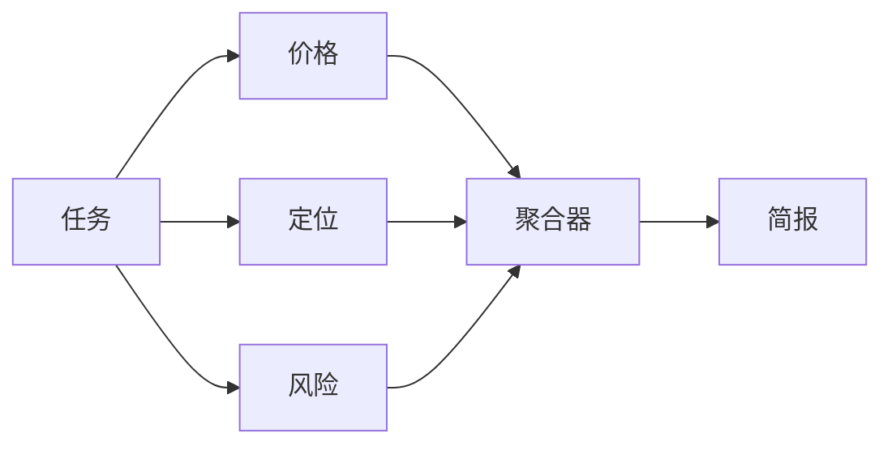
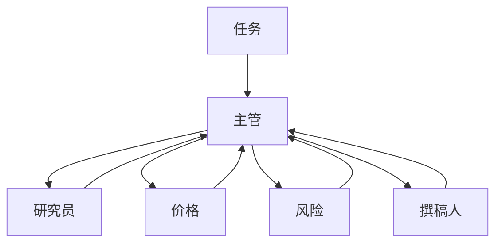

# 如何用 Python 构建智能体蜂群：分步教程

本教程一步一步地演示如何用托管的 Swarms API 在 Python 中构建智能体蜂群（agent swarm）。你先用单个智能体为一款产品写一份竞品分析简报，然后把工作拆成一条流水线，让多个专家智能体并行起草并合并它们的草稿，最后搭建一个层级蜂群：由一个主管（director）智能体规划简报，并把各部分工作分派给执行者（worker）。整个过程中任务始终不变，所以你能清楚地看到每种架构在代码、输出和成本上分别改变了什么。

所有调用都通过 `aiohttp` 走 HTTP。不需要安装智能体框架，也不需要自己托管模型：每一步都是发往 `https://api.swarms.world` 的一个 JSON 请求体，响应里带有输出、token 数量和成本。最后一步讲进入生产环境时需要改什么：结构化输出、成本追踪、速率限制和批量运行。

如果你还在犹豫是否需要不止一个智能体，请先读[单智能体与多智能体](/zh/blog/single-agent-vs-multi-agent)。想了解"蜂群"这个词背后的思想，[什么是群体智能](/zh/blog/what-is-swarm-intelligence)从蚁群一路讲到 LLM 智能体。

## 你将构建什么

贯穿全文的示例是一份一页纸的竞品分析简报：市场定位、价格对比、主要风险和三条建议。输入是一份简短的产品说明，产品是一个虚构的发票应用 Acme Invoice。把这份说明换成你自己的产品，每一步照样能运行。

同一份简报会用五种方式构建：

1. 一个智能体写完整份简报。
2. 一条流水线：研究员、分析师和撰稿人依次运行。
3. 三个专家智能体并行起草各自的部分，然后同样三个专家再运行一次，并由一个聚合器合并它们的草稿。
4. 一个层级蜂群：主管规划简报，把工作交给四个执行者。
5. 可选：让 API 替你设计团队，或者由你手写执行流程。


由于各步骤之间只有请求体在变，你可以在同一份产品说明上运行所有步骤，并排比较简报内容和打印出来的成本。这种比较是这份智能体蜂群教程能给你的最有用的东西：针对你自己的任务，用实测数据回答"多加的智能体值不值"。

每一步都是一个独立脚本。它们都导入第 0 步里的一个小型共享模块，所以后面的脚本都很短：

```text
swarm-tutorial/
  .env
  common.py            # step 0: setup, helpers, the task
  step1_agent.py
  step2_pipeline.py
  step3_concurrent.py
  step3_mixture.py
  step4_hierarchical.py
  ...
```

## 第 0 步：在 Python 中配置 Swarms API

**获取 API key。** 在 [swarms.world](https://swarms.world) 注册账号，然后在 [API Keys 页面](https://swarms.world/platform/api-keys)生成一个 key。[API Key 配置指南](https://docs.swarms.ai/docs/documentation/getting-started/api-key-setup)有完整步骤。新账号会获得免费额度，本文用到的计费端点要求账户余额高于 1.00 美元。key 只显示一次，请立即保存。

**安装两个包。**

```bash
pip install aiohttp python-dotenv
```

**把 key 存进项目目录下的 `.env` 文件**，并确保这个文件不进入版本控制：

```bash
SWARMS_API_KEY=your_api_key_here
```

**创建 `common.py`。** 它包含 base URL、`x-api-key` 请求头、几个辅助函数和任务本身。后面每个脚本都从它导入。

```python
# common.py: shared setup for every step in this tutorial
import asyncio
import os

import aiohttp
from dotenv import load_dotenv

load_dotenv()

API_KEY = os.environ["SWARMS_API_KEY"]  # fails fast with KeyError if the key is missing

BASE_URL = "https://api.swarms.world"
HEADERS = {"x-api-key": API_KEY, "Content-Type": "application/json"}
# Multi-agent runs can take minutes, so give the whole request room.
TIMEOUT = aiohttp.ClientTimeout(total=600)


def new_session():
    """Open one session per program, inside a coroutine, and reuse it for every call."""
    return aiohttp.ClientSession(headers=HEADERS, timeout=TIMEOUT)


async def post(session, path, payload):
    """POST to the Swarms API. Returns the JSON body or raises with the error detail."""
    async with session.post(f"{BASE_URL}{path}", json=payload) as resp:
        if resp.status >= 400:
            body = await resp.text()
            raise RuntimeError(f"{path} returned {resp.status}: {body}")
        return await resp.json()


async def run_agent(session, payload):
    return await post(session, "/v1/agent/completions", payload)


async def run_swarm(session, payload):
    return await post(session, "/v1/swarm/completions", payload)


def print_turns(turns):
    """Print a list of {"role": ..., "content": ...} turns."""
    for turn in turns:
        print(f"\n=== {turn['role']} ===\n{turn['content']}")


def print_usage(result):
    """Agent completions report total_cost directly; swarm completions nest it in billing_info."""
    usage = result.get("usage") or {}
    cost = usage.get("total_cost", (usage.get("billing_info") or {}).get("total_cost"))
    print(f"\ntokens: {usage.get('total_tokens')}  cost: ${cost}")


PRODUCT_NOTES = """
Product: Acme Invoice (a made-up example), invoicing and expense tracking for freelancers.
Pricing: free for up to 5 clients, then $12 per month.
Strengths: invoices built from time logs, multi-currency, receipt capture on mobile.
Gaps: no payroll, no inventory, integrations limited to Stripe and PayPal.
Customers: solo freelancers and two-person studios in the US and EU.
Competitors to cover: a full small-business accounting suite, a free invoice
generator, and a payments platform with built-in invoicing.
"""


def make_task(notes):
    return (
        "Write a one-page competitive analysis brief for the product below. "
        "Cover positioning, a pricing comparison, the main risks, and three "
        "recommendations for the next two quarters. Use only the facts given "
        "and label anything else as an assumption.\n" + notes
    )


TASK = make_task(PRODUCT_NOTES)


async def main():
    async with new_session() as session:
        # Health check from the quickstart: is the API reachable?
        async with session.get(f"{BASE_URL}/health") as resp:
            print(await resp.json())
        # A 200 with your balance confirms the key works.
        async with session.get(f"{BASE_URL}/v1/account/credits") as resp:
            print(resp.status, await resp.json())


if __name__ == "__main__":
    asyncio.run(main())
```

运行 `python common.py`。API 正常时，健康检查会返回一个 `status` 为 `"ok"` 的 JSON；`/v1/account/credits` 返回 200 并带上你的余额，说明 key 有效。健康检查的写法沿用 [Swarms API 快速入门](https://docs.swarms.ai/docs/documentation/getting-started/quickstart)。

这个文件里有几个选择会在后面派上用场。调用 API 的辅助函数都是协程，第一个参数是一个 aiohttp 会话（session）：每个脚本在自己的 `main()` 协程里用 `new_session()` 打开一个会话，并在所有调用中复用它。`post()` 在抛出异常前会先读取响应体，因为 `422` 的响应体会指出到底是哪个字段没通过校验，这是修正错误请求体最快的办法。会话的超时时间设得很宽松，因为一次多智能体运行在返回前要发起很多次模型调用。`print_usage()` 从两个位置读取成本，因为单智能体端点和蜂群端点报告成本的方式不同（第 6 步会讲到这两种）。每个脚本都以 `asyncio.run(main())` 结尾；在 Jupyter 中事件循环已经在运行，请改用 `await main()`。

## 第 1 步：运行单个智能体

**变化：** 还没有需要编排的东西。一个智能体拿到系统提示词、模型和任务，你把它发到 `POST /v1/agent/completions`。在 [Agent Completions 参考文档](https://docs.swarms.ai/docs/documentation/capabilities/agent)中，请求由一个 `agent_config` 对象加一个 `task` 字符串组成。如果想回顾"智能体"这个词具体指什么，请看[什么是 AI 智能体](/zh/blog/what-is-an-agent)。

```python
# step1_agent.py: one agent writes the whole brief (uses common.py from step 0)
import asyncio

from common import TASK, new_session, print_usage, run_agent

payload = {
    "agent_config": {
        "agent_name": "Competitive Analyst",
        "description": "Writes competitive analysis briefs for product teams",
        "system_prompt": (
            "You are a product marketing analyst. Write short, specific "
            "competitive briefs with clear headings. Do not invent figures."
        ),
        "model_name": "claude-sonnet-5",
        "max_loops": 1,
        "max_tokens": 4096,
        "temperature": 0.4,
    },
    "task": TASK,
}


async def main():
    async with new_session() as session:
        result = await run_agent(session, payload)
    print(result["outputs"][-1]["content"])
    print_usage(result)


asyncio.run(main())
```

`outputs` 是一个消息列表，每条消息都有 `role`（智能体的名字）和 `content`。取最后一条就是智能体的最终回答。如果省略 `model_name`，API 会使用 `claude-sonnet-5`。`temperature` 的取值范围是 0 到 2，`max_loops` 表示智能体处理任务的轮数。

**示例输出**（已删节，数值省略）：

```json
{
  "job_id": "agent-...",
  "success": true,
  "name": "Competitive Analyst",
  "description": "Writes competitive analysis briefs for product teams",
  "temperature": 0.4,
  "outputs": [
    {
      "role": "Competitive Analyst",
      "content": "# Acme Invoice: Competitive Brief\n\n## Positioning\nAcme Invoice sits between the free invoice generator and the accounting suite: more automation than the first, much less setup than the second..."
    }
  ],
  "usage": { "input_tokens": ..., "output_tokens": ..., "total_tokens": ..., "total_cost": ... },
  "timestamp": "..."
}
```

对很多任务来说这已经够用，如果简报质量不错，就停在这里。问题出现在质量不好的时候：一个提示词同时负责研究、分析和写作，结果不理想时你分不清是哪一环出了问题，也没法给写作环节换一个不同于分析环节的提示词或模型。拆分工作可以同时解决这两个问题。（如果你希望智能体先去查资料，这个端点还接受在请求体顶层加上 `"tools_enabled": ["auto_search"]`，按每次请求收取一笔固定费用。）

## 第 2 步：用 SequentialWorkflow 把智能体串成流水线

**变化：** 端点换成 `POST /v1/swarm/completions`，`agent_config` 变成一个 `agents` 列表，`swarm_type` 指定如何协调它们。使用 [`SequentialWorkflow`](https://docs.swarms.ai/docs/documentation/multi-agent/sequential_workflow) 时，每个智能体在上一个之后运行，并接收它的输出。[Swarm Completions 参考文档](https://docs.swarms.ai/docs/documentation/multi-agent/swarm_completions)列出了这个端点接受的所有字段。

**原因：** 每个阶段都有自己的提示词和模型，而且每个中间结果你都能读到。这里研究员用 `gpt-5.4-mini` 做一项范围很窄的信息提取，分析师用 `gpt-5.4`，撰稿人用 `claude-sonnet-5`。每个提示词还写明了哪些工作要留给下一个智能体，这样研究员就不会自己把整份简报写完。

```python
# step2_pipeline.py: researcher -> analyst -> writer (uses common.py from step 0)
import asyncio

from common import TASK, new_session, print_turns, print_usage, run_swarm

PIPELINE_AGENTS = [
    {
        "agent_name": "Market Researcher",
        "description": "Extracts facts and open questions from product notes",
        "system_prompt": (
            "List the facts in the product notes that matter for competition: "
            "pricing, features, gaps, customers, and each competitor type. "
            "End with open questions. Leave analysis and writing to later agents."
        ),
        "model_name": "gpt-5.4-mini",
        "max_loops": 1,
        "max_tokens": 4096,
        "temperature": 0.2,
    },
    {
        "agent_name": "Competitive Analyst",
        "description": "Compares the product with each competitor type",
        "system_prompt": (
            "Using the researcher's notes, compare the product with each "
            "competitor type on price, features, and target customer. "
            "Rank the three biggest risks. Leave the final write-up to the writer."
        ),
        "model_name": "gpt-5.4",
        "max_loops": 1,
        "max_tokens": 4096,
        "temperature": 0.3,
    },
    {
        "agent_name": "Brief Writer",
        "description": "Turns the analysis into a one-page brief",
        "system_prompt": (
            "Write a one-page competitive brief from the analysis: positioning, "
            "pricing comparison, risks, and three recommendations. Plain language. "
            "Use no figures that are missing from your input."
        ),
        "model_name": "claude-sonnet-5",
        "max_loops": 1,
        "max_tokens": 4096,
        "temperature": 0.5,
    },
]

payload = {
    "name": "Competitive Brief Pipeline",
    "description": "Research, analyze, then write a competitive brief",
    "swarm_type": "SequentialWorkflow",
    "max_loops": 1,
    "task": TASK,
    "agents": PIPELINE_AGENTS,
}


async def main():
    async with new_session() as session:
        result = await run_swarm(session, payload)
    print_turns(result["output"])
    print_usage(result)


if __name__ == "__main__":
    asyncio.run(main())
```

对这种蜂群类型，文档说明 `output` 中每个智能体对应一轮，顺序与 `agents` 数组相同，所以这个列表同时也是流水线的执行轨迹。`if __name__ == "__main__"` 守卫让后面的步骤可以导入 `PIPELINE_AGENTS` 而不触发流水线运行。

**示例输出**（已删节，数值省略）：

```json
{
  "job_id": "swarm-...",
  "status": "success",
  "swarm_name": "Competitive Brief Pipeline",
  "description": "Research, analyze, then write a competitive brief",
  "swarm_type": "SequentialWorkflow",
  "output": [
    { "role": "Market Researcher", "content": "Facts: free for up to 5 clients, then $12 per month; invoices built from time logs... Open questions: how many users pass the 5-client limit?" },
    { "role": "Competitive Analyst", "content": "Accounting suite: covers payroll and inventory, heavier setup. Free generator: wins on price, no time-log invoicing... Top risks: 1. Payments platforms bundle invoicing..." },
    { "role": "Brief Writer", "content": "# Acme Invoice: Competitive Brief\n\n## Positioning\n..." }
  ],
  "number_of_agents": 3,
  "execution_time": ...,
  "usage": {
    "input_tokens": ...,
    "output_tokens": ...,
    "total_tokens": ...,
    "billing_info": { "cost_breakdown": { ... }, "total_cost": ... }
  }
}
```

当每个阶段确实需要上一阶段的完整产出时，流水线就是合适的形态。[顺序、并发与图工作流](/zh/blog/agent-orchestration-patterns)更深入地讨论了这个选择。

### 用 swarms-client SDK 运行同一条流水线

如果你更习惯用 SDK 调用，官方的 [`swarms-client`](https://docs.swarms.ai/docs/documentation/clients/python-client) 包封装了同一个端点。用 `pip install swarms-client` 安装。[Python Client 文档](https://docs.swarms.ai/docs/documentation/clients/python-client)建议显式传入 `base_url`，因为不传时客户端会回退到它自己内置的默认地址。

```python
# sdk_pipeline.py: step 2's pipeline through swarms-client (reuses common.py and step2_pipeline.py)
import os

from dotenv import load_dotenv
from swarms_client import SwarmsClient

from common import TASK
from step2_pipeline import PIPELINE_AGENTS

load_dotenv()

client = SwarmsClient(
    api_key=os.getenv("SWARMS_API_KEY"),
    base_url="https://api.swarms.world",
)

response = client.swarms.run(
    name="Competitive Brief Pipeline",
    description="Research, analyze, then write a competitive brief",
    swarm_type="SequentialWorkflow",
    max_loops=1,
    task=TASK,
    agents=PIPELINE_AGENTS,
)
print(response)
```

本教程其余部分继续使用 `aiohttp`，因为下面用到的一些端点（比如 Auto Agent Builder）还没有被 SDK 封装，而且原始请求体可以和文档一一对应。

## 第 3 步：并行运行专家智能体，再合并它们的草稿

**变化：** 流水线变成扇出结构。三个专家（价格、定位、风险）用 [`ConcurrentWorkflow`](https://docs.swarms.ai/docs/documentation/multi-agent/concurrent_workflow) 同时各写一部分。然后同样三个专家以 [`MixtureOfAgents`](https://docs.swarms.ai/docs/documentation/multi-agent/mixture_of_agents) 的方式运行，它会额外加入一个聚合器，把草稿合并成一份简报。

**原因：** 这三个部分互不依赖，所以并行运行能缩短总耗时，而且每个专家都只需处理一个简短、聚焦的提示词。在并发运行中，每个智能体收到的都是同一个原始任务，所以要靠系统提示词把每个智能体限定在自己负责的部分。

```python
# step3_concurrent.py: three specialists draft sections in parallel (uses common.py)
import asyncio

from common import TASK, new_session, print_usage, run_swarm


def specialist(name, focus):
    return {
        "agent_name": name,
        "description": f"Drafts the {focus} section of a competitive brief",
        "system_prompt": (
            f"You are a {focus} specialist. Write only the {focus} section of a "
            "competitive brief, in under 250 words, using only the facts given."
        ),
        "model_name": "gpt-5.4-mini",
        "max_loops": 1,
        "max_tokens": 2048,
        "temperature": 0.4,
    }


SPECIALISTS = [
    specialist("Pricing Analyst", "pricing"),
    specialist("Positioning Analyst", "positioning"),
    specialist("Risk Analyst", "risk"),
]

payload = {
    "name": "Competitive Brief Specialists",
    "description": "Pricing, positioning, and risk drafts in parallel",
    "swarm_type": "ConcurrentWorkflow",
    "max_loops": 1,
    "task": TASK,
    "agents": SPECIALISTS,
}


async def main():
    async with new_session() as session:
        result = await run_swarm(session, payload)
    # Turns arrive in the order the agents finished, so look them up by role.
    drafts = {turn["role"]: turn["content"] for turn in result["output"]}
    for name in ("Positioning Analyst", "Pricing Analyst", "Risk Analyst"):
        print(f"\n=== {name} ===\n{drafts.get(name, '(no output)')}")
    print_usage(result)


if __name__ == "__main__":
    asyncio.run(main())
```

文档明确指出，并发运行时各轮按照智能体完成的先后顺序进入 `output`，这个顺序可能与请求中的顺序不同。把 `output[0]` 当成"价格部分"的代码，有时对、有时错，而且两种情况都不会报错。结果按完成顺序返回，正是[多智能体系统的失败模式](/zh/blog/multi-agent-system-failure-modes)中列出的七种静默失败之一。请像上面那样按 `role` 建立索引。

**示例输出**（已删节，数值省略）：

```json
{
  "status": "success",
  "swarm_name": "Competitive Brief Specialists",
  "swarm_type": "ConcurrentWorkflow",
  "output": [
    { "role": "Risk Analyst", "content": "Risk 1: payments platforms include invoicing at no extra charge..." },
    { "role": "Pricing Analyst", "content": "Acme Invoice is free for up to 5 clients, then $12 per month..." },
    { "role": "Positioning Analyst", "content": "For freelancers who bill by the hour, Acme Invoice turns time logs into invoices..." }
  ],
  "number_of_agents": 3,
  "usage": { ... }
}
```

使用 `ConcurrentWorkflow` 时，你得到三个独立的部分，合并由你自己完成。如果想让 API 来合并，只需改一个字段：

```python
# step3_mixture.py: same specialists plus an aggregator (reuses common.py and step3_concurrent.py)
import asyncio

from common import TASK, new_session, print_usage, run_swarm
from step3_concurrent import SPECIALISTS

payload = {
    "name": "Competitive Brief Mixture",
    "description": "Specialist drafts merged into one brief",
    "swarm_type": "MixtureOfAgents",
    "max_loops": 1,
    "task": TASK,
    "agents": SPECIALISTS,
}


async def main():
    async with new_session() as session:
        result = await run_swarm(session, payload)
    merged = result["output"][-1]  # the aggregator's synthesis is the final turn
    print(f"=== {merged['role']} ===\n{merged['content']}")
    print_usage(result)


asyncio.run(main())
```



**示例输出**（已删节，数值省略）：

```json
{
  "status": "success",
  "swarm_name": "Competitive Brief Mixture",
  "swarm_type": "MixtureOfAgents",
  "output": [
    { "role": "Pricing Analyst", "content": "..." },
    { "role": "Positioning Analyst", "content": "..." },
    { "role": "Risk Analyst", "content": "..." },
    { "role": "<aggregator>", "content": "# Acme Invoice: Competitive Brief\n\nPositioning: ...\nPricing: ...\nRisks: ...\nRecommendations: 1. ..." }
  ],
  "number_of_agents": 3,
  "usage": { ... }
}
```

根据 [MixtureOfAgents 文档](https://docs.swarms.ai/docs/documentation/multi-agent/mixture_of_agents)，聚合器由 API 自己创建，一次完整运行通常以它的综合结果作为最后一轮，而 `number_of_agents` 只统计你提供的专家。请求结构里没有用于设置聚合器提示词或模型的字段。如果你需要控制合并环节，就把这项工作交给你自己定义的智能体，第 4 步和第 5 步就是这么做的。[多智能体协作模式](/zh/blog/multi-agent-collaboration-patterns)把混合智能体与投票、辩论和委员会等模式做了对比。

## 第 4 步：用 Python 构建带主管的智能体蜂群

**变化：** [`HierarchicalSwarm`](https://docs.swarms.ai/docs/documentation/multi-agent/hierarchical_swarm) 增加了一个主管：它读取任务，把任务拆成若干分工，交给执行者，再审阅交回来的结果。主管不需要你来写，蜂群会自动创建它；`agents` 里的每一项都是执行者，哪怕你把其中一个命名为 "coordinator"。主管通过两个顶层字段配置：`director_model_name`（默认 `gpt-5.4`）和 `director_settings`。

**原因：** 在第 2 步和第 3 步里，分工是你事先定好的。有了主管，计划直接来自任务本身，所以同一个团队可以处理没有价格数据的产品说明，或者有六个竞争对手的产品，而不用改代码。这就是[经理与执行者智能体架构](/zh/blog/manager-worker-agent-architectures)中描述的结构。



```python
# step4_hierarchical.py: a director delegates to four workers (uses common.py)
import asyncio

from common import TASK, new_session, print_turns, print_usage, run_swarm


def worker(name, description, prompt, model="gpt-5.4-mini"):
    return {
        "agent_name": name,
        "description": description,
        "system_prompt": prompt,
        "model_name": model,
        "max_loops": 1,
        "max_tokens": 4096,
        "temperature": 0.3,
    }


WORKERS = [
    worker(
        "Market Researcher",
        "Extracts facts, competitor types, and open questions from product notes",
        "You extract facts and open questions from product notes. You write no recommendations.",
    ),
    worker(
        "Pricing Analyst",
        "Compares pricing and packaging against each competitor type",
        "You compare pricing and packaging. Use only the prices given and label estimates.",
    ),
    worker(
        "Risk Analyst",
        "Identifies and ranks the biggest competitive risks",
        "You identify the three to five biggest competitive risks and rank them.",
    ),
    worker(
        "Brief Writer",
        "Writes the final one-page brief from the team's findings",
        "You write the final one-page competitive brief from the other agents' findings.",
        model="claude-sonnet-5",
    ),
]


def hierarchical_payload(task):
    return {
        "name": "Competitive Brief Team",
        "description": "A director plans the brief and delegates to specialists",
        "swarm_type": "HierarchicalSwarm",
        "max_loops": 1,
        "task": task,
        "agents": WORKERS,
        "director_model_name": "gpt-5.4",
        "director_settings": {"temperature": 0.2, "max_tokens": 8000},
        "list_all_agents": True,
    }


async def main():
    async with new_session() as session:
        result = await run_swarm(session, hierarchical_payload(TASK))
    print_turns(result["output"])
    print_usage(result)


if __name__ == "__main__":
    asyncio.run(main())
```

这里有三个细节起了大部分作用。执行者的 `description` 字段按岗位描述来写，因为主管是根据这份名单来做计划的，描述含糊，分派的任务也会含糊。`list_all_agents` 让每个智能体都能看到其他智能体的名字和描述，这样撰稿人就知道该等谁的结论。主管使用较低的 temperature，文档推荐这样做以获得更一致的任务拆解，而执行者保留各自的设置。蜂群层面的 `max_loops`（上限为 50）会给蜂群更多执行轮次；轮次越多，模型调用就越多，所以从 1 开始。

**示例输出**（已删节，数值省略）：

```json
{
  "job_id": "swarm-...",
  "status": "success",
  "swarm_name": "Competitive Brief Team",
  "swarm_type": "HierarchicalSwarm",
  "output": [
    { "role": "Market Researcher", "content": "Facts from the notes: ... Missing: churn data, competitor prices..." },
    { "role": "Pricing Analyst", "content": "Against the free generator, Acme Invoice charges for volume (over 5 clients)..." },
    { "role": "Risk Analyst", "content": "1. Payments platforms bundle invoicing (high). 2. ..." },
    { "role": "Brief Writer", "content": "# Acme Invoice: Competitive Brief\n\n## Positioning\n..." }
  ],
  "number_of_agents": 4,
  "execution_time": ...,
  "usage": { "input_tokens": ..., "output_tokens": ..., "total_tokens": ..., "billing_info": { ... } }
}
```

和所有蜂群类型一样，请按 `role` 读取各轮，不要依赖位置。主管会在执行者自身的调用之外再加上规划和审阅调用，所以这一步的成本应该会高于第 2 步。比较打印出来的成本和两份简报：如果流水线产出的简报一样好，就保留流水线。[什么是多智能体编排](/zh/blog/what-is-multi-agent-orchestration)更详细地讲了编排器如何保存状态、处理故障。

## 第 5 步（可选）：让 API 设计团队，或者自己写执行流程

两个更短的变体。第一个把团队设计交给 API。第二个反过来，把工作顺序精确地固定下来。

### 用 Auto Agent Builder 生成团队名单

[Auto Agent Builder](https://docs.swarms.ai/docs/documentation/multi-agent/auto_agent_builder)（`POST /v1/auto-agent-builder/completions`）接收一个任务，返回智能体配置：名字、描述、系统提示词和模型选择。它只设计团队，不运行任何东西，所以你可以在为一次运行付费之前先审阅名单。`max_agents` 是上限（构建器倾向于用能覆盖任务的最小团队），`agent_kwargs` 会把 `max_loops` 之类的设置应用到每个生成的智能体上。更多背景见[推出 Auto Agent Builder](/zh/blog/introducing-auto-agent-builder)。

```python
# step5_auto_builder.py: generate a team, review it, then run it (uses common.py)
import asyncio

from common import TASK, new_session, post, print_turns, print_usage, run_swarm


async def main():
    async with new_session() as session:
        built = await post(
            session,
            "/v1/auto-agent-builder/completions",
            {"task": TASK, "max_agents": 4, "agent_kwargs": {"max_loops": 1, "max_tokens": 4096}},
        )

        for agent in built["agents"]:
            print(f"{agent['agent_name']} ({agent['model_name']}): {agent['description']}")

        if input("\nRun this team? [y/N] ").strip().lower() == "y":
            result = await run_swarm(session, {
                "name": "Auto-built Brief Team",
                "swarm_type": "HierarchicalSwarm",
                "director_model_name": "gpt-5.4",
                "max_loops": 1,
                "task": TASK,
                "agents": built["agents"],
            })
            print_turns(result["output"])
            print_usage(result)


asyncio.run(main())
```

构建器调用的**示例输出**（已删节，数值省略）：

```json
{
  "job_id": "auto-agent-builder-...",
  "name": "auto-agent-builder",
  "status": "success",
  "agents": [
    { "agent_name": "CompetitorResearcher", "description": "Maps each competitor type...", "system_prompt": "You are...", "model_name": "gpt-5.4" },
    { "agent_name": "PricingStrategist", "description": "Compares pricing tiers...", "system_prompt": "You are...", "model_name": "gpt-5.4" },
    { "agent_name": "BriefWriter", "description": "Writes the final brief...", "system_prompt": "You are...", "model_name": "claude-sonnet-5" }
  ],
  "usage": { "input_tokens": ..., "output_tokens": ..., "total_tokens": ..., "total_cost": ..., "cost_per_agent": ... },
  "timestamp": "..."
}
```

### 用 AgentRearrange 混合顺序与并行步骤

当你已经知道执行顺序时，[`AgentRearrange`](https://docs.swarms.ai/docs/documentation/multi-agent/agent_rearrange) 让你用一个字符串把它写出来。在 `rearrange_flow` 中，`->` 表示交给下一步，逗号表示同一步内的智能体并行运行。下面的流程先运行研究员，然后价格和风险两个智能体并行，最后是撰稿人。这种蜂群类型必须提供 `rearrange_flow`。

```python
# step5_rearrange.py: research, then pricing and risk in parallel, then write
# (reuses common.py and the WORKERS list from step4_hierarchical.py)
import asyncio

from common import TASK, new_session, print_turns, print_usage, run_swarm
from step4_hierarchical import WORKERS

payload = {
    "name": "Competitive Brief Flow",
    "description": "Research first, pricing and risk in parallel, then write",
    "swarm_type": "AgentRearrange",
    "rearrange_flow": "Market Researcher -> Pricing Analyst, Risk Analyst -> Brief Writer",
    "max_loops": 1,
    "task": TASK,
    "agents": WORKERS,
}


async def main():
    async with new_session() as session:
        result = await run_swarm(session, payload)
    print_turns(result["output"])
    print_usage(result)


asyncio.run(main())
```

输出的形态和第 2 步相同：一个由 `role` 和 `content` 组成的轮次列表，流程中每个智能体一轮。它提供了 `MixtureOfAgents` 所缺少的合并控制，因为撰稿人是你自己定义的智能体。

## 第 6 步：让你的 Python 智能体蜂群进入生产环境

蜂群已经能跑了。在它无人值守地运行之前，下面这些改动值得做。

### 用 response_format 获取结构化输出

简报是给人看的，下游代码通常需要字段。[结构化输出文档](https://docs.swarms.ai/docs/documentation/capabilities/swarms_api_tools)通过任意智能体上的 `llm_args.response_format` 传入 JSON schema，蜂群里的智能体也一样。这里在第 2 步流水线的末尾加了一个格式化智能体，所以最后一轮是符合 schema 的 JSON。文档列出 `gpt-5.4` 和 `gpt-5.4-mini` 支持这种模式，因此格式化智能体使用 `gpt-5.4`。

```python
# step6_structured.py: end the pipeline with a JSON scorecard (reuses common.py and step2_pipeline.py)
import asyncio
import json

from common import TASK, new_session, print_usage, run_swarm
from step2_pipeline import PIPELINE_AGENTS

SCORECARD_FORMAT = {
    "type": "json_schema",
    "json_schema": {
        "name": "competitive_scorecard",
        "strict": True,
        "schema": {
            "type": "object",
            "properties": {
                "product": {"type": "string"},
                "threats": {
                    "type": "array",
                    "items": {
                        "type": "object",
                        "properties": {
                            "competitor": {"type": "string"},
                            "level": {"type": "string", "enum": ["low", "medium", "high"]},
                            "reason": {"type": "string"},
                        },
                        "required": ["competitor", "level", "reason"],
                        "additionalProperties": False,
                    },
                },
                "recommendations": {"type": "array", "items": {"type": "string"}},
            },
            "required": ["product", "threats", "recommendations"],
            "additionalProperties": False,
        },
    },
}

formatter = {
    "agent_name": "Scorecard Formatter",
    "description": "Converts the brief into a JSON scorecard",
    "system_prompt": "Convert the competitive brief you receive into the scorecard schema. Return only JSON.",
    "model_name": "gpt-5.4",
    "max_loops": 1,
    "max_tokens": 2048,
    "temperature": 0.0,
    "llm_args": {"response_format": SCORECARD_FORMAT},
}


async def main():
    async with new_session() as session:
        result = await run_swarm(session, {
            "name": "Competitive Brief Pipeline (JSON)",
            "swarm_type": "SequentialWorkflow",
            "max_loops": 1,
            "task": TASK,
            "agents": PIPELINE_AGENTS + [formatter],
        })

    scorecard = json.loads(result["output"][-1]["content"])  # content is a JSON string
    print(json.dumps(scorecard, indent=2))
    print_usage(result)


asyncio.run(main())
```

**示例输出**（解析后的评分卡，已删节）：

```json
{
  "product": "Acme Invoice",
  "threats": [
    { "competitor": "Payments platform with built-in invoicing", "level": "high", "reason": "..." },
    { "competitor": "Free invoice generator", "level": "medium", "reason": "..." },
    { "competitor": "Small-business accounting suite", "level": "low", "reason": "..." }
  ],
  "recommendations": ["...", "...", "..."]
}
```

设置了 `"strict": True` 和 `"additionalProperties": False` 之后，`required` 里的每个字段都一定存在，所以解析代码可以写得很短。

### 从响应中读取 token 用量和成本

每个响应都会报告这次运行用了多少。在 `/v1/agent/completions` 上，`usage` 包含 `input_tokens`、`output_tokens`、`total_tokens` 和 `total_cost`。在 `/v1/swarm/completions` 上，成本位于 `usage.billing_info` 下，并细分为按智能体收取的费用以及输入和输出 token 的费用：

```python
# step6_cost.py: where the money went in one swarm run (reuses common.py and step2_pipeline.py)
import asyncio

from common import new_session, run_swarm
from step2_pipeline import payload


async def main():
    async with new_session() as session:
        result = await run_swarm(session, payload)
    usage = result["usage"]
    billing = usage["billing_info"]
    breakdown = billing["cost_breakdown"]

    print(f"time:          {result['execution_time']}s")
    print(f"input tokens:  {usage['input_tokens']}")
    print(f"output tokens: {usage['output_tokens']}")
    print(f"agent fees:    ${breakdown['agent_cost']}")
    print(f"input cost:    ${breakdown['input_token_cost']}")
    print(f"output cost:   ${breakdown['output_token_cost']}")
    print(f"total:         ${billing['total_cost']}")
    if billing.get("discount_active"):
        print(f"discount:      {billing['discount_type']} ({billing['discount_percentage']}%)")


asyncio.run(main())
```

上面这些代码读取的 `usage` 对象的**示例输出**（结构来自文档，数值省略）：

```json
{
  "input_tokens": ...,
  "output_tokens": ...,
  "total_tokens": ...,
  "billing_info": {
    "cost_breakdown": {
      "agent_cost": ...,
      "input_token_cost": ...,
      "output_token_cost": ...,
      "token_counts": { "total_input_tokens": ..., "total_output_tokens": ..., "total_tokens": ... },
      "num_agents": 3,
      "night_time_discount_applied": false
    },
    "total_cost": ...,
    "discount_active": false,
    "discount_type": "none",
    "discount_percentage": 0
  }
}
```

在[定价页面](https://docs.swarms.ai/docs/documentation/resources/pricing)上，token 按模型计价：每个模型的价格是其提供商的价格加 15% 服务费；混用多个模型的蜂群（比如第 2 步的流水线）按智能体计费，每个智能体按它自己所用模型的价格计算。蜂群调用每个智能体另收 0.01 美元，并在太平洋时间晚 8 点到早 6 点之间享受 token 费用五折（按智能体收取的费用不打折），[夜间定价指南](https://docs.swarms.ai/docs/guides/guides/night-mode-pricing-strategy)指出判断依据是运行结束的时间。`GET /v1/models/pricing?model_name=gpt-5.4` 会返回某个模型当前每百万 token 的价格，`GET /v1/usage/costs` 会返回固定费用。把每次运行的 `total_cost` 和任务一起记录下来，你就能用数据回答"一份简报要花多少钱"。如果你还用开源框架在自己的进程里运行智能体，[追踪每个智能体的 token 用量与成本](/zh/blog/track-llm-token-usage-cost-python)讲了那边对应的统计方法。

### 控制在速率限制之内

[速率限制页面](https://docs.swarms.ai/docs/documentation/resources/ratelimits)规定免费层每分钟 100 次、每小时 350 次、每天 1,200 次请求，付费方案分别为 2,000、10,000 和 100,000 次。只有完成的计费请求才会计数。超出限制会返回 `429`，响应中的[速率限制响应头](https://docs.swarms.ai/docs/documentation/resources/rate-limit-headers)会告诉你当前状态：正常响应带有 `X-RateLimit-Remaining-Minute`，`429` 响应带有 `Retry-After`（单位为秒）。下面是一个可以直接替换 `post()` 的版本，它会等待并重试：

```python
# retry.py: retry 429s using the Retry-After header (reuses common.py)
import asyncio

from common import BASE_URL


async def post_with_retry(session, path, payload, max_retries=3):
    for attempt in range(max_retries + 1):
        async with session.post(f"{BASE_URL}{path}", json=payload) as resp:
            if resp.status == 429 and attempt < max_retries:
                wait = int(resp.headers.get("Retry-After", 60))
            elif resp.status >= 400:
                body = await resp.text()
                raise RuntimeError(f"{path} returned {resp.status}: {body}")
            else:
                remaining = resp.headers.get("X-RateLimit-Remaining-Minute")
                if remaining is not None:
                    print(f"requests left this minute: {remaining}")
                return await resp.json()
        print(f"Rate limited, retrying in {wait}s")
        await asyncio.sleep(wait)
```

另外两种错误需要单独处理：`402` 表示额度余额不足，`403` 表示该模型或端点需要付费方案。这两种情况重试都没有用。

### 用批处理端点生成大量简报

要给一整批产品写简报，`POST /v1/swarm/batch/completions` 接受一个最多包含 50 个蜂群配置的数组，在一次请求中全部运行。这是一个付费端点（Pro 和 Ultra 方案）。根据[批量蜂群文档](https://docs.swarms.ai/docs/examples/examples/batch-swarm-completions)，结果按请求顺序返回，每项都带有 `status`；输出位于 `result` 字段下（单个蜂群的响应中叫 `output`），失败的项会返回 `"status": "error"` 和一条 `detail` 信息，但不会让整个批次失败。

```python
# step6_batch.py: one brief per notes file in a single request
# (premium plans; reuses common.py and step4_hierarchical.py)
import asyncio
import json
from pathlib import Path

from common import make_task, new_session, post
from step4_hierarchical import hierarchical_payload


async def main():
    notes_files = sorted(Path("product_notes").glob("*.txt"))[:50]  # 50 specs per request max
    batch = []
    for path in notes_files:
        spec = hierarchical_payload(make_task(path.read_text()))
        spec["name"] = f"Brief: {path.stem}"
        batch.append(spec)

    async with new_session() as session:
        results = await post(session, "/v1/swarm/batch/completions", batch)

    out = Path("briefs")
    out.mkdir(exist_ok=True)
    for path, item in zip(notes_files, results):
        if item["status"] == "success":
            (out / f"{path.stem}.json").write_text(json.dumps(item["result"], indent=2))
            print(f"{path.stem}: ${item['usage']['billing_info']['total_cost']}")
        else:
            print(f"{path.stem}: failed: {item.get('detail')}")


asyncio.run(main())
```

**示例输出**（响应结构来自文档，已删节）：

```json
[
  { "status": "success", "swarm_name": "Brief: acme-invoice", "result": { ... }, "usage": { "billing_info": { "total_cost": ... } } },
  { "status": "error", "swarm_name": "Brief: other-product", "detail": "Failed to run swarm: ..." }
]
```

如果你在免费层，就改为每个产品发送一次 `/v1/swarm/completions` 请求。这正是 aiohttp 派上用场的地方：这些请求共用一个会话，`asyncio.gather` 让其中几个同时进行，各自等待自己的蜂群运行。信号量限制同时运行的数量，速率限制一节中的 `post_with_retry` 负责处理任何 `429`：

```python
# step6_parallel.py: free tier, one swarm request per notes file, a few at a time
# (reuses common.py, retry.py and step4_hierarchical.py)
import asyncio
import json
from pathlib import Path

from common import make_task, new_session
from retry import post_with_retry
from step4_hierarchical import hierarchical_payload

MAX_IN_FLIGHT = 4  # swarm runs in progress at once; retry.py handles any 429


async def run_brief(session, semaphore, path):
    async with semaphore:
        payload = hierarchical_payload(make_task(path.read_text()))
        return await post_with_retry(session, "/v1/swarm/completions", payload)


async def main():
    notes_files = sorted(Path("product_notes").glob("*.txt"))
    semaphore = asyncio.Semaphore(MAX_IN_FLIGHT)
    async with new_session() as session:
        results = await asyncio.gather(
            *(run_brief(session, semaphore, path) for path in notes_files),
            return_exceptions=True,  # collect failures instead of raising on the first one
        )

    out = Path("briefs")
    out.mkdir(exist_ok=True)
    for path, result in zip(notes_files, results):
        if isinstance(result, Exception):
            print(f"{path.stem}: failed: {result}")
        else:
            (out / f"{path.stem}.json").write_text(json.dumps(result["output"], indent=2))
            print(f"{path.stem}: ${result['usage']['billing_info']['total_cost']}")


asyncio.run(main())
```

如果安排的任务在夜间时段内结束，还能拿到 token 折扣。

## 用 Python 构建智能体蜂群时，应该选择哪种架构？

先按工作的形态来选，再用打印出来的成本确认。

| 步骤 | `swarm_type` | 适用场景 |
| --- | --- | --- |
| 1 | 无（单个智能体） | 一个提示词、一个视角就能得到好结果 |
| 2 | `SequentialWorkflow` | 每个阶段都需要上一阶段的完整产出 |
| 3 | `ConcurrentWorkflow` | 各部分互相独立，由你自己合并 |
| 3 | `MixtureOfAgents` | 希望由 API 把各自独立的草稿合并成一个答案 |
| 4 | `HierarchicalSwarm` | 分工取决于输入，因此应由主管来规划 |
| 5 | `AgentRearrange` | 你清楚确切的顺序，包括哪些步骤并行 |

API 一共提供 14 种蜂群类型，包括 `MajorityVoting`、`CouncilAsAJudge`、`GroupChat` 和 `MultiAgentRouter`；`GET /v1/swarms/available` 返回当前列表，[可用架构页面](https://docs.swarms.ai/docs/documentation/multi-agent/available-architectures)逐一介绍了它们。[蜂群架构详解](/zh/blog/swarm-architectures-explained)更深入地讨论了每种结构适合什么场景。如果你是从其他框架迁移过来的，[AutoGen 替代方案](/zh/blog/autogen-alternatives)对各种选择做了比较。

## 常见问题

### 不用框架，如何在 Python 中构建多智能体系统？

把整个系统描述成一个 JSON 请求体发到 `POST /v1/swarm/completions`：一个智能体列表、一个 `swarm_type` 和一个任务。API 会运行这些智能体，返回每个智能体的输出以及 token 数量和成本。本地只需要 `aiohttp` 和一个 API key；`swarms-client` SDK 是可选的。

### ConcurrentWorkflow 和 MixtureOfAgents 有什么区别？

两者都会让同一组专家在同一个任务上并行运行。`ConcurrentWorkflow` 为每个智能体返回一轮，合并留给你来做。`MixtureOfAgents` 额外加入一个聚合器，把各份草稿综合成最后一轮，这个聚合器无法通过请求来配置。

### HierarchicalSwarm 的主管要放进 agents 列表吗？

不用。蜂群会自己创建主管，`agents` 里的每一项都作为执行者运行，哪怕它叫 "coordinator"。用 `director_model_name`（默认 `gpt-5.4`）设置主管的模型，用 `director_settings` 设置它的采样参数。

### 通过 Swarms API 运行一个智能体蜂群要花多少钱？

每个智能体的 token 按其模型的提供商价格加 15% 服务费计费，蜂群调用每个智能体另收 0.01 美元，太平洋时间晚 8 点到早 6 点 token 费用五折。每个响应都会在 `usage` 中报告实际成本（蜂群调用位于 `usage.billing_info.total_cost`）。`GET /v1/models/pricing` 会返回某个模型当前的 token 价格，`GET /v1/usage/costs` 会返回固定费用。把同一个任务依次跑过本教程的每一步，就能看出对你的工作负载来说，多加的智能体要花多少钱。

### 一个蜂群最多能有多少个智能体？

`agents` 数组最多接受 2,000 项，`max_loops` 上限为 50；超出任一限制都会在计费之前返回 `422`。实际使用时，先用能覆盖任务的最少智能体，Auto Agent Builder 确定团队规模时也是这个思路。

### 每个智能体可以使用哪些模型？

每个智能体通过自己的 `model_name` 指定模型，可选范围见 `GET /v1/models/available`；省略时使用 `claude-sonnet-5`。少数模型（例如 `gpt-5.6` 和 `claude-opus-5`）仅限付费方案，免费层请求它们会返回 `403`，并附带推荐的替代模型。

---

本文用到的每个端点的完整参考都在 [docs.swarms.ai](https://docs.swarms.ai)。想要更多可运行的代码，[Swarms API 示例集](/zh/blog/swarms-api-examples-suite)收录了 100 多个可运行脚本，[什么是多智能体系统](/zh/blog/what-is-a-multi-agent-system)讲解了它们背后的概念。
