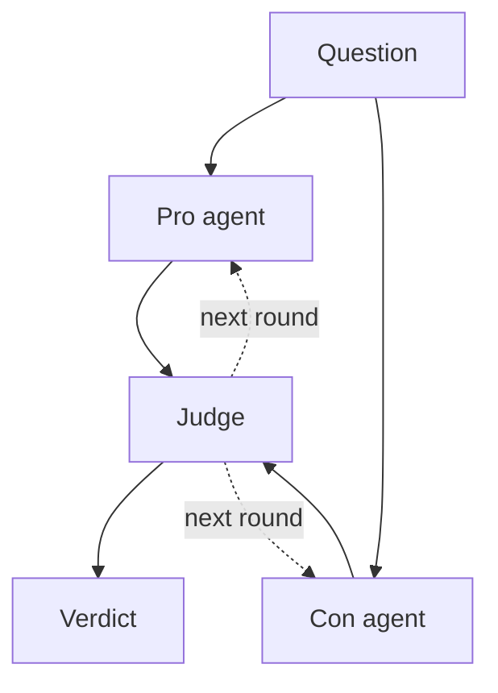
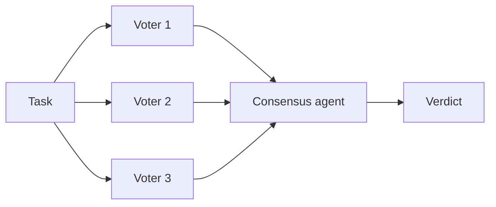
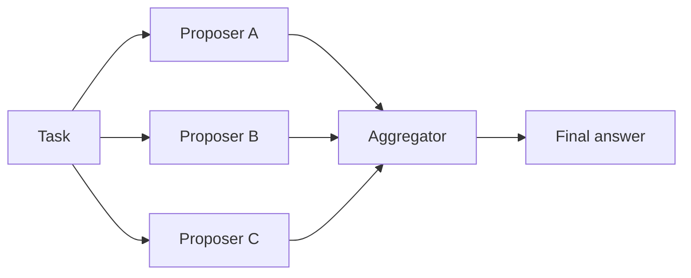
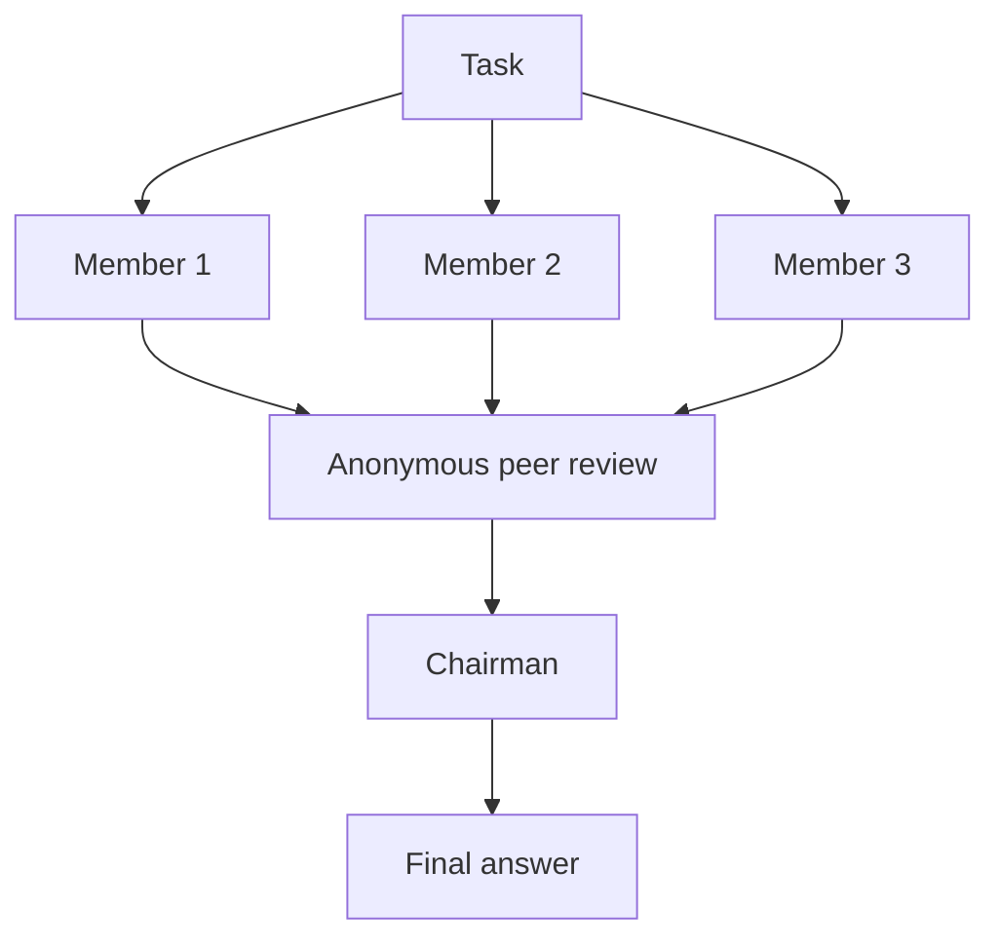
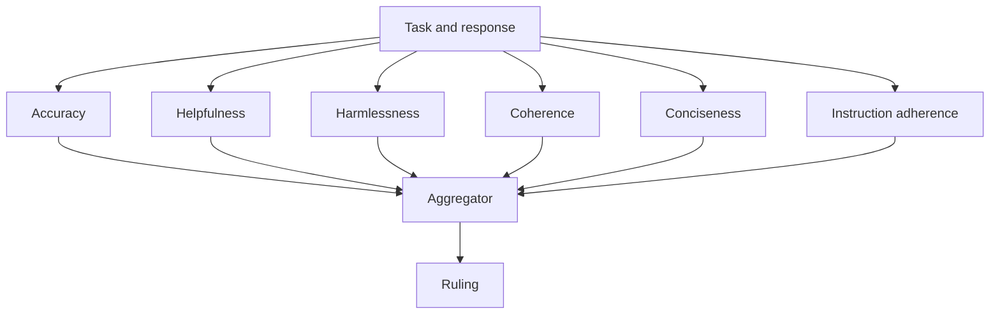
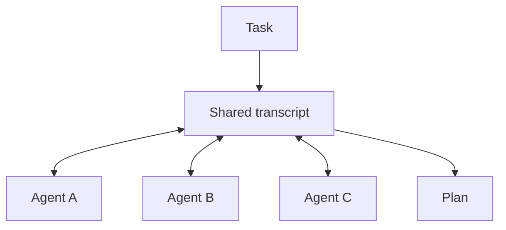

# 多智能体协作模式：辩论、投票、Mixture of Agents 与委员会

多智能体协作，指的是多个 LLM 智能体处理同一个问题，再由一条固定规则把它们的输出合并成一个答案。区分各种模式的正是这条规则：两个智能体辩论、由裁判裁决；一个小组投票；一层提议者把结果交给聚合者；或者一个委员会先各自作答、再匿名互评，最后由主席写出结论。每条规则都能追溯到一篇论文或一个知名项目，每条规则的模型调用次数都可以预估，各自适合不同类型的任务。

本指南介绍六种模式。每一种都包含一张图、它所依据的研究、适用场景、模型调用次数，以及一个可以直接复制运行的完整 Swarms API 请求。所有示例都使用同一个端点 `POST /v1/swarm/completions`，只改变 `swarm_type`。

如果你想先看全局，[什么是多智能体系统](/zh/blog/what-is-a-multi-agent-system)介绍了基础知识，[蜂群架构详解](/zh/blog/swarm-architectures-explained)列出了组织智能体团队的所有方式。本文深入讲解其中智能体共同处理同一个问题的那些模式。

## 什么是多智能体协作？

大多数多智能体系统做的是分工。研究员把结果交给写手，主管把子任务分配给工作者，路由器把每个请求发给一个专家。这属于编排，[什么是多智能体编排](/zh/blog/what-is-multi-agent-orchestration)对此有详细介绍，顺序、并发和图三种形态的对比见[智能体编排模式](/zh/blog/agent-orchestration-patterns)。

协作模式则让多个智能体处理同一个任务，然后合并它们的产出。合并这一步就是设计决策所在。你可以计票、请裁判裁决、让聚合者合并草稿，或者让智能体阅读彼此的答案并修改。每种选择都是用成本和延迟换取某一种特定的可靠性。

这些做法之所以有效，是因为相互独立的错误会相互抵消。如果三个智能体各有 20% 的概率答错，而且它们的错误互不相关，那么其中两个以同样方式答错的概率要低得多。关键在于「互不相关」。同一个模型配同一个提示词的三个副本往往会犯同样的错误，在它们之间投票只会把错误确认下来。这就是下面的示例混用不同模型家族、并给每个智能体不同任务说明的原因。[多智能体系统的失败模式](/zh/blog/multi-agent-system-failure-modes)一文讲了一个智能体的错误输出悄悄变成下一个智能体上下文时会发生什么。

## 准备工作

每个示例都需要一个 Swarms API key，可以在 [API keys 页面](https://swarms.world/platform/api-keys)获取，并存放在 `SWARMS_API_KEY` 环境变量或 `.env` 文件中：

```bash
pip install aiohttp python-dotenv
export SWARMS_API_KEY="your-api-key"
```

六种模式都通过 [Swarm Completions 端点](https://docs.swarms.ai/docs/documentation/multi-agent/swarm_completions)运行。响应的外层结构始终相同（`job_id`、`status`、`output`、`execution_time`、`usage`），其中 `output` 是一个由 `{"role": ..., "content": ...}` 组成的轮次列表，角色名取决于具体模式。下面每个代码块都是独立完整的，任意一段粘贴到文件里就能运行。[快速入门](https://docs.swarms.ai/docs/documentation/getting-started/quickstart)使用的是同样的配置，[Swarms API 示例集](/zh/blog/swarms-api-examples-suite)在这六个之外还收录了 100 多个可运行示例。

在介绍各个模式之前，先说一下成本。API 按 `agents` 列表中的每个智能体收取 0.01 美元，另加输入和输出 token 费用（[定价](https://docs.swarms.ai/docs/documentation/resources/pricing)）。token 开销和延迟取决于一个模式发起的模型调用次数，所以下面每一节都会给出这个数字。

## 模式 1：带裁判的多智能体辩论



### 工作原理

`DebateWithJudge` 需要恰好三个智能体，并按顺序排列：第一个支持命题，第二个反对命题，第三个是裁判，负责权衡双方并写出综合结论。当 `max_loops` 大于 1 时，裁判的综合结论会成为下一轮的起点，双方都必须回应裁判的反馈。完整的参数说明见 [DebateWithJudge 文档页面](https://docs.swarms.ai/docs/documentation/multi-agent/debate_with_judge)。

### 多智能体辩论背后的研究

关于 LLM 在相互辩论时推理得更好，最知名的证据来自 [Du 等人的《Improving Factuality and Reasoning in Language Models through Multiagent Debate》](https://arxiv.org/abs/2305.14325)（2023 年，发表于 ICML 2024）。在他们的设置中，同一个模型的多个实例各自作答，阅读其他实例的答案，再经过几轮修改直到收敛。在 gpt-3.5-turbo 上使用三个智能体、两轮辩论时，GSM8K 准确率从单个智能体的 77.0% 提高到辩论后的 85.0%，算术题准确率从 67.0% 提高到 81.8%。对同样三个智能体做多数投票，在 GSM8K 上达到 81.0%，可见在他们的实验中，智能体之间的交流带来了投票之外的增益。在算术任务上，准确率随智能体数量和轮数的增加而上升，作者也明确指出，辩论需要多个模型实例和多轮交互，因此成本更高。

Du 等人的方法没有指定立场，也没有裁判。`DebateWithJudge` 的正方、反方加裁判结构，更接近 [Liang 等人的《Encouraging Divergent Thinking in Large Language Models through Multi-Agent Debate》](https://arxiv.org/abs/2305.19118)（EMNLP 2024）。他们描述了一种被称为「思维退化」（Degeneration-of-Thought）的失败：模型一旦对某个答案有了信心，自我反思就不再产生新想法，即使这个答案是错的。一个持相反立场的辩手会把新的论点带进上下文，而裁判决定何时停止并提取最终答案。他们有两个发现可以直接借鉴。第一，适度的分歧比强迫辩手在每一点上都唱反调效果更好。第二，当两个辩手使用不同模型时，裁判会偏向与自己使用同一模型的一方。下面的示例让正方和反方使用同一个模型，裁判使用另一个模型，这样任何一方都没有这种优势。

### 适用场景

辩论适合「是或否」的问题，以及双方都有真实代价的 A 与 B 之间的抉择：自建还是采购，现在迁移还是以后迁移，是否批准某项政策。当单个模型容易锁定在第一种思路上时，辩论很合适。对于只有一个可验证答案的问题，先用投票，它更便宜；只有当投票的准确率不够时，再改用辩论。

### 调用成本

每轮三次调用，按顺序执行：正方、反方、裁判。`max_loops: 2` 就是六次调用，而且裁判每轮都要阅读双方的内容，输入会越来越长。

```python
import asyncio
import os

import aiohttp
from dotenv import load_dotenv

load_dotenv()

API_KEY = os.environ["SWARMS_API_KEY"]
BASE_URL = "https://api.swarms.world"
HEADERS = {"x-api-key": API_KEY, "Content-Type": "application/json"}


def text(turn):
    content = turn["content"]
    return content if isinstance(content, str) else " ".join(map(str, content))


async def main() -> None:
    payload = {
        "name": "Database Split Debate",
        "description": "Pro and Con argue, a judge rules",
        "swarm_type": "DebateWithJudge",
        "task": (
            "Should a 10-engineer startup with one Postgres database split it into "
            "one database per service this quarter? Consider delivery speed, "
            "incident risk, data consistency and hiring."
        ),
        "agents": [
            {
                "agent_name": "Pro",
                "description": "Argues for the proposition",
                "system_prompt": (
                    "You argue FOR the proposition. Give your three strongest arguments "
                    "with concrete mechanisms and answer the other side's best point. "
                    "In later rounds, respond directly to the judge's feedback."
                ),
                "model_name": "claude-sonnet-5",
                "max_loops": 1,
                "temperature": 0.5,
            },
            {
                "agent_name": "Con",
                "description": "Argues against the proposition",
                "system_prompt": (
                    "You argue AGAINST the proposition. Give your three strongest arguments "
                    "with concrete mechanisms and answer the other side's best point. "
                    "In later rounds, respond directly to the judge's feedback."
                ),
                "model_name": "claude-sonnet-5",
                "max_loops": 1,
                "temperature": 0.5,
            },
            {
                "agent_name": "Judge",
                "description": "Weighs both sides and writes the verdict",
                "system_prompt": (
                    "You are an impartial judge. Assess each side on evidence and logic, "
                    "name the strongest point from each, then give a clear verdict and "
                    "the conditions under which it would change."
                ),
                "model_name": "gpt-5.4",
                "max_loops": 1,
                "temperature": 0.2,
            },
        ],
        "max_loops": 2,  # two rounds, three calls per round
    }

    # Multi-agent runs can take minutes, so give the whole request room.
    timeout = aiohttp.ClientTimeout(total=600)
    async with aiohttp.ClientSession(headers=HEADERS, timeout=timeout) as session:
        async with session.post(f"{BASE_URL}/v1/swarm/completions", json=payload) as resp:
            resp.raise_for_status()
            result = await resp.json()

    judge_turns = [t for t in result["output"] if t["role"] == "Judge"]
    print(f"{len(judge_turns)} rounds in {result['execution_time']:.1f}s")
    print("Final verdict:\n", text(judge_turns[-1]))


asyncio.run(main())
```

## 模式 2：LLM 智能体的多数投票



### 工作原理

`MajorityVoting` 让所有智能体并行处理任务，任何一个智能体都看不到其他智能体的答案。随后一个单独的 `Consensus-Agent` 统计票数，写出最终结论及其理由。文档指出，这个共识智能体始终使用 `gpt-5.4`，无法通过请求配置。详细信息见 [MajorityVoting 文档页面](https://docs.swarms.ai/docs/documentation/multi-agent/majority_voting)和[代码评审委员会示例](https://docs.swarms.ai/docs/examples/examples/majority-voting)。

### 研究依据：自洽性

LLM 多数投票最清晰的证据来自 [Wang 等人的《Self-Consistency Improves Chain of Thought Reasoning in Language Models》](https://arxiv.org/abs/2203.11171)（ICLR 2023）。他们不再只取一条贪心解码的思维链答案，而是从同一个模型采样多条推理路径，保留出现次数最多的最终答案。论文摘要报告，与标准思维链提示相比，GSM8K 提升 17.9%，SVAMP 提升 11.0%，AQuA 提升 12.2%。

Swarms 的版本有两点不同。投票者是带有不同任务说明（本例中还使用不同模型）的不同智能体，而不是同一个模型的多次采样；最终由一个共识智能体阅读选票及其理由，而不是简单计数。当各个智能体检查的内容不同时，比如代码评审中的安全性、正确性和可维护性，这两点改变都是合理的。如果你需要论文原本的形式，也就是对同一个模型采样 N 次，高级版的[推理智能体端点](https://docs.swarms.ai/docs/documentation/capabilities/reasoning_agent)提供 `self-consistency` 类型和 `num_samples` 设置。

### 适用场景

投票需要可以直接比较的答案：批准或拒绝、一个标签、一个数字、一个选择题选项。它是给分类步骤加上第二、第三意见的最便宜方式。使用奇数个投票者以避免平票，并要求每个投票者以固定格式给出投票，这样你可以自己计票，再拿自己的统计结果去核对共识智能体的结论。

### 调用成本

N 次并行的投票者调用，加一次共识调用。三个投票者共四次调用，实际耗时大约是一次投票者调用加一次共识调用。

```python
import asyncio
import os
import re
from collections import Counter

import aiohttp
from dotenv import load_dotenv

load_dotenv()

API_KEY = os.environ["SWARMS_API_KEY"]
BASE_URL = "https://api.swarms.world"
HEADERS = {"x-api-key": API_KEY, "Content-Type": "application/json"}

DIFF = '''
def get_user(conn, username):
    query = f"SELECT * FROM users WHERE name = '{username}'"
    return conn.execute(query).fetchone()
'''

VOTE_RULE = (
    "Start your reply with exactly 'VOTE: APPROVE' or 'VOTE: REJECT', "
    "then give at most three reasons."
)

voters = [
    ("Security-Reviewer", "You review code for security flaws such as injection and unsafe input handling.", "gpt-5.4"),
    ("Correctness-Reviewer", "You review code for bugs, edge cases and wrong results.", "claude-sonnet-5"),
    ("Maintainability-Reviewer", "You review code for readability, naming and testability.", "gpt-5.4-mini"),
]


def text(turn):
    content = turn["content"]
    return content if isinstance(content, str) else " ".join(map(str, content))


async def main() -> None:
    payload = {
        "name": "PR Approval Vote",
        "description": "Independent reviewers vote on a pull request",
        "swarm_type": "MajorityVoting",
        "task": f"Vote on whether this change can merge.\n{VOTE_RULE}\n\n{DIFF}",
        "agents": [
            {
                "agent_name": name,
                "description": prompt,
                "system_prompt": f"{prompt} {VOTE_RULE}",
                "model_name": model,
                "max_loops": 1,
                "temperature": 0.2,
            }
            for name, prompt, model in voters
        ],
        "max_loops": 1,
    }

    # Multi-agent runs can take minutes, so give the whole request room.
    timeout = aiohttp.ClientTimeout(total=600)
    async with aiohttp.ClientSession(headers=HEADERS, timeout=timeout) as session:
        async with session.post(f"{BASE_URL}/v1/swarm/completions", json=payload) as resp:
            resp.raise_for_status()
            result = await resp.json()

    voter_names = {name for name, _, _ in voters}
    tally = Counter()
    for turn in result["output"]:
        match = re.match(r"\s*\**VOTE:\s*(APPROVE|REJECT)", text(turn), re.IGNORECASE)
        if turn["role"] in voter_names and match:
            tally[match.group(1).upper()] += 1

    consensus = [t for t in result["output"] if t["role"] == "Consensus-Agent"]
    print("Our tally:", dict(tally))
    print("Consensus agent:\n", text(consensus[-1]) if consensus else "(none returned)")


asyncio.run(main())
```

## 模式 3：Mixture of Agents



### 工作原理

`MixtureOfAgents` 把你的智能体作为提议者并行运行，再把所有提议交给一个聚合者，由它写出一个答案。[MixtureOfAgents 文档](https://docs.swarms.ai/docs/documentation/multi-agent/mixture_of_agents)和[尽职调查示例](https://docs.swarms.ai/docs/examples/examples/mixture-of-agents)中有两个细节会影响你的请求体。第一，API 把 `agents` 中的**最后一个**智能体用作聚合者，而这个智能体也会作为普通提议者运行一次，所以请把专门负责综合的智能体放在最后。第二，swarm 层级的 `max_loops` 决定提议者的层数。设置 `max_loops: 2` 时，每个提议者会在第二层再运行一次，并能看到第一层的合并输出。

### Mixture of Agents 背后的研究

这个模式来自 [Wang 等人的《Mixture-of-Agents Enhances Large Language Model Capabilities》](https://arxiv.org/abs/2406.04692)（2024 年，发表于 ICLR 2025）。他们的默认配置堆叠了三层、每层六个开源提议模型，最终聚合者是 Qwen1.5-110B-Chat。这个只用开源模型的配置在 AlpacaEval 2.0 上取得了 65.1% 的长度控制胜率，而 GPT-4o 为 57.5%。论文的出发点是一个被称为「协作性」（collaborativeness）的现象：模型在看到其他模型的答案后，往往能写出更好的回答，即使那些答案比它自己单独作答的水平更弱。作者也指出了主要缺点：在最后一层完成之前无法开始流式输出，因此首个 token 的延迟较高，他们建议限制层数。

### 适用场景

Mixture of Agents 适合整体评价质量的开放式生成任务：迁移方案、设计评审、技术解释、报告。增益来自多样性，所以请用不同模型家族作为提议者，并让每个提议者从不同角度处理任务。对于只有一个正确答案的任务，投票更便宜，也更容易核对。

### 调用成本

每层 N 次调用加一次聚合调用，其中 N 包括作为聚合者的那个智能体。四个智能体、一层，共五次调用；第二层再增加四次。

```python
import asyncio
import os

import aiohttp
from dotenv import load_dotenv

load_dotenv()

API_KEY = os.environ["SWARMS_API_KEY"]
BASE_URL = "https://api.swarms.world"
HEADERS = {"x-api-key": API_KEY, "Content-Type": "application/json"}


def text(turn):
    content = turn["content"]
    return content if isinstance(content, str) else " ".join(map(str, content))


async def main() -> None:
    payload = {
        "name": "Region Migration Plan",
        "description": "Three proposers, one synthesizer",
        "swarm_type": "MixtureOfAgents",
        "task": (
            "Write a step-by-step plan to move a 2 TB Postgres database to a new "
            "cloud region with under 5 minutes of write downtime. Include the "
            "rollback plan and the checks that gate each step."
        ),
        "agents": [
            {
                "agent_name": "Database-Engineer",
                "description": "Replication and cutover mechanics",
                "system_prompt": "Focus on replication setup, lag monitoring and the cutover sequence.",
                "model_name": "gpt-5.4",
                "max_loops": 1,
                "temperature": 0.3,
            },
            {
                "agent_name": "SRE",
                "description": "Operational risk and observability",
                "system_prompt": "Focus on monitoring, alerting, runbooks and what can go wrong at 3 a.m.",
                "model_name": "claude-sonnet-5",
                "max_loops": 1,
                "temperature": 0.3,
            },
            {
                "agent_name": "Risk-Reviewer",
                "description": "Failure cases and rollback",
                "system_prompt": "Focus on data loss scenarios, rollback paths and go or no-go criteria.",
                "model_name": "gpt-5.4-mini",
                "max_loops": 1,
                "temperature": 0.3,
            },
            {
                # The last agent is reused as the aggregator.
                "agent_name": "Synthesizer",
                "description": "Merges the proposals into one plan",
                "system_prompt": (
                    "You receive the task plus other engineers' proposals. Merge them into "
                    "one numbered plan, resolve conflicts explicitly, and drop repetition."
                ),
                "model_name": "gpt-5.4",
                "max_loops": 1,
                "temperature": 0.2,
            },
        ],
        "max_loops": 1,  # one proposer layer
    }

    # Multi-agent runs can take minutes, so give the whole request room.
    timeout = aiohttp.ClientTimeout(total=600)
    async with aiohttp.ClientSession(headers=HEADERS, timeout=timeout) as session:
        async with session.post(f"{BASE_URL}/v1/swarm/completions", json=payload) as resp:
            resp.raise_for_status()
            result = await resp.json()

    # The synthesizer appears twice: once as a proposer, then as the aggregator.
    synthesis = [t for t in result["output"] if t["role"] == "Synthesizer"][-1]
    print(text(synthesis))
    usage = result.get("usage") or {}
    print("Total cost:", usage.get("billing_info", {}).get("total_cost"))


asyncio.run(main())
```

## 模式 4：LLM 委员会



### 工作原理

`LLMCouncil` 分三个阶段运行。每个成员独立回答任务。答案被重新标记为 A、B、C，没人知道哪个答案出自谁，然后每个成员对所有答案排序并点评。最后由主席阅读原始答案和所有评审意见，写出最终回复。主席使用的模型通过请求中的 `chairman_model` 设置（默认 `gpt-5.1`）。[LLMCouncil 文档](https://docs.swarms.ai/docs/documentation/multi-agent/llm_council)和[委员会示例](https://docs.swarms.ai/docs/examples/examples/llm-council)给出了输出中的角色：每个成员一条回答，每个成员一条 `<member>-Evaluation` 评审，最后是一条 `Chairman` 回复。

### LLM 委员会背后的研究

这个三阶段设计沿用了 Andrej Karpathy 的 [llm-council](https://github.com/karpathy/llm-council) 项目：把一个问题发给多个模型，让每个模型在身份隐藏的情况下给其他模型的答案排序，再由一个主席模型写出最终回复。Karpathy 在 README 中称它是一个周六的业余小项目，所以请把它当作设计参考。匿名评审这一步针对的是 LLM 作为评判者相关研究中测到的一种偏差：[Zheng 等人](https://arxiv.org/abs/2306.05685)把自我增强偏差（评判者偏爱自己的答案）列为模型评判者的问题之一（他们在这一点上的证据有限）。由不同模型组成评审小组的依据来自 [Verga 等人的《Replacing Judges with Juries》](https://arxiv.org/abs/2404.18796)（2024）：在三种评判设置和六个数据集上，由不同模型家族的较小模型组成的小组优于单个大型评判模型，模型内部偏差更小，成本还低七倍以上。

### 适用场景

委员会适合合理答案各不相同、而你希望在合并之前看清分歧的判断类问题：架构选择、定价、政策、事故处理优先级。评审轮次本身就很有用，它会告诉你成员们认为哪个答案最好以及原因。文档建议使用三到五个成员，并且提示词或模型要真正不同。成员几乎一样的委员会，只会产出几乎一样的答案。

### 调用成本

每个成员两次调用（作答和评审），再加一次主席调用：2N + 1。三个成员共七次调用，每增加一个成员多两次。

```python
import asyncio
import os

import aiohttp
from dotenv import load_dotenv

load_dotenv()

API_KEY = os.environ["SWARMS_API_KEY"]
BASE_URL = "https://api.swarms.world"
HEADERS = {"x-api-key": API_KEY, "Content-Type": "application/json"}


def text(turn):
    content = turn["content"]
    return content if isinstance(content, str) else " ".join(map(str, content))


async def main() -> None:
    payload = {
        "name": "Moderation Latency Council",
        "description": "Members answer, review each other, chairman decides",
        "swarm_type": "LLMCouncil",
        "chairman_model": "gpt-5.4",
        "task": (
            "Our API's p99 latency doubled after we added an LLM moderation step "
            "before every response. Options: (a) run moderation asynchronously and "
            "retract flagged responses, (b) switch to a smaller moderation model, "
            "(c) cache verdicts for repeated content. Recommend one and say why."
        ),
        "agents": [
            {
                "agent_name": "Latency-Engineer",
                "description": "Optimizes for response time",
                "system_prompt": "You care most about latency budgets and tail behavior.",
                "model_name": "gpt-5.4",
                "max_loops": 1,
                "temperature": 0.4,
            },
            {
                "agent_name": "Trust-and-Safety",
                "description": "Optimizes for harm prevention",
                "system_prompt": "You care most about harmful content reaching users, even briefly.",
                "model_name": "claude-sonnet-5",
                "max_loops": 1,
                "temperature": 0.4,
            },
            {
                "agent_name": "Cost-Analyst",
                "description": "Optimizes for spend",
                "system_prompt": "You care most about cost per request and engineering effort.",
                "model_name": "gpt-5.4-mini",
                "max_loops": 1,
                "temperature": 0.4,
            },
        ],
        "max_loops": 1,
    }

    # Multi-agent runs can take minutes, so give the whole request room.
    timeout = aiohttp.ClientTimeout(total=600)
    async with aiohttp.ClientSession(headers=HEADERS, timeout=timeout) as session:
        async with session.post(f"{BASE_URL}/v1/swarm/completions", json=payload) as resp:
            resp.raise_for_status()
            result = await resp.json()

    for turn in result["output"]:
        if turn["role"].endswith("-Evaluation"):
            print(f"--- {turn['role']} ---\n{text(turn)[:400]}\n")

    chairman = [t for t in result["output"] if t["role"] == "Chairman"]
    print("Chairman:\n", text(chairman[-1]) if chairman else "(none returned)")


asyncio.run(main())
```

## 模式 5：委员会式评判（LLM 作为评判者）



### 工作原理

`CouncilAsAJudge` 评判一个已经存在的回答。你在 `task` 中同时放入原始提示词和待评判的回答，API 会并行运行六个评判者，每个负责一个固定维度：准确性、有用性、无害性、连贯性、简洁性和指令遵循。随后一个聚合者阅读这六份点评，写出最终裁决。`council_judge_model_name` 设置给出最终裁决的模型（默认 `gpt-5.4`）。委员会会自己构建评判者，所以你发送的智能体不会被运行。[CouncilAsAJudge 文档](https://docs.swarms.ai/docs/documentation/multi-agent/council_as_a_judge)要求在 `agents` 中放一个占位条目，它按每个智能体的费率计费，但从不执行。评判维度和评判者的提示词都是固定的。[评估示例](https://docs.swarms.ai/docs/examples/examples/council-as-judge)给出了输出中的角色：从 `accuracy_judge` 到 `instruction_adherence_judge`，最后是 `aggregator_agent`。

### LLM 作为评判者背后的研究

这方面的标准参考文献是 [Zheng 等人的《Judging LLM-as-a-Judge with MT-Bench and Chatbot Arena》](https://arxiv.org/abs/2306.05685)（NeurIPS 2023 Datasets and Benchmarks）。他们发现，GPT-4 作为评判者与人类偏好的一致率超过 80%，与人类之间相互一致的比例大致相当。他们也记录了模型评判者出错的地方：位置偏差（在两两比较中偏向排在前面的答案）、冗长偏差（偏向更长但没有增加信息的答案）、自我增强偏差，以及在数学和推理题上评判能力不足：即使评判者自己能解出题目，也可能被眼前的答案误导。他们提出的缓解方法包括交换答案位置，以及给评判者提供参考答案。

把评估拆成六个范围较窄的评分标准，让每个评判者的工作更小；一次只评判一个回答，也避开了两两比较中的位置偏差。其他偏差仍可能存在，所以对于数学或事实类任务，请在 `task` 中连同回答一起放入参考答案。

### 适用场景

把它当作生成之后的质量关卡：在草稿发出之前打分，在同一组任务上比较不同提示词或模型，或者把回答标记出来交给人工审核。它产出的是点评，所以请把它和一个负责生成的模式搭配使用。常见的做法是先用 `MixtureOfAgents` 写草稿，再用 `CouncilAsAJudge` 打分，然后才交给用户。

### 调用成本

每评判一个回答需要七次调用（六个评判者加一个聚合者），与 `agents` 中放了什么无关。

```python
import asyncio
import os

import aiohttp
from dotenv import load_dotenv

load_dotenv()

API_KEY = os.environ["SWARMS_API_KEY"]
BASE_URL = "https://api.swarms.world"
HEADERS = {"x-api-key": API_KEY, "Content-Type": "application/json"}

original_task = "Explain to a junior engineer when to add a database index."
candidate = (
    "Indexes always make queries faster, so add one to every column. "
    "They have no downside because the database maintains them for free."
)


def text(turn):
    content = turn["content"]
    return content if isinstance(content, str) else " ".join(map(str, content))


async def main() -> None:
    payload = {
        "name": "Answer Review Council",
        "description": "Six judges grade one response, an aggregator rules",
        "swarm_type": "CouncilAsAJudge",
        "council_judge_model_name": "gpt-5.4",
        "task": f"Task: {original_task}\n\nResponse: {candidate}",
        "agents": [
            {
                # Required by the API for this type, but never executed.
                "agent_name": "placeholder",
                "description": "Not run by CouncilAsAJudge",
                "model_name": "gpt-5.4-mini",
                "max_loops": 1,
            }
        ],
        "max_loops": 1,
    }

    # Multi-agent runs can take minutes, so give the whole request room.
    timeout = aiohttp.ClientTimeout(total=600)
    async with aiohttp.ClientSession(headers=HEADERS, timeout=timeout) as session:
        async with session.post(f"{BASE_URL}/v1/swarm/completions", json=payload) as resp:
            resp.raise_for_status()
            result = await resp.json()

    for turn in result["output"]:
        if turn["role"].endswith("_judge"):
            print(f"{turn['role']}: {text(turn)[:200]}...")

    ruling = [t for t in result["output"] if t["role"] == "aggregator_agent"]
    print("\nRuling:\n", text(ruling[-1]) if ruling else "(none returned)")


asyncio.run(main())
```

## 模式 6：小组讨论



### 工作原理

`GroupChat` 把所有智能体放进一个共享对话。每一轮由一个智能体发言，它能看到之前所有的发言，可以在此基础上补充，也可以提出反对。这里没有聚合规则：对话记录本身就是输出。有一个设置需要注意。对于这种类型，`max_loops` 是整个对话中的最大消息数，每轮一个发言者，而 API 的默认值 1 只允许一个智能体发言。请把它设得足够大，让每个参与者至少发言一次（对话也可能提前结束）。参见 [GroupChat 文档](https://docs.swarms.ai/docs/documentation/multi-agent/group_chat)和[头脑风暴示例](https://docs.swarms.ai/docs/examples/examples/group-chat)。

### 小组对话背后的研究

把应用组织成智能体之间的对话，这种做法因 [Wu 等人的《AutoGen: Enabling Next-Gen LLM Applications via Multi-Agent Conversation》](https://arxiv.org/abs/2308.08155)（2023）而广为人知。该论文提出了一个框架，用相互对话的智能体来构建应用，这些智能体可以结合 LLM、人类输入和工具。如果你正在从那个框架迁移，[AutoGen 替代方案](/zh/blog/autogen-alternatives)介绍了接下来的选择，文档中也有一份[迁移指南](https://docs.swarms.ai/docs/guides/migration/from-autogen)。

### 适用场景

小组讨论适合头脑风暴和跨职能规划，价值在于智能体之间的相互回应：工程师指出某个功能在时间线内做不完，产品经理随即调整计划。在六种模式中，它提供的保证最弱。没有任何机制强制收敛，而且每一轮都要读取完整的对话记录，所以输入 token 会随消息增加而增长。如果最后需要一个决定，请把对话记录交给上面的某个模式。

### 调用成本

最多 `max_loops` 次调用，依次执行。六条消息最多六次调用，越靠后的调用上下文越长。

```python
import asyncio
import os

import aiohttp
from dotenv import load_dotenv

load_dotenv()

API_KEY = os.environ["SWARMS_API_KEY"]
BASE_URL = "https://api.swarms.world"
HEADERS = {"x-api-key": API_KEY, "Content-Type": "application/json"}


def text(turn):
    content = turn["content"]
    return content if isinstance(content, str) else " ".join(map(str, content))


async def main() -> None:
    payload = {
        "name": "Reliability Sprint Planning",
        "description": "Three roles plan a one-week sprint together",
        "swarm_type": "GroupChat",
        "task": (
            "Plan a one-week reliability sprint for our payments API, which had two "
            "outages last month (a bad config push and a database connection storm). "
            "Agree on at most five work items, an owner role for each, and what we drop."
        ),
        "agents": [
            {
                "agent_name": "SRE",
                "description": "Owns incident data and operational risk",
                "system_prompt": "Ground every proposal in the two outages. Push back on vague items.",
                "model_name": "claude-sonnet-5",
                "max_loops": 1,
                "temperature": 0.5,
            },
            {
                "agent_name": "Backend-Engineer",
                "description": "Estimates effort and feasibility",
                "system_prompt": "Estimate effort for each proposal and flag what will not fit in a week.",
                "model_name": "gpt-5.4",
                "max_loops": 1,
                "temperature": 0.5,
            },
            {
                "agent_name": "Product-Manager",
                "description": "Owns priorities and trade-offs",
                "system_prompt": "Decide what gets cut, and summarize the agreed plan when the group converges.",
                "model_name": "gpt-5.4-mini",
                "max_loops": 1,
                "temperature": 0.5,
            },
        ],
        "max_loops": 6,  # total messages in the conversation
    }

    # Multi-agent runs can take minutes, so give the whole request room.
    timeout = aiohttp.ClientTimeout(total=600)
    async with aiohttp.ClientSession(headers=HEADERS, timeout=timeout) as session:
        async with session.post(f"{BASE_URL}/v1/swarm/completions", json=payload) as resp:
            resp.raise_for_status()
            result = await resp.json()

    for turn in result["output"]:
        print(f"[{turn['role']}] {text(turn)[:300]}\n")


asyncio.run(main())
```

## 多智能体协作模式对比

N 是你发送的智能体数量。调用次数来自各个架构的文档页面。

| 模式 | `swarm_type` | 每个任务的调用次数 | 最适合 |
|---|---|---|---|
| 辩论 | `DebateWithJudge` | 每轮 3 次 | 双方都有代价的是非题和 A 与 B 抉择 |
| 投票 | `MajorityVoting` | N + 1 | 标签、审批，以及可以直接比较的答案 |
| Mixture of Agents | `MixtureOfAgents` | 每层 N 次 + 1 | 开放式草稿：方案、报告、解释 |
| LLM 委员会 | `LLMCouncil` | 2N + 1 | 希望看清分歧的判断类问题 |
| 委员会式评判 | `CouncilAsAJudge` | 7 | 在发布前评判已有的回答 |
| 小组讨论 | `GroupChat` | 最多 `max_loops` 次 | 头脑风暴和跨职能规划 |

调用次数说明了每种模式的开销，而哪一种值得这些开销，只有在你自己的任务上跑一遍才知道。每种模式都只是一次请求，所以你可以在同一个问题上同时运行几种模式，比较它们的答案、耗时和成本。下面的示例通过一个共享的 aiohttp 会话，用 `asyncio.gather` 同时发出投票、委员会和 Mixture of Agents 三次运行，总等待时间大约等于最慢的那一次。每个 `output` 的最后一轮就是该模式的最终答案，某一次运行失败时会被单独报告，不会中断另外两次。

```python
import asyncio
import os

import aiohttp
from dotenv import load_dotenv

load_dotenv()

API_KEY = os.environ["SWARMS_API_KEY"]
BASE_URL = "https://api.swarms.world"
HEADERS = {"x-api-key": API_KEY, "Content-Type": "application/json"}

TASK = (
    "Our checkout service times out on 2% of calls at peak hours. Should we "
    "put a cache in front of the pricing service or scale the pricing service "
    "horizontally? Recommend one and say why."
)

MEMBERS = [
    {
        "agent_name": "Performance-Engineer",
        "description": "Focuses on latency",
        "system_prompt": "You care most about latency and tail behavior.",
        "model_name": "gpt-5.4",
        "max_loops": 1,
    },
    {
        "agent_name": "Reliability-Engineer",
        "description": "Focuses on failure modes",
        "system_prompt": "You care most about stale data, failure modes and recovery.",
        "model_name": "claude-sonnet-5",
        "max_loops": 1,
    },
    {
        "agent_name": "Cost-Analyst",
        "description": "Focuses on spend",
        "system_prompt": "You care most about infrastructure cost and engineering effort.",
        "model_name": "gpt-5.4-mini",
        "max_loops": 1,
    },
]

SYNTHESIZER = {
    "agent_name": "Synthesizer",
    "description": "Merges the proposals into one recommendation",
    "system_prompt": "Merge the other agents' answers into one recommendation with its reasons.",
    "model_name": "gpt-5.4",
    "max_loops": 1,
}

PAYLOADS = [
    {"name": "Compare: voting", "swarm_type": "MajorityVoting",
     "task": TASK, "agents": MEMBERS, "max_loops": 1},
    {"name": "Compare: council", "swarm_type": "LLMCouncil", "chairman_model": "gpt-5.4",
     "task": TASK, "agents": MEMBERS, "max_loops": 1},
    {"name": "Compare: mixture", "swarm_type": "MixtureOfAgents",
     "task": TASK, "agents": MEMBERS + [SYNTHESIZER], "max_loops": 1},
]


def text(turn):
    content = turn["content"]
    return content if isinstance(content, str) else " ".join(map(str, content))


async def run_swarm(session: aiohttp.ClientSession, payload: dict) -> dict:
    async with session.post(f"{BASE_URL}/v1/swarm/completions", json=payload) as resp:
        if resp.status >= 400:
            body = await resp.text()
            raise RuntimeError(f"{resp.status}: {body}")
        return await resp.json()


async def main() -> None:
    # Multi-agent runs can take minutes, so give the whole request room.
    timeout = aiohttp.ClientTimeout(total=600)
    async with aiohttp.ClientSession(headers=HEADERS, timeout=timeout) as session:
        # One shared session; the three runs are in flight at the same time.
        results = await asyncio.gather(
            *(run_swarm(session, p) for p in PAYLOADS), return_exceptions=True
        )

    for payload, result in zip(PAYLOADS, results):
        if isinstance(result, Exception):
            print(f"--- {payload['swarm_type']} failed: {result}\n")
            continue
        usage = result.get("usage") or {}
        cost = usage.get("billing_info", {}).get("total_cost")
        print(f"--- {payload['swarm_type']}: {result['execution_time']:.1f}s, cost {cost}")
        # The last turn holds each pattern's final answer.
        print(text(result["output"][-1])[:500], "\n")


asyncio.run(main())
```

## 如何选择多智能体协作模式？

从你需要的答案形态出发：

- **一个可以核对的标签、数字或是非答案：** `MajorityVoting`。它是这里最便宜的模式，而且你可以自己计票来验证结果。
- **在两个各有真实代价的选项之间做决定：** `DebateWithJudge`。先跑一轮，只有当裁判的结论一直在变时再增加轮数。
- **一份较长的开放式草稿：** `MixtureOfAgents`，提议者来自不同模型家族，最后放一个专门负责综合的智能体。
- **一个高风险的决定，并希望把推理过程和不同意见都记录下来：** `LLMCouncil`。
- **一个已经存在、需要评判的回答：** `CouncilAsAJudge`。
- **一个需要多个角色相互回应的计划：** `GroupChat`，如果最后需要一个决定，再接上上面的某个模式。

有两条规则适用于全部六种模式。第一，在添加任何一种模式之前，先测量单个智能体的表现。每种模式都会成倍增加调用次数，[单智能体与多智能体](/zh/blog/single-agent-vs-multi-agent)讨论了哪些信号说明额外的调用值得。如果大部分输入都很简单，先用低成本的方式筛选，只把难的那部分交给小组，做法见[用决策模型降低 LLM 成本](/zh/blog/reduce-llm-costs-decision-model)。第二，追踪每次运行的开销。每个响应中的 `usage` 字段都包含 token 数和成本，[追踪 token 用量与成本](/zh/blog/track-llm-token-usage-cost-python)介绍了如何按智能体统计总量。

这些模式把一个问题分给多个智能体。如果你的问题需要的是一个智能体在中间步骤之间搜索，[Tree of Thoughts](/zh/blog/tree-of-thoughts-python-guide) 更合适。要围绕其中任何一种模式搭建完整的流水线，[如何用 Python 构建智能体蜂群](/zh/blog/build-agent-swarm-python)给出了具体步骤，[什么是群体智能](/zh/blog/what-is-swarm-intelligence)则解释了为什么一群简单的智能体能胜过一个大模型。

## 常见问题

### 什么是多智能体协作？

多智能体协作是一组模式：多个 LLM 智能体处理同一个任务，再由一条固定规则合并它们的输出，比如投票、裁判、聚合者或主席。它和编排不同，编排是把一个任务拆成几个独立的部分交给不同智能体。合并规则决定了一个模式擅长什么，以及它需要多少次模型调用。

### 多智能体辩论能提高准确率吗？

在 Du 等人（2023）的研究中，三个 gpt-3.5-turbo 智能体辩论两轮后，GSM8K 准确率从单个智能体的 77.0% 提高到 85.0%，算术题准确率从 67.0% 提高到 81.8%。在算术任务上，增益随智能体数量和轮数增加而增长，成本也随之上升。Liang 等人（2024）发现，裁判可能偏向与自己使用同一模型的辩手，所以请让两个辩手使用同一个模型，或者让裁判使用另一个模型。

### Mixture of Agents 和多数投票有什么区别？

多数投票是在多个答案中挑选：各个智能体独立作答，出现最多的答案胜出，适用于答案可以直接比较的情况。Mixture of Agents 是把答案合并：聚合者阅读所有提议，写出一个新的回复，适合没有东西可数的开放式文本。投票需要 N + 1 次调用，Mixture of Agents 需要每层 N 次再加一次。

### 什么是 LLM 委员会？

LLM 委员会是一个由多个模型组成的小组：每个模型回答问题，匿名评审彼此的答案，再把所有内容交给一个主席模型写出最终回复。在 Swarms API 中，它对应 `swarm_type: "LLMCouncil"`，主席的模型由 `chairman_model` 设置。N 个成员需要 2N + 1 次调用。

### LLM 作为评判者可靠吗？

Zheng 等人（2023）发现，GPT-4 作为评判者与人类偏好的一致率超过 80%，与人类之间相互一致的比例大致相当。模型评判者也存在位置偏差、冗长偏差，并且不擅长评判数学和推理题。由不同模型家族组成的评判小组、一次只评判一个回答，以及为事实类任务提供参考答案，分别能缓解其中一部分问题。

### 每种模式需要多少次模型调用？

辩论每轮三次，多数投票 N + 1 次，Mixture of Agents 每层 N 次再加一次，LLM 委员会 2N + 1 次，委员会式评判七次，小组讨论最多 `max_loops` 次。在大多数模式中，靠后的调用会读取前面的输出，所以输入 token 的增长比调用次数更快。每个响应中的 `usage` 字段会报告实际的 token 数和成本。
