# 蜂群架构详解：组织智能体团队的所有方式

蜂群架构（swarm architecture）是一组决定智能体团队如何协作的规则：哪个智能体在什么时候运行，每个智能体能看到什么，以及它们的输出如何变成一个答案。两个团队即使使用相同的智能体、提示词和模型，只要外面套的架构不同，得到的结果和花费的成本都可能相差很大。

本文是 [Swarms API](https://docs.swarms.ai/docs/documentation/multi-agent/overview) 所提供的每一种蜂群架构的参考目录：同一个端点背后的 14 种蜂群类型，再加上用于图、自动生成团队和批处理的独立端点。每个条目的结构都一样：一张示意图、一段说明、什么时候用、什么时候不用，以及需要发送的请求字段。文末的决策表和一张简短的流程图帮你做选择。

如果你刚接触这个主题，[什么是多智能体系统](/zh/blog/what-is-a-multi-agent-system)介绍了基础知识，[单智能体与多智能体](/zh/blog/single-agent-vs-multi-agent)讨论了什么时候一个团队值得多花那些模型调用。至于编排在这些形态下如何处理状态和故障，请看[什么是多智能体编排](/zh/blog/what-is-multi-agent-orchestration)。

## 什么是蜂群架构？

每一种多智能体系统架构都要回答三个问题：

1. **顺序。** 哪些智能体运行，按什么顺序运行，哪些同时运行？
2. **可见性。** 每个智能体运行时能看到什么：只有任务本身，上一个智能体的输出，还是到目前为止的全部对话？
3. **合并。** 多个输出如何变成一个结果：取最后一个智能体的答案，投票，由裁判裁定，还是由另一个智能体写出综合结论？

在不同架构之间，智能体本身保持不变。一个系统提示词和模型都固定的「Researcher」智能体，可以放在流水线里、并行扇出里、辩论里，也可以放在委员会里。变化的是它周围的协调方式，而本文所说的蜂群架构指的正是这种协调方式。「蜂群」一词来自群体智能（swarm intelligence），即研究大量简单个体如何产生协调一致的群体行为的学科；[什么是群体智能](/zh/blog/what-is-swarm-intelligence)梳理了这个概念从蚁群到 LLM 智能体的演变。

在 Swarms API 中，架构只是一个字段。你只需描述一次智能体，然后在 [`POST /v1/swarm/completions`](https://docs.swarms.ai/docs/documentation/multi-agent/swarm_completions) 上设置 `swarm_type`，就能选择它们的协调方式。切换架构通常只需改动请求中的一行，所以在同一个任务上试两种架构并做比较的成本很低。

## Swarms API 如何对智能体蜂群架构分组？

API 在 `GET /v1/swarms/available` 中列出所有蜂群类型，响应会把这些多智能体架构分成四个类别（[Available Architectures](https://docs.swarms.ai/docs/documentation/multi-agent/available-architectures)）：

| 类别 | 涵盖内容 | 蜂群类型 |
| --- | --- | --- |
| workflow | 有序或并行执行 | SequentialWorkflow、ConcurrentWorkflow、RoundRobin |
| routing | 在智能体之间组织或分派工作 | AgentRearrange、MultiAgentRouter |
| collaboration | 智能体为同一个结果协作 | MixtureOfAgents、GroupChat、HierarchicalSwarm、HeavySwarm、PlannerWorkerSwarm |
| judgment | 决策、投票与评估 | MajorityVoting、CouncilAsAJudge、LLMCouncil、DebateWithJudge |

本文沿用同样的分组。另外还有三种组织智能体的方式各自有独立端点：GraphWorkflow（由你自己画出的有向图）、Auto Agent Builder（替你设计团队）以及批处理端点（在一次请求中运行很多任务）。它们在 14 种蜂群类型之后单独成节。

API 会以 `400` 拒绝作为 `swarm_type` 传入的 `"auto"` 和 `"SpreadSheetSwarm"`，而 SwarmRouter 和 SpreadSheetSwarm 仍然是开源 Swarms 框架中的可选项，文档见 [docs.swarms.world](https://docs.swarms.world)。

## 基础请求

下面的每一种蜂群类型都使用同样的请求结构。这里先给出一个完整的请求：一个由三个智能体组成、用来评估 CI 迁移的 `SequentialWorkflow`。同一个团队和任务会贯穿全文，方便你在同一个问题上比较各种蜂群类型。先安装两个依赖，并从 [API Keys 页面](https://swarms.world/platform/api-keys)获取密钥后设置好：

```bash
pip install aiohttp python-dotenv
export SWARMS_API_KEY="..."
```

```python
import asyncio
import os

import aiohttp
from dotenv import load_dotenv

load_dotenv()

API_KEY = os.environ["SWARMS_API_KEY"]
BASE_URL = "https://api.swarms.world"
HEADERS = {"x-api-key": API_KEY, "Content-Type": "application/json"}

TASK = (
    "Our 40-person engineering team runs CI on a self-hosted Jenkins server. "
    "Assess whether we should move to GitHub Actions this quarter."
)


async def main() -> None:
    payload = {
        "name": "CI Migration Review",
        "description": "Research, analyze, and write up a CI migration decision",
        "swarm_type": "SequentialWorkflow",
        "task": TASK,
        "max_loops": 1,
        "agents": [
            {
                "agent_name": "Researcher",
                "description": "Collects facts, constraints, and open questions",
                "system_prompt": "You research the task. List the relevant facts, constraints, and open questions. Do not recommend anything yet.",
                "model_name": "gpt-5.4-mini",
                "max_tokens": 4096,
                "temperature": 0.3,
            },
            {
                "agent_name": "Analyst",
                "description": "Weighs costs, risks, and benefits",
                "system_prompt": "You weigh the costs, risks, and benefits in the material you are given and rank the options.",
                "model_name": "gpt-5.4",
                "max_tokens": 4096,
                "temperature": 0.3,
            },
            {
                "agent_name": "Writer",
                "description": "Writes the final one-page brief",
                "system_prompt": "You turn the analysis you are given into a one-page brief with a clear recommendation.",
                "model_name": "claude-sonnet-5",
                "max_tokens": 4096,
                "temperature": 0.5,
            },
        ],
    }

    # Multi-agent runs can take minutes, so give the whole request room.
    timeout = aiohttp.ClientTimeout(total=600)
    async with aiohttp.ClientSession(headers=HEADERS, timeout=timeout) as session:
        async with session.post(f"{BASE_URL}/v1/swarm/completions", json=payload) as resp:
            resp.raise_for_status()
            result = await resp.json()

    for turn in result["output"]:
        print(f"\n--- {turn['role']}")
        print(turn["content"])

    print("\nagents billed:", result["number_of_agents"])
    print("seconds:", result["execution_time"])
    print("cost:", result["usage"]["billing_info"]["total_cost"])


asyncio.run(main())
```

成功的响应包含 `job_id`、`status`、`swarm_type`、`output`、`number_of_agents`、`execution_time` 和 `usage`。`output` 字段是一个由 `{"role", "content"}` 轮次组成的列表，这些轮次的含义取决于架构：对流水线来说是一份执行轨迹，对 MajorityVoting 来说是一组投票，对 judgment 类架构来说是各方答案加上最后的裁定。解析时请根据 `swarm_type` 分支处理。

蜂群补全（swarm completions）按 `agents` 数组中的每个智能体收取 0.01 美元的固定费用，另加 token 费用，token 按模型计价，即提供商价格加 15% 服务费（`GET /v1/models/pricing` 会返回某个模型的当前价格）。每个智能体的 token 都按它自己所用模型的价格计费，蜂群类型替你创建的智能体（例如 HierarchicalSwarm 的 director）也是如此。太平洋时间晚上 8 点到早上 6 点之间 token 费用减半（[Pricing](https://docs.swarms.ai/docs/documentation/resources/pricing)）。因此比较架构时有两点值得关注：一次运行要发起多少次模型调用，以及每次调用要读入多少上下文。

**想试另一种架构时，保留这段脚本，只改 payload。** 下面每个条目只列出与基础请求不同的字段。在 `main()` 中、`session.post` 发送请求之前，用 `payload.update({...})` 把它们合并进 `payload` 即可；代码片段中没有出现的字段保持基础请求中的值。

## Workflow 类架构：固定顺序或并行运行

### SequentialWorkflow

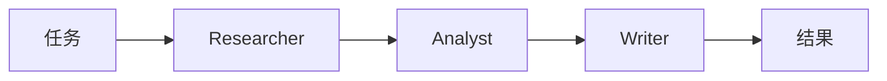

智能体按照 `agents` 数组中的顺序依次运行，每个智能体都把上一个智能体的输出作为自己的输入。`output` 列表中每个智能体恰好对应一个轮次，顺序与请求一致，因此它同时也是一份执行轨迹：当最终的简报出错时，你可以沿着这些轮次往回读，找到是哪一步走偏了。上面的基础请求就是一个 SequentialWorkflow。

**适用场景：** 每一步都需要上一步完成后的输出，例如先调研、再分析、最后写作。

**不适用场景：** 各步骤彼此独立。把它们排成一条线会让各自的延迟叠加起来，而且早期的错误会流入后面的每一步。

**参数：** 除通用字段外没有额外参数。[文档](https://docs.swarms.ai/docs/documentation/multi-agent/sequential_workflow)

```json
{
  "swarm_type": "SequentialWorkflow",
  "max_loops": 1
}
```

### ConcurrentWorkflow

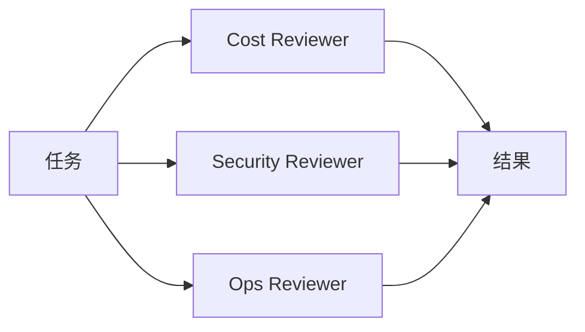

每个智能体都收到同一个原始任务，并在线程池上同时运行。没有哪个智能体需要等待另一个，也看不到另一个的输出。你会拿回每个智能体各一个轮次，它们在 `output` 中的顺序反映的是各自完成的先后，所以要按 `role` 匹配轮次，而且永远不要按位置匹配。这里没有合并步骤：API 返回彼此独立的答案，如何合并由你决定（或者交给下文的 MixtureOfAgents）。

**适用场景：** 你需要对同一个输入做几份独立的评审，并且在意延迟，因为这些智能体是并排运行的。

**不适用场景：** 某一步依赖另一步的输出，或者你需要 API 直接返回一个合并好的答案。

**参数：** 除通用字段外没有额外参数。[文档](https://docs.swarms.ai/docs/documentation/multi-agent/concurrent_workflow)

```json
{
  "swarm_type": "ConcurrentWorkflow",
  "agents": [
    {"agent_name": "Cost Reviewer", "system_prompt": "Estimate the cost impact of the migration, including runner minutes and engineering time.", "model_name": "gpt-5.4-mini"},
    {"agent_name": "Security Reviewer", "system_prompt": "List the security risks of the migration, including secrets handling and third-party actions.", "model_name": "gpt-5.4-mini"},
    {"agent_name": "Ops Reviewer", "system_prompt": "List the operational risks of the migration and propose a rollout order.", "model_name": "gpt-5.4-mini"}
  ]
}
```

后面有几个条目会复用这三个评审智能体。

### RoundRobin

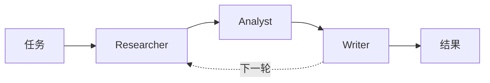

智能体严格按照你列出的顺序轮流发言，每个智能体都会读到到目前为止的完整对话。内置的轮次标题会告诉每个智能体谁在它之前发言、谁在它之后发言，这会促使智能体在彼此的工作上继续推进，而不是重复。若有 `N` 个智能体、`max_loops` 设为 `L`，日程是固定的：每个智能体恰好获得 `L` 个轮次，并且每一轮的顺序都相同。把应该开启讨论的智能体放在第一个，把应该做总结的放在最后一个。

**适用场景：** 你想要发言顺序可预测的迭代改进，例如一份草稿由每位专家轮流修改两三轮。

**不适用场景：** 智能体的观点需要保持独立（后发言的智能体能看到前面的观点，也可能被它们锚定），或者参与者很多。文档建议使用 3 到 5 个智能体，因为每一轮发言都会让共享上下文变长。

**参数：** 除通用字段外没有额外参数；`max_loops` 决定轮数。[文档](https://docs.swarms.ai/docs/documentation/multi-agent/round_robin)

```json
{
  "swarm_type": "RoundRobin",
  "max_loops": 2
}
```

## Routing 类架构：自定义流程与分派

### AgentRearrange

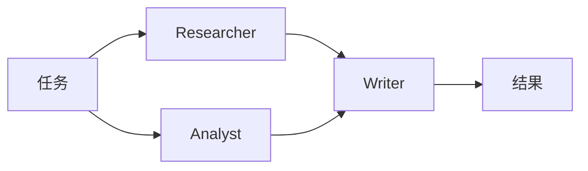

AgentRearrange 按照你在 `rearrange_flow` 中用字符串写出的流程来运行智能体。箭头（`->`）把工作交给下一步，逗号让同一步中的智能体并行运行，所以 `"Researcher, Analyst -> Writer"` 会让前两个智能体并排运行，然后交给 Writer。流程中的名字必须与 `agent_name` 的值完全一致。你只需编辑一个字符串，就能对同一个团队重新排序或重新分组，不必改动任何提示词。

**适用场景：** 你需要混合串行和并行阶段，或者想快速尝试同一个团队的几种排列方式。

**不适用场景：** 一条直线或一次简单扇出就够用；或者流程在多个位置分叉又汇合，这种情况用 GraphWorkflow 的显式边来描述更清楚。

**参数：** `rearrange_flow`，此类型必填，缺少它的请求会被拒绝。[文档](https://docs.swarms.ai/docs/documentation/multi-agent/agent_rearrange)

```json
{
  "swarm_type": "AgentRearrange",
  "rearrange_flow": "Researcher, Analyst -> Writer"
}
```

### MultiAgentRouter

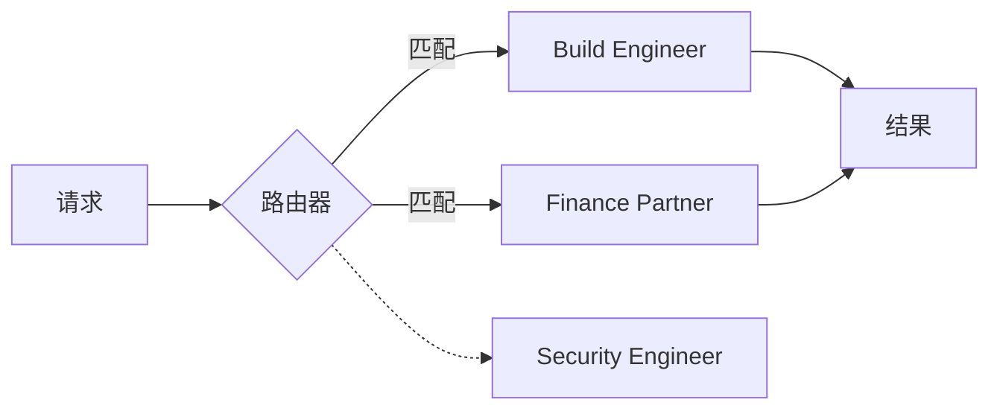

一个内部路由步骤会读取任务，并通过函数调用把它交给最合适的智能体。它可以把整个任务交给一位专家，也可以在多位专家都相关时把任务拆给几位。路由器没有选中的智能体根本不会运行，也不会在 `output` 中留下轮次；`output` 中包含路由决定，以及每个被选中智能体的回复。请在每个智能体的 `description` 和系统提示词中写清楚、写分明它的专长，因为路由器是按智能体的能力来匹配任务的。

**适用场景：** 请求的类型各不相同，而每种类型都有对应的专家：工单支持、混杂的运维问题，或者在许多领域智能体前面放一个统一入口。

**不适用场景：** 每个请求都需要所有专家（请用 ConcurrentWorkflow 或 MixtureOfAgents），或者路由规则简单到可以在你自己的代码里写成一个 `if` 语句，这样更便宜，结果也确定。

**参数：** 除通用字段外没有额外参数。[文档](https://docs.swarms.ai/docs/documentation/multi-agent/multi_agent_router)

```json
{
  "swarm_type": "MultiAgentRouter",
  "task": "The nightly build started failing on our ARM runners, and last month's runner bill doubled.",
  "agents": [
    {"agent_name": "Build Engineer", "description": "CI pipelines, runners, and build failures", "system_prompt": "You diagnose CI and build failures step by step.", "model_name": "gpt-5.4-mini"},
    {"agent_name": "Security Engineer", "description": "Secrets, permissions, and supply-chain risk in CI", "system_prompt": "You review security issues in CI configuration.", "model_name": "gpt-5.4-mini"},
    {"agent_name": "Finance Partner", "description": "CI and cloud spend, invoices, and budgets", "system_prompt": "You explain and reduce CI and cloud costs.", "model_name": "gpt-5.4-mini"}
  ]
}
```

## Collaboration 类架构：智能体为同一个结果协作

### MixtureOfAgents

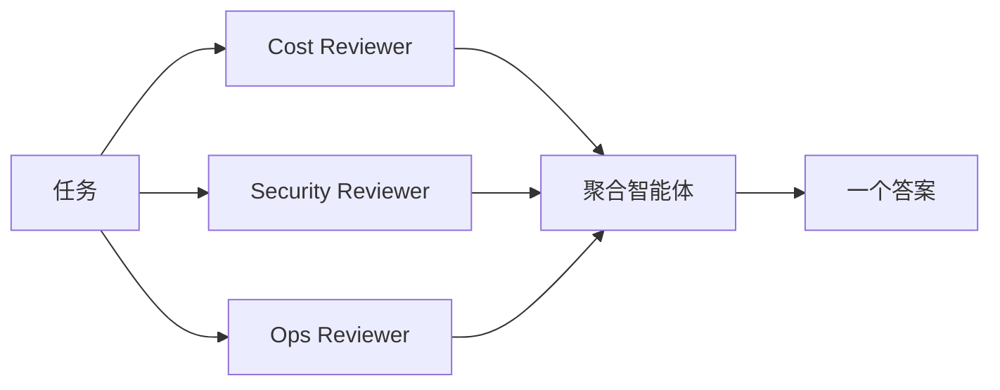

你的智能体作为专家在同一个任务上并行运行，然后一个内部的聚合智能体读取它们的全部输出，写出一个综合答案。`output` 列表通常包含每位专家的一个轮次，外加最后的综合轮次；而 `number_of_agents` 只统计你提供的专家，因为聚合智能体是 API 自己创建的。这种模式与 [Mixture-of-Agents 论文](https://arxiv.org/abs/2406.04692)（Wang 等，2024）中的分层方法相关：在那篇论文里，每一层智能体都会读取上一层的答案；API 中的版本只运行一层专家和一个聚合智能体。

**适用场景：** 你既想要 ConcurrentWorkflow 那样的独立视角，又想要一个合并后的答案，例如把成本、安全和运维三方面的意见合成一条建议。

**不适用场景：** 你想自己查看并权衡各方意见（ConcurrentWorkflow 会原样返回它们），或者专家之间需要相互回应（GroupChat）。

**参数：** 除通用字段外没有额外参数。把 `agents` 设为 ConcurrentWorkflow 条目中的三个评审智能体。[文档](https://docs.swarms.ai/docs/documentation/multi-agent/mixture_of_agents)

```json
{
  "swarm_type": "MixtureOfAgents"
}
```

### GroupChat

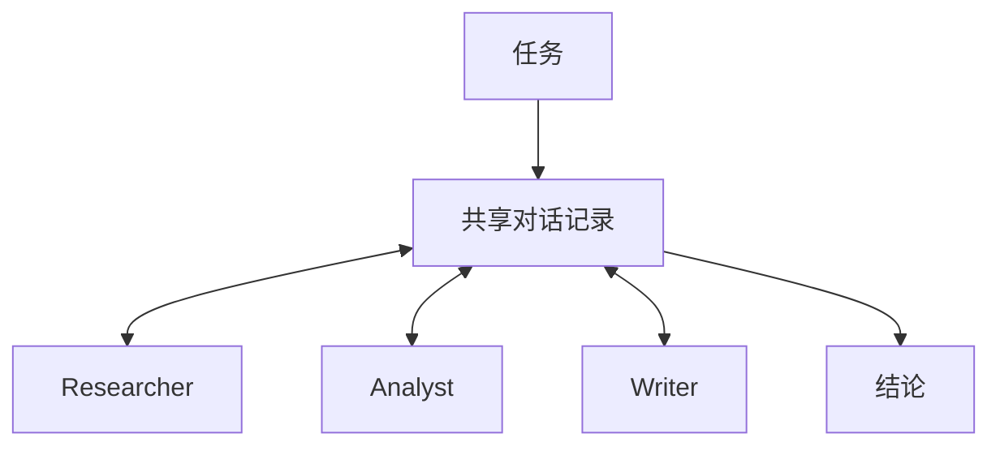

智能体在同一份共享对话记录中进行多轮对话。每个智能体轮流发言，能看到在它之前说过的所有内容，并应当在前面的发言基础上补充、质疑或完善，因此 `output` 中靠后的轮次会引用前面的轮次。这是它与 ConcurrentWorkflow 的主要区别，后者的智能体彼此看不到对方。GroupChat 还接受 `messages` 字段，用来传入已有的对话历史。文档建议使用 3 到 6 个智能体，并在系统提示词中要求每位参与者回应其他人。

**适用场景：** 问题能从来回讨论中获益：头脑风暴、跨职能规划，或者一场设计评审，其中一位参与者提出的约束会改变另一位的方案。

**不适用场景：** 你需要彼此独立的判断（同一个群聊里的智能体会相互影响）、严格的发言顺序（用 RoundRobin），或者低成本的简短回答。对话记录每一轮都会变长，而且每个智能体都要读完整份记录。

**参数：** 除通用字段外没有额外参数。[文档](https://docs.swarms.ai/docs/documentation/multi-agent/group_chat)

```json
{
  "swarm_type": "GroupChat",
  "max_loops": 1
}
```

### HierarchicalSwarm

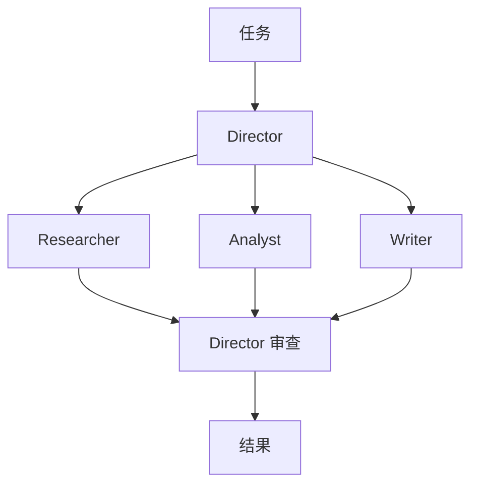

HierarchicalSwarm 会加入一个由 API 替你创建的 director（主管）智能体。director 负责拆解任务，把子任务分派给你的智能体，再整合它们交回的结果。`agents` 中的每个智能体都作为 worker（执行者）运行，即使你把其中一个命名为「coordinator」也一样；director 通过 `director_model_name` 和 `director_settings` 单独配置。由于 director 的计划决定了每个 worker 做什么，文档建议为 director 选一个能力强的模型，并使用较低的 temperature，以便得到一致的任务拆解。关于这种模式的一般性取舍，请看[经理与执行者智能体架构](/zh/blog/manager-worker-agent-architectures)。

**适用场景：** 任务大到「如何拆分」本身就需要判断，而且你希望由一个智能体负责制定计划并检查结果。

**不适用场景：** 你已经知道怎么拆分。SequentialWorkflow 或 ConcurrentWorkflow 可以完成同样的工作，却省掉了 director 的额外调用，而 director 的计划也是运行中又一个可能出错的环节。

**参数：** `director_model_name`（默认 `gpt-5.4`）和 `director_settings`，后者是一个对象，可包含 `temperature`、`top_p`、`max_tokens` 等值。通用字段 `list_all_agents` 会把每个智能体的名字和描述展示给其他智能体。[文档](https://docs.swarms.ai/docs/documentation/multi-agent/hierarchical_swarm)

```json
{
  "swarm_type": "HierarchicalSwarm",
  "director_model_name": "gpt-5.4",
  "director_settings": {"temperature": 0.2, "max_tokens": 8000},
  "list_all_agents": true
}
```

### HeavySwarm

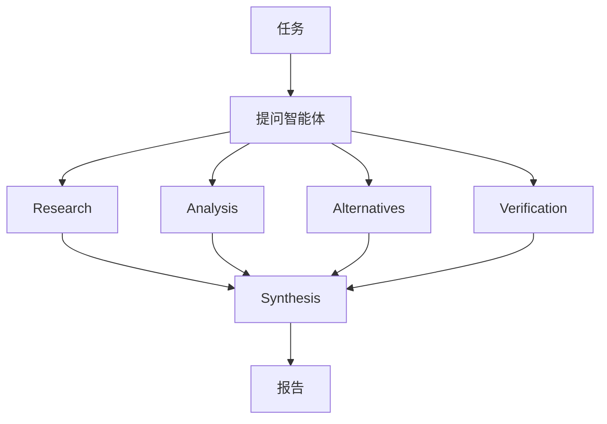

HeavySwarm 会自己组建团队，所以你要发送 `"agents": []`。一个提问智能体通过函数调用把任务转化为四个专门的问题。在默认变体中，Research、Analysis、Alternatives 和 Verification 四个智能体并行回答这些问题，再由一个 Synthesis 智能体写出最终报告。`heavy_swarm_variant` 会替换整套阵容：`"default"` 运行上面这 5 个 worker，`"medium"` 运行 4 个（一名队长加三位专家），`"heavy"` 运行 16 个（一名队长协调 15 位领域专家）。把 `heavy_swarm_max_loops` 设为大于 1 时，会以上一轮的结果作为上下文重复整个循环。由于请求中的 `agents` 数组为空，`number_of_agents` 和按智能体收取的固定费用都是 0，但内部智能体使用的每一个 token 你仍然要付费，全部按 `heavy_swarm_worker_model_name` 所指模型的价格计算。

**适用场景：** 答案质量比延迟和成本更重要：尽职调查、深入的市场或技术研究，以及默认就应覆盖核实与备选方案的问题。

**不适用场景：** 问题很简单，你需要控制每个智能体的提示词，或者预算紧张。即使是默认变体，每一轮也至少要发起六次模型调用。

**参数：** `heavy_swarm_variant`、`heavy_swarm_max_loops`、`heavy_swarm_question_agent_model_name`（默认 `gpt-5.4`）以及 `heavy_swarm_worker_model_name`，后者作用于每一个 worker。[文档](https://docs.swarms.ai/docs/documentation/multi-agent/heavy_swarm)

```json
{
  "swarm_type": "HeavySwarm",
  "agents": [],
  "heavy_swarm_variant": "default",
  "heavy_swarm_max_loops": 1,
  "heavy_swarm_question_agent_model_name": "gpt-5.4",
  "heavy_swarm_worker_model_name": "claude-sonnet-5"
}
```

### PlannerWorkerSwarm

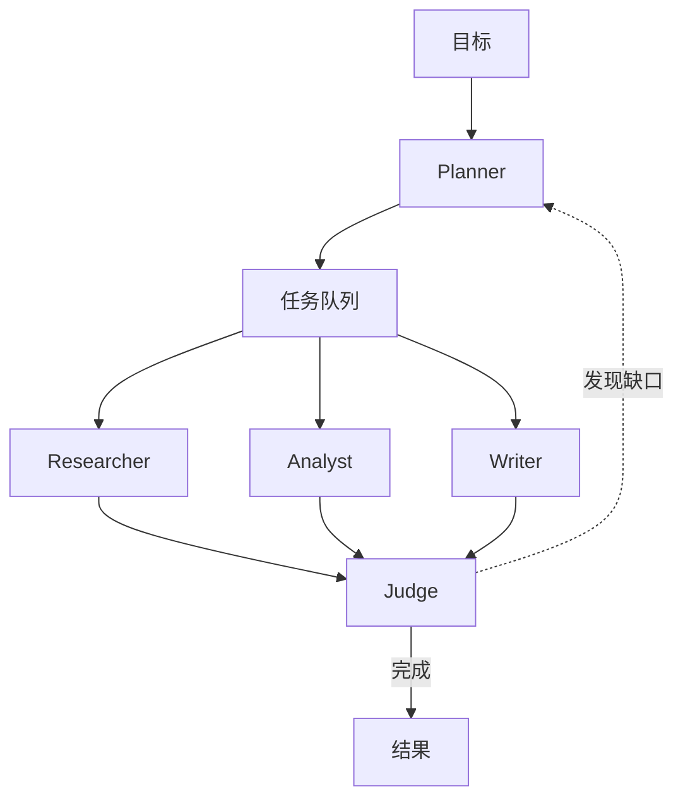

PlannerWorkerSwarm 把计划和执行分开。每个周期分三个阶段：planner（规划）智能体把子任务写入一个共享队列（子任务之间可以带依赖关系），你的智能体从队列中领取任务并并发执行，然后 judge（裁判）智能体对照目标检查结果。judge 会给出三种结论之一：已完成；需要更多工作（并列出具体缺口）；或者因为工作已经跑偏而需要从头开始。`max_loops` 限定周期数的上限，一旦 judge 判定目标已完成，蜂群就会提前停止。planner 和 judge 都是内部智能体，没有可调字段；你的 `agents` 就是 worker 池。

**适用场景：** 目标开放且包含多个步骤，你无法事先列出这些步骤，并且希望有一个自动检查来确认工作真的完成了。

**不适用场景：** 步骤固定且已知。对于这种情况，文档也指出 SequentialWorkflow 更简单、更便宜。

**参数：** 除通用字段外没有额外参数。把 `max_loops` 设为 2 或 3，蜂群才有机会根据「需要更多工作」的结论再做一轮；并给 worker 写范围窄、聚焦执行的提示词。[文档](https://docs.swarms.ai/docs/documentation/multi-agent/planner_worker_swarm)

```json
{
  "swarm_type": "PlannerWorkerSwarm",
  "task": "Write a migration plan from Jenkins to GitHub Actions covering pipelines, secrets, self-hosted runners, and rollback.",
  "max_loops": 3
}
```

## Judgment 类架构：投票、委员会、辩论与裁判

这四种架构产出的是一个决定或一次评估，而不产出新的工作成果。每种模式背后的道理（为什么独立投票有效，辩论能暴露什么，委员会如何减少单一模型的偏差）在[多智能体协作模式](/zh/blog/multi-agent-collaboration-patterns)中有深入讲解。

### MajorityVoting

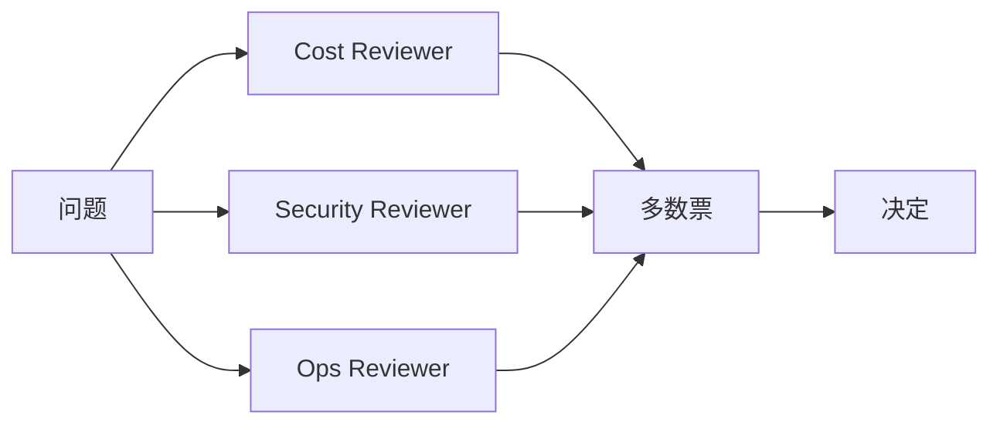

每个智能体在看不到其他智能体的情况下独立回答同一个问题，最后选出多数答案。独立性是这种方式起作用的关键：某个智能体犯的错误，只要其他智能体没有重复，就会被票数压过。它适合答案离散的问题（是或否、一个标签、从列表中选一项），并且每个系统提示词都需要清楚的投票说明，才能统计票数。

**适用场景：** 你面对的是分类、审批或是/否决策，并希望降低单个智能体的波动。

**不适用场景：** 答案是开放式文本，没有可以计票的离散选项；或者所有投票者共用同一个模型和提示词，很可能一起犯同样的错误。

**参数：** 除通用字段外没有额外参数。使用奇数个投票者以避免平票；这里把 `agents` 设为那三个评审智能体。[文档](https://docs.swarms.ai/docs/documentation/multi-agent/majority_voting)

```json
{
  "swarm_type": "MajorityVoting",
  "task": "Vote YES or NO, then give one sentence of reasoning: should our team move CI from Jenkins to GitHub Actions this quarter?"
}
```

### CouncilAsAJudge

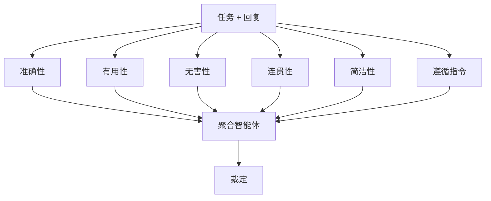

CouncilAsAJudge 的工作是给一个回复打分，它本身不生成回复。它会创建六个裁判智能体，每个负责一个固定维度（准确性、有用性、无害性、连贯性、简洁性和指令遵循），并行地为回复打分和点评，然后由一个聚合智能体把它们的理由合并成一份裁定。裁判是内部构建的，所以你发送的智能体永远不会运行；但请求中的 `agents` 仍然需要一个条目，一个廉价的占位智能体就够了（它会按每个智能体的固定费用计费）。`task` 必须同时包含原始提示词和你要打分的回复。

**适用场景：** 你需要一道结构化的质量关卡：在生成内容发布前打分、比较不同模型或提示词的效果，或者对提示词做回归测试。常见做法是先用一次蜂群调用生成内容，再用第二次调用把结果交给它打分。

**不适用场景：** 你要的是生成新内容，或者你的评分标准与这六个固定维度不同。这时请自己编写裁判智能体并使用 MajorityVoting，或者在 SequentialWorkflow 的末尾放一个评审智能体。

**参数：** `council_judge_model_name`（默认 `gpt-5.4`），即给出最终裁定的裁判所用的模型。[文档](https://docs.swarms.ai/docs/documentation/multi-agent/council_as_a_judge)

```json
{
  "swarm_type": "CouncilAsAJudge",
  "council_judge_model_name": "gpt-5.4",
  "task": "Task: Assess whether our team should move CI from Jenkins to GitHub Actions this quarter.\n\nResponse: <paste the Writer's brief here>",
  "agents": [
    {"agent_name": "placeholder", "description": "Required by the API, not executed", "model_name": "gpt-5.4-mini", "max_loops": 1}
  ]
}
```

### LLMCouncil

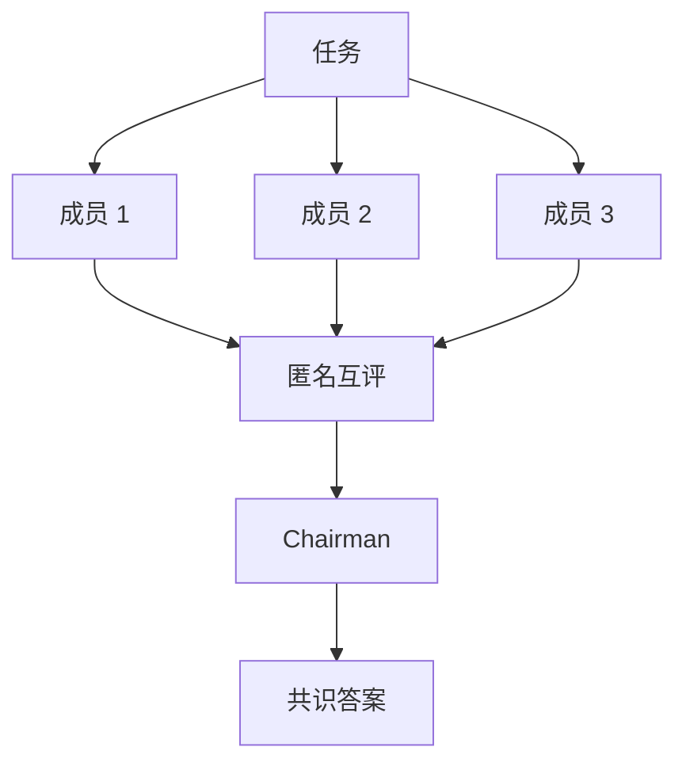

你的智能体成为委员会成员。每个成员先独立回答任务。然后这些答案被重新标记为 A、B、C 以隐藏作者，每个成员对所有答案进行排序和点评。最后由一个 chairman（主席）智能体阅读原始答案和每一份评审，写出一个共识答案。互评这一轮能把分歧暴露出来，而单次综合步骤会把这些分歧掩盖掉。同样的三个阶段也出现在 Andrej Karpathy 的开源项目 [llm-council](https://github.com/karpathy/llm-council) 中。文档估计每个成员大约需要两次调用（一次回答，一次评审），再加上一次 chairman 调用；而且每次评审都要读完所有答案，所以成本和延迟的增长比单轮蜂群更快。

**适用场景：** 问题需要权衡真实的利弊，答错的代价很高，并且你想比较不同模型对它的推理方式。

**不适用场景：** 问题只有一个正确答案（MajorityVoting 更便宜），或者成员几乎一模一样。同一个模型配同一个提示词组成的委员会，只会给出几乎相同的答案，互评这一轮也就没有多少价值。

**参数：** `chairman_model`（默认 `gpt-5.1`）。给每个成员配置不同的模型或视角。[文档](https://docs.swarms.ai/docs/documentation/multi-agent/llm_council)

```json
{
  "swarm_type": "LLMCouncil",
  "chairman_model": "gpt-5.4",
  "agents": [
    {"agent_name": "Cost Lens", "system_prompt": "Judge the migration on total cost over two years.", "model_name": "gpt-5.4"},
    {"agent_name": "Risk Lens", "system_prompt": "Judge the migration on security and delivery risk.", "model_name": "claude-sonnet-5"},
    {"agent_name": "Team Lens", "system_prompt": "Judge the migration on developer time and team disruption.", "model_name": "gpt-5.4-mini"}
  ]
}
```

### DebateWithJudge

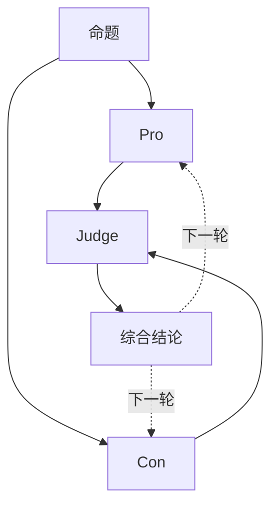

DebateWithJudge 恰好需要三个按固定顺序排列的智能体：第一个支持命题，第二个反对命题，第三个担任裁判。裁判权衡双方观点，给出反馈，并把双方最有力的论点综合成一个更完善的答案。当 `max_loops` 大于 1 时，每一轮新辩论都从裁判的综合结论出发，所以论证会一轮比一轮更扎实。

**适用场景：** 决策是二选一或比较型的，并且你希望在给出结论前把正反两方的理由都充分展开：自建还是采购，迁移还是保持现状，批准还是驳回。

**不适用场景：** 有两个以上值得认真考虑的选项（LLMCouncil 更合适），或者一方明显正确，辩论只会让答案变得冗长。

**参数：** 除通用字段外没有额外参数。智能体顺序很重要：先 Pro，再 Con，最后 Judge。文档建议给裁判设置较低的 temperature（0.3 到 0.4）。[文档](https://docs.swarms.ai/docs/documentation/multi-agent/debate_with_judge)

```json
{
  "swarm_type": "DebateWithJudge",
  "max_loops": 2,
  "task": "Proposition: our team should move CI from Jenkins to GitHub Actions this quarter.",
  "agents": [
    {"agent_name": "Pro", "system_prompt": "Argue for the proposition with evidence. In later rounds, answer the judge's feedback.", "model_name": "gpt-5.4-mini"},
    {"agent_name": "Con", "system_prompt": "Argue against the proposition with evidence. In later rounds, answer the judge's feedback.", "model_name": "gpt-5.4-mini"},
    {"agent_name": "Judge", "system_prompt": "Weigh both sides, name the strongest points from each, and give a verdict.", "model_name": "gpt-5.4", "temperature": 0.3}
  ]
}
```

## swarm_type 之外：图、自动生成的团队与批处理

还有三个端点也用来组织智能体，各自有自己的请求体。GraphWorkflow 和批处理端点属于高级功能，适用于 Pro 和 Ultra 套餐（[Premium Endpoints](https://docs.swarms.ai/docs/documentation/resources/premium-endpoints)）。Auto Agent Builder 对所有套餐开放。

### GraphWorkflow

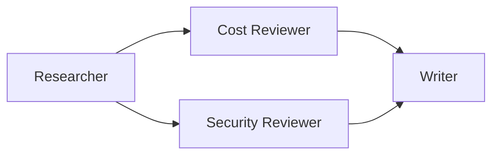

GraphWorkflow（`POST /v1/graph-workflow/completions`）把智能体作为节点，放在你定义的有向图中运行。每条边都有一个 `source` 和一个 `target`，它们要与 `agent_name` 的值对应；`entry_points` 和 `end_points` 指定执行从哪里开始、在哪里结束；各分支并行运行，并在两条边指向同一个节点的地方汇合。它的响应与蜂群补全不同：`outputs` 是一个以智能体名字为键的字典，所以你可以直接读取任意节点的结果。`auto_compile`（默认开启）会在运行前先编译这张图。想了解这个引擎与 LangGraph 的对比，请看 [Swarms GraphWorkflow 对比 LangGraph](/zh/blog/swarms-graphworkflow-vs-langgraph) 和 [GraphWorkflow 研究论文](/zh/blog/graphworkflow-research-paper)。

**适用场景：** 流程在多个位置分叉又汇合，或者你想按名字拿到每个节点的输出。

**不适用场景：** 形态只是一条直线、一次简单扇出或一次分叉，这些用标准端点上的 SequentialWorkflow、ConcurrentWorkflow 和 AgentRearrange 就能覆盖，不需要高级套餐。

**字段：** `agents`、`edges`、`entry_points`、`end_points`、`task`、`max_loops` 和 `auto_compile`。[文档](https://docs.swarms.ai/docs/documentation/multi-agent/graph_workflow)

```python
import asyncio
import os

import aiohttp
from dotenv import load_dotenv

load_dotenv()

API_KEY = os.environ["SWARMS_API_KEY"]
BASE_URL = "https://api.swarms.world"
HEADERS = {"x-api-key": API_KEY, "Content-Type": "application/json"}


def agent(name, prompt, model="gpt-5.4-mini"):
    return {"agent_name": name, "system_prompt": prompt, "model_name": model, "max_loops": 1}


async def main() -> None:
    workflow = {
        "name": "CI Migration Graph",
        "description": "Research, two parallel reviews, then a brief",
        "task": "Assess whether our 40-person engineering team should move CI from Jenkins to GitHub Actions this quarter.",
        "agents": [
            agent("Researcher", "List the relevant facts, constraints, and open questions."),
            agent("Cost Reviewer", "Estimate the cost impact using the research you are given."),
            agent("Security Reviewer", "List the security risks using the research you are given."),
            agent("Writer", "Write a one-page brief with a recommendation from the reviews.", "claude-sonnet-5"),
        ],
        "edges": [
            {"source": "Researcher", "target": "Cost Reviewer"},
            {"source": "Researcher", "target": "Security Reviewer"},
            {"source": "Cost Reviewer", "target": "Writer"},
            {"source": "Security Reviewer", "target": "Writer"},
        ],
        "entry_points": ["Researcher"],
        "end_points": ["Writer"],
        "max_loops": 1,
        "auto_compile": True,
    }

    # Multi-agent runs can take minutes, so give the whole request room.
    timeout = aiohttp.ClientTimeout(total=600)
    async with aiohttp.ClientSession(headers=HEADERS, timeout=timeout) as session:
        async with session.post(f"{BASE_URL}/v1/graph-workflow/completions", json=workflow) as resp:
            resp.raise_for_status()
            result = await resp.json()

    print(result["outputs"]["Writer"])
    print("cost:", result["usage"]["total_cost"])


asyncio.run(main())
```

### Auto Agent Builder

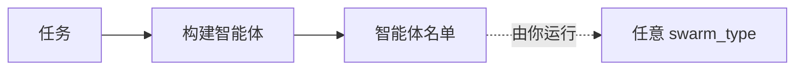

Auto Agent Builder（`POST /v1/auto-agent-builder/completions`）根据任务描述设计一个团队，并以 JSON 形式返回：每个智能体的名字、描述、系统提示词和模型。它从不运行这些智能体。设计工作由单个构建智能体完成，它倾向于用能覆盖任务的最小团队（`max_agents` 默认为 5，是上限；`num_agents` 用来指定确切人数），生成的名单可以直接放进任意蜂群补全的 `agents` 字段。只有构建这一次调用会计费。更多背景请看 [Auto Agent Builder 正式上线](/zh/blog/introducing-auto-agent-builder)。

**适用场景：** 你清楚任务，却不清楚该组建怎样的团队；或者你想先拿到一版系统提示词的草稿再修改。

**不适用场景：** 你已经有调好的智能体。在生产环境运行生成的名单之前，先读一遍它的提示词和模型选择；它就是普通的 JSON，看一遍只需要一分钟。

**字段：** `task`（必填），`max_agents` 或 `num_agents`，用于构建智能体本身的 `model_name` 和 `system_prompt`，以及 `agent_kwargs`，用来把 `max_loops` 等设置应用到每个生成的智能体上。[文档](https://docs.swarms.ai/docs/documentation/multi-agent/auto_agent_builder)

```python
import asyncio
import os

import aiohttp
from dotenv import load_dotenv

load_dotenv()

API_KEY = os.environ["SWARMS_API_KEY"]
BASE_URL = "https://api.swarms.world"
HEADERS = {"x-api-key": API_KEY, "Content-Type": "application/json"}

task = "Assess whether our 40-person engineering team should move CI from Jenkins to GitHub Actions this quarter."


async def main() -> None:
    # One session for both calls; the swarm run can take minutes.
    timeout = aiohttp.ClientTimeout(total=600)
    async with aiohttp.ClientSession(headers=HEADERS, timeout=timeout) as session:
        # 1. Design the team (no agents run in this call)
        async with session.post(
            f"{BASE_URL}/v1/auto-agent-builder/completions",
            json={"task": task, "max_agents": 4, "agent_kwargs": {"max_loops": 1}},
        ) as resp:
            resp.raise_for_status()
            roster = (await resp.json())["agents"]
        for a in roster:
            print(a["agent_name"], "|", a["model_name"])

        # 2. Run the generated team with any swarm_type
        async with session.post(
            f"{BASE_URL}/v1/swarm/completions",
            json={
                "name": "auto-built-ci-review",
                "swarm_type": "SequentialWorkflow",
                "task": task,
                "agents": roster,
            },
        ) as resp:
            resp.raise_for_status()
            result = await resp.json()

    for turn in result["output"]:
        print(f"\n--- {turn['role']}")
        print(turn["content"])


asyncio.run(main())
```

### 批处理端点

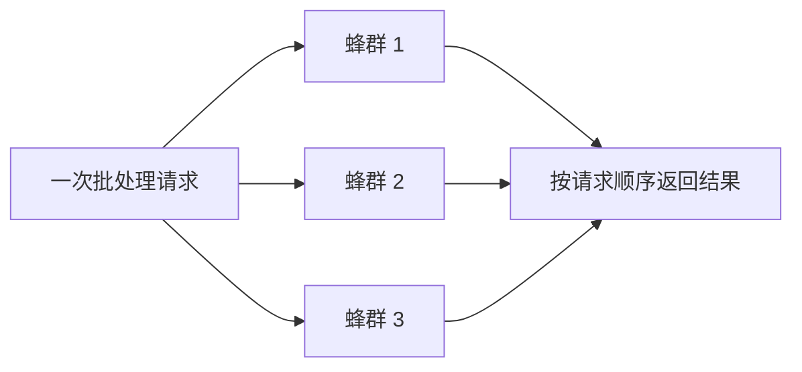

批处理端点在一次请求中运行许多相互独立的任务。[`POST /v1/swarm/batch/completions`](https://docs.swarms.ai/docs/examples/examples/batch-swarm-completions) 接受一个最多包含 50 个完整蜂群配置的数组，每个配置可以有自己的 `swarm_type`，并按请求顺序为每一项返回一个结果。每个条目包含 `status`、`swarm_name`、`result` 和 `usage`；蜂群的输出位于 `result` 下（单次端点中这个字段叫 `output`）。失败的条目会在自己的位置报告 `"status": "error"` 和一条 `detail` 信息，批次中的其余部分照常完成。对于单个智能体，[`POST /v1/agent/batch/completions`](https://docs.swarms.ai/docs/examples/examples/batch-processing) 以同样方式处理最多 50 个 `{"agent_config", "task"}` 条目。[`POST /v1/batched-grid-workflow/completions`](https://docs.swarms.ai/docs/documentation/multi-agent/batched_grid_workflow) 把 `agent_completions[i]` 与 `tasks[i]` 配对，所有配对并发运行，还可以让这些配对重复运行若干轮，每个智能体保留自己的记忆。

**适用场景：** 你要在许多输入上运行同一个蜂群（每个仓库一次评审，每个客户一份报告），或者想在同一批任务上并排比较两种架构。

**不适用场景：** 你只有一个任务，或者需要每个结果一完成就拿到；批处理会在一个响应中返回全部结果。

**字段：** 一个数组，其中的每一项就是你发给 `/v1/swarm/completions` 的同样的 payload。下面的协程使用基础请求中的 `BASE_URL`，并接收它的 session 和 `payload`；在 `main()` 的 `async with aiohttp.ClientSession(...)` 代码块中用 `await run_batch(session, payload)` 调用它：

```python
async def run_batch(session: aiohttp.ClientSession, payload: dict) -> None:
    services = ["billing-api", "web-frontend", "data-pipeline"]
    batch = [
        {
            **payload,
            "name": f"CI review {s}",
            "task": f"Assess whether the {s} repository should move its CI from Jenkins to GitHub Actions.",
        }
        for s in services
    ]

    # A batch of swarms can run longer than one swarm, so this call gets more time.
    async with session.post(
        f"{BASE_URL}/v1/swarm/batch/completions",
        json=batch,
        timeout=aiohttp.ClientTimeout(total=900),
    ) as resp:
        resp.raise_for_status()
        results = await resp.json()

    for item in results:
        if item["status"] == "success":
            print(item["swarm_name"], item["usage"]["billing_info"]["total_cost"])
        else:
            print(item["swarm_name"], "failed:", item["detail"])
```

## 蜂群架构决策表

下表中的相对成本指每次运行的模型调用次数以及每次调用读入的上下文量，依据的是各类型文档中描述的行为。实际成本取决于你的模型、提示词和输出长度，所以在正式采用前先看几次运行的 `usage`；[如何用 Python 追踪每个智能体的 LLM token 用量与成本](/zh/blog/track-llm-token-usage-cost-python)介绍了一种做法。

| 架构 | 形态 | 最适合 | 相对成本 |
| --- | --- | --- | --- |
| SequentialWorkflow | 直线 | 每一步都建立在上一步之上 | 低：每个智能体一次调用 |
| ConcurrentWorkflow | 扇出 | 低延迟的独立评审 | 低：每个智能体一次调用，并行执行 |
| RoundRobin | 固定轮转 | 按固定发言顺序迭代改进 | 低到中：智能体数乘以轮数，上下文不断变长 |
| AgentRearrange | 自定义直线与扇出 | 混合串行与并行阶段 | 低：流程中每个智能体一次调用 |
| MultiAgentRouter | 分派器 | 有专家对应的多类型请求 | 低：路由器加上被选中的智能体 |
| MixtureOfAgents | 扇出加聚合 | 把多位专家的意见合成一个答案 | 中：每个智能体一次调用，再加聚合智能体 |
| GroupChat | 共享对话 | 头脑风暴与跨职能规划 | 中：每一轮都要读完整份对话记录 |
| HierarchicalSwarm | 主管与执行者 | 拆分本身需要判断的大任务 | 中：director 的调用加上各 worker |
| HeavySwarm | 提问、并行 worker、综合 | 深度研究与尽职调查 | 高：每轮至少 6 次调用，heavy 变体有 16 个 worker |
| PlannerWorkerSwarm | 规划、队列、执行、裁判 | 开放式的多步骤目标 | 中到高：每个周期包含规划、子任务和裁判 |
| MajorityVoting | 独立投票 | 离散决策与分类 | 低到中：每位投票者一个答案 |
| CouncilAsAJudge | 六位裁判加聚合 | 在发布前给回复打分 | 中：每次运行七个内部智能体 |
| LLMCouncil | 回答、互评、主席 | 高风险的权衡决策 | 高：每个成员约两次调用，再加主席 |
| DebateWithJudge | 正方、反方、裁判 | 二选一或比较型决策 | 低到中：每轮三次调用 |
| GraphWorkflow（高级） | 有向图 | 会分叉再汇合的流程 | 低：每个节点一次调用 |
| Auto Agent Builder | 团队设计器 | 为以上任意架构起草智能体名单 | 很低：一次构建调用 |
| 批处理端点（高级） | 一次请求，多个任务 | 在许多输入上运行同一个蜂群 | 批次中各任务成本之和 |

## 如何选择蜂群架构？

从你需要回答的问题出发，然后沿着这棵树往下走：

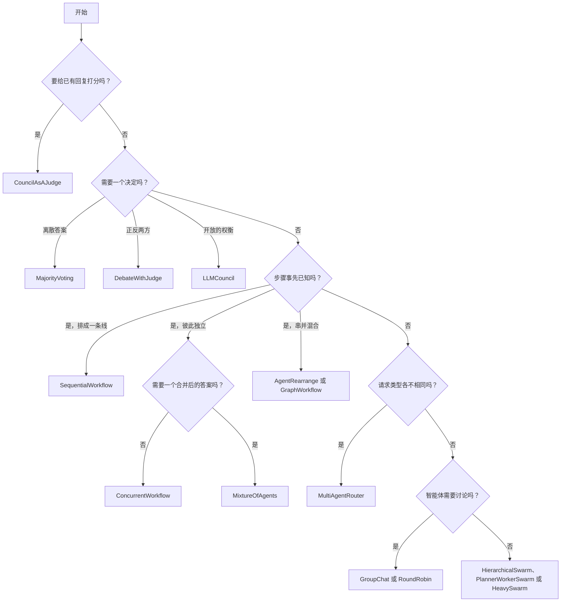

这棵树背后有几条经验法则：

1. **从能满足需求的最简单形态开始。** 大多数任务要么是一条直线，要么是一次扇出。[顺序、并发与图工作流](/zh/blog/agent-orchestration-patterns)论证了大多数流水线都可以归结为这三种形态之一。
2. **只有在你说得出它能带来什么时，才加入合并、裁判或主管。** 每加一层都意味着更多调用、更多上下文，以及又一个可能扩散错误的智能体。[多智能体系统的失败模式](/zh/blog/multi-agent-system-failure-modes)展示了这种扩散可以多么悄无声息。
3. **在最后三种之间，按你对工作的了解程度来选。** 如果 director 能一次拆分好任务，用 HierarchicalSwarm；如果你希望由裁判检查是否完成并重新规划，用 PlannerWorkerSwarm；如果你干脆不想自己设计团队，用 HeavySwarm。
4. **测量两个候选方案。** 因为架构只是一个字段，可以在同一小批真实任务上运行两种蜂群类型（批处理端点可以把它们一起发送），再对照 `usage.billing_info.total_cost` 比较输出质量。

想一步步搭建第一个蜂群，请看[如何用 Python 构建智能体蜂群](/zh/blog/build-agent-swarm-python)。[Swarms API 示例套件](/zh/blog/swarms-api-examples-suite)为每种编排模式都提供了可运行的示例。如果你还在考虑用哪个框架，请阅读 [2026 多智能体框架对比](/zh/blog/multi-agent-framework-comparison-2026)和 [AutoGen 替代方案](/zh/blog/autogen-alternatives)。

## 常见问题

### 蜂群架构和多智能体框架有什么区别？

蜂群架构是一种协调模式：谁在什么时候运行，每个智能体能看到什么，以及输出如何合并成结果。框架则是实现这些模式的软件，同时还提供智能体、工具和记忆等能力。Swarms API 把它的架构做成一个字段 `swarm_type` 的取值，所以你无需改动智能体就能切换模式。

### Swarms API 支持多少种蜂群类型？

一共有 14 个 `swarm_type` 取值，API 把它们分为 workflow、routing、collaboration 和 judgment 四类。GraphWorkflow 和 BatchedGridWorkflow 是独立的高级端点，而 `"auto"` 和 `"SpreadSheetSwarm"` 会被以 `400` 拒绝。调用 `GET /v1/swarms/available` 可以拿到带描述和类别的实时列表。

### 哪种蜂群架构最便宜？

MultiAgentRouter 每次请求消耗的 token 可能最少，因为路由器没有选中的智能体根本不会运行（但它们仍然计入按智能体收取的固定费用）。SequentialWorkflow、ConcurrentWorkflow 和 AgentRearrange 每个智能体调用一次。HeavySwarm 和 LLMCouncil 最贵，因为它们会加入内部智能体和评审轮次。此外，`agents` 数组中的每个智能体都会产生 0.01 美元的固定费用，太平洋时间晚上 8 点到早上 6 点之间 token 费用减半。

### RoundRobin 和 GroupChat 有什么区别？

两者都把智能体放进同一个共享对话中，每个智能体都能读到前面的内容。RoundRobin 保证顺序：智能体按你列出的顺序发言，每个智能体恰好获得 `max_loops` 个轮次，并且每一轮的顺序都相同。GroupChat 是面向讨论的类型，还接受 `messages` 历史；当发言顺序本身很重要时，选择 RoundRobin。

### 我总是需要自己定义智能体吗？

不需要。HeavySwarm 会自己组建团队，并要求 `"agents": []`。CouncilAsAJudge 在内部创建六位裁判和一个聚合智能体，只需要一个占位智能体；HierarchicalSwarm、PlannerWorkerSwarm 和 MixtureOfAgents 则会在你提供的智能体之外，分别加入一个 director、一对 planner 与 judge，或者一个聚合智能体。如果你希望由 API 来设计智能体，Auto Agent Builder 会返回一份可以发给任意蜂群类型的名单。

### 可以组合使用多种蜂群架构吗？

可以，方法是把多次调用串起来。常见的做法是先用一种架构（例如 SequentialWorkflow）生成内容，再在发布前用 CouncilAsAJudge 给结果打分。如果想在一次运行中使用自定义形态，可以用 AgentRearrange 或 GraphWorkflow；如果想在一次请求中运行许多不同类型的蜂群，可以用批处理端点。
