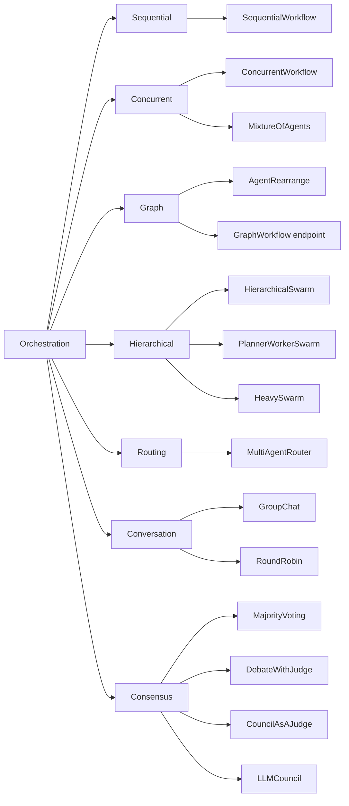

# 什么是多智能体编排？模式、状态与故障处理

多智能体编排（multi-agent orchestration）是包裹在一组 LLM 智能体外面的控制层。它要做四个决定：哪个智能体在何时运行、每个智能体能看到什么、它们的输出如何合并，以及这次运行何时停止。智能体负责调研、写作和审阅；编排器负责安排顺序、在智能体之间传递上下文、合并它们的返回结果并结束运行。每个多智能体系统都有编排器，哪怕它只是一个没人起过名字的 for 循环。

本文是一篇总览。它给出这个术语的定义，把每种常见的编排模式对应到 [Swarms API](https://docs.swarms.ai/docs/documentation/multi-agent/overview) 中一个具体的 `swarm_type`，并讲清决定编排系统能否在生产环境中站得住的三件事：状态如何在智能体之间流动、故障如何被发现，以及你如何看到一次运行做了什么、花了多少钱。每一节在有更深入文章的地方都会给出链接。如果你还在犹豫是否需要不止一个智能体，请先读[单智能体与多智能体](/zh/blog/single-agent-vs-multi-agent)。想了解多智能体系统由哪些部分组成，请看[什么是多智能体系统](/zh/blog/what-is-a-multi-agent-system)。

## 什么是多智能体编排？

任何一个多智能体工作流的编排方式，都可以用四个问题来描述。

1. **控制流：谁在何时运行？** 固定顺序、所有智能体同时运行，或者由路由器或主管智能体在运行时决定。
2. **状态：每个智能体能看到什么？** 原始任务、上一个智能体的输出、由管理者写好的子任务，或者整段共享对话。
3. **合并：输出如何组合？** 保留最后一个智能体的答案、把所有答案并列返回、投票，或者把所有输出交给一个聚合者或评审。
4. **终止：何时停止？** 跑完固定的轮数后、评审判定目标已达成时，或者某个智能体认为自己已经完成时。

回答这些问题的可以是普通代码，也可以是模型。在 `SequentialWorkflow` 或 `ConcurrentWorkflow` 中，顺序在运行开始前就由你确定，所以编排本身不增加任何模型调用，每次的行为都一样。在 `HierarchicalSwarm` 或 `MultiAgentRouter` 中，控制流由一个 LLM 在运行时决定。当工作的形态取决于输入时，这带来了灵活性；代价是额外的调用，以及一个可能出错的新组件：计划糟糕的主管会把所有执行智能体都带偏。

「智能体编排」（agent orchestration）和「AI 智能体编排」通常与多智能体编排指同一件事。这些词有时也被用来描述单个智能体在多个工具之间做选择，那是另一个问题，下一节会讲到。

## 编排与「带工具的单个智能体」有什么区别？

带工具的单个智能体，是一个模型、一份系统提示词和一个上下文窗口在循环中运行：读任务、调用工具、读结果、决定下一步。[什么是 AI 智能体](/zh/blog/what-is-an-agent)讲的就是这个循环。模型就是它自己的编排器，工具返回数据，所有判断都由模型完成。

编排多个 LLM 智能体会改变三件事：

- **独立的上下文。** 每个智能体都有自己的系统提示词和上下文窗口。安全审阅者永远看不到营销写手的指令。这种隔离很有用，同时也意味着上下文必须有意识地传递。
- **独立的模型。** 每个智能体可以使用不同的模型，便宜的步骤用小模型，困难的步骤用强模型。
- **模型输出就是输入。** 在步骤之间流动的是另一个模型写出的文字，它远不如带类型的工具结果可预测。这就是为什么在多智能体工作流中，校验和评审步骤比在单个智能体内部更重要。

| | 带工具的单个智能体 | 编排起来的多个智能体 |
| --- | --- | --- |
| 谁决定下一步 | 模型，在它自己的循环里 | 你的代码，或一个主管/路由模型 |
| 上下文 | 一个窗口 | 每个智能体一个窗口，需要显式传递 |
| 模型 | 一个 | 如有需要，每个智能体一个 |
| 典型故障 | 循环太久，或选错工具 | 交接出错、上下文丢失、某一步输出为空而下一个智能体照样在其上继续工作 |
| Swarms API 端点 | `POST /v1/agent/completions` | `POST /v1/swarm/completions` |

单个智能体更便宜、更快、也更容易调试。当工作包含不同的角色、可以并行的独立部分，或者需要由一个没有参与写草稿的智能体来审阅时，再考虑编排。

## 多智能体编排模式：完整地图

大多数编排设计都由七种模式构成。Swarms API 把它们暴露为 [`POST /v1/swarm/completions`](https://docs.swarms.ai/docs/documentation/multi-agent/swarm_completions) 上的 `swarm_type` 取值，目前共接受 14 种类型；带显式边的图工作流则有自己独立的端点。



| 模式 | 谁决定下一步运行什么 | `swarm_type` | 深入阅读 |
| --- | --- | --- | --- |
| 顺序 | 你设定的智能体顺序 | `SequentialWorkflow` | [智能体编排的三种基本形态](/zh/blog/agent-orchestration-patterns) |
| 并发 | 无人决定：所有智能体同时开始 | `ConcurrentWorkflow`、`MixtureOfAgents` | [智能体编排的三种基本形态](/zh/blog/agent-orchestration-patterns) |
| 图 | 你写的流程字符串或边列表 | `AgentRearrange`、GraphWorkflow 端点 | [GraphWorkflow 与 LangGraph 对比](/zh/blog/swarms-graphworkflow-vs-langgraph) |
| 层级 | 主管或规划模型 | `HierarchicalSwarm`、`PlannerWorkerSwarm`、`HeavySwarm` | [经理与执行者架构](/zh/blog/manager-worker-agent-architectures) |
| 路由 | 路由模型 | `MultiAgentRouter` | [Swarm 架构详解](/zh/blog/swarm-architectures-explained) |
| 对话 | 共享记录上的发言顺序 | `GroupChat`、`RoundRobin` | [Swarm 架构详解](/zh/blog/swarm-architectures-explained) |
| 共识与评判 | 投票、评审或主席 | `MajorityVoting`、`DebateWithJudge`、`CouncilAsAJudge`、`LLMCouncil` | [多智能体协作模式](/zh/blog/multi-agent-collaboration-patterns) |

**顺序。** 智能体按固定顺序运行，每个智能体接收上一个智能体的输出（[文档](https://docs.swarms.ai/docs/documentation/multi-agent/sequential_workflow)）。延迟是所有步骤之和；调试很简单，因为输出读起来就是一份执行轨迹。当每一步都依赖前一步时使用它。

**并发。** 所有智能体同时拿到同一个任务，谁也不等谁，所以延迟大致降到最慢的那个智能体。[`ConcurrentWorkflow`](https://docs.swarms.ai/docs/documentation/multi-agent/concurrent_workflow) 把每个智能体的输出并列返回。[`MixtureOfAgents`](https://docs.swarms.ai/docs/documentation/multi-agent/mixture_of_agents) 额外加了一个聚合者，把并行的答案综合成一个。

**图。** 真实的流水线常常两者兼有：某一步扇出给几个并行的审阅者，它们的结果再汇入最后一步。[`AgentRearrange`](https://docs.swarms.ai/docs/documentation/multi-agent/agent_rearrange) 用一个字符串 `rearrange_flow` 就能表达这种结构。如果需要带显式边、入口点和终点的有向图，[GraphWorkflow 端点](https://docs.swarms.ai/docs/documentation/multi-agent/graph_workflow)（`POST /v1/graph-workflow/completions`，付费套餐可用）直接接收节点和边。[GraphWorkflow 研究论文](/zh/blog/graphworkflow-research-paper)一文介绍了其背后的执行引擎。

**层级。** 主管智能体读取任务，为执行智能体写好子任务，并审阅返回的结果。在 [`HierarchicalSwarm`](https://docs.swarms.ai/docs/documentation/multi-agent/hierarchical_swarm) 中，主管会自动创建；你列出的每个智能体都是执行者，主管通过 `director_model_name` 和 `director_settings` 调整。[`PlannerWorkerSwarm`](https://docs.swarms.ai/docs/documentation/multi-agent/planner_worker_swarm) 把管理者的角色一分为二：规划者填充任务队列，评审在每一轮之后判断目标是否达成。[`HeavySwarm`](https://docs.swarms.ai/docs/documentation/multi-agent/heavy_swarm) 会自己组建一支负责提问、研究分析与综合的团队，也是唯一可以用 `"agents": []` 运行的类型。

**路由。** 路由模型读取任务，把它交给最合适的专家智能体（[文档](https://docs.swarms.ai/docs/documentation/multi-agent/multi_agent_router)）。没有被选中的智能体永远不会运行，因此不产生 token 消耗，但列出的每个智能体仍然计入下文成本一节讲到的按智能体计费。

**对话。** 在 [`GroupChat`](https://docs.swarms.ai/docs/documentation/multi-agent/group_chat) 中，智能体共享一份对话记录，每个发言者都能看到此前说过的所有内容，因此可以在彼此的观点上继续发展或提出反驳。[`RoundRobin`](https://docs.swarms.ai/docs/documentation/multi-agent/round_robin) 做的是同一件事，但有确定的轮次：智能体按你列出的顺序发言，每轮一次。

**共识与评判。** 这些模式用更多的调用换取一个更可靠的答案。[`MajorityVoting`](https://docs.swarms.ai/docs/documentation/multi-agent/majority_voting) 收集相互独立的答案并取多数。[`DebateWithJudge`](https://docs.swarms.ai/docs/documentation/multi-agent/debate_with_judge) 让正方和反方智能体辩论，由评审一轮又一轮地综合。[`CouncilAsAJudge`](https://docs.swarms.ai/docs/documentation/multi-agent/council_as_a_judge) 从六个固定维度给一个已有的回答打分。[`LLMCouncil`](https://docs.swarms.ai/docs/documentation/multi-agent/llm_council) 让成员各自作答，再对匿名化后的答案互相排序，最后由主席完成综合。[协作模式](/zh/blog/multi-agent-collaboration-patterns)一文对它们做了深入比较，[Swarm 架构详解](/zh/blog/swarm-architectures-explained)则逐一介绍了全部 14 种类型。

这些模式可以组合。图中的某一步可以是一条小的顺序链，任何 swarm 的输出都可以交给 `CouncilAsAJudge` 作为质量关口，下文故障处理部分的示例就是这样做的。

## 多智能体编排中的状态：每个智能体能看到什么？

在所有编排决定中，状态造成的损害最不容易察觉。上下文给少了，智能体只能猜；给多了，它要为用不到的 token 付费，还得在冗长的对话记录里找出真正要紧的部分。每种模式都替你做了默认的选择：

| 模式 | `swarm_type` | 每个智能体能看到什么 |
| --- | --- | --- |
| 顺序 | `SequentialWorkflow` | 上一个智能体的输出 |
| 并发 | `ConcurrentWorkflow` | 原始任务，看不到同伴的输出 |
| 扇出加聚合 | `MixtureOfAgents` | 专家看到任务；聚合者看到每个专家的输出 |
| 自定义流程 | `AgentRearrange` | 同一并行组内的智能体接收相同的输入；下一步接收该组的全部输出 |
| 主管与执行者 | `HierarchicalSwarm` | 执行者看到主管为它写的指令；主管看到所有结果 |
| 规划者、执行者、评审 | `PlannerWorkerSwarm` | 执行者看到队列中的一个子任务；评审对照目标检查结果 |
| 路由 | `MultiAgentRouter` | 只有被选中的智能体能看到任务 |
| 共享对话 | `GroupChat`、`RoundRobin` | 截至目前的完整对话记录 |
| 投票 | `MajorityVoting` | 任务本身，看不到其他人的投票 |
| 委员会 | `LLMCouncil` | 先是任务，然后是需要排序的匿名同伴答案；主席看到所有答案和评审意见 |

### 顺序传递输出

在 `SequentialWorkflow` 中，每个智能体在上一个完成后运行，并接收它的输出。响应中的 `output` 是一个由 `{"role", "content"}` 组成的列表，每个智能体一条，按流水线顺序排列，因此它同时也记录了每一步交给下一步的内容。本文所有示例都使用 `aiohttp`，并像[快速入门](https://docs.swarms.ai/docs/documentation/getting-started/quickstart)中那样从环境变量读取 API 密钥：

```bash
pip install aiohttp python-dotenv
export SWARMS_API_KEY="your-api-key"
```

一个三步的发布说明流水线，提取步骤使用便宜的模型：

```python
import asyncio
import os

import aiohttp
from dotenv import load_dotenv

load_dotenv()

API_KEY = os.environ["SWARMS_API_KEY"]
BASE_URL = "https://api.swarms.world"
HEADERS = {"x-api-key": API_KEY, "Content-Type": "application/json"}

CHANGELOG = """
- Added CSV export to the reports page
- Fixed a bug where saved filters were lost after logout
- Deprecated the v1 webhooks endpoint; v2 replaces it
"""

swarm_config = {
    "name": "Release Notes Pipeline",
    "description": "Extract changes, write release notes, then edit them",
    "swarm_type": "SequentialWorkflow",
    "task": f"Write customer-facing release notes for this changelog:\n{CHANGELOG}",
    "max_loops": 1,
    "agents": [
        {
            "agent_name": "Change Extractor",
            "description": "Turns a raw changelog into a structured list",
            "system_prompt": (
                "List every change as: type (feature, fix, deprecation), "
                "what changed, and who is affected. Output only the list."
            ),
            "model_name": "gpt-5.4-mini",
            "max_loops": 1,
            "max_tokens": 2000,
            "temperature": 0.2,
        },
        {
            "agent_name": "Release Writer",
            "description": "Writes release notes from the structured list",
            "system_prompt": (
                "Write short release notes from the list you receive. Group them "
                "by type and explain each change in one or two plain sentences."
            ),
            "model_name": "claude-sonnet-5",
            "max_loops": 1,
            "max_tokens": 3000,
            "temperature": 0.5,
        },
        {
            "agent_name": "Editor",
            "description": "Tightens the notes for publication",
            "system_prompt": (
                "Edit the release notes you receive for clarity and length. "
                "Remove marketing language. Return only the final notes."
            ),
            "model_name": "gpt-5.4",
            "max_loops": 1,
            "max_tokens": 3000,
            "temperature": 0.3,
        },
    ],
}


async def main() -> None:
    # Multi-agent runs can take minutes, so give the whole request room.
    timeout = aiohttp.ClientTimeout(total=600)
    async with aiohttp.ClientSession(headers=HEADERS, timeout=timeout) as session:
        async with session.post(f"{BASE_URL}/v1/swarm/completions", json=swarm_config) as resp:
            resp.raise_for_status()
            result = await resp.json()

    # One turn per agent, in pipeline order: the list is an execution trace.
    for turn in result["output"]:
        print(f"--- {turn['role']}\n{turn['content']}\n")

    usage = result["usage"]
    cost = usage.get("billing_info", {}).get("total_cost")
    print(f"job {result['job_id']}: {result['execution_time']:.1f}s, "
          f"{usage['total_tokens']} tokens, ${cost}")


asyncio.run(main())
```

由于每个智能体都基于上一个智能体传下来的内容工作，靠后的步骤如果需要原始输入，只有在前面的智能体把它带下来时才能拿到。例如，一个要把发布说明与原始变更日志逐条比对的检查步骤，就需要写作智能体在输出中附上原始条目。编写上游提示词时，要为下游的读者着想。

### AgentRearrange 的 rearrange_flow 语法

`rearrange_flow` 是一个由 `agent_name` 组成的字符串。`->` 表示交接给下一步，同一步内用逗号分隔的智能体会并行运行。所以 `"Scoper -> Security, Pricing, Integration -> Recommender"` 先运行一个智能体，再同时运行三个，最后运行一个。这种类型必须提供该字段，其中的每个名字都必须与 `agents` 数组中的某个智能体对应。

```python
import asyncio
import os

import aiohttp
from dotenv import load_dotenv

load_dotenv()

API_KEY = os.environ["SWARMS_API_KEY"]
BASE_URL = "https://api.swarms.world"
HEADERS = {"x-api-key": API_KEY, "Content-Type": "application/json"}

REVIEWER_RULE = "Answer only the question addressed to you in the scope, in at most 200 words."

swarm_config = {
    "name": "Vendor Evaluation",
    "description": "Scope the decision, review it three ways in parallel, then recommend",
    "swarm_type": "AgentRearrange",
    # "->" hands off to the next step; commas run agents in parallel within a step.
    "rearrange_flow": "Scoper -> Security, Pricing, Integration -> Recommender",
    "task": (
        "Should we move our support search to a hosted vector database? "
        "We index 2 million help-center documents, need SOC 2 compliance, "
        "and have a budget of $3,000 per month."
    ),
    "max_loops": 1,
    "agents": [
        {
            "agent_name": "Scoper",
            "system_prompt": (
                "Restate the decision and its constraints in five bullet points, "
                "then write one question each for Security, Pricing and Integration."
            ),
            "model_name": "gpt-5.4-mini",
            "max_tokens": 1500,
        },
        {
            "agent_name": "Security",
            "system_prompt": f"You review security and compliance risk. {REVIEWER_RULE}",
            "model_name": "claude-sonnet-5",
            "max_tokens": 1500,
        },
        {
            "agent_name": "Pricing",
            "system_prompt": f"You review cost at the stated scale. {REVIEWER_RULE}",
            "model_name": "gpt-5.4-mini",
            "max_tokens": 1500,
        },
        {
            "agent_name": "Integration",
            "system_prompt": f"You review migration and integration effort. {REVIEWER_RULE}",
            "model_name": "gpt-5.4-mini",
            "max_tokens": 1500,
        },
        {
            "agent_name": "Recommender",
            "system_prompt": (
                "Read the three reviews. Recommend adopt, trial or reject, give the "
                "two reasons that matter most, and list the open questions."
            ),
            "model_name": "gpt-5.4",
            "max_tokens": 2000,
        },
    ],
}


async def main() -> None:
    # Multi-agent runs can take minutes, so give the whole request room.
    timeout = aiohttp.ClientTimeout(total=600)
    async with aiohttp.ClientSession(headers=HEADERS, timeout=timeout) as session:
        async with session.post(f"{BASE_URL}/v1/swarm/completions", json=swarm_config) as resp:
            resp.raise_for_status()
            result = await resp.json()

    # Key turns by agent name: parallel agents can finish in any order.
    by_agent = {turn["role"]: turn["content"] for turn in result["output"]}
    for name in ("Security", "Pricing", "Integration"):
        print(f"--- {name}\n{by_agent.get(name, '(no output)')}\n")
    print("=== Recommendation\n", by_agent.get("Recommender", "(no output)"))


asyncio.run(main())
```

这个示例里有两个关于状态的决定。Scoper 为每个审阅者各写一个问题，所以每个审阅者拿到的是一份范围很窄、只需回答一个问题的简报。另外，结果是按角色名读取的：文档指出，对于 `ConcurrentWorkflow`，各条输出按智能体完成的先后顺序进入 `output`，因此对任何并行步骤来说，列表中的位置都不是可靠的索引。

### GroupChat 与 RoundRobin 中的共享对话

在 `GroupChat` 中，每一次发言都写进同一份对话记录，下一个发言者会读到它。`RoundRobin` 再加上固定的轮次：对 N 个智能体和 `max_loops` 轮来说，每个智能体恰好发言 `max_loops` 次，每次都会读取到目前为止的完整历史。共享对话让智能体能对彼此作出反应；同时记录会随着每次发言增长，所以每一次新发言读取的输入 token 都比上一次多。文档因此建议两者都使用较小的阵容：`GroupChat` 三到六个智能体，`RoundRobin` 三到五个。

### 每个智能体应该获得多少上下文？

一条经得起检验的规则：只给每个智能体完成工作所需的最少上下文，并让上游智能体为下游读者写作。

- **用系统提示词划定范围。** 只该回答一个问题的智能体，就明确告诉它只回答那个问题，就像上面示例中的审阅者那样。
- **在交接处压缩。** 要求生产内容的智能体输出列表、固定标题或简短摘要，并用 `max_tokens` 加以限制。一份简短的摘要让下一个智能体更少误读，也消耗更少的输入 token。
- **控制对团队成员的知晓范围。** `list_all_agents: true` 会让每个智能体看到其他智能体的名字和描述，这对主管或群组讨论有帮助；如果希望智能体各司其职，就保持关闭。`multi_agent_collab_prompt` 默认开启，会注入一段协作提示词；如果你希望智能体只遵循自己的系统提示词，可以把它设为 `false`。
- **需要独立判断时隐藏同伴。** 投票和委员会之所以有效，是因为成员在看到彼此之前就已作答。如果智能体可以先读到彼此的答案，你得到的是附和，这比独立确认弱得多。

底层的消息传递层（格式、交接、寻址）在[智能体间高级通信协议](/zh/blog/agent-communication-protocols)一文中有详细介绍。

## 多智能体编排中的故障处理

多智能体运行可能出错的地方比单次调用多得多。任何一个智能体都可能报错、超时，或者返回空的或错误的内容，而下一个智能体照样会在它的基础上继续工作。[多智能体系统的失败模式](/zh/blog/multi-agent-system-failure-modes)详细讲解了七种静默失败。在编排层，Swarms API 文档中给出了以下控制手段：

**循环上限。** swarm 级别的 `max_loops` 默认为 1，上限为 50。一轮循环的含义取决于模式：在 `DebateWithJudge` 中是一轮辩论，在 `RoundRobin` 中是完整的一圈发言，在 `PlannerWorkerSwarm` 中是一个「规划、执行、评审」周期，而且一旦评审判定目标完成，它会提前停止。每个智能体也有自己的 `max_loops`，取值为 1 到 50 的整数，或设为 `"auto"` 让智能体自己决定何时完成。每多一轮都会重新运行智能体并增加 token，所以请有意识地设置这些值。

**输出上限。** 每个智能体的 `max_tokens`（默认 16,000）同时限制了成本和下一个智能体需要阅读的内容量。

**超时。** swarm 请求本身没有超时字段，所以请在 HTTP 客户端上设置超时（在 aiohttp 中，就是在 session 上设置 `aiohttp.ClientTimeout(total=...)`），并按模式调整：三步的链和两轮的层级结构耗时差别很大。调用 MCP 服务器的智能体可以通过连接对象做更细的控制：`timeout` 用于 HTTP 请求（默认 30 秒），`tool_timeout` 用于单次工具调用（默认 120 秒），`sse_read_timeout` 用于流式事件（默认 300 秒）。

**校验。** 违反 schema 的请求，例如 `max_loops` 超过 50，或 `temperature` 不在 0 到 2 之间，会在任何工作被计费之前返回 `422`，其中的 `detail` 数组会指出出错的字段。内容则需要你自己校验：检查 `status`，检查 `output` 中有内容，并在任何下游步骤读取之前确认没有空的输出。

**评审与验证步骤。** 有些模式自带检查：`HierarchicalSwarm` 的主管会审阅执行者的输出，`DebateWithJudge` 每轮都以评审收尾，`PlannerWorkerSwarm` 的评审可以把工作退回去再做一轮。对于其他模式，可以加一道关口：文档建议先用一次 swarm 调用生成回答，再把原始任务连同该回答一起交给 `CouncilAsAJudge`。

**重试。** 重试发生在你的客户端里。根据[错误处理指南](https://docs.swarms.ai/docs/documentation/multi-agent/overview)，遇到 `429` 时按 `Retry-After` 头退避，遇到 `500` 时带退避重试。`401`（密钥无效）、`402`（额度不足）、`403`（仅限高级套餐的模型或端点）和 `422`（请求无效）重试时会以同样的方式失败，所以应当立即抛出。

**回退。** 每个智能体都接受 `fallback_models`（主模型失败时依次尝试的模型列表）和 `fallback_model_name`（在该列表之后再尝试的单个模型）。再往上一层，你可以在自己的代码中回退到更简单的架构。[开源框架](https://docs.swarms.world)以 `SwarmRouter(fallback_swarms=...)` 的形式内置了这一功能，失败模式一文中有演示。

下面的示例把这些手段组合在一起：一个执行者带回退模型的 `HierarchicalSwarm`，一个只重试值得重试的请求的客户端，一个遇到空输出就明确报错的检查，一个回退到 `SequentialWorkflow` 的方案，以及一次用 `CouncilAsAJudge` 对最终简报的审阅。

```python
import asyncio
import os

import aiohttp
from dotenv import load_dotenv

load_dotenv()

API_KEY = os.environ["SWARMS_API_KEY"]
BASE_URL = "https://api.swarms.world"
HEADERS = {"x-api-key": API_KEY, "Content-Type": "application/json"}


async def run_swarm(session: aiohttp.ClientSession, spec: dict, attempts: int = 3) -> dict:
    """Run one swarm. Retry 429 and 500 with backoff; raise on anything else."""
    for attempt in range(1, attempts + 1):
        # A request that outlives the session timeout raises asyncio.TimeoutError,
        # which is not retried here.
        async with session.post(f"{BASE_URL}/v1/swarm/completions", json=spec) as resp:
            if resp.status == 200:
                return await resp.json()
            body = await resp.text()
            retry_after = resp.headers.get("Retry-After")
        if resp.status in (429, 500) and attempt < attempts:
            await asyncio.sleep(int(retry_after or 2 ** attempt))
            continue
        # 401, 402, 403 and 422 fail the same way on a retry, so stop here.
        raise RuntimeError(
            f"{spec['swarm_type']} failed with HTTP {resp.status}: {body[:300]}"
        )


def checked_turns(result: dict) -> list:
    """Fail loudly instead of passing an empty run downstream."""
    output = result.get("output")
    turns = [t for t in output if isinstance(t, dict)] if isinstance(output, list) else []
    empty = [t.get("role") for t in turns if not str(t.get("content", "")).strip()]
    if result.get("status") != "success" or not turns or empty:
        raise ValueError(
            f"unusable output: status={result.get('status')}, "
            f"turns={len(turns)}, empty={empty}"
        )
    return turns


TASK = (
    "Write a one-page market brief on AI code review tools for a seed-stage "
    "startup deciding whether to enter that market."
)

workers = [
    {
        "agent_name": "Market Researcher",
        "system_prompt": (
            "Research buyers, competitors and trends for the question you are "
            "given. Flag anything you are unsure of."
        ),
        "model_name": "claude-sonnet-5",
        "fallback_models": ["gpt-5.4"],
        "max_tokens": 3000,
    },
    {
        "agent_name": "Pricing Analyst",
        "system_prompt": "Analyze pricing models and unit economics for the question you are given.",
        "model_name": "gpt-5.4",
        "fallback_models": ["claude-sonnet-5"],
        "max_tokens": 3000,
    },
    {
        "agent_name": "Brief Writer",
        "system_prompt": "Write a one-page brief from the findings you are given. End with open questions.",
        "model_name": "claude-sonnet-5",
        "fallback_models": ["gpt-5.4"],
        "max_tokens": 4000,
    },
]

spec = {
    "name": "Market Brief",
    "swarm_type": "HierarchicalSwarm",
    "task": TASK,
    "agents": workers,
    "max_loops": 2,  # up to two rounds of plan, delegate and review
    "director_model_name": "gpt-5.4",
    "director_settings": {"temperature": 0.2, "max_tokens": 8000},
}


async def main() -> None:
    # Applies to each request on the session; a two-loop hierarchy can take minutes.
    timeout = aiohttp.ClientTimeout(total=900)
    async with aiohttp.ClientSession(headers=HEADERS, timeout=timeout) as session:
        # 1. Run the hierarchy; if it fails, fall back to a fixed pipeline of the same agents.
        try:
            result = await run_swarm(session, spec)
            turns = checked_turns(result)
        except (RuntimeError, ValueError, asyncio.TimeoutError) as err:
            print(f"HierarchicalSwarm failed ({err!r}); falling back to SequentialWorkflow")
            fallback = {**spec, "swarm_type": "SequentialWorkflow", "max_loops": 1}
            result = await run_swarm(session, fallback)
            turns = checked_turns(result)

        by_role = {t["role"]: t["content"] for t in turns}
        brief = by_role.get("Brief Writer", turns[-1]["content"])

        # 2. Gate the brief with a council of judges before anyone reads it.
        review = await run_swarm(session, {
            "name": "Brief Review",
            "swarm_type": "CouncilAsAJudge",
            "council_judge_model_name": "gpt-5.4",
            "task": f"Task: {TASK}\n\nResponse: {brief}",
            # Required by the API, billed, and never executed by CouncilAsAJudge.
            "agents": [{"agent_name": "placeholder", "model_name": "gpt-5.4-mini", "max_loops": 1}],
            "max_loops": 1,
        })
        verdict = checked_turns(review)[-1]["content"]  # the aggregator's ruling comes last

    for run in (result, review):
        cost = (run.get("usage") or {}).get("billing_info", {}).get("total_cost")
        print(f"{run['swarm_type']} {run['job_id']}: {run['execution_time']:.1f}s, ${cost}")
    print("\nJudge verdict:\n", verdict)


asyncio.run(main())
```

这段代码中有两个容易忽略的细节。`director_model_name` 这类架构专属字段对其他 swarm 类型不起作用，所以回退时可以复用同一份配置，只改 `swarm_type` 和 `max_loops`。另外，`CouncilAsAJudge` 会自己构建六个评审和一个聚合者：占位智能体是 API 必需的，会被计费但永远不会运行，所以给它配一个小模型即可。在生产环境中，应当根据评审结论把关：带着评审意见把简报退回重写，或者转交给人来处理。

## 可观测性与成本：一次 swarm 运行会返回什么？

每个成功的 `POST /v1/swarm/completions` 响应都包含监控编排系统所需的信息：

- `job_id`：本次运行的标识符。把它和你自己的请求 ID 一起记录下来。
- `status`、`swarm_type` 和 `number_of_agents`。
- `output`：各条输出，同时也是执行轨迹。
- `execution_time`：实际耗时（秒）。
- `usage`：`input_tokens`、`output_tokens`、`total_tokens`，以及一个 `billing_info` 对象，其中包含 `cost_breakdown`（智能体费用、输入 token 费用、输出 token 费用）和本次运行的 `total_cost`。

示例输出：来自 [Swarm Completions 参考文档](https://docs.swarms.ai/docs/documentation/multi-agent/swarm_completions)中 `SequentialWorkflow` 响应示例的 `usage` 部分。

```json
{
  "usage": {
    "input_tokens": 420,
    "output_tokens": 1850,
    "total_tokens": 2270,
    "billing_info": {
      "cost_breakdown": {
        "agent_cost": 0.02,
        "input_token_cost": 0.00137,
        "output_token_cost": 0.01713,
        "num_agents": 2
      },
      "total_cost": 0.0385
    }
  }
}
```

Swarm completions 按 `agents` 数组中每个智能体收取固定费用，再加上 token 费用。截至本文撰写时，[定价页面](https://docs.swarms.ai/docs/documentation/resources/pricing)列出的价格是每个智能体 $0.01，每百万输入和输出 token 分别为 $6.50 和 $18.50；太平洋时间晚上 8 点到早上 6 点之间，token 费用享受 50% 折扣，而按智能体收取的费用在任何时段都全额收取。这对编排设计有两个影响：你列出的每个智能体都有成本，哪怕路由器从未调用它；而反复读取不断增长的对话记录的模式（群聊、多轮循环），其输入 token 费用的增长速度比短流水线快。

在账户层面，[Usage Report](https://docs.swarms.ai/docs/documentation/resources/usage-report) 页面记录了三个端点：

- `GET /v1/usage/costs`：当前的定价模型，让你的成本估算与实时价格保持一致。
- `GET /v1/account/logs`：你所有 API 密钥的请求历史。`count` 是真实总数，`logs` 最多只包含最新的 1,000 条记录。
- `GET /v1/account/metrics/summary`：用过的不同智能体数量、累计和成功的调用次数，以及最近 24 小时和 7 天内的调用次数（[详情](https://docs.swarms.ai/docs/documentation/capabilities/metrics_summary)）。

`GET /v1/account/credits` 返回你的余额（计费端点要求总额度高于 $1.00，否则会直接返回 `402`，不执行任何工作）；每个经过限流器的响应都带有 [`X-RateLimit-*` 响应头](https://docs.swarms.ai/docs/documentation/resources/rate-limit-headers)，显示你剩余的配额。下面的三个读取请求相互独立，所以示例用 `asyncio.gather` 在同一个 session 上并发发送它们。

```python
import asyncio
import os

import aiohttp
from dotenv import load_dotenv

load_dotenv()

API_KEY = os.environ["SWARMS_API_KEY"]
BASE_URL = "https://api.swarms.world"
HEADERS = {"x-api-key": API_KEY, "Content-Type": "application/json"}


async def get_json(session: aiohttp.ClientSession, path: str) -> dict:
    async with session.get(f"{BASE_URL}{path}") as resp:
        if resp.status >= 400:
            body = await resp.text()
            raise RuntimeError(f"GET {path} failed with HTTP {resp.status}: {body}")
        return await resp.json()


async def main() -> None:
    timeout = aiohttp.ClientTimeout(total=30)
    async with aiohttp.ClientSession(headers=HEADERS, timeout=timeout) as session:
        # The three reads are independent, so send them at once over one session.
        metrics, logs, pricing = await asyncio.gather(
            get_json(session, "/v1/account/metrics/summary"),
            get_json(session, "/v1/account/logs"),
            get_json(session, "/v1/usage/costs"),
        )

    print(f"{metrics['successful_completions']} of {metrics['total_completion_calls']} completions "
          f"succeeded; {metrics['completions_last_24h']} in the last 24 hours")

    print(f"{logs['count']} logged requests, newest first:")
    for entry in logs["logs"][:5]:
        print(entry)

    print("per-agent fee:", pricing["usage_pricing"]["swarm_completions_agent_cost"])


asyncio.run(main())
```

如果要在自己的代码里按智能体统计 token，请看[如何按智能体追踪 LLM 的 token 用量和成本](/zh/blog/track-llm-token-usage-cost-python)。[Swarms Cloud 上的 Completion Logs](/zh/blog/completion-logs-swarms-cloud) 在控制台中展示同样的请求历史。如果你的大部分开销花在筛选大量条目上，[先用决策模型筛选](/zh/blog/reduce-llm-costs-decision-model)可以减少真正交给智能体处理的条目数。对于耗时较长的运行，`stream: true` 可以让你在输出生成时就看到它（[swarm 流式输出](https://docs.swarms.ai/docs/examples/examples/swarm-streaming)）。

## 如何选择多智能体编排模式？

从任务的形态出发，选择能满足需求的最简单模式。

| 如果任务…… | 模式 | `swarm_type` |
| --- | --- | --- |
| 每一步都需要上一步的输出 | 顺序 | `SequentialWorkflow` |
| 需要对同一输入做几份独立分析 | 并发 | `ConcurrentWorkflow` |
| 需要把几份独立分析合并成一个答案 | 扇出加聚合 | `MixtureOfAgents` |
| 混合了事先已知的顺序步骤和并行步骤 | 图 | `AgentRearrange`，或 GraphWorkflow 端点 |
| 必须在运行时拆解，并审阅结果 | 层级 | `HierarchicalSwarm` |
| 周期长、开放式，需要「完成了吗？」的检查 | 规划者、执行者、评审 | `PlannerWorkerSwarm` |
| 需要深度研究，而你不想自己设计团队 | 深度研究 | `HeavySwarm` |
| 属于几类请求之一，每类都有专家 | 路由 | `MultiAgentRouter` |
| 能从智能体之间的相互回应中受益 | 对话 | `GroupChat` 或 `RoundRobin` |
| 答案是离散的，多数一致能提高置信度 | 投票 | `MajorityVoting` |
| 是一个双方都有道理的权衡 | 辩论 | `DebateWithJudge` |
| 产出的内容在发布前需要打分 | 评审 | `CouncilAsAJudge` |
| 是一个高风险的判断 | 委员会 | `LLMCouncil` |

在这张表之上还有两条经验法则。事先知道步骤时，优先使用由代码驱动的编排（顺序、并发、固定流程）；只有当计划确实取决于输入时，才为主管或路由器付费。在答错代价高的地方加入评判模式；如果输出本来就会由人审阅，就可以省掉它。

想从头到尾搭建一个，可以跟着 [Python 智能体集群教程](/zh/blog/build-agent-swarm-python)一步步来。框架对比请看 [2026 多智能体框架对比](/zh/blog/multi-agent-framework-comparison-2026)和 [AutoGen 替代方案](/zh/blog/autogen-alternatives)。至于这一切背后更早的思想，即简单个体产生协调一致的群体行为，请阅读[什么是群体智能](/zh/blog/what-is-swarm-intelligence)。

## 常见问题

### 用简单的话说，什么是多智能体编排？

它是在同一个任务上协调多个 AI 智能体的逻辑。它决定哪个智能体在何时运行、每个智能体接收什么上下文、它们的输出如何合并，以及运行何时结束。它可以是固定的代码，比如一条流水线；也可以是一个模型，比如在运行时分配子任务的主管。

### 智能体编排和多智能体系统有什么区别？

多智能体系统指的是整体：智能体、它们的提示词和模型，以及围绕它们的协调机制。编排是其中负责协调的那部分。两个由完全相同的智能体组成的系统，如果一个以流水线方式运行、另一个以带评审的辩论方式运行，表现会大不相同。

### 我应该从哪种编排模式开始？

从单个智能体开始。如果工作有明显不同的阶段，就换成 `SequentialWorkflow`；如果各部分相互独立，就用 `ConcurrentWorkflow`。两者都需要时用 `AgentRearrange`；只有当任务必须在运行时拆解时才用 `HierarchicalSwarm`，因为每往上走一步，都会增加调用次数、成本和可能出错的地方。

### 在多智能体工作流中，智能体如何共享状态？

通过所选模式的上下文规则。在流水线中，每个智能体接收上一个智能体的输出；在并发运行中，每个智能体只看到任务；在 `GroupChat` 和 `RoundRobin` 中，每个智能体都读取共享的对话记录；在层级结构中，执行者看到主管为它写的子任务。选择模式时，部分依据就是每个智能体应该拥有多少上下文。

### 编排 LLM 智能体时如何处理故障？

用 `max_loops` 和 `max_tokens` 限定运行范围，设置客户端超时，只对 `429` 和 `500` 响应做带退避的重试，并为智能体配置 `fallback_models`。检查每一条输出都有内容，并在任何要发布的内容之前放一道像 `CouncilAsAJudge` 这样的评审关口。[失败模式指南](/zh/blog/multi-agent-system-failure-modes)介绍了这些检查要拦截的静默失败。

### 在 Swarms API 上，多智能体编排的成本是多少？

一次 swarm 运行的费用是每个智能体的固定费用，加上输入和输出 token 的费用；响应中的 `usage.billing_info.total_cost` 给出了这次运行的实际收费。`GET /v1/usage/costs` 返回当前价格。对于同一个任务，智能体更多、循环更多或使用共享对话记录的模式，成本都会高于一条短流水线。
