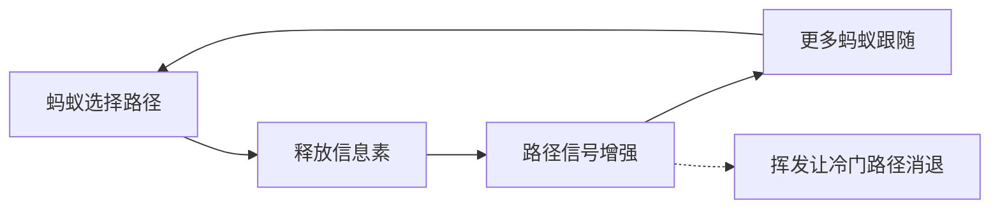
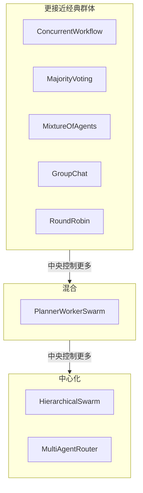

# 什么是群体智能？从蚁群到 LLM 智能体蜂群

群体智能（swarm intelligence）是这样一种解决问题的行为：许多简单的个体遵循局部规则，没有任何中央控制者告诉它们该做什么，但整个群体却能把事情办成。蚁群能找到通往食物的短路线，鸟群能像一个整体那样转向，白蚁能筑起蚁丘，而没有哪一只昆虫或鸟掌握着整体计划。计算机科学家从 1980 年代末就开始借鉴这些机制，如今这套词汇也进入了 AI 领域：一组相互协作的 LLM 智能体，常被称为 AI 蜂群或智能体蜂群。

本指南介绍这个概念的来历、背后的四个原则、三种经典算法（boids、蚁群优化和粒子群优化），以及其中有多少能迁移到 LLM 智能体蜂群上。有些部分迁移得很好，有些部分并不成立，我们会具体说明哪些是哪些。文末附有可运行的代码，在 [Swarms API](https://docs.swarms.ai/docs/documentation/multi-agent/swarm_completions) 上构建一个投票式蜂群。

如果你刚接触智能体，[什么是智能体](/zh/blog/what-is-an-agent)和[什么是多智能体系统](/zh/blog/what-is-a-multi-agent-system)是更简短的入门。

## 什么是群体智能？

这个术语来自机器人学。Gerardo Beni 和 Jing Wang 于 1989 年在一篇关于细胞机器人系统（cellular robotic systems）的论文中提出了「swarm intelligence」一词，该论文发表于一次以机器人与生物系统为主题的 NATO 研讨会（[Beni 与 Wang，收录于 1993 年出版的会议论文集](https://doi.org/10.1007/978-3-642-58069-7_38)）。他们研究的是一群简单机器人如何共同产生有序的行为。此后这个词的含义逐渐扩大，涵盖任何去中心化、自组织的系统，无论是自然的还是人工的，只要有用的行为属于群体本身。

一个实用的定义包含三部分：

1. **大量个体。** 通常彼此相同或相近，数量往往很大。
2. **只有局部信息。** 每个个体只能感知邻居或周围的环境，没有谁能看到整个系统。
3. **集体结果。** 群体解决了一个问题（找到路径、躲避天敌、筑巢、求函数最小值），而没有哪个成员被分配过这个问题。

Guy Theraulaz 和 Eric Bonabeau 在[他们关于 stigmergy 历史的文章](https://doi.org/10.1162/106454699568700)中把这个谜题说得很清楚：在昆虫社会中，「个体工作时仿佛各自独立，而它们的集体活动却显得协调一致」。解释这一现象，正是这个领域的核心。

## 群体智能的四个原则

### 1. 没有中央控制

蚁群中没有哪只蚂蚁持有觅食路线的地图，也没有哪只椋鸟在指挥鸟群。控制分散在每一个成员身上，所以失去任何一个成员影响都很小。自然界的群体正是由此获得容错能力：没有单一的控制点，也就没有单点故障。

### 2. 简单的局部规则

每个个体遵循一小组规则，这些规则只涉及它在附近能感知到的东西。下文介绍的 Reynolds 的 boids 只需要三条。

### 3. 涌现行为

有意思的行为只存在于群体层面。最短路径、鸟群的形状和巢穴的结构都来自个体之间的相互作用，没有哪个个体在计算它们。对局部规则做很小的改动，就可能让涌现出的结果发生很大的变化，这也是为什么群体系统容易描述却难以预测。

### 4. Stigmergy：通过环境协同

Pierre-Paul Grassé 于 1959 年在研究白蚁如何重建巢穴时提出了「stigmergy」一词（[Grassé，《Insectes Sociaux》，1959](https://doi.org/10.1007/BF02223791)），指个体通过环境进行的间接协同。他观察到，工蚁是通过它们正在建造的东西来协调彼此的。一个建了一半的结构会刺激更多个体在同一位置继续建造，于是正在进行的工作本身就告诉了下一个工蚁该做什么。

蚂蚁的路径是最著名的例子。蚂蚁边走边释放信息素，并且更倾向于沿着信息素更浓的方向走，因此走的蚂蚁越多的路径就越有吸引力。[Dorigo 在 IRIDIA 的研究组](https://iridia.ulb.ac.be/dorigo/ACO/RealAnts.html)描述了这种正反馈如何让蚁群找到绕过障碍物的较短路线：碰巧走了较短一侧的蚂蚁能更快地重建路径，信息素在那里累积得更快，很快几乎所有蚂蚁都走这条路。



请记住 stigmergy。它是与当今 LLM 智能体分工协作方式对应得最直接的原则。

## 自然界中的群体智能实例

- **蚂蚁觅食。** 在双桥实验中，一窝阿根廷蚁的巢穴通过两座桥与食物相连。当两座桥长度相同时，蚁群会收敛到其中一座上；在多次重复实验中，两座桥各自胜出的比例约为一半，因为早期的随机差异会被信息素放大（[Dorigo，Scholarpedia](https://doi.org/10.4249/scholarpedia.1461)）。当其中一条路线更短时，真实的蚂蚁无需视觉线索就能找到它（[IRIDIA，引用 Goss 等人 1989 年的研究](https://iridia.ulb.ac.be/dorigo/ACO/RealAnts.html)）。
- **白蚁筑巢。** Grassé 研究的白蚁对结构作出反应，而结构又不断累积它们的反应。
- **鸟群与鱼群。** 没有领头者的协调转向，Reynolds 的模型用三条局部规则就再现了这种行为。

## 经典群体智能算法：boids、ACO 与 PSO

### Boids（Reynolds，1987）

Craig Reynolds 于 1986 年构建了 boids 模型，并于 1987 年在 SIGGRAPH 上以[《Flocks, Herds, and Schools: A Distributed Behavioral Model》](https://doi.org/10.1145/37401.37406)为题发表。每只模拟鸟按三条规则转向，以下译自 [Reynolds 本人的页面](https://www.red3d.com/cwr/boids/)：

- **分离（Separation）：**「转向以避免与邻近同伴过度拥挤」
- **对齐（Alignment）：**「转向邻近同伴的平均朝向」
- **聚合（Cohesion）：**「转向并移向邻近同伴的平均位置」

这些规则里没有一条提到鸟群。鸟群是涌现出来的。Boids 出自计算机图形学，不解决任何优化问题，但它至今仍是最清晰的演示：三条局部规则就足以产生逼真的群体行为。

### 蚁群优化（Dorigo，1990 年代初）

Marco Dorigo 把信息素路径变成了一种优化方法。第一个系统叫 Ant System，出现在他 1992 年于米兰理工大学完成的博士论文中（[IRIDIA](https://iridia.ulb.ac.be/dorigo/ACO/about.html)），期刊版本于 1996 年发表（[Dorigo、Maniezzo 与 Colorni](https://doi.org/10.1109/3477.484436)）。在旅行商问题上，它的工作方式如下（[Scholarpedia](https://doi.org/10.4249/scholarpedia.1461)）：

1. 每只人工蚂蚁逐个城市地构建一条路线，选择下一条边的概率取决于这条边上的信息素和它的长度。
2. 所有蚂蚁完成后，所有信息素值按固定比例下降（挥发）。
3. 然后每条边按使用过它的路线的质量获得相应比例的信息素。
4. 重复，直到满足停止条件。

挥发和释放同样重要。Scholarpedia 的文章称挥发是「一种有用的遗忘形式」：没有它，第一条还算不错的路线就会被锁定，蚁群也就不再探索。

### 粒子群优化（Kennedy 与 Eberhart，1995）

James Kennedy 和 Russell Eberhart 在 1995 年的 IEEE 国际神经网络会议上提出了[粒子群优化](https://doi.org/10.1109/ICNN.1995.488968)。它的根源在于鸟群模拟（包括 Reynolds 的工作）以及社会心理学（[Dorigo 等，Scholarpedia](https://doi.org/10.4249/scholarpedia.1486)）。每个粒子都是一个候选解，带有位置和速度。每一步，它的速度都会被拉向两个点：它自己找到过的最佳位置，以及它的邻居中找到的最佳位置。哪些粒子算作邻居（全部粒子，或环形结构中紧挨着它的两个）由种群拓扑决定，因此一个好的位置要么一次性传遍整个群体，要么在邻居之间逐步扩散。

| 算法 | 提出时间 | 个体 | 局部规则 | 共享信号 | 涌现结果 |
| --- | --- | --- | --- | --- | --- |
| Boids | 1987 | 模拟鸟 | 分离、对齐、聚合 | 邻居的位置和朝向 | 群体飞行 |
| 蚁群优化 | 1992 | 人工蚂蚁 | 按信息素偏好选择边 | 图边上的信息素 | 短路径与短路线 |
| 粒子群优化 | 1995 | 粒子 | 移向自身最佳和邻居最佳 | 邻居中的最佳位置 | 向优质区域收敛 |

## 什么是 LLM 智能体蜂群？

LLM 智能体蜂群是一组语言模型智能体，它们处理同一个任务，并通过一种明确的协作模式合并各自的输出。每个智能体都有自己的系统提示词、自己的模型和自己对任务的视角。协作模式决定每个智能体看到什么、谁在什么时候行动，以及输出如何合并。

有几项研究结果为这种「蜂群直觉」提供了一些依据：

- **Self-consistency（自洽性）**（Wang 等，2022）从同一个模型中采样多条推理路径，并保留最一致的答案，从而在算术和常识推理基准上提升了思维链的准确率（[arXiv:2203.11171](https://arxiv.org/abs/2203.11171)）。
- **More Agents Is All You Need**（Li 等，2024）发现，只用简单的「采样加投票」方法，LLM 的表现就会随智能体数量增加而提升，而且提升幅度与任务难度相关（[arXiv:2402.05120](https://arxiv.org/abs/2402.05120)）。
- **多智能体辩论**（Du 等，2023）让多个模型实例提出答案，并在多轮中相互批评，从而提升了数学和策略推理能力，并减少了幻觉答案（[arXiv:2305.14325](https://arxiv.org/abs/2305.14325)）。
- **Mixture-of-Agents**（Wang 等，2024）把 LLM 智能体堆叠成多层，每个智能体都会读取上一层所有智能体的输出（[arXiv:2406.04692](https://arxiv.org/abs/2406.04692)）。

它们与蚁群的共同点在于计算的形态：先并行进行许多次尝试，再用一个步骤把它们合并起来，并放大大多数尝试达成一致的部分。相互独立的错误往往会相互抵消，而一致的部分则会不断累积。[多智能体协作模式](/zh/blog/multi-agent-collaboration-patterns)详细比较了辩论、投票、混合智能体和委员会等模式，[什么是集体超级智能](/zh/blog/what-is-collective-superintelligence)及其姊妹篇[为什么 CSI 将超越 AGI 和 ASI](/zh/blog/collective-superintelligence)则讨论了集体系统最终会走向哪里这一更大的问题。

## 群体智能与 LLM 智能体蜂群：类比成立的地方

这个类比有用，但也比较宽松。下面并排比较。

| | 经典群体 | LLM 智能体蜂群 |
| --- | --- | --- |
| 个体数量 | 很多：一个蚁群、一群鸟、一群粒子 | 通常只有几个 |
| 个体能力 | 非常简单，规则固定 | 每个智能体都是能力很强的通用模型 |
| 通信方式 | 局部：邻居或环境 | 通常是全局的：共享对话记录或协调者 |
| 控制 | 无 | 常有一个主管、路由器或汇总智能体 |
| 多样性来源 | 随机噪声与位置 | 需要专门设计：提示词、模型、温度 |
| 单个个体的成本 | 可以忽略 | 每个智能体都是一次计费的模型调用 |
| 错误独立性 | 高 | 当所有智能体使用相同模型和提示词时较低 |

类比中有三部分站得住：

- **独立尝试加汇总。** 在答案可以核对的任务上（一个标签、是或否、一个数字），几个独立的智能体加一次投票往往胜过单个智能体，因为相互独立的错误很少会落到同一个错误答案上。
- **Stigmergy。** 共享的对话记录、任务队列或共享文件，都是智能体可以读取和修改的环境。当智能体 B 在智能体 A 写下的内容上继续工作时，协调就是通过这个产物完成的，就像白蚁通过蚁丘来协调一样。
- **冗余。** 当几个智能体处理同一个问题时，某一个智能体失败或出错，很少能决定最终结果。

## 类比失效的地方

- **规模与简单性。** 经典的群体智能从大量弱小的个体中获得聪明的行为。LLM 蜂群使用的是少数强大的个体，所以大部分智能存在于每个智能体内部，而从它们之间的规则中涌现出来的相对很少。
- **中央协调者。** 许多实际的 LLM 系统会让一个主管或路由器负责全局。这是一种层级结构，而经典群体完全不需要它。这往往是正确的工程选择（更容易调试，调用更少），但把它称为群体智能就有些牵强了。[经理与执行者智能体架构](/zh/blog/manager-worker-agent-architectures)讨论了什么时候层级结构是更好的设计。
- **相关的错误。** 同一个模型配同一个提示词复制五份，往往会犯同样的错误。蚂蚁的噪声是相互独立的；LLM 的噪声往往不是。多样性需要专门设计：不同的模型、不同的提示词，或者不同的证据。
- **成本。** 释放信息素不花钱，而模型调用按 token 计费。增加智能体是一个预算决策，[追踪 LLM 的 token 用量和成本](/zh/blog/track-llm-token-usage-cost-python)可以帮你衡量它。
- **汇总者往往是一个模型。** 在投票和混合模式中，最后的合并通常由一个 LLM 完成，这又引入了一个可能误读投票结果的单一组件。当答案是离散的时，你可以用一条简单的计数规则代替它，下文的第二个示例就是这样做的。

## 哪些 Swarms 架构最接近群体智能？

Swarms API 通过 `POST /v1/swarm/completions` 的 `swarm_type` 字段提供 14 种架构（[完整列表](https://docs.swarms.ai/docs/documentation/multi-agent/available-architectures)）。按照控制的分布方式排序，它们可以分成三组。



| `swarm_type` | 智能体如何协作 | 对应的群体原则 | 中心化的部分 |
| --- | --- | --- | --- |
| [ConcurrentWorkflow](https://docs.swarms.ai/docs/documentation/multi-agent/concurrent_workflow) | 每个智能体并行收到同一个任务，各自独立工作 | 独立的局部决策 | 无；由你自己汇总 |
| [MajorityVoting](https://docs.swarms.ai/docs/documentation/multi-agent/majority_voting) | 先独立作答，再按多数决定 | 独立决策加汇总 | 一个共识智能体统计票数 |
| [MixtureOfAgents](https://docs.swarms.ai/docs/documentation/multi-agent/mixture_of_agents) | 专家并行作答，再由汇总者综合 | 多样性加汇总 | 一个内部汇总智能体 |
| [GroupChat](https://docs.swarms.ai/docs/documentation/multi-agent/group_chat) | 智能体轮流在同一份共享对话记录中发言 | 通过共享媒介实现的 stigmergy | 除轮流发言外没有 |
| [RoundRobin](https://docs.swarms.ai/docs/documentation/multi-agent/round_robin) | 固定轮换，每个智能体读取完整历史 | 按固定顺序进行的 stigmergy | 轮换顺序本身 |
| [PlannerWorkerSwarm](https://docs.swarms.ai/docs/documentation/multi-agent/planner_worker_swarm) | 执行者从共享队列中领取子任务，彼此之间从不交谈 | 执行阶段的 stigmergy | 一个规划者和一个评审者 |
| [HierarchicalSwarm](https://docs.swarms.ai/docs/documentation/multi-agent/hierarchical_swarm) | 主管拆解任务、分配并审核 | 层级结构 | 一个主管智能体 |
| [MultiAgentRouter](https://docs.swarms.ai/docs/documentation/multi-agent/multi_agent_router) | 路由器把任务发给最合适的一个或多个智能体 | 分派 | 一个路由智能体 |

文档中有几个细节对这个对应关系很重要。在 `MajorityVoting` 中，智能体独立并行地作出决定，然后由一个单独的 `Consensus-Agent` 统计票数并给出裁决。这个智能体始终使用 `gpt-5.4`，文档说明它无法通过请求更改。`MixtureOfAgents` 会额外加入一个内部汇总者，它不在你的 `agents` 列表中。在 `PlannerWorkerSwarm` 中，执行者只与队列交互，这大概是 LLM 系统能做到的最接近 Grassé 的白蚁的形态，但队列由一个规划者写入，是否再跑一轮则由一个评审者决定。`HierarchicalSwarm` 会自动创建它的主管，你可以用 `director_model_name` 和 `director_settings` 来调整它。

这些分组描述的是结构，与质量无关。对许多实际任务来说，层级结构才是更好的选择。[蜂群架构详解](/zh/blog/swarm-architectures-explained)逐一介绍了全部 14 种架构以及各自的适用场景，[什么是多智能体编排](/zh/blog/what-is-multi-agent-orchestration)则讨论了围绕这些架构的状态管理和故障处理。

## 用 Swarms API 构建一个 AI 蜂群

第一个示例是一个投票式蜂群：三个评审者各自独立地评判同一个数据库迁移，由多数票决定结果。它在三个方面与蚁群相似：每个智能体独立决策，每个智能体只遵循一条简单的输出规则，最终结果来自对局部决策的汇总。为了减少相关错误，每个评审者使用不同的模型，并关注不同的风险。

先在 [Swarms 平台](https://swarms.world/platform/api-keys)获取 API key，然后安装依赖并设置 key：

```bash
pip install aiohttp python-dotenv
export SWARMS_API_KEY="your-api-key"
```

```python
import asyncio
import os

import aiohttp
from dotenv import load_dotenv

load_dotenv()

API_KEY = os.environ["SWARMS_API_KEY"]
BASE_URL = "https://api.swarms.world"
HEADERS = {"x-api-key": API_KEY, "Content-Type": "application/json"}

MIGRATION = """
ALTER TABLE orders ADD COLUMN discount_code TEXT;
CREATE INDEX idx_orders_discount_code ON orders (discount_code);
UPDATE orders SET discount_code = 'NONE' WHERE discount_code IS NULL;
"""

RULES = (
    "Work alone and judge only from the migration text. "
    "Your first line must be exactly 'VOTE: SAFE' or 'VOTE: UNSAFE'. "
    "Then give at most three short reasons."
)


def reviewer(name: str, focus: str, model: str) -> dict:
    return {
        "agent_name": name,
        "description": f"Reviews database migrations for {focus}",
        "system_prompt": f"You are a PostgreSQL reviewer focused on {focus}. {RULES}",
        "model_name": model,
        "max_loops": 1,
        "max_tokens": 2048,
        "temperature": 0.3,
    }


async def main() -> None:
    payload = {
        "name": "Migration Safety Vote",
        "description": "Independent reviewers vote and the majority decides",
        "swarm_type": "MajorityVoting",
        "task": (
            "Is this migration safe to run on a large, busy production `orders` table "
            "during business hours?\n" + MIGRATION
        ),
        "agents": [
            reviewer("Locking Reviewer", "table locks and blocked writes", "gpt-5.4"),
            reviewer("Load Reviewer", "I/O load, runtime and replication lag", "claude-sonnet-5"),
            reviewer("Rollback Reviewer", "reversibility and partial failure", "gpt-5.4-mini"),
        ],
        "max_loops": 1,
    }

    # Multi-agent runs can take minutes, so give the whole request room.
    timeout = aiohttp.ClientTimeout(total=600)
    async with aiohttp.ClientSession(headers=HEADERS, timeout=timeout) as session:
        async with session.post(f"{BASE_URL}/v1/swarm/completions", json=payload) as resp:
            resp.raise_for_status()
            result = await resp.json()

    for turn in result["output"]:
        if turn["role"].lower() == "user":
            continue  # the echoed task
        content = turn["content"]
        if isinstance(content, list):
            content = " ".join(str(part) for part in content)
        print(f"\n--- {turn['role']}")
        print(str(content)[:600])

    billing = result.get("usage", {}).get("billing_info", {})
    print("\nAgents:", result["number_of_agents"], "| seconds:", result["execution_time"])
    print("Cost (USD):", billing.get("total_cost"))


asyncio.run(main())
```

示例输出（节选；每次运行的措辞和投票都会不同，耗时和成本两行已省略）：

```
--- Locking Reviewer
VOTE: UNSAFE
1. CREATE INDEX without CONCURRENTLY blocks writes to orders until the build finishes.
2. The UPDATE rewrites every existing row in a single transaction.

--- Load Reviewer
VOTE: UNSAFE
1. Backfilling every row in one statement produces a large burst of I/O and WAL.
2. Replicas can fall behind while it runs.

--- Rollback Reviewer
VOTE: SAFE
1. Each step can be reversed with DROP INDEX and DROP COLUMN.

--- Consensus-Agent
FINAL VERDICT: UNSAFE (2-1). Build the index with CREATE INDEX CONCURRENTLY
and backfill in small batches outside peak hours.
```

`output` 字段是一个由 `{"role", "content"}` 组成的列表：每个评审者一条，最后是共识智能体的裁决（[响应格式](https://docs.swarms.ai/docs/documentation/multi-agent/swarm_completions)）。文档建议使用奇数个投票者，这样总能形成多数。如果你想要一份综合性的答案而不是裁决，把 `swarm_type` 改成 `"MixtureOfAgents"`，并给智能体开放式的分析提示词，汇总者就会把它们的观点合并成一份报告。

### 用一条简单规则代替模型来汇总

第二个示例把模型从汇总步骤中拿掉。五个打标签的智能体以 `ConcurrentWorkflow` 运行，彼此之间没有任何协调，计票则在普通的 Python 代码里完成。这更接近真实的蚁群，在蚁群中，「决定」不过是信息素的累加。它还让你可以设置一个阈值：如果蜂群的意见不够一致，就把工单交给人工处理。

```python
import asyncio
import os
import re
from collections import Counter

import aiohttp
from dotenv import load_dotenv

load_dotenv()

API_KEY = os.environ["SWARMS_API_KEY"]
BASE_URL = "https://api.swarms.world"
HEADERS = {"x-api-key": API_KEY, "Content-Type": "application/json"}

TICKET = "I was charged twice for my March invoice and now my account is locked."
LABELS = ["BILLING", "BUG", "ACCOUNT"]
MODELS = ["gpt-5.4", "claude-sonnet-5", "gpt-5.4-mini", "gpt-5.4", "claude-sonnet-5"]


async def main() -> None:
    payload = {
        "name": "Ticket Label Swarm",
        "description": "Five independent labelers, tallied in plain Python",
        "swarm_type": "ConcurrentWorkflow",
        "task": f"Label this support ticket: {TICKET}",
        "agents": [
            {
                "agent_name": f"Labeler-{i}",
                "description": "Labels one customer support ticket",
                "system_prompt": (
                    "You label customer support tickets. Work alone. "
                    f"Your first line must be 'LABEL: X' where X is one of {', '.join(LABELS)}. "
                    "Then give one sentence of reasoning."
                ),
                "model_name": model,
                "max_loops": 1,
                "max_tokens": 512,
                "temperature": 0.7,
            }
            for i, model in enumerate(MODELS, start=1)
        ],
        "max_loops": 1,
    }

    # Multi-agent runs can take minutes, so give the whole request room.
    timeout = aiohttp.ClientTimeout(total=600)
    async with aiohttp.ClientSession(headers=HEADERS, timeout=timeout) as session:
        async with session.post(f"{BASE_URL}/v1/swarm/completions", json=payload) as resp:
            resp.raise_for_status()
            result = await resp.json()

    pattern = re.compile(r"LABEL:\s*(" + "|".join(LABELS) + r")")
    votes = []
    for turn in result["output"]:
        if not turn["role"].startswith("Labeler-"):
            continue
        match = pattern.search(str(turn["content"]))
        if match:
            votes.append(match.group(1))

    tally = Counter(votes)
    print("Votes:", dict(tally))

    label, count = tally.most_common(1)[0] if tally else ("NONE", 0)
    if count >= 4:
        print("Decision:", label)
    else:
        print(f"Only {count} of {len(MODELS)} agree: send this ticket to a human")


asyncio.run(main())
```

这张工单故意把账单问题和账户问题混在一起，所以打标签的智能体可能会产生分歧。这恰恰是有用的情况：微弱的多数本身就是一个信号。`ConcurrentWorkflow` 按智能体完成的先后顺序返回结果，这对计票没有影响。如果你想看一份从单个智能体逐步构建到完整蜂群的详细教程，请阅读[如何用 Python 构建智能体蜂群](/zh/blog/build-agent-swarm-python)；[Swarms API 示例集](/zh/blog/swarms-api-examples-suite)里还有更多可以直接运行的请求示例。

## 什么时候应该使用智能体蜂群？

当答案是离散且可核对的、同一个模型在不同运行中给出不同答案、并且一个错误答案的代价高于多几次调用时，使用投票式蜂群（`MajorityVoting`，或者 `ConcurrentWorkflow` 加上你自己的计票）。分类、审批关卡、抽取结果校验和代码评审结论都很适合。

当任务是开放式的、价值来自覆盖面时，使用综合式蜂群（`MixtureOfAgents`）：几位专家各自看到问题的不同部分，再由一份报告把它们整合起来。

当智能体需要在彼此的工作基础上继续推进时，例如起草并评审一个设计方案，使用 stigmergy 式的模式（`GroupChat`、`RoundRobin`）。保持对话记录简短、角色分明，因为每个智能体都会读取它之前的所有内容。

如果一个提示词写得好、工具配得对的单个智能体已经能完成任务，就不要用蜂群。[单智能体与多智能体](/zh/blog/single-agent-vs-multi-agent)提供了做这个决定的检查清单。还要记住，蜂群放大共同错误的能力，和它抵消独立错误的能力一样强：如果每个智能体读的都是同一份错误的文档，投票就会全票通过一个错误的结论。[多智能体系统的失败模式](/zh/blog/multi-agent-system-failure-modes)介绍了这类系统更隐蔽的出错方式。

## 常见问题

### 用简单的话说，什么是群体智能？

群体智能是指许多简单个体遵循局部规则、在没有领导者也没有全局计划的情况下，产生出有用的群体行为。蚁群找到短路径和鸟群飞行是标准的例子。群体解决了一个没有哪个成员理解或被分配过的问题。

### 「群体智能」这个术语是谁提出的？

Gerardo Beni 和 Jing Wang 于 1989 年在一篇关于细胞机器人系统的论文中提出了这个术语，该论文发表于一次 NATO 研讨会，并收录于 1993 年出版的会议论文集。其背后的生物学研究更早：Pierre-Paul Grassé 在 1959 年描述了白蚁中的 stigmergy。

### 群体智能算法有哪些例子？

三个经典例子是：Craig Reynolds 的 boids（1987），用三条转向规则模拟鸟群飞行；蚁群优化，由 Marco Dorigo 在他 1992 年的博士论文中提出；以及粒子群优化，由 James Kennedy 和 Russell Eberhart 于 1995 年发表。ACO 和 PSO 是优化方法，而 boids 是对集体运动的模拟。

### LLM 多智能体系统真的算群体智能吗？

部分算。智能体独立作答再汇总输出的模式（投票、并发扇出、混合智能体），以及智能体通过共享对话记录或队列来协调的模式，遵循的是群体原则。由主管或路由器负责的系统是层级结构；而且 LLM 蜂群使用的是少数能力很强的智能体，经典群体使用的则是大量简单的个体。

### AI 蜂群有什么用途？

AI 蜂群适用于独立判断能提高可靠性或覆盖面的场景：工单分类和分派、内容或代码审批、从多个角度审阅文档，以及需要多种视角的研究任务。使用 Swarms API 时，你只需在 `POST /v1/swarm/completions` 上设置一个 `swarm_type` 字段来选择协作模式。

### 一个智能体蜂群应该有多少个智能体？

投票场景先从三个或五个开始，奇数可以避免平票，只有在实测准确率确实提升时才增加智能体。每个智能体都是一次计费的模型调用，而共用同一个模型和提示词的智能体，实际贡献比数量看起来要少。改变模型和指令，通常比增加更多相同的智能体更有效。
